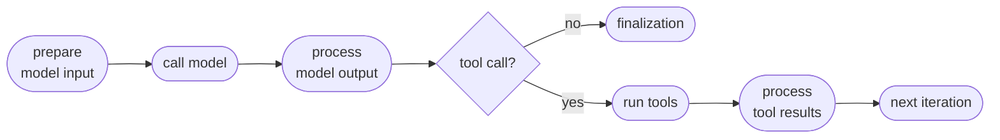

# Agent 生命周期

调用 [`generate()`](/reference/agents/generate) 或 [`stream()`](/reference/streaming/agents/stream) 时，Mastra 会启动一次 Agent 运行。调用模型前，它会准备 Agent 及其输入。如果模型请求调用 Tool，Mastra 会执行 Tool，随后可能再次调用模型。工作完成后，Mastra 会整理并返回结果。

本指南将运行过程分为准备、循环执行和收尾三个阶段，并说明[处理器](/docs/agents/processors)在何处运行、哪些情况会触发下一次模型调用，以及常规运行与持久化运行有何区别。

## 运行、迭代和模型步骤 {/* #runs-iterations-and-model-steps */}

工作发生在三个层面：

- **运行**：从一次 `generate()` 或 `stream()` 调用开始，直到最终结果或错误为止的全部工作；也包括持久化执行等待外部输入期间的暂停和恢复。
- **循环迭代**：Agent 循环的一轮处理，从一个模型步骤开始，并包含 Mastra 决定是否继续前请求执行的 Tool 工作。
- **模型步骤**：向模型 Provider 发出的一次请求及其响应，以及围绕该请求运行的输入和输出处理器。

准备阶段取决于运行时上下文和初始输入处理：

- [`RequestContext`](/docs/server/request-context) 向动态配置、处理器和 Tool 提供身份或租户信息等可信运行时数据，但其中的值不会自动进入模型提示词。
- [`processInput`](/reference/processors/processor-interface#processinput) 在循环开始前处理初始消息。它可以转换消息，并建立后续处理器钩子和 Tool 所需的状态。

一次运行包含一轮或多轮循环迭代。模型返回最终答案时，运行会在当前迭代后停止。模型请求 Tool 时，Mastra 会处理结果，并可能开始下一轮迭代；但配置的 [`stopWhen`](/reference/agents/generate#parameters) 或终止条件也可能在 Tool 工作结束后停止运行。迭代通常对应一个模型步骤，但这种对应关系属于当前实现行为，不应视为稳定契约。

## 生命周期概述 {/* #lifecycle-overview */}

图中展示的是三个主要阶段，而非内部 Workflow 步骤。准备阶段建立首次模型交互；循环可以多次重复模型和 Tool 工作，最后在收尾阶段产生结果。常规运行留在当前进程中；持久化运行可保存状态，稍后恢复。

## 准备 {/* #preparation */}

准备阶段将 Agent 定义和当前请求转化为可执行的模型交互。在此阶段，Mastra 会：

- 验证传入的 [`RequestContext`](/docs/server/request-context)。
- 解析模型、指令、Workspace、Skill 及其他动态配置。
- 根据当前输入和已配置的记忆构建消息列表。
- 准备循环要使用的 Tool 和处理器。

准备结束时，运行已具备首次模型步骤所需的消息、Tool 和处理器配置，但这些工作并非全部严格按顺序执行。

| 准备工作 | 时机 | 对 `RequestContext` 的影响 |
| - | - | - |
| 验证、Workspace、模型和指令 | [`processInput`](/reference/processors/processor-interface#processinput) 之前 | 必需的值必须在运行开始时就存在。 |
| 供 `processInput` 使用、由记忆、Workspace 和 Skill 派生的处理器实例 | `processInput` 之前完成解析 | 在 `processInput` 中更改上下文，无法改变这些实例的选取结果。 |
| 动态 Skill 解析 | `processInput` 之前 | Skill 的选择不能依赖首次在 `processInput` 中加入的值。 |
| 常规运行中的 Tool 转换 | 与记忆及输入准备并行 | 动态 [`tools` 回调](/reference/agents/agent) 与 `processInput` 之间没有确定的执行顺序。 |
| `processInput` | 初始输入准备期间执行一次 | 可转换消息，并为后续循环回调和 Tool 执行建立状态。 |
| 循环使用的有效输入、LLM 请求及错误处理器工厂 | 常规运行的准备分支汇合后 | 这些工厂能看到先前的上下文变更，但并非所有解析器都适合在 `processInput` 中设置。 |
| 持久化运行的准备 | 持久化循环执行前 | 与常规路径的位置不同，恢复运行时也可能跳过初始输入处理。 |

`generate()` 和 `stream()` 会先验证 `RequestContext`，再调用 [`getDefaultOptions()`](/reference/agents/getDefaultOptions)。因此，函数形式的默认选项无法及时补充验证所需但尚未提供的值。

常规运行会在整个执行期间复用调用方的 `RequestContext` 实例。动态配置、处理器和 Tool 执行接收的是同一个实时实例，而非各自的副本。变更能否被看到，取决于使用方是否已经完成解析。

## 选择设置 `RequestContext` 的边界 {/* #choose-the-requestcontext-boundary */}

上下文中的值只能影响尚未发生的工作。应在最早需要该值的可信边界处设置它。

例如，应用可检查用户的访问权限，并据此确定租户或账户范围。请在 Agent 外完成检查，将结果存入新的 `RequestContext`，再把上下文传给 `generate()` 或 `stream()`。动态配置和 Tool 随后可读取同一可信范围，无需重复检查。

上下文携带的是授权检查的结果，不能取代应用边界处的授权。

| 需要影响的环节 | 设置时机 | 原因 |
| - | - | - |
| 验证、模型、指令、Skill、Workspace、供 `processInput` 使用的输入处理器或动态 Tool | 在 `generate()` 或 `stream()` 之前，通常由服务器中间件或调用方代码设置 | 这些环节会在 `processInput` 之前或与之同时完成解析。 |
| 后续循环的处理器工厂、处理器钩子或 Tool 执行 | 尽可能在 `generate()` 或 `stream()` 之前设置，也可在 `processInput` 中设置 | 输入处理后，这些环节会收到同一个实时上下文。 |
| 恢复的持久化运行 | 在可信的请求或恢复边界处设置 | 初始输入处理器可能不再运行，且不可序列化的值必须重新构建。 |
| 模型推理 | 在模型可见的指令或消息中提供 | `RequestContext` 是运行时数据，不会自动加入提示词。 |

除非有意共享其中的值，否则应为每个独立请求创建一个上下文。[请求上下文指南](/docs/server/request-context)介绍了 schema 和服务器中间件。

`processInput` 仍适合转换消息，以及设置后续循环所需的状态。其中的更改可以影响后续处理器钩子和 Tool 执行，但不能改变初始验证或已完成的 Skill、输入处理器解析；动态 Tool 准备也可能已经开始。

## Agent 循环 {/* #the-agent-loop */}

循环使用迄今累积的消息。

再次迭代前，Tool 结果会加入累积的消息；最终答案则离开循环，进入收尾阶段。

### 每个模型步骤的处理顺序 {/* #around-each-model-step */}

处理器回调按以下公开顺序运行：

1. [`processInputStep`](/reference/processors/processor-interface#processinputstep) 在下一次模型调用前接收累积的消息列表。
1. [`processLLMRequest`](/reference/processors/processor-interface#processllmrequest) 在消息转换后接收将发给 Provider 的提示词。
1. Provider 流式返回响应，[`processOutputStream`](/reference/processors/processor-interface#processoutputstream) 可以检查或转换每个数据块。
1. [`processLLMResponse`](/reference/processors/processor-interface#processllmresponse) 在该步骤的 Provider 响应流结束后运行。
1. [`processOutputStep`](/reference/processors/processor-interface#processoutputstep) 在模型步骤后、本地 Tool 执行前运行。
1. 若模型请求本地或客户端 Tool，Mastra 会处理其输入及已配置的审批，然后执行 Tool 或等待其结果。
1. [`processToolResult`](/reference/processors/processor-interface#processtoolresult) 在原始结果进入消息列表前接收每个本地或客户端 Tool 的结果。

由 Provider 执行的 Tool 可能以不同方式返回结果。如果延迟的 Provider 结果在后续模型响应流中到达，`processToolResult` 会在结果到达时运行；它并不总是位于每个模型步骤之后的固定位置。

有关准确的调用频率、可见性保证、参数和返回类型，请参阅 [Processor 接口中的回调时机](/reference/processors/processor-interface#callback-timing)。

### 哪些变化持续存在 {/* #what-changes-persist */}

处理器方法操作的表示并不完全相同：

- `processInput` 和 `processInputStep` 操作实时消息列表。它们的更改会影响后续模型步骤，也可能被记忆处理器保存。
- `processLLMRequest` 只更改本次 Provider 调用发送的提示词。它适合不应改变已存储对话历史的临时调整。
- `processOutputStream` 更改流式数据块。处理器状态可在数据块之间，以及同一请求后续的输出回调之间传递数据。
- `processToolResult` 在原始 Tool 结果进入消息列表前运行，可在后续模型步骤或持久化前验证或脱敏结果。
- 收尾阶段的 [`processOutputResult`](/reference/processors/processor-interface#processoutputresult) 可更改返回的消息及其元数据。

## 循环如何决定是否继续 {/* #how-the-loop-decides-to-continue */}

完成模型步骤及请求的 Tool 工作后，Mastra 会判断是否需要再迭代一次。Tool 结果往往会触发下一次模型调用，因为模型需要利用这些结果形成后续响应。

满足已配置的停止条件或终止条件时，循环会停止。这些条件包括：

- 模型返回不再请求 Tool 的最终响应。
- 根据累积步骤判断的自定义 [`stopWhen`](/reference/agents/generate#parameters) 条件。
- [`maxSteps`](/reference/agents/generate#using-maxsteps) 上限。
- 任务完成、目标达成或[子 Agent](/docs/subagents) 委派结果。
- Provider 的终止结束原因、错误、处理器触发的阻断条件或中止。

这些检查共同作用，并不构成公开且穷尽的内部执行顺序。应将 `maxSteps` 视为模型步骤的上限，用 `stopWhen` 表达应用特定的完成规则。

## 收尾 {/* #finalization */}

运行停止后进入收尾阶段。无论正常完成还是 Provider 抛出错误，`processOutputResult` 都会针对已完成的结果和消息每次请求运行一次。消息中可能没有最终的 Assistant 响应，例如 `maxSteps` 恰好在 Tool 调用处结束时。

先运行已配置的输出处理器，再运行自动附加的记忆输出处理器，使消息历史能够保存最终形式。Observational Memory 通过自己的钩子持久化，不依赖自动附加的记忆输出处理器。收尾完成后，`generate()` 的 Promise 会完成，或响应流会关闭。

收尾阶段独立于模型步骤：它处理的是整个运行的结果，而非单次 Provider 调用的响应。

## 错误、重试和中止 {/* #errors-retries-and-aborts */}

Provider API 拒绝请求时，错误可能进入 `processAPIError`。错误处理器可以更改请求或消息，并请求再次调用 Provider。`processAPIError` 重试和阻断条件重试共用请求级 [`maxProcessorRetries`](/reference/agents/generate#parameters) 上限。配置错误处理器但未指定 `maxProcessorRetries` 时，Mastra 会使用默认错误重试次数。如需特定上限，请明确设置 `maxProcessorRetries`。

输入或输出处理器调用 [`abort()`](/reference/processors/processor-interface#aborting-and-tripwire-chunks) 会触发阻断条件。设置 `retry: true` 后，符合条件的输入步骤或输出步骤检查可带着反馈重放模型步骤；重放次数受 `maxProcessorRetries` 限制。不重试的阻断条件会停止正常执行，并包含在结果或响应流中。

外部中止信号会传递给 Provider 调用及 Tool 生命周期工作。触发后，它会阻止循环继续，并终止响应流；在支持的情况下保留部分结果。处理器无法恢复的错误会传播给调用方。

有关重试配置、阻断条件及 API 错误处理，参阅[处理器](/docs/agents/processors#retry-mechanism)。

## 常规运行与持久化运行 {/* #regular-and-durable-runs */}

常规 [`Agent`](/reference/agents/agent) 运行在当前进程中维持循环。进程结束后，内存中的执行也随之结束。

[持久化 Agent](/docs/harness/durable-agents) 将同一个 Agent 循环封装进 Workflow。它持久化运行状态，并通过 PubSub 发布事件，让受支持的运行时恢复工作、客户端重新连接。如果状态和事件历史必须跨进程重启保留，生产环境就需要持久化后端。

持久化执行还允许暂停运行，例如等待 Tool 审批；随后可跨越常规进程内运行所没有的序列化边界，从已保存的状态恢复。

Mastra 会为持久化工作创建可序列化 `RequestContext` 条目的快照。函数、类实例、打开的连接等不可序列化的值，在暂停或传输到其他进程后都不应假定仍然存在。请在可信的请求或恢复边界，根据稳定标识符重新构建它们。

持久化运行从已存储的快照恢复时，会跳过初始 `processInput` 处理。信号唤醒和定时唤醒等启动新阶段的唤醒则会再次运行它。

- 每次由外部请求恢复运行时，都要重新执行可信的数据补充步骤。
- 只存储后续流程所需的可序列化范围信息。
- 不要依赖只执行一次的 `processInput` 副作用。

## 接下来阅读 {/* #what-to-read-next */}

- [请求上下文](/docs/server/request-context)：定义、验证并填充运行时上下文。
- [身份验证与身份信息](/docs/guides/authentication-identity)：让可信身份和授权数据远离模型可控制的输入。
- [处理器](/docs/agents/processors)：配置处理器、重试和阻断条件。
- [Processor 接口](/reference/processors/processor-interface)：查看回调参数及返回值。
- [Tool](/docs/agents/tools)：配置 Tool 执行、审批和生命周期钩子。
- [持久化 Agent](/docs/harness/durable-agents)：持久化并恢复长时间运行的 Agent 执行。
