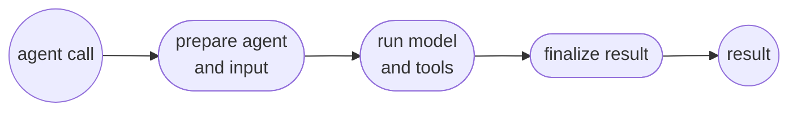
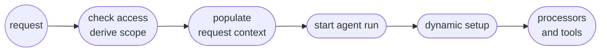

# Agent生命周期

当你打电话时[`generate()`](/reference/agents/generate)或者[`stream()`](/reference/streaming/agents/stream)，Mastra 启动Agent运行。它在调用模型之前准备Agent及其输入。如果模型请求一个Tool，Mastra 会运行它并可能再次调用该模型。工作完成后，Mastra 完成并返回结果。

本指南将这项工作分解为准备、循环执行和完成。它解释了在哪里[processors](/docs/agents/processors) run, what can cause another model call, and how regular and durable runs differ.

## 运行、迭代和模型步骤 {/* #runs-iterations-and-model-steps */}

工作发生在三个层面：

* **跑步**：所有工作均由一次调用开始`generate()` or `stream()` through the final result or error, including any pause and resume while durable execution waits for external input.
* **循环迭代**：一次通过Agent循环，从模型步骤开始，并在 Mastra 决定是否继续之前包括任何请求的Tool工作。
* **模型步骤**：对模型提供者的一个请求及其响应，以及围绕该请求运行的输入和输出处理器。

准备工作取决于运行时上下文和初始输入处理：

* [`RequestContext`](/docs/server/request-context)将受信任的运行时数据（例如身份或租户信息）携带到动态配置、处理器和Tool，但其值不会自动包含在模型提示中。
* [`processInput`](/reference/processors/processor-interface#processinput)在循环开始之前处理初始消息，它可以在其中转换这些消息并建立稍后处理器挂钩和Tool使用的状态。

一次运行包含一次或多次循环迭代。当模型返回最终答案时，它会在当前迭代之后停止。当模型请求Tool时，Mastra 会处理结果并可能开始另一次迭代，除非已配置[`stopWhen`](/reference/agents/generate#parameters) or terminal condition ends the run after tool work. An iteration commonly coincides with one model step, but treat that pairing as implementation behavior rather than a stable contract.

## 生命周期概述 {/* #lifecycle-overview */}

该图显示了三个主要阶段，而不是内部Workflow程步骤。准备创建第一个模型交互。在最终确定产生结果之前，循环可能会重复模型和Tool工作多次。常规运行会在当前进程中继续工作，而持久运行可以保存其状态并在以后恢复。

## 准备 {/* #preparation */}

准备工作将Agent定义和当前请求转变为可运行的模型交互。在此阶段，马斯特拉：

* 验证提供的[`RequestContext`](/docs/server/request-context).
* 解析模型、指令、Workspace、技能和其他动态配置。
* 从当前输入和配置的内存构建消息列表。
* 准备循环期间使用的Tool和处理器。

在准备结束时，运行具有第一个模型步骤所需的消息、Tool和处理器配置，尽管这些任务并非全部按严格的顺序发生。

|准备工作|时间 |这意味着什么`RequestContext` |
| - | - | - |
| Validation, workspace, model, and instructions | Before [`processInput`](/reference/processors/processor-interface#processinput) | Required values must already exist when the run starts. |
| Memory-, workspace-, and skills-derived processor instances used for `processInput` | Resolved before `processInput` | A context change inside `processInput` can't change how these instances were selected. |
| Dynamic skill resolution | Before `processInput` | Skill selection can't depend on a value first added by `processInput`. |
| Tool conversion in a regular run | In parallel with memory and input preparation | A dynamic [`tools` callback](/reference/agents/agent) has no guaranteed ordering relative to `processInput`. |
| `processInput` | Once during initial input preparation | It can transform messages and establish state for later loop callbacks and tool execution. |
| Effective input, LLM-request, and error processor factories used by the loop | After the regular preparation branches join | These factories can observe earlier context changes, but `processInput` isn't a safe setup point for every resolver. |
| Durable preparation | Before durable loop execution | Its placement differs from the regular path, and resumed work may skip initial input processing. |

`generate()`和`stream()` validate `RequestContext` before calling [`getDefaultOptions()`](/reference/agents/getDefaultOptions). A function-based default option therefore can't add a missing required value in time for validation.

在常规运行中，Mastra 会重用调用者的`RequestContext` instance throughout execution. Dynamic configuration, processors, and tool execution receive that live instance rather than separate copies. Whether a change is visible depends on whether the consumer has already resolved.

## 选择`RequestContext` boundary {/* #choose-the-requestcontext-boundary */}

上下文值只能影响尚未发生的工作。将每个值设置在需要它的最早的可信边界处。

例如，应用程序可以检查用户的访问权限并得出租户或帐户范围。在Agent外部执行该检查，将结果存储在新的`RequestContext`, then pass the context to `generate()` or `stream()`. Dynamic configuration and tools can read the same trusted scope without performing the check again.

上下文携带授权检查的结果。它不会取代应用程序边界的授权。

|该值必须影响 |建立它|为什么 |
| - | - | - |
|使用的验证、模型、指令、技能、工作空间、输入处理器`processInput`, or dynamic tools | Before `generate()` or `stream()`, usually in server middleware or caller code | These consumers resolve before or concurrently with `processInput`. |
| Later loop processor factories, processor hooks, or tool execution | Before `generate()` or `stream()` when practical, or in `processInput` | These consumers receive the same live context after input processing. |
| Resumed durable work | At the trusted request or resume boundary | Initial input processors may not run again, and non-serializable values must be reconstructed. |
| Model reasoning | In model-visible instructions or messages | `RequestContext` is runtime data and isn't automatically added to the prompt. |

除非您有意共享其值，否则为每个独立请求创建一个上下文。这[Request context guide](/docs/server/request-context) explains schemas and server middleware.

`processInput`对于循环中稍后所需的消息转换和状态仍然有用。那里的更改可以影响以后的处理器挂钩和Tool执行。它无法更改初始验证或已完成的技能和输入处理器分辨率，并且动态Tool准备可能已经在运行。

## Agent循环 {/* #the-agent-loop */}

该循环处理迄今为止积累的消息。

Tool结果在另一次迭代之前加入累积的消息，而最终答案则离开循环进行最终确定。

### 围绕每个模型步骤 {/* #around-each-model-step */}

处理器回调按以下公共顺序运行：

1. [`processInputStep`](/reference/processors/processor-interface#processinputstep)在下一次模型调用之前接收累积的消息列表。
2. [`processLLMRequest`](/reference/processors/processor-interface#processllmrequest)消息转换后接收面向提供者的提示。
3. 提供者流式传输其响应，并且[`processOutputStream`](/reference/processors/processor-interface#processoutputstream) can inspect or transform each chunk.
4. [`processLLMResponse`](/reference/processors/processor-interface#processllmresponse)该步骤的提供程序流完成后运行。
5. [`processOutputStep`](/reference/processors/processor-interface#processoutputstep)在模型步骤之后、本地执行的Tool之前运行。
6. 如果模型请求本地或客户端Tool，Mastra 会处理他们的输入并处理任何配置的批准。然后它执行该Tool或等待其结果。
7. [`processToolResult`](/reference/processors/processor-interface#processtoolresult)在原始结果进入消息列表之前接收每个本地或客户端Tool结果。

提供者执行的Tool可以返回不同的结果。如果延迟的提供程序结果在稍后的模型流期间到达，`processToolResult` runs when that result arrives. It doesn't have one universal position after every model step.

有关确切的频率、可见性保证、参数和返回类型，请参阅[callback timing in the Processor interface](/reference/processors/processor-interface#callback-timing).

### 哪些变化持续存在 {/* #what-changes-persist */}

处理器方法并不都修改相同的表示：

* `processInput`和`processInputStep` work with the live message list. Their changes can affect later model steps and may be saved by memory processors.
* `processLLMRequest`仅更改为该Provider调用发送的提示。将其用于面向Provider的临时更改，这些更改不应更改存储的对话历史记录。
* `processOutputStream`更改流式传输块。处理器状态可以跨块携带数据，并为同一请求稍后输出回调。
* `processToolResult`在原始Tool结果进入消息列表之前运行，允许在后续模型步骤或持久性之前进行验证或编辑。
* 在最终确定过程中，[`processOutputResult`](/reference/processors/processor-interface#processoutputresult) can change returned messages and their message metadata.

## 循环如何决定继续 {/* #how-the-loop-decides-to-continue */}

在模型步骤和任何请求的Tool工作之后，Mastra 决定运行是否需要另一次迭代。Tool结果通常会导致另一个模型调用，因为模型必须使用这些结果来生成下一个响应。

当达到配置或终止条件时，循环停止。这些条件可以包括：

* 不需要其他Tool的最终模型响应。
* 定制[`stopWhen`](/reference/agents/generate#parameters) condition evaluated against accumulated steps.
* 这[`maxSteps`](/reference/agents/generate#using-maxsteps) limit.
* 任务完成、目标或[subagent](/docs/subagents) delegation outcomes.
* 终端Provider完成原因、错误、处理器绊线或中止。

这些检查一起发挥作用，而不是形成一个公开的、详尽的内部秩序。对待`maxSteps` as a bound on model steps and use `stopWhen` for application-specific completion rules.

## 最终确定 {/* #finalization */}

停止使跑步进入最终阶段。`processOutputResult` runs once per request on the completed result and messages, whether the run completes normally or the provider throws. Those messages may not include a final assistant response, such as when `maxSteps` ends on a tool call.

配置的输出处理器首先运行，然后自动连接的内存输出处理器在它们之后运行，以便消息历史记录可以保留最终形式。观察记忆坚持自己的挂钩，而不是依赖于自动附加的记忆输出处理器。当最终完成时，`generate()` resolves or the stream closes.

最终确定与模型步骤是分开的。它对整个运行的结果进行操作，而不是对一个提供程序调用的响应进行操作。

## 错误、重试和中止 {/* #errors-retries-and-aborts */}

Provider API 拒绝可以达到`processAPIError`. An error processor may change the request or messages and request another provider attempt. `processAPIError` retries and tripwire retries share the same [`maxProcessorRetries`](/reference/agents/generate#parameters) bound on the request. When error processors are configured and `maxProcessorRetries` is omitted, Mastra applies a default error-retry budget. Set `maxProcessorRetries` explicitly when you need a specific limit.

呼唤[`abort()`](/reference/processors/processor-interface#aborting-and-tripwire-chunks) from an input or output processor raises a tripwire. Set `retry: true` to let an eligible input-step or output-step check replay the model step with feedback. `maxProcessorRetries` bounds replay attempts. A tripwire without a retry stops normal execution and is included in the result or stream.

外部中止信号通过提供程序调用和Tool生命周期工作。触发后，它会停止进一步的循环执行并终止流，同时保留支持的部分结果。处理器无法恢复的错误会传播到调用者。

看[Processors](/docs/agents/processors#retry-mechanism) for retry configuration, tripwires, and API error handling.

## 定期且持久的运行 {/* #regular-and-durable-runs */}

一个常规的[`Agent`](/reference/agents/agent) run keeps the loop in the current process. If that process ends, the in-memory execution ends with it.

一个[durable agent](/docs/harness/durable-agents) wraps the same agent loop in a workflow. It persists run state and publishes events through PubSub so supported runtimes can recover work and clients can reconnect. Persistent production backends are required when that state and event history must survive process restarts.

持久执行还允许暂停运行（例如在Tool等待批准时），并稍后从存储的状态跨常规进程内运行中不存在的序列化边界恢复。

Mastra 快照可序列化`RequestContext` entries for durable work. Functions, class instances, open connections, and similar non-serializable values shouldn't be expected to survive either suspension or transport into another process. Reconstruct them from stable identifiers at a trusted request or resume boundary.

最初的`processInput` processing is skipped when a durable run resumes from a stored snapshot. Wakes that start a fresh segment, including signal and schedule wakes, run it again.

* 每当外部请求恢复运行时，请重复权威丰富步骤。
* 仅存储下游所需的可序列化范围。
* 不要依赖一次性`processInput` side effect.

## 接下来读什么 {/* #what-to-read-next */}

* [请求上下文](/docs/server/request-context)：定义、验证和填充运行时上下文。
* [身份验证和身份](/docs/guides/authentication-identity)：将可信身份和授权数据保留在模型控制的输入之外。
* [处理器](/docs/agents/processors)：配置处理器、重试和绊线。
* [处理器接口](/reference/processors/processor-interface)：查看回调参数和返回值。
* [Tool](/docs/agents/tools)：配置Tool执行、审批和生命周期挂钩。
* [持久剂](/docs/harness/durable-agents)：坚持并恢复长时间运行的Agent执行。
