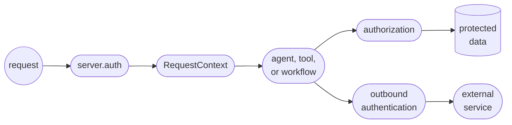

# 身份验证和身份

了解如何保护应用程序中的 API 端点、Studio 和Agent调用。以编程方式限制访问至关重要，因为 LLM 可以快速绕过您可能添加到系统提示符中的表面检查。

身份验证验证谁在呼叫您的 Mastra 服务器。身份是与该请求关联的经过验证的用户或服务帐户。 Mastra 通过运行时代码传递此身份，以便每个组件都可以做出可信的访问决策。

您可以使用四个阶段来设计该链：

|舞台|问题 |马斯特拉机制|
| - | - | - |
|认证|谁在打电话？ |[`server.auth`](/docs/auth/overview) |
| Identity propagation | How does verified identity reach runtime code? | [`RequestContext`](/docs/server/request-context) |
| Authorization | What can this caller access or execute? | Application checks, role-based access control (RBAC), or [细粒度授权（FGA）](/docs/auth/fga)|
|出站认证| Mastra 应将哪种凭证与其他服务一起使用？ |可信Tool代码或模型上下文协议（MCP）连接配置 |

## 设计身份流程 {/* #design-the-identity-flow */}

将身份决策保留在应用程序的可信端。调用者可以提供凭据，但只有身份验证提供者才能决定它代表哪个用户。运行时组件使用服务器拥有的上下文来授权数据访问或选择出站凭据。



该流程建立了四个边界：

* **传入数据：**&#x5C06;所有请求数据视为不可信，直到身份验证成功。
* **身份背景：**&#x8BA9;服务器拥有保留的身份值`RequestContext`.
* **Tool输入：**&#x9632;止模型控制的输入选择所有权范围。
* **外部凭证：**&#x5C06;凭据保存在受信任的运行时代码和外部模型输入或Tool输出中。

## 建立可信身份 {/* #establish-trusted-identity */}

配置`server.auth` with an [auth provider](/docs/auth/overview) or an `authenticateToken` function. When auth is configured, built-in and custom routes require a valid user unless a route explicitly opts out.

从验证者中选择一个稳定的身份并将其映射到运行时所有权边界。

```typescript title="src/mastra/index.ts"
import { Mastra } from '@mastra/core'
import { verifyAccessToken } from './lib/auth'

type AuthUser = {
  id: string
  workspaceId: string
}

export const mastra = new Mastra({
  server: {
    auth: {
      authenticateToken: async token => verifyAccessToken(token),
      mapUserToResourceId: (user: AuthUser) => `${user.workspaceId}:${user.id}`,
    },
  },
})
```

使用来自经过验证的Provider的规范标识符，因为显示名称和其他可变配置文件字段不是合适的所有权密钥。添加足够的范围以防止租户和身份系统之间发生冲突。

如果一个[custom API route](/docs/server/custom-api-routes#authentication) must be public, set `requiresAuth: false`. Public webhooks still need to verify the provider signature before trusting the body.

：：：警告

马斯特拉路线何时公开`server.auth` isn't configured. A production deployment must configure authentication for every server surface that shouldn't be anonymous. If you set a custom `server.apiPrefix`, update the auth path configuration to use that prefix.

:::

## 选择资源边界 {/* #choose-the-resource-boundary */}

Mastra 验证调用者后，决定谁应该拥有其内存和线程。资源 ID 是该所有者的稳定标识符，Mastra 使用它来确定状态范围。凭证验证身份，授权规则授予权限。

例如，假设两个用户都请求一个具有 ID 的线程`support`. If each user's ID is their resource ID, Mastra keeps the threads separate because they have different owners. If both users map to the same organization ID, they share the organization's memory and threads instead.

使用`mapUserToResourceId` to derive this value from the verified user. After authentication succeeds, Mastra:

* 通话`mapUserToResourceId` with the authenticated user.
* 将结果存储为服务器拥有的值`RequestContext`.
* 使用该值来确定内存和线程操作的范围。
* 忽略客户端提供的冲突资源 ID。

：：：警告

如果`server.auth` is configured without `mapUserToResourceId`, there's no server-derived resource ID. Built-in routes then use the resource ID from the request itself (for example `memory.resource` in the body), so any authenticated caller can read and write threads under any resource ID. Mastra logs a warning at startup in this state. Always configure `mapUserToResourceId` when more than one user shares a deployment.

:::

选择与人们应该如何共享状态相匹配的最窄边界：

|期望的边界|示例映射 |
| - | - |
|每个用户的私人内存|`user.id` |
| Shared memory for an organization | `user.organizationId` |
| User memory within a workspace and project | `${workspaceId}:${projectId}:${userId}` |

Mastra 自动将此边界应用于内存和线程操作，包括观察内存。`GET /api/memory/observational-memory`, `POST /api/memory/observational-memory/buffer-status`, and the Observational Memory details in `GET /api/memory/status` return `403` when the requested thread belongs to another resource or an [FGA](/docs/auth/fga) check denies it. Without `server.auth`, these routes use the `resourceId` and `threadId` the client sends, but a thread paired with a different `resourceId` still gets `403`. Application code can continue using the authenticated user in `RequestContext` when it authorizes database records or external services.

### 来自 JWT Provider的用户 ID {/* #user-ids-from-jwt-providers */}

[`MastraJwtAuth`](/reference/auth/jwt), [Auth0](/reference/auth/auth0), and [Clerk](/reference/auth/clerk) set the authenticated user's `id` to the token's `sub` claim when the token has no `id` claim. A token with its own `id` claim keeps it. RBAC loads roles by `id`, and `id` is also the owner of the records a user creates when `mapUserToResourceId` isn't set.

没有`mapUserToResourceId`, this means:

* 每个用户都可以看到自己存储的Agent、技能、工作空间和其他拥有的记录以及公共记录。他们创建的记录归他们所有，默认情况下是私有的。在您的应用使用这些用户 ID 之前创建的记录没有所有者，并且对所有人都可见。具有管理员权限的用户，例如`stored-agents:admin` still see every record.
* 每个作者的ToolProvider连接都存储在用户的`id`. Connections saved under the shared `default` owner aren't found, so users reconnect them. Shared connections aren't affected.
* 反馈与用户的记录一起记录`id` as the user ID.

要将每个用户保留在一个共享资源中，请传递`mapUserToResourceId: () => 'default'` to the auth provider. This also shares memory and owned records between all users, so use it only when that's how your app should work.

## 在数据边界强制执行身份验证 {/* #enforce-identity-at-the-data-boundary */}

授权属于可信代码，尽可能接近受保护的操作。受信任的运行时代码可以从经过身份验证的用户那里获取所有权`RequestContext` rather than model-generated tool input:

```typescript title="src/mastra/tools/list-orders.ts"
import { createTool } from '@mastra/core/tools'
import { z } from 'zod'
import { orders } from '../lib/orders'

type AuthenticatedUser = {
  id: string
}

export const listOrders = createTool({
  id: 'list-orders',
  description: 'List orders owned by the authenticated user',
  inputSchema: z.object({ status: z.enum(['open', 'shipped']).optional() }),
  execute: async ({ status }, { requestContext }) => {
    const user = requestContext.get('user') as AuthenticatedUser | undefined

    if (!user?.id) {
      throw new Error('Authenticated user is missing')
    }

    return orders.list({ ownerId: user.id, status })
  },
})
```

型号可以选择`status` but it can't choose `ownerId`.

对自定义路由和Workflow步骤使用相同的规则，从经过身份验证的上下文中派生所有权，然后在返回数据之前限制数据库查询或服务调用。

## 通过运行时代码携带身份 {/* #carry-identity-through-runtime-code */}

Auth 中间件将可信身份写入`RequestContext` before handlers run. Mastra then passes the same context to:

* **Agent选项：**&#x89E3;决特定于请求的Agent配置。
* **Tool执行：**&#x8BFB;取里面的身份`execute` callbacks.
* **Workflow程步骤：**&#x8BFB;取步骤内的身份`execute` callbacks.
* **服务器处理程序：**&#x8BFB;取中间件和自定义 API 路由内的身份。

使用应用程序密钥`requestContext.get()`. The [RequestContext guide](/docs/server/request-context) documents the available component APIs, middleware patterns, and reserved runtime keys used by advanced integrations.

`RequestContext`不是环境全局状态。在 Mastra 服务器请求路径之外启动Agent或Workflow时显式传递它。

：：：提示

身份可以个性化说明并选择可用的Tool，但这些选择不是授权检查。在涉及受保护资源的组件或 FGA 策略中强制执行访问。

:::

## 从受信任的身份中选择出站凭据 {/* #select-outbound-credentials-from-trusted-identity */}

传入的身份验证令牌和下游服务凭证解决不同的问题：

* **代币转发：**&#x5916;部服务信任提供给 Mastra 的相同不记名令牌。
* **凭证选择：**&#x7ECF;过身份验证的用户的租户选择由应用程序存储的单独凭据。

仅当接收服务打算信任该令牌时才使用令牌转发。这包括对接受调用者自己的令牌的服务的出站调用。它不允许 MCP 服务器将其收到的 MCP 令牌转发到另一个 API。对于多租户服务，请改为在受信任的Tool代码中解析租户范围的凭据：

```typescript title="src/mastra/tools/list-invoices.ts"
import { createTool } from '@mastra/core/tools'
import { z } from 'zod'

import { billing, tenantCredentials } from '../lib/billing'

type AuthenticatedUser = {
  organizationId: string
}

export const listInvoices = createTool({
  id: 'list-invoices',
  description: 'List invoices for the authenticated tenant',
  inputSchema: z.object({ limit: z.number().int().min(1).max(100).default(20) }),
  execute: async ({ limit }, { requestContext }) => {
    const user = requestContext.get('user') as AuthenticatedUser | undefined

    if (!user?.organizationId) {
      throw new Error('Authenticated organization is missing')
    }

    const credential = await tenantCredentials.getBillingToken(user.organizationId)
    return billing.listInvoices({ limit, token: credential.token })
  },
})
```

将凭据提供程序配置为对未知资源关闭失败并返回最低权限凭据。保守秘密，避免其错误。该模型仅提供业务输入，例如`limit`. Trusted code selects the tenant and credential.

当您的应用程序连接到外部 MCP 服务器时，适用相同的模式。使用经过身份验证的用户的租户来选择存储的凭据。当该 MCP 服务器接受调用者自己的令牌时，从以下位置读取为其准备的令牌：`MASTRA_AUTH_TOKEN_KEY` and send that instead of a stored credential. Expose only the resulting tools to the agent. This is an outgoing credential: an MCP server must not forward the MCP token it received to another API. See [MCP connections](/docs/connections/mcp) for client configuration and [access upstream services safely](/docs/guides/mcp-authentication-authorization#access-upstream-services-safely) for the audience boundary.

## 将身份转发至 MCP Tool {/* #forward-identity-to-mcp-tools */}

有关 MCP 凭证、委派访问和Tool权限之间的区别，请参阅[Authentication and authorization with MCP](/docs/guides/mcp-authentication-authorization).

默认情况下，当`MCPServer` runs behind `server.auth`, Mastra places the authenticated caller in the MCP `authInfo` object. Server tools can use this identity without parsing the request again:

```typescript title="src/mastra/tools/get-customer-record.ts"
import { createTool } from '@mastra/core/tools'
import { z } from 'zod'

import { customers } from '../lib/customers'

export const getCustomerRecord = createTool({
  id: 'get-customer-record',
  description: 'Get the authenticated customer record',
  inputSchema: z.object({}),
  execute: async (_input, { mcp }) => {
    const user = mcp?.extra.authInfo?.extra?.user as { id?: string } | undefined

    if (!user?.id) throw new Error('Authenticated MCP caller is missing')
    return customers.getByUserId(user.id)
  },
})
```

本示例使用默认网桥。 Mastra 首先保留任何`req.auth` value set by middleware. Otherwise, `server.mcpOptions.setRequestAuth` defines the `authInfo` shape when configured. Whichever source supplies `req.auth` must provide the fields your MCP tools read.

`setRequestAuth`和上游中间件仅控制`authInfo`. Whenever `req.auth` is set, Mastra also gives MCP tools the user, permissions, roles, resource, and organization that server auth resolved, through the tool's `requestContext`. These values come from server code, never from the MCP client, and `authInfo` doesn't change them, even when it names a different principal. Read identity from one source consistently in each tool.

当您配置时`MCPServer.mapAuthInfoToUser` and it returns a user, that user replaces `requestContext.get('user')`, which fine-grained authorization reads. Permissions, roles, resource, and organization stay as server auth resolved them.

`MCPServer.mapAuthInfoToUser`当MCP传输身份必须成为用户所消费的时执行反向映射[fine-grained authorization](/docs/auth/fga). Keep the mapping at the transport boundary instead of accepting a user ID as a tool argument.

## 在模型边界之外保守秘密 {/* #keep-secrets-outside-the-model-boundary */}

`RequestContext`Tool执行在可信应用程序代码中运行。该模型不会自动接收其内容。

|资讯|可信运行时代码 |型号|
| - | - | - |
|经过身份验证的用户位于`RequestContext` | Available | Only when application code adds it to instructions or results |
| Raw token in `MASTRA_AUTH_TOKEN_KEY` | Available | Keep it out of prompts and tool results |
| Tenant API keys and service credentials | Available to the code that resolves them | Keep them outside model-visible data |
| Tool arguments | Treat them as untrusted input | Usually selected by the model |
| Tool results | Available | Usually returned to the model |

仅返回模型需要的数据。在返回Tool结果之前删除凭据和敏感上游字段。

保留的 Mastra 键（以`mastra__` or `__mastra_`, including `MASTRA_AUTH_TOKEN_KEY`) are omitted when request context is attached to tracing spans or saved on score records. Application logs and custom telemetry must apply the same principle to other credentials and sensitive identity fields.

## 认证后添加授权 {/* #add-authorization-after-authentication */}

使用与资源匹配的授权层：

|要求|使用|
| - | - |
|针对管理员、成员和查看者等角色的广泛功能 |`server.rbac` |
| Permissions that depend on a user-resource relationship | `server.fga` |
| Ownership of application database rows | A scoped query or application authorization check |

身份缺失或无效会产生`401`. A known identity without permission produces `403`. The [FGA guide](/docs/auth/fga) owns the detailed configuration.

:::提示\[📹观看]

手表[an FGA production walkthrough](https://www.youtube.com/watch?v=aT2viVoHs7A) to see how FGA works in a deployed application.

:::

## 生产前验证 {/* #verify-before-production */}

* \[ ] **Reject anonymous requests:** Confirm every protected server surface returns `401` without credentials.
* \[ ] **Reject invalid credentials:** Confirm failed authentication doesn't populate trusted `RequestContext` values.
* \[ ] **Verify public webhooks:** Check the provider signature before trusting the request body.
* \[ ] **Protect thread ownership:** Confirm one user can't access another user's thread.
* \[ ] **Ignore ownership input:** Prevent tool input from replacing server-owned identity or scope.
* \[ ] **Reject forbidden access:** Confirm the enforcing layer returns `403` for a known user without permission.
* \[ ] **Select credentials safely:** Resolve downstream credentials from trusted identity rather than model-controlled input.
* \[ ] **Keep secrets private:** Confirm secrets stay outside model-facing and observability data.
* \[ ] **Pass context explicitly:** Supply trusted `RequestContext` values in direct agent and workflow tests.

对于 Studio 中的手动测试，请使用[request context presets](/docs/server/request-context#studio). Use production authentication outside local development.
