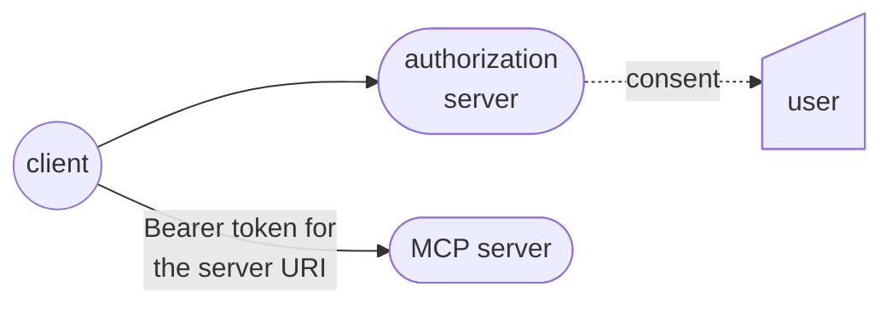

# MCP认证和授权

您可以将 Mastra 应用程序连接到其他人受保护的 MCP 服务器，或者将自己的Tool和数据公开给第三方客户端。每个方向都需要不同的凭证和不同的检查。

在两个方向上，MCP 连接都会跨越多个安全边界：对调用者进行身份验证并不会决定他们可以读取哪些客户记录，并且连接权限不会授权每个Tool操作。将凭据、委派访问和应用程序权限视为单独的决策。

本指南解释了 Mastra 作为 MCP 客户端和服务器的这些决策。协议要求参见[MCP authorization specification dated July 28, 2026](https://modelcontextprotocol.io/specification/2026-07-28/basic/authorization).

## 了解界限 {/* #understand-the-boundaries */}

这三个决定回答了不同的问题：

* **验证**验证调用者，例如用户或服务帐户。
* **授权访问**让客户端通过授权服务器授予访问权限进行操作。 OAuth 访问令牌授予对其预期资源的访问权限，它不是通用身份凭证。
* **申请授权**决定调用者是否可以对数据执行操作，例如更新其组织中的发票。

在 HTTP OAuth 流程中，这些是单独的角色而不是一项服务：

MCP 服务器是受保护的资源，不一定是让用户登录的服务。授权服务器颁发令牌，并且可以与 MCP 服务器分开。客户端获取并呈现一个令牌。在用户委托的流程中，授权服务器根据需要与用户交互以进行身份​​验证和同意。并非每个流程都需要用户交互。

您的应用程序在该图中的位置决定了它管理哪些凭据。和[`MCPClient`](/reference/tools/mcp-client), your Mastra application connects to another MCP server. With [`MCPServer`](/reference/tools/mcp-server), your application exposes capabilities to other clients. The same application can do both, but its incoming and outgoing credentials serve different boundaries.

MCP 授权是可选的。对于 HTTP 传输，支持授权的实现应遵循规范。使用 stdio 的实现应该从环境中检索凭据，并且不应使用此 HTTP 授权流程。在选择凭证机制之前选择传输方式。

## 连接到受保护的 MCP 服务器 {/* #connect-to-protected-mcp-servers */}

根据远程服务器应强制执行的访问权限来选择凭据：

|接入模式|马斯特拉整合 |应用责任|
| - | - | - |
|共享服务访问|通过配置服务器特定的凭据`MCPClient` request headers or a custom `fetch`. | Limit the service account's access. Don't treat shared credentials as proof of the end user's permissions. |
| Access delegated by each user | Configure a separate `MCPOAuthClientProvider` for each server through `authProvider`. | Isolate each user's providers, connections, tokens, and stored registration state. |

看[MCP connection configuration](/docs/connections/mcp) for static and runtime tools, and the [OAuth client reference](/reference/tools/mcp-client#oauth-authentication) for provider configuration and storage.

每个 MCP 服务器都有一个单独的提供者做一件事而不是另一件事：

* 它阻止该提供者的授权会话状态在服务器之间共享。
* 它不会隔离用户或授权服务器颁发者。 Mastra 的默认 OAuth 存储在内存中。风俗`OAuthStorage` controls persistence, so scope that storage to the user and connection.
* 它无法为您将凭证绑定到颁发者。该规范要求颁发者绑定的注册凭据以及不同授权服务器的单独注册和令牌状态，因此当颁发者更改时不要重复使用这些凭据。

### 注册和浏览器回调 {/* #registration-and-browser-callbacks */}

该规范建议支持**Client ID Metadata Documents (CIMD)**, which identify a client through an HTTPS metadata URL. It also defines pre-registration. Clients that support all registration options should prefer existing pre-registered information when available. Legacy Dynamic Client Registration (DCR) remains optional for compatibility but is deprecated for new implementations. See the versioned [client registration rules](https://modelcontextprotocol.io/specification/2026-07-28/basic/authorization/client-registration).

`MCPOAuthClientProvider`从不在运行时注册客户端并且不支持 DCR。仅配置一个客户端身份：`clientInformation` for a client pre-registered with the authorization server, or `clientMetadataUrl` for CIMD. Check that your authorization server supports the mechanism you choose before deploying. See the [OAuth client reference](/reference/tools/mcp-client#oauth-authentication) for configuration examples.

马斯特拉的互动`authenticate()` flow uses a local loopback callback server. It isn't a hosted multi-user login endpoint. A hosted application must own its callback endpoint and associate each authorization attempt with the correct user and provider. See [interactive browser authentication](/reference/tools/mcp-client#interactive-browser-authentication).

### 授权响应职责 {/* #authorization-response-responsibilities */}

对于您选择的客户端集成，请区分以下协议职责：

* 客户端必须实现代码交换证明密钥 (PKCE)，验证授权服务器公布的支持，并使用`S256` when technically capable.
* 重定向 URI 必须使用 HTTPS 或 localhost。授权服务器必须与注册的重定向 URI 完全匹配。客户端应使用并验证 OAuth`state`.

客户还必须拒绝任何授权响应，其`iss` value doesn't exactly match the issuer recorded from validated authorization-server metadata. What the client must do depends on the response and whether the server advertises `authorization_response_iss_parameter_supported`:

|授权响应`iss` | Server advertises `iss` support | Client action |
| - | - | - |
| Present and exactly matches the recorded issuer | Either value | Continue |
| Present but doesn't match | Either value | Reject before exchanging the code |
| Missing | `true` | Reject before exchanging the code |
| Missing | `false` or absent | Permitted |

请参阅[authorization response validation rules](https://modelcontextprotocol.io/specification/2026-07-28/basic/authorization#authorization-response-validation). Validating `state` isn't issuer validation.

在依赖您选择的集成之前验证这些责任`authProvider` configuration. The [security considerations](https://modelcontextprotocol.io/specification/2026-07-28/basic/authorization/security-considerations) define the full rules.

## 保护 Mastra MCP 服务器 {/* #protect-a-mastra-mcp-server */}

从两个单独的问题开始：客户端如何发现从哪里获取令牌，以及服务器如何验证该令牌？

如果您的服务器使用授权，则协议流程为：

1. 客户端发现 MCP 服务器的受保护资源元数据，该元数据标识其授权服务器。
2. 客户端发现所选授权服务器的元数据并获取 MCP 服务器的令牌。
3. MCP 服务器在应用程序授权请求的操作之前验证令牌。

该规范需要受保护的资源元数据和授权服务器发现。宣传发行者或支持的范围不会验证令牌或强制执行权限。看[authorization server discovery](https://modelcontextprotocol.io/specification/2026-07-28/basic/authorization/authorization-server-discovery).

对于令牌使用，客户端必须将 MCP 服务器的规范 URI 包含为`resource` in authorization and token requests, then send access tokens in the `Authorization` header, never the query string. Servers must validate that a token is valid and intended for them, including its audience, and return HTTP 401 for invalid or expired tokens.

马斯特拉的`createOAuthMiddleware` can serve protected-resource metadata and challenge requests without a bearer token. It calls a configured token validator and rejects results marked invalid.

：：：警告

如果没有验证器，中间件将接受未经验证的令牌。该行为用于开发和测试，而不是生产保护。

:::

配置适合您的发行人的验证，包括受众和到期检查。验证结果还需要连接到您的Tool使用的可信身份。中间件不会为您执行身份映射。

保护马斯特拉路线`server.auth` and providing interoperable OAuth discovery are different tasks. Don't assume configuring one supplies the other.

### 路由 Mastra 注册 MCP 服务器 {/* #routes-mastra-registers-for-an-mcp-server */}

除了 MCP 传输之外，Mastra 还注册 Studio 使用的 REST 路由来列出服务器、检查Tool、执行Tool和读取资源。请参阅[MCP routes reference](/reference/server/routes#mcp) for the full list. These paths use the default `/api` prefix.

这`POST /api/mcp/:serverId/tools/:toolId/execute` route calls `executeTool()` directly, without a protocol client. With a Mastra FGA provider configured, `MCPServer.executeTool()` enforces tool execution permission using the user in `requestContext`. The REST tool list also filters tools through FGA, but these permission checks don't replace route authentication.

这些路由的内置身份验证取决于`server.auth`. Without it, `requiresAuth: true` doesn't enforce authentication. Custom middleware that checks only the `/mcp` or `/sse` transport paths leaves the REST routes open. If you use custom middleware instead of `server.auth`, default-deny `/api/mcp/*` and allow access only after authentication.

### 将经过验证的身份传递给Tool {/* #pass-verified-identity-to-tools */}

当 Mastra 服务器处理 MCP 请求时，其身份验证桥会保留现有的`req.auth`. Otherwise, it uses `server.mcpOptions.setRequestAuth` when configured, or builds `authInfo` from the request context. With the default bridge, the authenticated user is available in `authInfo.extra.user`.

从受信任的身份验证结果填充该身份，因为映射字段不会验证凭据。看[forwarding identity to MCP tools](/docs/guides/authentication-identity#forward-identity-to-mcp-tools) for the bridge and [where `authInfo` comes from](/reference/tools/mcp-server#where-authinfo-comes-from) for the mapping reference.

## 授权Tool和数据 {/* #authorize-tools-and-data */}

OAuth 范围描述了授予的访问权限，但它们并不能替代应用程序的权限和所有权检查。该规范建议最小权限范围请求，并描述当操作需要更多访问权限时的逐步授权。不要假设 Mastra 会自动组合范围或针对您的应用程序策略发出范围不足的挑战。

配置 Mastra FGA 提供程序后，`MCPServer` filters `tools/list` and enforces tool execution authorization on `tools/call`. `mapAuthInfoToUser` maps trusted MCP authentication information to the user those checks consume. See [fine-grained authorization](/docs/auth/fga) for policy setup and the [`MCPServer` configuration](/reference/tools/mcp-server#configuration-properties) for MCP-specific mappings.

Tool可见性还不够：调用者可以尝试调用Tool而无需先列出它。在调用时保持授权，并检查每个请求的记录是否属于调用者可以访问的组织或用户。从受信任的服务器上下文解析调用者和租户，而不是模型提供的Tool参数。人工批准可以确认预期的操作，但不能取代这些检查。

MCP Tool FGA 集成不会自动授权资源、提示或订阅，并且其映射不适用于内部Agent或WorkflowTool执行。如果您公开这些表面，请在应用程序代码中对它们进行授权。

：：：警告

不要假设Tool权限可以保护您通过资源、提示或订阅公开的调用者敏感数据。

:::

## 安全访问上游服务 {/* #access-upstream-services-safely */}

MCP 访问令牌用于 MCP 服务器。该规范禁止将该令牌传递给上游 API。当Tool调用另一个服务时，请使用专用于该服务的单独凭据，这些凭据由授权用户或租户的可信应用程序代码选择。

将访问令牌、刷新令牌和服务凭证保留在模型可见指令、Tool参数和Tool结果之外。仅返回任务所需的数据。这[authentication and identity guide](/docs/guides/authentication-identity#keep-secrets-outside-the-model-boundary) explains this model boundary.

## 生产清单 {/* #production-checklist */}

* \[ ] **Validate tokens:** Configure validation for your issuer, including audience and expiry checks, and confirm an unvalidated token is rejected.
* \[ ] **Challenge missing tokens:** Confirm every protected server path returns `401` without a bearer token.
* \[ ] **Protect MCP REST routes:** If you don't use `server.auth`, confirm `/api/mcp/:serverId/tools*`, `/api/mcp/:serverId/resources*`, and `/api/mcp/v0/servers*` aren't reachable without authentication. Use your configured API prefix if it differs from `/api`.
* \[ ] **Isolate users:** Confirm one user's provider, connection, and stored credentials aren't reused for another user.
* \[ ] **Bind credentials to the issuer:** Confirm registration and tokens aren't reused when the authorization server changes.
* \[ ] **Deny unauthorized operations:** Confirm a caller without permission is denied both `tools/call` and `POST /api/mcp/:serverId/tools/:toolId/execute`, including for a tool it never listed.
* \[ ] **Scope records to the caller:** Confirm record lookups resolve the tenant from trusted server context rather than tool arguments.
* \[ ] **Keep tokens at their audience:** Confirm upstream calls use separate credentials and never forward the MCP token.
* \[ ] **Keep secrets out of model data:** Confirm tokens and credentials stay out of instructions, tool arguments, and tool results.

## 后续步骤 {/* #next-steps */}

* 连接到受保护的服务器[MCP connection configuration](/docs/connections/mcp) and the [`MCPClient` reference](/reference/tools/mcp-client).
* 公开您自己的Tool并查看传输和上下文选项[`MCPServer` reference](/reference/tools/mcp-server).
* 添加权限检查[fine-grained authorization](/docs/auth/fga).
* 使用以下命令跟踪传入请求的身份[authentication and identity guide](/docs/guides/authentication-identity).
