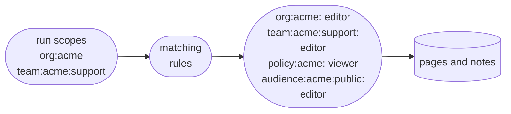

# 范围和访问权限

范围控制Agent可以在知识中看到和更改的内容。您决定每种范围允许什么。您的服务器决定每次运行或Agent调用的范围。该模型仅适用于页面并记录这些范围给它的信息，并且它不能改变任何一个决定。

：：：阿尔法

知识处于阿尔法阶段。其 API 可能会在不同版本之间发生变化。每次Tool调用时都会检查访问权限，但 alpha 版本尚不能保证作用域之间的隔离。不要在 Knowledge 中存储任何绝不能到达其他客户或用户的内容。

:::

## 声明范围 {/* #declare-scopes */}

一个**scope** is an area of Knowledge that holds pages and notes. Each scope has an address, such as `org:acme`, `team:acme:support` or `resource:dana`。第一个冒号之前的部分是作用域的类型，例如`team`。其余部分标识该类型的一个范围。

知识没有内置的范围类型。您在中声明所需的类型`scopes` option on `Knowledge`. Each type is a pattern, such as `team:$orgId:$teamId`. A `$name` segment is a placeholder that matches any value. The address `team:acme:support` matches that pattern with `$orgId = acme`和`$teamId = support`.

该示例设置了以下规则：

* 支持团队的成员可以编辑其团队的页面。
* 组织中的每个人都可以阅读团队的页面和公司政策。
* 组织成员可以编写公共页面，公共常见问题解答Agent可以读取这些页面。
* 其他组织看不到任何内容。

```typescript title="src/mastra/knowledge.ts"
import { Knowledge, knowledgeMemoryScopes } from '@mastra/core/knowledge'
import { LibSQLStore } from '@mastra/libsql'

export const knowledge = new Knowledge({
  id: 'company',
  storage: new LibSQLStore({ id: 'knowledge', url: 'file:./knowledge.db' }),
  tools: true,
  scopes: {
    ...knowledgeMemoryScopes(),
    'team:$orgId:$teamId': {
      description: 'A team',
      belongsTo: 'org:$orgId',
      access: [
        { principal: 'self', role: 'editor' },
        { principal: 'org:$orgId', role: 'viewer' },
      ],
    },
    'policy:$orgId': {
      description: 'Company policies',
      access: [{ principal: 'org:$orgId', role: 'viewer' }],
    },
    'audience:$orgId:public': {
      description: 'Pages for public visitors',
      access: [
        { principal: 'self', role: 'viewer' },
        { principal: 'org:$orgId', role: 'editor' },
      ],
    },
  },
})
```

[`knowledgeMemoryScopes()`](/reference/knowledge/knowledge-memory-scopes)添加三种类型：`org:` for each organization, plus Memory's `resource:` type for users and `thread:` type for conversations. A run is the owner of the `resource:` and `thread:` scopes it holds, and an editor of its `org:` scope. The FAQ agent in [For one agent](#for-one-agent) reads the `audience:` scope.

## 访问规则和角色 {/* #access-rules-and-roles */}

每个声明的`access` list says who gets which role on scopes of that type. Each entry is a **rule** with a `principal` and a `role`. The principal says which runs the rule applies to. A rule applies to a run when the run holds a scope that matches the principal. A principal is either `self` or one of your declared patterns. In the `team:$orgId:$teamId` declaration:

* `self`表示正在访问的团队范围。跑步控股`team:acme:support` is an editor there.
* `org:$orgId`表示团队自己的组织，因为它重用了团队的组织`$orgId`. A run holding `org:acme` can read `team:acme:support`, but not `team:globex:support`.

每个角色都可以执行其之上的角色可以执行的所有操作：

|角色 |可以|
| - | - |
|`viewer` | Search and read pages and notes |
| `contributor` | Create pages and add notes |
| `editor` | Edit pages, move them within a scope, change who can see a note, remove notes, and pin pages |
| `owner` | Move pages to another scope, merge a page into another page, and delete pages |

`belongsTo`将一个范围放在树中的另一个范围下，就像文件夹中的文件夹一样。它本身不提供任何访问权限。声明还可以添加模板页面、子范围和显示标签。[Scope declarations](/reference/knowledge/scope-declarations) lists every field and the errors Knowledge reports at startup.

## 设置运行范围 {/* #set-a-runs-scopes */}

**运行范围**是运行的范围。他们识别运行所针对的用户、团队或对话。只有您的服务器代码设置它们。模型无法更改它们，客户端也无法在请求正文中发送它们。

仅当规则赋予运行某个作用域时，它才会在某个作用域中发挥作用。每个运行范围还必须与声明的类型匹配，否则知识Tool会失败。

### 从您的服务器 {/* #from-your-server */}

您的服务器知道用户是谁。在中间件中设置用户的范围`MASTRA_SCOPES_KEY` request context key, as strings such as `org:acme`. In this example, `getUser()` is your app's own login lookup, and `support` is an agent with Knowledge attached:

```typescript title="src/mastra/index.ts"
import { Mastra } from '@mastra/core/mastra'
import { MASTRA_RESOURCE_ID_KEY, MASTRA_SCOPES_KEY } from '@mastra/core/request-context'

export const mastra = new Mastra({
  agents: { support },
  server: {
    middleware: [
      async (c, next) => {
        const user = await getUser(c.req.header('Authorization'))
        const requestContext = c.get('requestContext')

        requestContext.set(MASTRA_SCOPES_KEY, [
          `org:${user.orgId}`,
          ...user.teams.map(team => `team:${user.orgId}:${team}`),
          `resource:${user.id}`,
        ])
        requestContext.set(MASTRA_RESOURCE_ID_KEY, user.id)

        await next()
      },
    ],
  },
})
```

还设置了`MASTRA_RESOURCE_ID_KEY` to the user's ID. The server then checks thread ownership against the same user. See [request context](/docs/server/request-context#reserved-keys).

### 在直接Agent呼叫中 {/* #in-a-direct-agent-call */}

当您的代码直接调用Agent时，请传递范围`scopes` option:

```typescript
await support.generate('How do I handle a chargeback?', {
  scopes: ['org:acme', 'team:acme:support'],
  memory: { resource: 'dana', thread: 'ticket-91' },
})
```

有了内存，运行还可以保存`resource:` and `thread:` scopes from the `memory` option, here `resource:dana` and `thread:ticket-91`. A run can hold only one of each. If you pass a `resource:` scope that differs from `memory.resource`, the run fails. `resource:` and `thread:` scopes take Memory's IDs unchanged, and Knowledge encodes them. Every other scope is a canonical address: encode an ID that contains `:`, `/`, `#` or `%` with [`encodeKnowledgeScopeId()`](/reference/knowledge/knowledge-memory-scopes#encodeknowledgescopeid), such as `` `org:${encodeKnowledgeScopeId(user.orgId)}` ``.

### 对于一名Agent {/* #for-one-agent */}

一个Agent的`scopes` option changes the scopes for that agent's runs. A list adds to the scopes from the request context and the call. A function receives those scopes and returns the final list, so it can give an agent less access than the user has. This public FAQ agent replaces the user's `org:` scope with the org's `audience:` scope, so it reads the org's public pages but none of its other pages. It keeps the user's `resource:` and `thread:` scopes, so it can still read pages in those:

```typescript
export const faq = new Agent({
  id: 'faq',
  name: 'FAQ',
  instructions: 'You answer public questions about Acme.',
  model: '__GATEWAY_OPENAI_MODEL__',
  knowledge,
  memory,
  scopes: ({ scopes }) =>
    scopes.flatMap(scope => {
      if (scope.startsWith('org:')) return [`audience:${scope.slice(4)}:public`]
      if (scope.startsWith('resource:') || scope.startsWith('thread:')) return [scope]
      return []
    }),
})
```

该函数必须返回每个`resource:` and `thread:` scope it receives. Memory uses them to identify the user and thread. The run fails if one is missing.

## 如何决定访问权限 {/* #how-access-is-decided */}

每次Tool运行时，Knowledge 都会计算出运行可以到达哪些范围以及扮演哪个角色：

1. 它从运行范围开始。
2. 它找到其主体与这些范围之一匹配的每条规则，并为运行提供该规则的角色。
3. 它停在那里。规则中的角色不会导致更多角色。

例如，对于运行持有`org:acme` and `team:acme:support`:



范围也不继承访问权限。一个角色`org:acme` gives nothing in the scopes placed under it unless a rule says so.

对于跑步者来说，任何超出其范围的东西看起来都不存在。隐藏的页面看起来与缺失的页面相同。当运行可以达到某个范围但其角色太弱时，错误会指出它需要哪个角色。

### 注意可见性 {/* #note-visibility */}

每个注释都是**stamped** with one or more scopes. A run sees a note only when it can read the page and at least one of the note's stamps. The run doesn't have to hold the stamp. When the note links to other pages with `[[...]]`, the run also needs to be able to read the scope of each linked page, though a link that matches no page is ignored. For example, on a team page:

* 一张加盖印章的便条`resource:dana` is visible only to Dana's runs, because only they can read `resource:dana`.
* 一张加盖印章的便条`team:acme:support` is visible to every run that can read the team scope. With the rules above, that's the whole of `org:acme`, not only the team.

### 测试访问`explainAccess()` {/* #test-access-with-explainaccess */}

[`explainAccess()`](/reference/knowledge/knowledge-class#explainaccess)获取运行范围和范围或页面的列表。它返回那些运行范围在那里的角色，以及赋予它的规则。

与上述所有规则一样，从作用域地址绑定的规则仅取决于您的声明。测试可以检查它们，而无需调用模型或编写页面。通过范围绑定的规则[place in the tree](/reference/knowledge/scope-declarations#place-scopes-with-belongsto) gives no role until a writing run has placed the scope, so test those after a write:

```typescript title="src/mastra/knowledge.test.ts"
import { describe, expect, it } from 'vitest'
import { knowledge } from './knowledge'

const roleOn = async (scopes: string[], scope: string) =>
  (await knowledge.explainAccess(scopes, { scope })).role

describe('team access', () => {
  it('lets a team edit its own scope', async () => {
    expect(await roleOn(['org:acme', 'team:acme:support'], 'team:acme:support')).toBe('editor')
  })
  it('lets the org read it', async () => {
    expect(await roleOn(['org:acme'], 'team:acme:support')).toBe('viewer')
  })
  it('hides it from another org', async () => {
    expect(await roleOn(['org:globex'], 'team:acme:support')).toBeNull()
  })
})
```

：：：警告

使用`explainAccess()` only in server code. It shows whether a page is missing or hidden, and a run must never learn that. Don't expose it through an agent tool, or through a server route without admin-level auth.

:::

## 后续步骤 {/* #next-steps */}

下一个，[give an agent the Knowledge tools](/docs/knowledge/agents-and-tools) so it can search, read and write in the scopes its runs hold.
