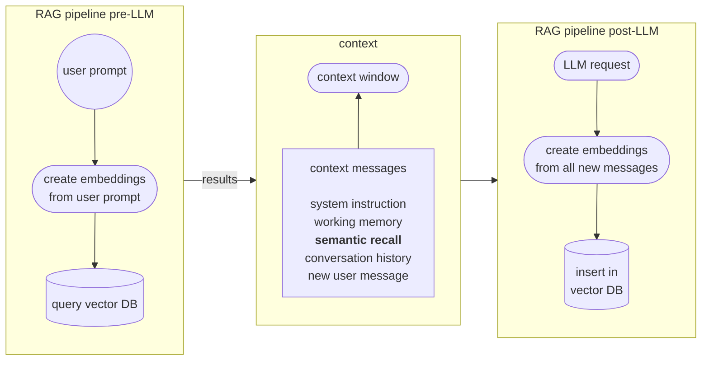

import Tabs from "@theme/Tabs";
import TabItem from "@theme/TabItem";

# 语义召回

语义召回是 Agent Memory 内置的一种检索增强生成（RAG）方式。用户发送消息时，Mastra 会搜索语义相近的历史消息，并将最相关的消息加入 Agent 的上下文。

按含义匹配很重要，因为人们记住的往往是想法，而不是当时的原话。例如，用户最初说“把钱退给他们”，后来问“退款的事我们怎么决定的？”关键词搜索可能无法关联这两句话，语义召回则可以。

当 Agent 需要获取长对话中已不在[近期消息历史](./message-history)里的细节，或用户其他对话中的细节时，可以使用语义召回。

:::tip[📹 观看]

观看 [Mastra 语义召回](https://www.youtube.com/watch?v=UVZtK8cK8xQ\&pp=ygUVbWFzdHJhIHdvcmtpbmcgbWVtb3J5)，了解 Agent 如何从历史对话中检索相关消息。

:::

## 语义召回的工作原理 {/* #how-semantic-recall-works */}

语义召回基于 RAG 搜索。当消息不再位于[近期消息历史](./message-history)中时，它仍能帮助 Agent 在较长的交互中保持上下文。

它将消息转换为向量嵌入来搜索相似内容，可接入向量存储，并能为检索到的消息配置前后的上下文窗口。



启用后，新消息将用于在向量数据库中查询语义相似的消息。

收到 LLM 响应后，所有新消息（用户、助手，以及 Tool 调用与结果）都会写入向量数据库，以便在后续交互中召回。

## 快速入门 {/* #quickstart */}

语义召回默认关闭。要启用它，请在 `options` 中设置 `semanticRecall: true`，并提供 `vector` 存储和 `embedder`。如果存储能自行生成嵌入，例如启用了 Automated Embedding 的 MongoDB，则无需另行提供。参见[服务端嵌入](#server-side-embeddings)。

<Tabs>
  <TabItem value="libsql" label="LibSQL" default>
    ```typescript title="src/mastra/agents/index.ts"
    import { Agent } from '@mastra/core/agent'
    import { Memory } from '@mastra/memory'
    import { LibSQLStore, LibSQLVector } from '@mastra/libsql'
    import { ModelRouterEmbeddingModel } from '@mastra/core/llm'

    const agent = new Agent({
      id: 'support-agent',
      name: 'SupportAgent',
      instructions: 'You are a helpful support agent.',
      model: '__GATEWAY_OPENAI_MODEL__',
      memory: new Memory({
        storage: new LibSQLStore({
          id: 'agent-storage',
          url: 'file:./local.db',
        }),
        vector: new LibSQLVector({
          id: 'agent-vector',
          url: 'file:./local.db',
        }),
        embedder: new ModelRouterEmbeddingModel('openai/text-embedding-3-small'),
        options: {
          semanticRecall: true,
        },
      }),
    })
    ```
  </TabItem>

  <TabItem value="mongodb" label="MongoDB">
    ```typescript title="src/mastra/agents/index.ts"
    import { Agent } from '@mastra/core/agent'
    import { Memory } from '@mastra/memory'
    import { MongoDBStore, MongoDBVector } from '@mastra/mongodb'
    import { ModelRouterEmbeddingModel } from '@mastra/core/llm'

    const agent = new Agent({
      id: 'support-agent',
      name: 'SupportAgent',
      instructions: 'You are a helpful support agent.',
      model: '__GATEWAY_OPENAI_MODEL__',
      memory: new Memory({
        storage: new MongoDBStore({
          id: 'agent-storage',
          uri: process.env.MONGODB_URI,
          dbName: process.env.MONGODB_DB_NAME,
        }),
        vector: new MongoDBVector({
          id: 'agent-vector',
          uri: process.env.MONGODB_URI,
          dbName: process.env.MONGODB_DB_NAME,
        }),
        embedder: new ModelRouterEmbeddingModel('openai/text-embedding-3-small'),
        options: {
          semanticRecall: true,
        },
      }),
    })
    ```
  </TabItem>
</Tabs>

## 使用 `recall()` 方法 {/* #using-the-recall-method */}

`listMessages` 按线程 ID 获取消息，并提供基本分页；[`recall()`](/reference/memory/recall) 则支持**语义搜索**。需要按含义而非时间先后查找消息时，可传入 `vectorSearchString` 调用 `recall()`：

```typescript
const memory = await agent.getMemory()

// Basic recall - similar to listMessages
const { messages } = await memory!.recall({
  threadId: 'thread-123',
  perPage: 50,
})

// Semantic recall - find messages by meaning
const { messages: relevantMessages } = await memory!.recall({
  threadId: 'thread-123',
  vectorSearchString: 'What did we discuss about the project deadline?',
  threadConfig: {
    semanticRecall: true,
  },
})
```

## 存储配置 {/* #storage-configuration */}

语义召回依赖[存储与向量数据库](/reference/memory/memory-class)保存消息及其嵌入。

```ts title="src/mastra/agents/index.ts"
import { Memory } from '@mastra/memory'
import { Agent } from '@mastra/core/agent'
import { LibSQLStore, LibSQLVector } from '@mastra/libsql'

const agent = new Agent({
  memory: new Memory({
    // this is the default storage db if omitted
    storage: new LibSQLStore({
      id: 'agent-storage',
      url: 'file:./local.db',
    }),
    // this is the default vector db if omitted
    vector: new LibSQLVector({
      id: 'agent-vector',
      url: 'file:./local.db',
    }),
    options: {
      semanticRecall: true,
    },
  }),
})
```

下面每个向量存储页面都提供安装说明、配置参数和使用示例：

- [Astra](/integrations/vectors/astra)
- [Chroma](/integrations/vectors/chroma)
- [Cloudflare Vectorize](/integrations/vectors/vectorize)
- [Convex](/integrations/vectors/convex)
- [Couchbase](/integrations/vectors/couchbase)
- [DuckDB](/integrations/vectors/duckdb)
- [Elasticsearch](/integrations/vectors/elasticsearch)
- [LanceDB](/integrations/vectors/lance)
- [libSQL](/integrations/vectors/libsql)
- [MongoDB](/integrations/vectors/mongodb)
- [OpenSearch](/integrations/vectors/opensearch)
- [OracleDB](/integrations/vectors/oracledb)
- [Pinecone](/integrations/vectors/pinecone)
- [PostgreSQL](/integrations/vectors/pg)
- [Qdrant](/integrations/vectors/qdrant)
- [S3 Vectors](/integrations/vectors/s3vectors)
- [Turbopuffer](/integrations/vectors/turbopuffer)
- [Upstash](/integrations/vectors/upstash)

## 召回配置 {/* #recall-configuration */}

以下选项控制语义回忆行为：

1. **topK**：检索的相似消息数量
1. **messageRange**：每个匹配结果前后要包含的消息
1. **scope**：搜索当前线程，还是某个资源的所有线程
1. **filter**：限制搜索结果的元数据条件

```typescript {5-9}
const agent = new Agent({
  id: 'agent',
  memory: new Memory({
    options: {
      semanticRecall: {
        topK: 3, // Retrieve 3 similar messages
        messageRange: 2, // Include 2 messages before and after each match
        scope: 'resource', // Search all threads for this resource
        filter: { projectId: { $eq: 'project-a' } },
      },
    },
  }),
})
```

:::note

LibSQL、OracleDB、PostgreSQL、MongoDB 和 Upstash 存储适配器支持 `scope: 'resource'`。

:::

### 元数据过滤 {/* #metadata-filtering */}

`filter` 选项会将语义召回结果限制为线程元数据匹配的消息。

```typescript {5-10}
const agent = new Agent({
  id: 'agent',
  memory: new Memory({
    options: {
      semanticRecall: {
        scope: 'resource',
        filter: {
          projectId: { $eq: 'project-a' },
          category: { $in: ['work', 'personal'] },
        },
      },
    },
  }),
})
```

保存消息时，过滤器会匹配消息嵌入中存储的元数据。如果线程元数据稍后发生更改，现有嵌入将保留其先前的元数据，直到这些消息再次保存或索引。

Agent 运行会将线程元数据存入消息嵌入。旧版本保存的消息没有这类元数据，必须重新保存或索引后才能匹配过滤器。

支持的过滤器运算符：

* `$and`：逻辑与
* `$eq`：等于
* `$gt`: 大于
* `$gte`: 大于或等于
* `$in`：在数组中
* `$lt`： 少于
* `$lte`：小于或等于
* `$ne`：不等于
* `$nin`: 不在数组中
* `$or`：逻辑或

以下示例演示了常见用例的元数据过滤器：

```typescript
// Filter by project
const options = {
  semanticRecall: { filter: { projectId: { $eq: 'my-project' } } },
}

// Filter by multiple categories
const options = {
  semanticRecall: { filter: { category: { $in: ['work', 'research'] } } },
}

// Filter by project and priority
const options = {
  semanticRecall: {
    filter: {
      $and: [{ projectId: { $eq: 'project-a' } }, { priority: { $gte: 3 } }],
    },
  },
}
```

### 长消息 {/* #long-messages */}

嵌入模型对每次输入的 token 数量有限制。Memory 会将长消息切成多个块，每块作为单独的向量记录保存，因此消息的每一部分都能被召回。`maxChunkChars` 用字符数设置分块大小上限：

```typescript {5}
const agent = new Agent({
  id: 'agent',
  memory: new Memory({
    options: {
      semanticRecall: { topK: 3, messageRange: 2, maxChunkChars: 6000 },
    },
  }),
})
```

默认上限为 16,384 个字符，约相当于 4,096 个英文 token，适合输入上限为 8,191 个 token 的 `openai/text-embedding-3-small`。这里按字符数限制，是因为各嵌入 Provider 使用的分词器不同。中文、日文、韩文和代码每个字符通常比英文消耗更多 token，因此当消息以这些内容为主时，应降低 `maxChunkChars`。

如果未设置 `maxChunkChars`，而 embedder 声明了输入上限，Memory 会据此计算分块大小。[FastEmbed](#using-fastembed-local) 模型声明了 512 token 的窗口，因此无需额外配置。

每个分块记录的 ID 都来自消息 ID，因此重新保存消息会替换其分块记录。若通过 `memory.saveMessages()` 将消息重新保存为更短的文本，超出新末尾的旧分块仍可被搜索，直到使用 `memory.updateMessages()` 更新该消息或将其删除。

请在 `Memory` 构造函数中设置 `maxChunkChars`。每次请求传入的 Memory 选项（例如 `agent.stream()` 中的 `memory.options`）不会修改它，因此 API 调用方无法强制生成大量小分块。

## 服务器端嵌入 {/* #server-side-embeddings */}

有些向量存储会自行生成嵌入。使用这类存储时，语义召回无需 `embedder`：数据库写入消息时会生成嵌入，收到搜索字符串时也会为其生成嵌入。嵌入 Provider 完全不进入应用流程。

MongoDB 通过 [Automated Embedding](/integrations/vectors/mongodb) 实现这一点：在向量存储中指定 Voyage AI 模型，并省略 `embedder`。

```typescript title="src/mastra/agents/index.ts"
import { Memory } from '@mastra/memory'
import { MongoDBStore, MongoDBVector } from '@mastra/mongodb'

const memory = new Memory({
  storage: new MongoDBStore({
    id: 'agent-storage',
    uri: process.env.MONGODB_URI,
    dbName: process.env.MONGODB_DB_NAME,
  }),
  vector: new MongoDBVector({
    id: 'agent-vector',
    uri: process.env.MONGODB_URI,
    dbName: process.env.MONGODB_DB_NAME,
    autoEmbed: { model: 'voyage-4' },
  }),
  options: {
    semanticRecall: { topK: 3, messageRange: 2 },
  },
})
```

消息以文本形式存储，再由 MongoDB 生成嵌入，因此模型选择和向量维度由索引管理，而非应用。无论通过 Agent 还是通过 [`recall()`](#using-the-recall-method)，召回方式都相同。

MongoDB 在后台嵌入新写入的消息。不久前保存的消息可能无法立即调出。

其他存储都要求应用提供向量，因此仍需 `embedder`。如果启用语义召回时既未提供 `embedder`，也未使用支持服务端嵌入的存储，系统会抛出错误，并指出这两个选项。

## Embedder 配置 {/* #embedder-configuration */}

语义召回依赖[嵌入模型](/reference/memory/memory-class)将消息转换为嵌入。Mastra 支持通过模型路由器使用 `provider/model` 字符串选择嵌入模型，也支持任何兼容 AI SDK 的[嵌入模型](https://sdk.vercel.ai/docs/ai-sdk-core/embeddings)。

### 使用模型路由器（推荐） {/* #using-the-model-router-recommended */}

最简单的方法是使用支持自动补全的 `provider/model` 字符串：

```ts title="src/mastra/agents/index.ts"
import { Memory } from '@mastra/memory'
import { Agent } from '@mastra/core/agent'
import { ModelRouterEmbeddingModel } from '@mastra/core/llm'

const agent = new Agent({
  id: 'agent',
  memory: new Memory({
    embedder: new ModelRouterEmbeddingModel('openai/text-embedding-3-small'),
    options: {
      semanticRecall: true,
    },
  }),
})
```

支持的嵌入模型：

- **OpenAI**：`text-embedding-3-small`、`text-embedding-3-large`、`text-embedding-ada-002`
* **谷歌**: `gemini-embedding-001`
- **OpenRouter**：提供多个 Provider 的嵌入模型

```ts {7}
import { Agent } from '@mastra/core/agent'
import { Memory } from '@mastra/memory'
import { ModelRouterEmbeddingModel } from '@mastra/core/llm'

const agent = new Agent({
  id: 'agent',
  memory: new Memory({
    embedder: new ModelRouterEmbeddingModel({
      providerId: 'openrouter',
      modelId: 'openai/text-embedding-3-small',
    }),
  }),
})
```

模型路由器会自动从环境变量（`OPENAI_API_KEY`、`GOOGLE_API_KEY`、`OPENROUTER_API_KEY`）检测 API 密钥。Google 模型还会回退使用 `GOOGLE_GENERATIVE_AI_API_KEY`。

### 使用 AI SDK 包 {/* #using-ai-sdk-packages */}

您还可以直接使用AI SDK嵌入模型：

```ts {2,7}
import { Memory } from '@mastra/memory'
import { Agent } from '@mastra/core/agent'
import { ModelRouterEmbeddingModel } from '@mastra/core/llm'

const agent = new Agent({
  id: 'agent',
  memory: new Memory({
    embedder: new ModelRouterEmbeddingModel('openai/text-embedding-3-small'),
  }),
})
```

### 使用 FastEmbed（本地） {/* #using-fastembed-local */}

要使用本地嵌入模型 FastEmbed，请安装 `@mastra/fastembed`：

```bash npm2yarn
npm install @mastra/fastembed@latest
```

然后在 Memory 中配置：

```ts {3,7}
import { Memory } from '@mastra/memory'
import { Agent } from '@mastra/core/agent'
import { fastembed } from '@mastra/fastembed'

const agent = new Agent({
  id: 'agent',
  memory: new Memory({
    embedder: fastembed,
  }),
})
```

FastEmbed 还提供适用于非英语内容的多语言 E5 模型。E5 采用非对称设计，因此分为两个模型：用于索引文本的 `multilingualE5LargePassage` 和用于搜索文本的 `multilingualE5LargeQuery`。

```ts {3,7}
import { Memory } from '@mastra/memory'
import { Agent } from '@mastra/core/agent'
import { fastembed } from '@mastra/fastembed'

const agent = new Agent({
  id: 'agent',
  memory: new Memory({
    embedder: fastembed.multilingualE5LargePassage,
  }),
})
```

Memory 在存储和召回消息时使用同一个 embedder，因此要选定两个模型中的一个并始终使用。只有当你能控制流程两端时，才使用配对的 `multilingualE5LargeQuery`，例如在 RAG Workflow 中用 passage 模型建立索引、用 query 模型搜索。

多语言 E5 生成 1024 维向量。您的矢量索引必须使用匹配的维度创建，并且 E5 矢量不能与同一索引中另一个嵌入器的矢量混合。

FastEmbed 模型每次输入最多嵌入 512 个 token（约 2,000 至 2,500 个英文字符）。更长的输入会被截断，超出上限的文本不会影响嵌入。语义召回会自动调整消息分块以适应该窗口（参见[长消息](#long-messages)）。在 Memory 之外，AI SDK v3 的 FastEmbed 模型会在输入被截断时发出警告，旧版 v1 和 v2 模型则不会。若用 FastEmbed 嵌入长文档，请将其分块以适应窗口，例如在 `MDocument.chunk()` 中设置 `maxSize: 1500`。

### 设置嵌入尺寸 {/* #setting-the-embedding-dimension */}

为了命名向量索引，Memory 需要知道 embedder 的输出维度。默认情况下，每个 `Memory` 实例首次设置语义召回时，都会嵌入一段短测试字符串来探测维度。如果已知维度，可设置 `embeddingDimension`；Memory 会跳过探测，因此启动时无需调用嵌入服务，也不依赖服务当时可用：

```ts title="src/mastra/agents/index.ts"
import { Memory } from '@mastra/memory'

const memory = new Memory({
  embedder: 'openai/text-embedding-3-small',
  embeddingDimension: 1536,
  options: {
    semanticRecall: true,
  },
})
```

无论维度是配置的还是探测的，索引名称都是相同的，因此现有索引可以继续工作。

该值必须与 embedder 返回的向量维度一致。Memory 会在创建或查询任何索引前，将它与首次实际嵌入的维度比较；若不一致，会抛出 `MASTRA_MEMORY_EMBEDDING_DIMENSION_MISMATCH` 错误并列出两个值。更换嵌入模型或输出维度时，请更新 `embeddingDimension`。

## PostgreSQL 索引优化 {/* #postgresql-index-optimization */}

当使用 PostgreSQL 作为向量存储时，您可以通过配置向量索引来优化语义召回性能。这对于包含数千条消息的大规模部署尤其重要。

PostgreSQL 支持 IVFFlat 和 HNSW 索引。Mastra 默认创建 IVFFlat 索引，但 HNSW 通常性能更好，尤其是使用内积距离的 OpenAI 嵌入。

语义召回始终按线程或资源过滤。只有在 pgvector 0.8.0 或更新版本上使用 HNSW 时，PgVector 才会为这些搜索使用向量索引。使用 IVFFlat 时，每次搜索都会将查询与该线程或资源中的每条消息比较。

```typescript {18-23}
import { Memory } from '@mastra/memory'
import { PostgresStore, PgVector } from '@mastra/pg'

const agent = new Agent({
  memory: new Memory({
    storage: new PostgresStore({
      id: 'agent-storage',
      connectionString: process.env.DATABASE_URL,
    }),
    vector: new PgVector({
      id: 'agent-vector',
      connectionString: process.env.DATABASE_URL,
    }),
    options: {
      semanticRecall: {
        topK: 5,
        messageRange: 2,
        indexConfig: {
          type: 'hnsw', // Use HNSW for better performance
          metric: 'dotproduct', // Best for OpenAI embeddings
          hnsw: {
            m: 16, // Number of bi-directional links (default: 16)
            efConstruction: 64, // Size of candidate list during construction (default: 64)
          },
        },
      },
    },
  }),
})
```

有关索引配置选项和性能调优的详细信息，请参阅 [PgVector 配置指南](/integrations/vectors/pg#index-configuration-guide)。

## 禁用语义回忆 {/* #disable-semantic-recall */}

语义召回默认关闭（`semanticRecall: false`）。每次调用都会增加延迟，因为新消息必须先转成嵌入并查询向量数据库，然后才能交给 LLM。

在以下情况下保持语义召回禁用：

* 消息历史记录为当前对话提供了足够的上下文。
* 您正在构建性能敏感的应用程序，例如实时双向音频，其中嵌入和矢量查询延迟很明显。

## 查看召回的消息 {/* #viewing-recalled-messages */}

启用追踪后，通过语义召回检索的消息会与近期消息历史（如已配置）一起显示在 Agent 的 Trace 输出中。
