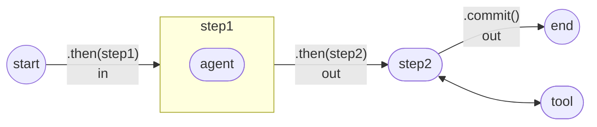
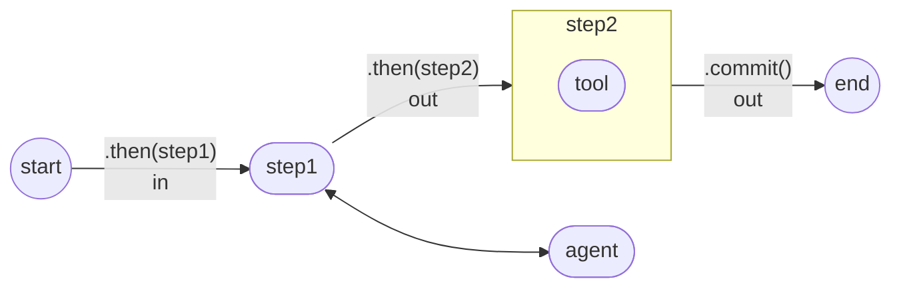

# Agent 与 Tool

Workflow 步骤可以调用 Agent 进行 LLM 推理，也可以调用 Tool 执行类型安全的逻辑。你可以在步骤的 `execute()` 函数中调用它们，也可以用 `createStep()` 直接将它们组合为步骤。

## 在 Workflow 中使用 Agent {/* #using-agents-in-workflows */}

需要推理、生成文本或处理其他依赖 LLM 的任务时，可以在 Workflow 步骤中使用 Agent。如果需要更细致地控制调用，例如跟踪消息历史或返回结构化输出，请在步骤的 `execute()` 函数中调用 Agent。如果不需要调整调用方式，可直接将 Agent 作为步骤。

### 调用 Agent {/* #calling-agents */}

在步骤的 `execute()` 函数中使用 `.generate()` 或 `.stream()` 调用 Agent。这样可以调整调用方式，并在将响应传给下一步前进行处理。

```typescript {8-16} title="src/mastra/workflows/test-workflow.ts"
import { createStep } from '@mastra/core/workflows'

const step1 = createStep({
  execute: async ({ inputData, mastra }) => {
    const { message } = inputData

    const testAgent = mastra.getAgent('testAgent')
    const response = await testAgent.generate(
      `Convert this message into bullet points: ${message}`,
      {
        memory: {
          thread: 'user-123',
          resource: 'test-123',
        },
      },
    )

    return {
      list: response.text,
    }
  },
})
```

### 将 Agent 作为步骤 {/* #agents-as-steps */}

如果不需要调整 Agent 的调用方式，可用 `createStep()` 将它作为步骤。用 `.map()` 将上一步的输出转换为 Agent 可用的 `prompt`。



```typescript {1,3,6-11} title="src/mastra/workflows/test-workflow.ts"
import { testAgent } from '../agents/test-agent'
import { createWorkflow, createStep } from '@mastra/core/workflows'
const step1 = createStep(testAgent)

export const testWorkflow = createWorkflow({})
  .map(async ({ inputData }) => {
    const { message } = inputData
    return {
      prompt: `Convert this message into bullet points: ${message}`,
    }
  })
  .then(step1)
  .then(step2)
  .commit()
```

详见[输入数据映射](/docs/workflows/control-flow#input-data-mapping)。

未提供 `structuredOutput` 选项时，Mastra Agent 使用默认模式：输入为 `prompt` 字符串，输出为 `text` 字符串。

```typescript oxfmt:false
{
  inputSchema: {
    prompt: string
  },
  outputSchema: {
    text: string
  }
}
```

### 让 Agent 返回结构化输出 {/* #agents-with-structured-output */}

如果需要 Agent 返回结构化数据而非纯文本，请向 `createStep()` 传入 `structuredOutput` 选项。步骤的输出模式会与你提供的模式一致，从而以类型安全的方式衔接后续步骤。

```typescript {11} title="src/mastra/workflows/test-workflow.ts"
import { createWorkflow, createStep } from '@mastra/core/workflows'
import { z } from 'zod'

const articleSchema = z.object({
  title: z.string(),
  summary: z.string(),
  tags: z.array(z.string()),
})

const agentStep = createStep(testAgent, {
  structuredOutput: { schema: articleSchema },
})

// Next step receives typed structured data
const processStep = createStep({
  id: 'process',
  inputSchema: articleSchema, // Matches agent's outputSchema
  outputSchema: z.object({ tagCount: z.number() }),
  execute: async ({ inputData }) => ({
    tagCount: inputData.tags.length, // Fully typed
  }),
})

export const testWorkflow = createWorkflow({})
  .map(async ({ inputData }) => ({
    prompt: `Generate an article about: ${inputData.topic}`,
  }))
  .then(agentStep)
  .then(processStep)
  .commit()
```

`structuredOutput.schema` 接受任意 Standard JSON Schema。Agent 会生成符合该模式的输出，步骤的 `outputSchema` 也会自动设为该模式。错误处理策略、结构化输出的流式传输等选项，见[结构化输出](/docs/agents/structured-output)。

### `.agent()` 简写 {/* #the-agent-shorthand */}

可用 `.agent()` 直接添加 Agent，无需用 `createStep()` 封装。它接受与 `createStep(agent, options)` 相同的选项，也可以用 Agent ID 字符串代替实例：

```typescript {9} title="src/mastra/workflows/test-workflow.ts"
import { testAgent } from '../agents/test-agent'
import { createWorkflow } from '@mastra/core/workflows'

export const testWorkflow = createWorkflow({})
  .map(async ({ inputData }) => ({
    prompt: `Generate an article about: ${inputData.topic}`,
  }))
  .agent(testAgent, { structuredOutput: { schema: articleSchema } })
  .commit()
```

`.agent()` 在 Workflow 图中记录一个声明式条目，而非内部逻辑不透明的步骤，因此可以将这样构建的 Workflow 作为[动态 Workflow](/docs/workflows/dynamic-workflows) 持久化。完整参数见 [Workflow.agent()](/reference/workflows/workflow-methods/agent)。

## 在 Workflow 中使用 Tool {/* #using-tools-in-workflows */}

在 Workflow 步骤中使用 Tool，可以复用其现有逻辑。需要准备上下文或处理响应时，请在步骤的 `.execute()` 函数中调用 Tool。如果不需要调整使用方式，可直接将 Tool 作为步骤。

### 调用 Tool {/* #calling-tools */}

在步骤的 `.execute()` 函数中调用 Tool，可更灵活地控制输入上下文，也可以先处理响应，再传给下一步。

```typescript title="src/mastra/workflows/test-workflow.ts"
import { testTool } from '../tools/test-tool'
import { isValidationError } from '@mastra/core/tools'
import { createStep } from '@mastra/core/workflows'

const step2 = createStep({
  execute: async ({ inputData, requestContext }) => {
    const { text } = inputData

    const response = await testTool.execute?.({ text }, { requestContext })

    if (!response || isValidationError(response)) {
      throw new Error('testTool did not return a result')
    }

    return {
      emphasized: response.emphasized,
    }
  },
})
```

### 将 Tool 作为步骤 {/* #tools-as-steps */}

上一步的输出与 Tool 的输入上下文匹配时，可以用 `createStep()` 将 Tool 作为步骤。如果不匹配，可用 `.map()` 转换上一步的输出。



```typescript {1,4,8-13} title="src/mastra/workflows/test-workflow.ts"
import { testTool } from '../tools/test-tool'
import { createWorkflow, createStep } from '@mastra/core/workflows'

const step2 = createStep(testTool)

export const testWorkflow = createWorkflow({})
  .then(step1)
  .map(async ({ inputData }) => {
    const { formatted } = inputData
    return {
      text: formatted,
    }
  })
  .then(step2)
  .commit()
```

详见[输入数据映射](/docs/workflows/control-flow#input-data-mapping)。

### `.tool()` 简写 {/* #the-tool-shorthand */}

可用 `.tool()` 直接添加 Tool，无需用 `createStep()` 封装。它接受 Tool 实例或已注册的 Tool ID 字符串，以及步骤级的 `retries` 和 `metadata`：

```typescript {6} title="src/mastra/workflows/test-workflow.ts"
import { testTool } from '../tools/test-tool'
import { createWorkflow } from '@mastra/core/workflows'

export const testWorkflow = createWorkflow({}).then(step1).tool(testTool).commit()
```

与 `.agent()` 一样，`.tool()` 会记录声明式条目，因此可以将 Workflow 作为[动态 Workflow](/docs/workflows/dynamic-workflows) 持久化。完整参数见 [Workflow.tool()](/reference/workflows/workflow-methods/tool)。

## 相关文档 {/* #related */}

- [使用 Agent](/docs/agents/overview)
- [MCP 概览](/docs/connections/mcp)
