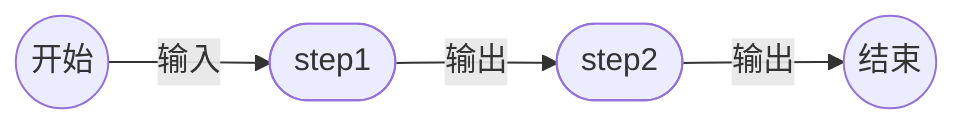
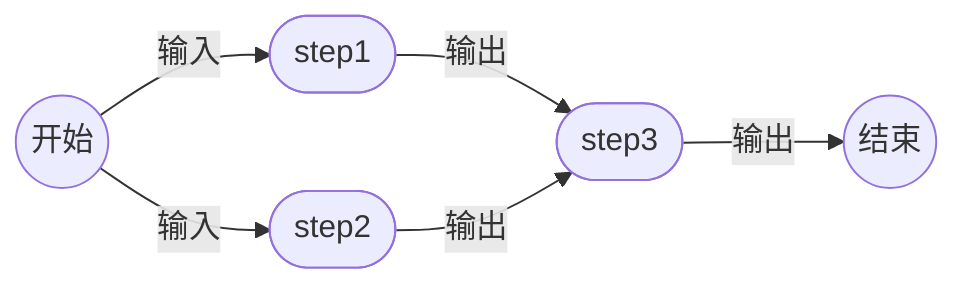
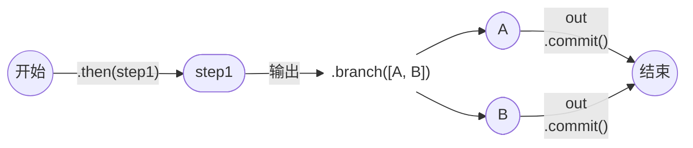
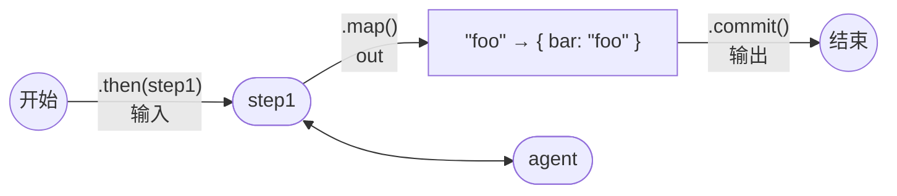
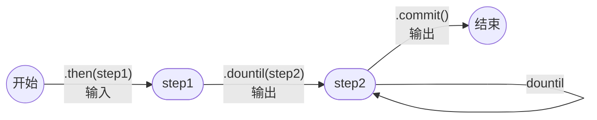
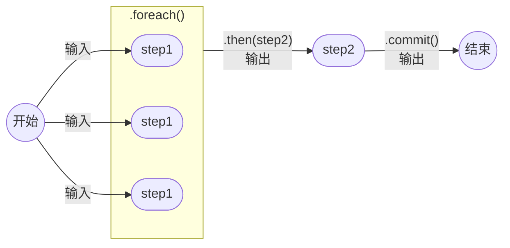

# 控制流程

Workflow 将预定义的任务拆分为多个**步骤**，让你控制任务的执行方式。这些步骤可以顺序或并行运行，也可以根据条件选择路径。

Workflow 中的各步骤通过明确定义的 schema 衔接，确保数据流可控且一致。

## 核心原则 {/* #core-principles */}

* 第一步的 `inputSchema` 必须与 Workflow 的 `inputSchema` 匹配。
* 最后一步的 `outputSchema` 必须与 Workflow 的 `outputSchema` 匹配。
* 每一步的 `outputSchema` 必须与下一步的 `inputSchema` 匹配。
  * 如果不匹配，请使用[输入数据映射](#input-data-mapping)将数据转换为所需结构。

## 使用 `.then()` 串接步骤 {/* #chaining-steps-with-then */}

使用 `.then()` 按顺序执行步骤，让每一步都能访问前一步的结果。



```typescript {30-31} title="src/mastra/workflows/test-workflow.ts"
import { createWorkflow, createStep } from '@mastra/core/workflows'
import { z } from 'zod'

const step1 = createStep({
  inputSchema: z.object({
    message: z.string(),
  }),
  outputSchema: z.object({
    formatted: z.string(),
  }),
})

const step2 = createStep({
  inputSchema: z.object({
    formatted: z.string(),
  }),
  outputSchema: z.object({
    emphasized: z.string(),
  }),
})

export const testWorkflow = createWorkflow({
  inputSchema: z.object({
    message: z.string(),
  }),
  outputSchema: z.object({
    emphasized: z.string(),
  }),
})
  .then(step1)
  .then(step2)
  .commit()
```

## 使用 `.parallel()` 同时执行步骤 {/* #simultaneous-steps-with-parallel */}

使用 `.parallel()` 同时执行多个步骤。所有并行步骤完成后，Workflow 才会继续执行下一步。每个步骤的 `id` 用于定义后续步骤的 `inputSchema`，也会成为 `inputData` 对象中的键，用于访问前一步的值。后续步骤可以引用或合并这些并行步骤的输出。



```typescript {42} title="src/mastra/workflows/test-workflow.ts"
import { createWorkflow, createStep } from '@mastra/core/workflows'
import { z } from 'zod'

const step1 = createStep({
  id: 'step-1',
})

const step2 = createStep({
  id: 'step-2',
})

const step3 = createStep({
  id: 'step-3',
  inputSchema: z.object({
    'step-1': z.object({
      formatted: z.string(),
    }),
    'step-2': z.object({
      emphasized: z.string(),
    }),
  }),
  outputSchema: z.object({
    combined: z.string(),
  }),
  execute: async ({ inputData }) => {
    const { formatted } = inputData['step-1']
    const { emphasized } = inputData['step-2']
    return {
      combined: `${formatted} | ${emphasized}`,
    }
  },
})

export const testWorkflow = createWorkflow({
  inputSchema: z.object({
    message: z.string(),
  }),
  outputSchema: z.object({
    combined: z.string(),
  }),
})
  .parallel([step1, step2])
  .then(step3)
  .commit()
```

### 输出结构 {/* #output-structure */}

并行步骤的输出是一个对象：每个键都是对应步骤的 `id`，值是该步骤的输出。你可以分别访问每个并行步骤的结果。

```typescript title="src/mastra/workflows/test-workflow.ts"
import { createWorkflow, createStep } from '@mastra/core/workflows'
import { z } from 'zod'

const step1 = createStep({
  id: 'format-step',
  inputSchema: z.object({ message: z.string() }),
  outputSchema: z.object({ formatted: z.string() }),
  execute: async ({ inputData }) => ({
    formatted: inputData.message.toUpperCase(),
  }),
})

const step2 = createStep({
  id: 'count-step',
  inputSchema: z.object({ message: z.string() }),
  outputSchema: z.object({ count: z.number() }),
  execute: async ({ inputData }) => ({
    count: inputData.message.length,
  }),
})

const step3 = createStep({
  id: 'combine-step',
  // The inputSchema must match the structure of parallel outputs
  inputSchema: z.object({
    'format-step': z.object({ formatted: z.string() }),
    'count-step': z.object({ count: z.number() }),
  }),
  outputSchema: z.object({ result: z.string() }),
  execute: async ({ inputData }) => {
    // Access each parallel step's output by its id
    const formatted = inputData['format-step'].formatted
    const count = inputData['count-step'].count
    return {
      result: `${formatted} (${count} characters)`,
    }
  },
})

export const testWorkflow = createWorkflow({
  id: 'parallel-output-example',
  inputSchema: z.object({ message: z.string() }),
  outputSchema: z.object({ result: z.string() }),
})
  .parallel([step1, step2])
  .then(step3)
  .commit()

// When executed with { message: "hello" }
// The parallel output structure will be:
// {
//   "format-step": { formatted: "HELLO" },
//   "count-step": { count: 5 }
// }
```

**要点：**

* 每个并行步骤的输出都以其 `id` 为键
* 所有并行步骤同时执行
* 下一步接收包含所有并行步骤输出的对象
* 后续步骤的 `inputSchema` 必须与这一结构匹配

### 处理步骤失败 {/* #handling-step-failures */}

只要有一个并行步骤抛出错误，整个并行区块就会失败。如果希望某些步骤失败时并行 Workflow 仍能继续，例如多个研究 Agent 中有一个的身份验证令牌已过期，就应在步骤内部使用 try/catch 处理错误：

```typescript title="src/mastra/workflows/test-workflow.ts"
import { createStep } from '@mastra/core/workflows'
import { z } from 'zod'

const resilientStep = createStep({
  id: 'researcher',
  inputSchema: z.object({ query: z.string() }),
  outputSchema: z.object({
    brief: z.string().nullable(),
    failed: z.boolean(),
  }),
  execute: async ({ inputData }) => {
    try {
      const result = await fetchExternalData(inputData.query)
      return { brief: result, failed: false }
    } catch {
      return { brief: null, failed: true }
    }
  },
})
```

这样，步骤总会成功返回带类型的结果，下游步骤便可以过滤失败的结果：

```typescript title="src/mastra/workflows/test-workflow.ts"
import { createStep } from '@mastra/core/workflows'
import { z } from 'zod'

const writerStep = createStep({
  id: 'writer',
  inputSchema: z.object({
    'researcher-a': z.object({ brief: z.string().nullable(), failed: z.boolean() }),
    'researcher-b': z.object({ brief: z.string().nullable(), failed: z.boolean() }),
  }),
  outputSchema: z.object({ synthesis: z.string() }),
  execute: async ({ inputData }) => {
    const briefs = Object.values(inputData)
      .filter(v => !v.failed && v.brief)
      .map(v => v.brief)
    return { synthesis: briefs.join('; ') }
  },
})
```

请参阅[如何选择合适的模式](#choosing-the-right-pattern)，了解何时使用 `.parallel()` 或 `.foreach()`。

## 使用 `.branch()` 实现条件逻辑 {/* #conditional-logic-with-branch */}

使用 `.branch()` 执行条件为 `true` 的步骤。系统会检查每个条件；每个返回 `true` 的条件都会执行其对应步骤，因此一次运行可能执行多个分支。各分支步骤需要使用相同的 `inputSchema` 和 `outputSchema`，以保持 schema 一致，让 Workflow 能沿不同路径运行。



```typescript {33-36} title="src/mastra/workflows/test-workflow.ts" oxfmt:false
import { createWorkflow, createStep } from '@mastra/core/workflows';
import { z } from 'zod';

const step1 = createStep({...})

const stepA = createStep({
  inputSchema: z.object({
    value: z.number()
  }),
  outputSchema: z.object({
    result: z.string()
  })
});

const stepB = createStep({
  inputSchema: z.object({
    value: z.number()
  }),
  outputSchema: z.object({
    result: z.string()
  })
});

export const testWorkflow = createWorkflow({
  inputSchema: z.object({
    value: z.number()
  }),
  outputSchema: z.object({
    result: z.string()
  })
})
  .then(step1)
  .branch([
    [async ({ inputData: { value } }) => value > 10, stepA],
    [async ({ inputData: { value } }) => value <= 10, stepB]
  ])
  .commit();
```

### 使用分类器选择路由 {/* #route-with-a-classifier */}

配置好的[classifier](/docs/classifier)可以在 `.branch()` 之前生成带类型的答案。根据问题类型对应的答案字段选择路由：`choice`、`score` 或 `probability`。

```typescript title="src/mastra/workflows/ticket-triage.ts"
import { Classifier } from '@mastra/core/classifier'
import { typeSafeAi } from '@ai-sdk/typesafe-ai'
import { createWorkflow } from '@mastra/core/workflows'
import { z } from 'zod'

const router = new Classifier({
  id: 'ticket-router',
  model: typeSafeAi.decisionModel('__AI_SDK_TYPESAFE_DECISION_MODEL__'),
  questions: {
    route: {
      type: 'choice',
      criteria: {
        billing: 'Billing, invoices, refunds, and payments',
        support: 'Account access and product help',
        other: 'Anything else',
      },
    },
  },
})

export const ticketTriage = createWorkflow({
  id: 'ticket-triage',
  inputSchema: z.object({ message: z.string() }),
  outputSchema: z.any(),
})
  .map({ message: { initData: true, path: 'message' } })
  .classifier(router)
  .branch([
    [async ({ inputData }) => inputData.answers.route.choice === 'billing', billingStep],
    [async ({ inputData }) => inputData.answers.route.choice === 'support', supportStep],
    [async ({ inputData }) => inputData.answers.route.choice === 'other', fallbackStep],
  ])
  .commit()
```

`choice` 字段保留了配置中 criteria 键的联合类型，因此 `inputData.answers.route.choice` 的类型为 `'billing' | 'support' | 'other' | undefined`。评分答案通过 `score` 提供分数；布尔答案提供 `P(true)` 的值，并将其放在 `probability` 字段中。选择路由时应设置明确的阈值。

如果决策模型拒绝回答某个问题，其答案为 `{ type: 'refusal' }`，而 `choice`、`score` 和 `probability` 均为 `undefined`。在上面的示例中，被拒绝的 `route` 问题不会匹配任何条件。添加 `inputData.answers.route.type === 'refusal'` 条件，才能显式处理这种情况。

### 输出结构 {/* #output-structure-1 */}

使用条件分支时，每个结果为 `true` 的条件都会执行对应步骤。输出结构与 `.parallel()` 类似，以每个已执行步骤的 `id` 为键。由于可能有多个条件同时成立，如果只希望执行一条路径，就应使用互斥条件；除非希望兜底分支与匹配的分支一起运行，否则不要在末尾设置无条件返回 `true` 的兜底分支。

```typescript title="src/mastra/workflows/test-workflow.ts"
import { createWorkflow, createStep } from '@mastra/core/workflows'
import { z } from 'zod'

const step1 = createStep({
  id: 'initial-step',
  inputSchema: z.object({ value: z.number() }),
  outputSchema: z.object({ value: z.number() }),
  execute: async ({ inputData }) => inputData,
})

const highValueStep = createStep({
  id: 'high-value-step',
  inputSchema: z.object({ value: z.number() }),
  outputSchema: z.object({ result: z.string() }),
  execute: async ({ inputData }) => ({
    result: `High value: ${inputData.value}`,
  }),
})

const lowValueStep = createStep({
  id: 'low-value-step',
  inputSchema: z.object({ value: z.number() }),
  outputSchema: z.object({ result: z.string() }),
  execute: async ({ inputData }) => ({
    result: `Low value: ${inputData.value}`,
  }),
})

const finalStep = createStep({
  id: 'final-step',
  // The inputSchema must account for either branch's output
  inputSchema: z.object({
    'high-value-step': z.object({ result: z.string() }).optional(),
    'low-value-step': z.object({ result: z.string() }).optional(),
  }),
  outputSchema: z.object({ message: z.string() }),
  execute: async ({ inputData }) => {
    // Conditions here are mutually exclusive, so only one branch runs
    const result = inputData['high-value-step']?.result || inputData['low-value-step']?.result
    return { message: result }
  },
})

export const testWorkflow = createWorkflow({
  id: 'branch-output-example',
  inputSchema: z.object({ value: z.number() }),
  outputSchema: z.object({ message: z.string() }),
})
  .then(step1)
  .branch([
    [async ({ inputData }) => inputData.value > 10, highValueStep],
    [async ({ inputData }) => inputData.value <= 10, lowValueStep],
  ])
  .then(finalStep)
  .commit()

// When executed with { value: 15 }
// The high-value-step condition is true, so that step executes, output structure:
// {
//   "high-value-step": { result: "High value: 15" }
// }

// When executed with { value: 5 }
// The low-value-step condition is true, so that step executes, output structure:
// {
//   "low-value-step": { result: "Low value: 5" }
// }
```

**要点：**

* 每个结果为 `true` 的条件都会执行对应步骤，因此一次运行可能执行多个分支
* 当只应执行一条路径时，使用互斥条件
* 输出以每个已执行步骤的 `id` 为键
* 后续步骤应处理所有可能的分支输出
* 如果下一步需要处理多个可能的分支，应在 `inputSchema` 中使用可选字段

## 输入数据映射 {/* #input-data-mapping */}

使用 `.then()`、`.parallel()` 或 `.branch()` 时，有时需要转换前一步的输出，以匹配下一步的输入。这时可以通过 `.map()` 访问 `inputData`，并将其转换为下一步需要的数据结构。



```typescript {11} title="src/mastra/workflows/test-workflow.ts" oxfmt:false
import { createWorkflow, createStep } from '@mastra/core/workflows';

const step1 = createStep({...});
const step2 = createStep({...});

export const testWorkflow = createWorkflow({...})
  .then(step1)
  .map(async ({ inputData }) => {
    const { foo } = inputData;
    return {
      bar: `new ${foo}`,
    };
  })
  .then(step2)
  .commit();
```

`.map()` 还提供辅助函数，适用于更复杂的映射场景。

**可用的辅助函数：**

* [`getStepResultAsync()`](/reference/workflows/workflow-methods/map#using-getstepresultasync)：访问特定步骤的完整输出
* [`getInitData<any>()`](/reference/workflows/workflow-methods/map#using-getinitdata)：访问 Workflow 的初始输入数据
* [`mapVariable()`](/reference/workflows/workflow-methods/map#using-mapvariable)：使用声明式对象语法提取字段并重命名

### 并行和分支输出 {/* #parallel-and-branch-outputs */}

`.parallel()` 和 `.branch()` 都返回以子步骤 `id` 为键的对象。使用 `.map()` 调整输出结构，供后续操作使用。以下示例将两个并行结果映射为 `.branch()` 所需的共同输入：

```typescript title="src/mastra/workflows/order-routing-workflow.ts"
import { createStep, createWorkflow } from '@mastra/core/workflows'
import { z } from 'zod'

const orderSchema = z.object({ amount: z.number(), inventory: z.number() })
const routingSchema = z.object({ riskScore: z.number(), inStock: z.boolean() })
const decisionSchema = z.object({ action: z.enum(['review', 'approve']) })

const scoreRisk = createStep({
  id: 'score-risk',
  inputSchema: orderSchema,
  outputSchema: z.object({ riskScore: z.number() }),
  execute: async ({ inputData }) => ({
    riskScore: inputData.amount >= 1_000 ? 80 : 20,
  }),
})

const checkInventory = createStep({
  id: 'check-inventory',
  inputSchema: orderSchema,
  outputSchema: z.object({ inStock: z.boolean() }),
  execute: async ({ inputData }) => ({ inStock: inputData.inventory > 0 }),
})

const manualReview = createStep({
  id: 'manual-review',
  inputSchema: routingSchema,
  outputSchema: decisionSchema,
  execute: async () => ({ action: 'review' as const }),
})

const autoApprove = createStep({
  id: 'auto-approve',
  inputSchema: routingSchema,
  outputSchema: decisionSchema,
  execute: async () => ({ action: 'approve' as const }),
})

export const orderRoutingWorkflow = createWorkflow({
  id: 'order-routing',
  inputSchema: orderSchema,
  outputSchema: z.object({
    'manual-review': decisionSchema.optional(),
    'auto-approve': decisionSchema.optional(),
  }),
})
  .parallel([scoreRisk, checkInventory])
  .map(async ({ inputData }) => ({
    riskScore: inputData['score-risk'].riskScore,
    inStock: inputData['check-inventory'].inStock,
  }))
  .branch([
    [async ({ inputData }) => inputData.riskScore >= 70 || !inputData.inStock, manualReview],
    [async ({ inputData }) => inputData.riskScore < 70 && inputData.inStock, autoApprove],
  ])
  .commit()
```

并行输出在经过 `.map()` 之前的结构如下：

```typescript oxfmt:false
{
  'score-risk': { riskScore: 80 },
  'check-inventory': { inStock: true },
}
```

映射后的 `{ riskScore, inStock }` 对象会传给每个分支条件和分支步骤，因此它们的 `inputSchema` 必须与 `routingSchema` 匹配。在 `.map()` 位于 `.branch()` 之后时，用法相同。可通过 `inputData['manual-review']` 或 `await getStepResultAsync(manualReview)` 读取分支输出。

## 循环步骤 {/* #looping-steps */}

Workflow 支持多种循环方法：可以重复执行步骤，直到条件成立，或在条件成立期间持续执行，也可以遍历数组。循环还能与 `.then()` 等控制方法组合使用。

### 使用 `.dountil()` 循环 {/* #looping-with-dountil */}

使用 `.dountil()` 重复执行步骤，直到条件成立。



```typescript oxfmt:false {16} title="src/mastra/workflows/test-workflow.ts"
import { createWorkflow, createStep } from '@mastra/core/workflows';

const step1 = createStep({...});

const step2 = createStep({
  execute: async ({ inputData }) => {
    const { number } = inputData;
    return {
      number: number + 1
    };
  }
});

export const testWorkflow = createWorkflow({})
  .then(step1)
  .dountil(step2, async ({ inputData: { number } }) => number > 10)
  .commit();
```

### 使用 `.dowhile()` 循环 {/* #looping-with-dowhile */}

使用 `.dowhile()` 在条件保持成立期间重复执行步骤。


```typescript oxfmt:false {16} title="src/mastra/workflows/test-workflow.ts"
import { createWorkflow, createStep } from '@mastra/core/workflows';

const step1 = createStep({...});

const step2 = createStep({
  execute: async ({ inputData }) => {
    const { number } = inputData;
    return {
      number: number + 1
    };
  }
});

export const testWorkflow = createWorkflow({})
  .then(step1)
  .dowhile(step2, async ({ inputData: { number } }) => number < 10)
  .commit();
```

### 在迭代之间传递数据 {/* #passing-data-between-iterations */}

`.dountil()` 或 `.dowhile()` 的每次迭代都会将上一次迭代的输出作为 `inputData`。启用输入验证时（默认启用），循环体运行前会先根据其 `inputSchema` 验证该输出。对于 `z.object()` 这样的对象 schema，未声明的键会被移除；而 `.passthrough()` 等允许未知键的 schema 会保留它们。

如果循环体是嵌套 Workflow，输出会先根据嵌套 Workflow 的 `inputSchema` 验证，再根据其第一个步骤的 `inputSchema` 验证。只有嵌套 Workflow 返回某个值，且这两个 schema 都声明了该值，它才会在下一次迭代中可用。这也适用于嵌套 Workflow 内部产生的值，例如某个步骤暂停并恢复后返回的反馈。

要在多次迭代间传递数据，请在循环体的 `inputSchema` 中声明该数据，并从循环体的最后一个步骤返回：

```typescript title="src/mastra/workflows/test-workflow.ts"
import { createStep } from '@mastra/core/workflows'
import { z } from 'zod'

const loopSchema = z.object({
  draft: z.string(),
  feedback: z.string().optional(),
  attempts: z.number(),
})

const reviewStep = createStep({
  id: 'review',
  inputSchema: loopSchema,
  outputSchema: loopSchema,
  execute: async ({ inputData }) => {
    // ...
    return { draft, feedback, attempts: inputData.attempts + 1 }
  },
})
```

对于计数器或审计数据等不属于步骤输入的值，请改用 [Workflow 状态](/docs/workflows/workflow-state)。

### 使用 `.foreach()` 遍历数组 {/* #looping-with-foreach */}

使用 `.foreach()` 对数组中的每个元素执行同一个步骤。输入必须是 `array` 类型，循环才能遍历各元素并应用步骤逻辑。关于何时选用 `.foreach()` 或其他方法，请参阅[如何选择合适的模式](#choosing-the-right-pattern)。



```typescript oxfmt:false {18} title="src/mastra/workflows/test-workflow.ts"
import { createWorkflow, createStep } from '@mastra/core/workflows';
import { z } from 'zod';

const step1 = createStep({
  inputSchema: z.string(),
  outputSchema: z.string(),
  execute: async ({ inputData }) => {
    return inputData.toUpperCase();
  }
});

const step2 = createStep({...});

export const testWorkflow = createWorkflow({
  inputSchema: z.array(z.string()),
  outputSchema: z.array(z.string())
})
  .foreach(step1)
  .then(step2)
  .commit();
```

#### 输出结构 {/* #output-structure-2 */}

`.foreach()` 始终返回一个数组，其中包含每次迭代的输出，顺序与输入元素一致。

```typescript title="src/mastra/workflows/test-workflow.ts"
import { createWorkflow, createStep } from '@mastra/core/workflows'
import { z } from 'zod'

const addTenStep = createStep({
  id: 'add-ten',
  inputSchema: z.object({ value: z.number() }),
  outputSchema: z.object({ value: z.number() }),
  execute: async ({ inputData }) => ({
    value: inputData.value + 10,
  }),
})

export const testWorkflow = createWorkflow({
  id: 'foreach-output-example',
  inputSchema: z.array(z.object({ value: z.number() })),
  outputSchema: z.array(z.object({ value: z.number() })),
})
  .foreach(addTenStep)
  .commit()

// When executed with [{ value: 1 }, { value: 22 }, { value: 333 }]
// Output: [{ value: 11 }, { value: 32 }, { value: 343 }]
```

#### 并发限制 {/* #concurrency-limits */}

使用 `concurrency` 控制同时处理的数组元素数量。默认值为 `1`，即按顺序执行。增大该值可让 `.foreach()` 同时处理多个元素。

```typescript oxfmt:false title="src/mastra/workflows/test-workflow.ts"
import { createWorkflow, createStep } from '@mastra/core/workflows';

const step1 = createStep({...})

export const testWorkflow = createWorkflow({...})
  .foreach(step1, { concurrency: 4 })
  .commit();
```

#### 汇总 `.foreach()` 的结果 {/* #aggregating-results-after-foreach */}

由于 `.foreach()` 输出数组，你可以使用 `.then()` 或 `.map()` 汇总或转换结果。紧随 `.foreach()` 的步骤会收到整个数组作为输入。

```typescript title="src/mastra/workflows/test-workflow.ts"
import { createWorkflow, createStep } from '@mastra/core/workflows'
import { z } from 'zod'

const processItemStep = createStep({
  id: 'process-item',
  inputSchema: z.object({ value: z.number() }),
  outputSchema: z.object({ processed: z.number() }),
  execute: async ({ inputData }) => ({
    processed: inputData.value * 2,
  }),
})

const aggregateStep = createStep({
  id: 'aggregate',
  // Input is an array of outputs from foreach
  inputSchema: z.array(z.object({ processed: z.number() })),
  outputSchema: z.object({ total: z.number() }),
  execute: async ({ inputData }) => ({
    // Sum all processed values
    total: inputData.reduce((sum, item) => sum + item.processed, 0),
  }),
})

export const testWorkflow = createWorkflow({
  id: 'foreach-aggregate-example',
  inputSchema: z.array(z.object({ value: z.number() })),
  outputSchema: z.object({ total: z.number() }),
})
  .foreach(processItemStep)
  .then(aggregateStep) // Receives the full array from foreach
  .commit()

// When executed with [{ value: 1 }, { value: 2 }, { value: 3 }]
// After foreach: [{ processed: 2 }, { processed: 4 }, { processed: 6 }]
// After aggregate: { total: 12 }
```

也可以使用 `.map()` 转换输出数组：

```typescript oxfmt:false title="src/mastra/workflows/test-workflow.ts"
import { createWorkflow } from '@mastra/core/workflows';

export const testWorkflow = createWorkflow({...})
  .foreach(processItemStep)
  .map(async ({ inputData }) => ({
    // Transform the array into a different structure
    values: inputData.map(item => item.processed),
    count: inputData.length
  }))
  .then(nextStep)
  .commit();
```

#### 串接多个 `.foreach()` 调用 {/* #chaining-multiple-foreach-calls */}

串接 `.foreach()` 调用时，每次调用都会处理上一步输出的数组。当数组中每个元素都需要依次经过多个步骤转换时，这种方式很有用。

```typescript title="src/mastra/workflows/test-workflow.ts"
import { createWorkflow, createStep } from '@mastra/core/workflows'
import { z } from 'zod'

const chunkStep = createStep({
  id: 'chunk',
  // Takes a document, returns an array of chunks
  inputSchema: z.object({ content: z.string() }),
  outputSchema: z.array(z.object({ chunk: z.string() })),
  execute: async ({ inputData }) => {
    // Split document into chunks
    const chunks = inputData.content.match(/.{1,100}/g) || []
    return chunks.map(chunk => ({ chunk }))
  },
})

const embedStep = createStep({
  id: 'embed',
  // Takes a single chunk, returns embedding
  inputSchema: z.object({ chunk: z.string() }),
  outputSchema: z.object({ embedding: z.array(z.number()) }),
  execute: async ({ inputData }) => ({
    embedding: [/* vector embedding */],
  }),
})

// For a single document that produces multiple chunks:
export const singleDocWorkflow = createWorkflow({
  id: 'single-doc-rag',
  inputSchema: z.object({ content: z.string() }),
  outputSchema: z.array(z.object({ embedding: z.array(z.number()) })),
})
  .then(chunkStep) // Returns array of chunks
  .foreach(embedStep) // Process each chunk -> array of embeddings
  .commit()
```

如果要处理多个文档，而每个文档都会生成多个分块，可以采用以下方式：

**方案 1：在单个步骤内处理所有文档，并控制批处理**

```typescript oxfmt:false title="src/mastra/workflows/test-workflow.ts"
import { createWorkflow, createStep } from '@mastra/core/workflows';
import { z } from 'zod';

const downloadAndChunkStep = createStep({
  id: "download-and-chunk",
  inputSchema: z.array(z.string()),  // Array of URLs
  outputSchema: z.array(z.object({ chunk: z.string(), source: z.string() })),
  execute: async ({ inputData: urls }) => {
    // Control batching/parallelization within the step
    const allChunks = [];
    for (const url of urls) {
      const content = await fetch(url).then(r => r.text());
      const chunks = content.match(/.{1,100}/g) || [];
      allChunks.push(...chunks.map(chunk => ({ chunk, source: url })));
    }
    return allChunks;
  }
});

export const multiDocWorkflow = createWorkflow({...})
  .then(downloadAndChunkStep)  // Returns flat array of all chunks
  .foreach(embedStep, { concurrency: 10 })  // Embed each chunk in parallel
  .commit();
```

**方案 2：先用 foreach 处理文档并汇总分块，再用 foreach 生成嵌入**

```typescript title="src/mastra/workflows/test-workflow.ts"
import { createWorkflow, createStep } from '@mastra/core/workflows'
import { z } from 'zod'

const downloadStep = createStep({
  id: 'download',
  inputSchema: z.string(), // Single URL
  outputSchema: z.object({ content: z.string(), source: z.string() }),
  execute: async ({ inputData: url }) => ({
    content: await fetch(url).then(r => r.text()),
    source: url,
  }),
})

const chunkDocStep = createStep({
  id: 'chunk-doc',
  inputSchema: z.object({ content: z.string(), source: z.string() }),
  outputSchema: z.array(z.object({ chunk: z.string(), source: z.string() })),
  execute: async ({ inputData }) => {
    const chunks = inputData.content.match(/.{1,100}/g) || []
    return chunks.map(chunk => ({ chunk, source: inputData.source }))
  },
})

export const multiDocWorkflow = createWorkflow({
  id: 'multi-doc-rag',
  inputSchema: z.array(z.string()), // Array of URLs
  outputSchema: z.array(z.object({ embedding: z.array(z.number()) })),
})
  .foreach(downloadStep, { concurrency: 5 }) // Download docs in parallel
  .foreach(chunkDocStep) // Chunk each doc -> array of chunk arrays
  .map(async ({ inputData }) => {
    // Flatten nested arrays: [[chunks], [chunks]] -> [chunks]
    return inputData.flat()
  })
  .foreach(embedStep, { concurrency: 10 }) // Embed all chunks
  .commit()
```

**串接 `.foreach()` 的要点：**

* 每个 `.foreach()` 都处理上一步输出的数组
* 如果 `.foreach()` 中的步骤返回数组，最终输出就会成为数组的数组
* 必要时结合 `.map()` 和 `.flat()` 展平嵌套数组
* 对于复杂的 RAG 流程，方案 1（在单个步骤内控制批处理）通常更便于控制

#### 在 foreach 中使用嵌套 Workflow {/* #nested-workflows-inside-foreach */}

`.foreach()` 后面的步骤要等所有迭代完成后才会执行。如果每个元素都需要依次经过多个操作，应使用嵌套 Workflow，而不是串接多个 `.foreach()` 调用。这样每个元素的操作会集中在一起，数据流也更清晰。

```typescript title="src/mastra/workflows/test-workflow.ts"
import { createWorkflow } from '@mastra/core/workflows'
import { z } from 'zod'

// Define a workflow that processes a single document
const processDocumentWorkflow = createWorkflow({
  id: 'process-document',
  inputSchema: z.object({ url: z.string() }),
  outputSchema: z.object({
    embeddings: z.array(z.array(z.number())),
    metadata: z.object({ url: z.string(), chunkCount: z.number() }),
  }),
})
  .then(downloadStep) // Download the document
  .then(chunkStep) // Split into chunks
  .then(embedChunksStep) // Embed all chunks for this document
  .then(formatResultStep) // Format the final output
  .commit()

// Use the nested workflow inside foreach
export const batchProcessWorkflow = createWorkflow({
  id: 'batch-process-documents',
  inputSchema: z.array(z.object({ url: z.string() })),
  outputSchema: z.array(
    z.object({
      embeddings: z.array(z.array(z.number())),
      metadata: z.object({ url: z.string(), chunkCount: z.number() }),
    }),
  ),
})
  .foreach(processDocumentWorkflow, { concurrency: 3 })
  .commit()

// Each document goes through all 4 steps before the next document starts (with concurrency: 1)
// With concurrency: 3, up to 3 documents process their full pipelines in parallel
```

**为什么使用嵌套 Workflow：**

* **并行度更高**：设置 `concurrency: N` 后，多个元素可以同时完成各自的完整处理流程。串接 `.foreach().foreach()` 会先让所有元素完成第一步，等待后再执行第二步；嵌套 Workflow 则让每个元素独立推进
* 每个元素的所有步骤完成后，才会收集其结果
* 与会产生嵌套数组的多个 `.foreach()` 调用相比，结构更清晰
* 每次嵌套 Workflow 的执行都有独立的数据流
* 更容易单独测试和复用针对每个元素的逻辑

**工作原理：**

1. 父 Workflow 将每个数组元素传给一个嵌套 Workflow 实例
1. 每个嵌套 Workflow 都对该元素执行完整的步骤序列
1. 当 `concurrency > 1` 时，多个嵌套 Workflow 会并行执行
1. 嵌套 Workflow 的最终输出成为结果数组中的一个元素
1. 所有嵌套 Workflow 完成后，父 Workflow 的下一步会收到完整数组

## 为控制流条目添加标签 {/* #labeling-control-flow-entries */}

每个控制流方法都可以接受最后一个可选参数，其中包含稳定的 `id`、`description` 和可序列化为 JSON 的 `metadata`。这些字段标识和描述图中的条目本身，与条目内的步骤区分开来。它们在序列化和存储后仍会保留，并出现在 `serializedStepGraph` 中，但不会影响执行。

```typescript
workflow
  .parallel([validateStep, enrichStep], {
    id: 'independent-enrichment',
    description: 'Run independent enrichment tasks concurrently',
    metadata: { title: 'Independent enrichment' },
  })
  .sleep(5000, { id: 'wait-before-retry', description: 'Pause before retrying' })
```

可视化编辑器和审阅工具可以用 `id` 记录布局和选中状态，并将 `metadata.title` 渲染为显示标签。对于 `.foreach()`，这些字段应与 `concurrency` 放在同一个选项对象中。对于 `.map()`、`.sleep()` 和 `.sleepUntil()`，提供的 `id` 会替换自动生成的条目 ID。

## 选择合适的模式 {/* #choosing-the-right-pattern */}

本节可作为选择控制流方法时的参考。

### 快速参考 {/* #quick-reference */}

| 方法 | 用途 | 输入 | 输出 | 并发 |
| - | - | - | - | - |
| `.then(step)` | 顺序处理 | `T` | `U` | 不适用（逐步执行） |
| `.parallel([a, b])` | 对同一输入执行不同操作 | `T` | `{ a: U, b: V }` | 所有分支同时运行 |
| `.foreach(step)` | 对数组中的每个元素执行相同操作 | `T[]` | `U[]` | 可配置（默认：1） |
| `.branch([...])` | 根据条件选择路径 | `T` | `{ stepId: U }` | 默认同时运行所有条件为 true 的分支；`perStep: true` 只调度第一个匹配的分支 |

### `.parallel()` 与 `.foreach()` 的区别 {/* #parallel-vs-foreach */}

**当同一输入需要接受不同处理时，使用 `.parallel()`：**

```typescript
// Same user data processed differently in parallel
workflow.parallel([validateStep, enrichStep, scoreStep]).then(combineResultsStep)
```

**当多个输入都需要接受相同处理时，使用 `.foreach()`：**

```typescript
// Multiple URLs each processed the same way
workflow.foreach(downloadStep, { concurrency: 5 }).then(aggregateStep)
```

### 何时使用嵌套 Workflow {/* #when-to-use-nested-workflows */}

**在 `.foreach()` 中**：当每个数组元素都需要依次经过多个步骤时：

```typescript oxfmt:false
// Each document goes through a full pipeline
const processDocWorkflow = createWorkflow({...})
  .then(downloadStep)
  .then(parseStep)
  .then(embedStep)
  .commit();

workflow.foreach(processDocWorkflow, { concurrency: 3 })
```

只调用一次 `.foreach()` 可以让结果保持为一层数组；串接 `.foreach().foreach()` 则会生成嵌套数组。

**在 `.parallel()` 中**：当并行分支需要独立的多步骤处理流程时：

```typescript oxfmt:false
const pipelineA = createWorkflow({...}).then(step1).then(step2).commit();
const pipelineB = createWorkflow({...}).then(step3).then(step4).commit();

workflow.parallel([pipelineA, pipelineB])
```

### 常见串接模式 {/* #chaining-patterns */}

| 模式 | 执行方式 | 常见用途 |
| - | - | - |
| `.then().then()` | 顺序执行步骤 | 简单处理流程 |
| `.parallel().then()` | 先并行运行，再合并结果 | 扇出/扇入 |
| `.foreach().then()` | 处理所有元素后汇总 | Map-reduce |
| `.foreach().foreach()` | 生成嵌套数组 | 避免使用；改用嵌套 Workflow，或通过 `.map()` 和 `.flat()` 展平 |
| `.foreach(workflow)` | 为每个元素运行完整流程 | 对每个数组元素执行多步骤处理 |

### 同步：下一步何时运行？ {/* #synchronization-when-does-the-next-step-run */}

`.parallel()` 和 `.foreach()` 都是同步点。只有所有并行分支或所有数组元素的迭代都完成后，Workflow 才会执行下一步。

```typescript
workflow
  .parallel([stepA, stepB, stepC]) // All 3 run simultaneously
  .then(combineStep) // Waits for ALL 3 to finish before running
  .commit()

workflow
  .foreach(processStep, { concurrency: 5 }) // Up to 5 items process at once
  .then(aggregateStep) // Waits for ALL items to finish before running
  .commit()
```

这意味着：

* `.parallel()` 将所有分支输出收集到一个对象中，再传给下一步
* `.foreach()` 将所有迭代输出收集到一个数组中，再传给下一步
* 结果完成时无法逐个“流式传输”给下一步

### 并发行为 {/* #concurrency-behavior */}

| 方法 | 行为 |
| - | - |
| `.then()` | 顺序执行，一次一个步骤 |
| `.parallel()` | 所有分支同时运行（没有并发限制选项） |
| `.foreach()` | 通过 `{ concurrency: N }` 控制；默认为 1（顺序执行） |
| `.foreach()` 中的嵌套 Workflow | 遵循父级设置的并发数 |

**性能提示：** 对于 `.foreach()` 中的 I/O 密集型操作，可以提高并发数，让多个元素同时处理：

```typescript
// Process up to 10 items simultaneously
workflow.foreach(fetchDataStep, { concurrency: 10 })
```

## 循环管理 {/* #loop-management */}

循环条件可以根据所需的退出方式，以不同方式实现。

常见做法是检查 `inputData` 返回的值，并设置最大迭代次数；达到上限时也可以中止执行。

### 中止循环 {/* #aborting-loops */}

使用 `iterationCount` 限制循环次数。如果次数超过设定阈值，就抛出错误，使步骤失败并停止 Workflow。

```typescript oxfmt:false title="src/mastra/workflows/test-workflow.ts"
import { createWorkflow, createStep } from '@mastra/core/workflows';

const step1 = createStep({...});

export const testWorkflow = createWorkflow({...})
  .dountil(step1, async ({ inputData: { userResponse, iterationCount } }) => {
    if (iterationCount >= 10) {
      throw new Error("Maximum iterations reached");
    }
    return userResponse === "yes";
  })
  .commit();
```

## 相关内容 {/* #related */}

* [暂停与恢复](/docs/workflows/suspend-and-resume)
* [人工参与流程](/docs/workflows/human-in-the-loop)
