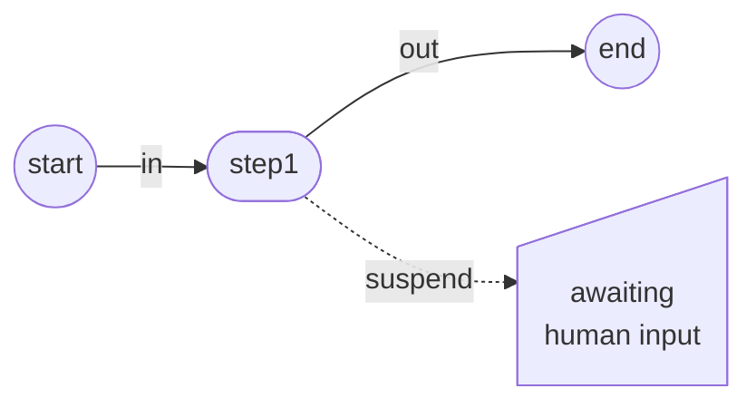
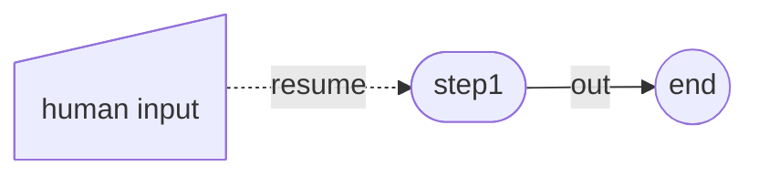

# 人工参与

有些 Workflow 要暂停以等待人工输入。[暂停](/docs/workflows/suspend-and-resume#pausing-a-workflow-with-suspend)时，可以返回消息说明暂停原因及继续所需的信息。收到输入后，Workflow 可据此[恢复执行](#resuming-workflows-with-human-input)或[提前结束](#handling-human-rejection-with-bail)。此方式适用于人工批准、拒绝、需要满足条件才能继续的决定，以及其他需要人工监督的步骤。

## 暂停 Workflow 以等待人工输入 {/* #pausing-workflows-for-human-input */}

人工参与（HITL）与用 `suspend()` [暂停 Workflow](/docs/workflows/suspend-and-resume) 类似。不同之处在于，需要人工输入时，可以返回 `suspend()` 并附上数据，向用户说明背景或下一步该怎么做。



```typescript {12-17,22-26} title="src/mastra/workflows/test-workflow.ts"
import { createWorkflow, createStep } from '@mastra/core/workflows'
import { z } from 'zod'

const step1 = createStep({
  id: 'step-1',
  inputSchema: z.object({
    userEmail: z.string(),
  }),
  outputSchema: z.object({
    output: z.string(),
  }),
  resumeSchema: z.object({
    approved: z.boolean(),
  }),
  suspendSchema: z.object({
    reason: z.string(),
  }),
  execute: async ({ inputData, resumeData, suspend }) => {
    const { userEmail } = inputData
    const { approved } = resumeData ?? {}

    if (!approved) {
      return await suspend({
        reason: 'Human approval required.',
      })
    }

    return {
      output: `Email sent to ${userEmail}`,
    }
  },
})

export const testWorkflow = createWorkflow({
  id: 'test-workflow',
  inputSchema: z.object({
    userEmail: z.string(),
  }),
  outputSchema: z.object({
    output: z.string(),
  }),
})
  .then(step1)
  .commit()
```

## 向用户说明如何继续 {/* #providing-user-feedback */}

Workflow 暂停后，找到暂停的步骤并读取其 `suspendPayload`，即可获取 `suspend()` 返回的数据。

```typescript {12} title="src/test-workflow.ts"
const workflow = mastra.getWorkflow('testWorkflow')
const run = await workflow.createRun()

const result = await run.start({
  inputData: {
    userEmail: 'alex@example.com',
  },
})

if (result.status === 'suspended') {
  const suspendStep = result.suspended[0]
  const suspendedPayload = result.steps[suspendStep[0]].suspendPayload

  console.log(suspendedPayload)
}
```

### 输出示例 {/* #example-output */}

步骤返回的数据可以包含暂停原因，并告诉用户需要提供哪些信息才能恢复 Workflow。

```typescript
{
  reason: 'Confirm to send email.'
}
```

## 收到人工输入后恢复 Workflow {/* #resuming-workflows-with-human-input */}

与[恢复 Workflow](/docs/workflows/suspend-and-resume#restarting-a-workflow-with-resume)相同，收到人工输入后，通过 `resume()` 传入 `resumeData`。Workflow 会从暂停的步骤继续执行。



```typescript {13}
const workflow = mastra.getWorkflow('testWorkflow')
const run = await workflow.createRun()

await run.start({
  inputData: {
    userEmail: 'alex@example.com',
  },
})

const handleResume = async () => {
  const result = await run.resume({
    step: 'step-1',
    resumeData: { approved: true },
  })
}
```

### 用 `bail()` 处理人工拒绝 {/* #handling-human-rejection-with-bail */}

用 `bail()` 可在某一步结束 Workflow，且不触发错误。这适用于人工明确拒绝某项操作的情况。Workflow 最终状态为 `success`，调用 `bail()` 后的逻辑会被跳过。

```typescript {6-10}
const step1 = createStep({
  execute: async ({ inputData, resumeData, suspend, bail }) => {
    const { userEmail } = inputData
    const { approved } = resumeData ?? {}

    if (approved === false) {
      return bail({
        reason: 'User rejected the request.',
      })
    }

    if (!approved) {
      return await suspend({
        reason: 'Human approval required.',
      })
    }

    return {
      message: `Email sent to ${userEmail}`,
    }
  },
})
```

## 多轮人工输入 {/* #multi-turn-human-input */}

需要在多个阶段接收人工输入时，暂停方式不变。每一步都定义 `resumeSchema` 和 `suspendSchema`，后者通常包含原因，供界面向用户说明。

```typescript {14-19,24-28} title="src/mastra/workflows/test-workflow.ts" oxfmt:false
import { createWorkflow, createStep } from '@mastra/core/workflows';
import { z } from 'zod';

const step1 = createStep({...});

const step2 = createStep({
  id: "step-2",
  inputSchema: z.object({
    message: z.string()
  }),
  outputSchema: z.object({
    output: z.string()
  }),
  resumeSchema: z.object({
    approved: z.boolean()
  }),
  suspendSchema: z.object({
    reason: z.string()
  }),
  execute: async ({ inputData, resumeData, suspend }) => {
    const { message } = inputData;
    const { approved } = resumeData ?? {};

    if (!approved) {
      return await suspend({
        reason: "Human approval required."
      });
    }

    return {
      output: `${message} - Deleted`
    };
  }
});

export const testWorkflow = createWorkflow({
  id: "test-workflow",
  inputSchema: z.object({
    userEmail: z.string()
  }),
  outputSchema: z.object({
    output: z.string()
  })
})
  .then(step1)
  .then(step2)
  .commit();
```

必须按顺序恢复各步骤，每个暂停的步骤单独调用一次 `resume()`。这样可以在多步审批中保持界面反馈一致，并明确处理每一阶段的输入。

```typescript {4,11}
const handleResume = async () => {
  const result = await run.resume({
    step: 'step-1',
    resumeData: { approved: true },
  })
}

const handleDelete = async () => {
  const result = await run.resume({
    step: 'step-2',
    resumeData: { approved: true },
  })
}
```

## 相关文档 {/* #related */}

- [控制流程](/docs/workflows/control-flow)
- [暂停和恢复](/docs/workflows/suspend-and-resume)
