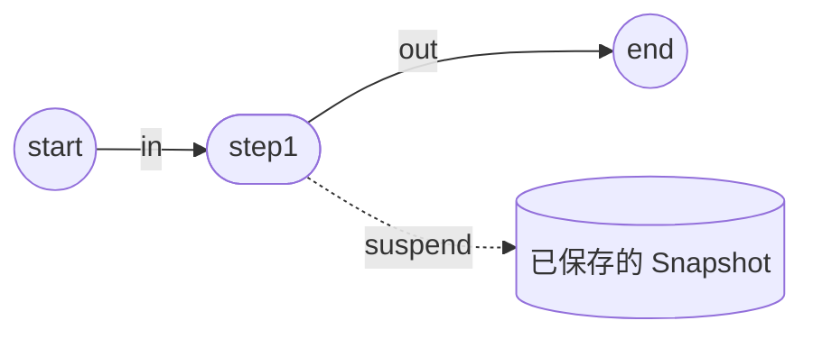

# 挂起与恢复

你可以在任意步骤暂停 Workflow，以收集额外数据、等待 API 回调、限制高成本操作，或请求 [Human-in-the-loop](/docs/workflows/human-in-the-loop) 输入。挂起时，当前执行状态会保存为 Snapshot。之后可从[特定步骤 ID](/docs/workflows/snapshots#retrieving-snapshots) 恢复，准确还原保存时的状态。[Snapshot](/docs/workflows/snapshots) 存储在已配置的 Storage Provider 中，可跨部署和应用重启持久存在。

## 使用 `suspend()` 暂停 Workflow {/* #pausing-a-workflow-with-suspend */}

使用 `suspend()` 在特定步骤暂停 Workflow 执行。可以在步骤的 `execute` 区块中使用 `resumeData` 的值定义挂起条件。

- 如果条件不满足，Workflow 会暂停并返回 `suspend()`。
- 如果条件满足，Workflow 会继续执行步骤中的剩余逻辑。



```typescript {12-14,19-21} title="src/mastra/workflows/test-workflow.ts"
import { createWorkflow, createStep } from '@mastra/core/workflows'
import { z } from 'zod'

const step1 = createStep({
  id: 'step-1',
  inputSchema: z.object({
    userEmail: z.string(),
  }),
  outputSchema: z.object({
    output: z.string(),
  }),
  resumeSchema: z.object({
    approved: z.boolean(),
  }),
  execute: async ({ inputData, resumeData, suspend }) => {
    const { userEmail } = inputData
    const { approved } = resumeData ?? {}

    if (!approved) {
      return await suspend({})
    }

    return {
      output: `Email sent to ${userEmail}`,
    }
  },
})

export const testWorkflow = createWorkflow({
  id: 'test-workflow',
  inputSchema: z.object({
    userEmail: z.string(),
  }),
  outputSchema: z.object({
    output: z.string(),
  }),
})
  .then(step1)
  .commit()
```

## 使用 `resume()` 重新启动 Workflow {/* #restarting-a-workflow-with-resume */}

使用 `resume()` 从暂停的步骤重新启动已挂起的 Workflow。传入与步骤 `resumeSchema` 匹配的 `resumeData`，满足挂起条件并继续执行。


```typescript
import { step1 } from './workflows/test-workflow'

const workflow = mastra.getWorkflow('testWorkflow')
const run = await workflow.createRun()

await run.start({
  inputData: {
    userEmail: 'alex@example.com',
  },
})

const handleResume = async () => {
  const result = await run.resume({
    step: step1,
    resumeData: { approved: true },
  })
}
```

传入 `step` 对象可以为 `resumeData` 提供完整的类型安全。也可以传入步骤 ID；当 ID 来自用户输入或数据库时，这种方式更加灵活。

```typescript
const result = await run.resume({
  step: 'step-1',
  resumeData: { approved: true },
})
```

如果只有一个步骤被挂起，可以完全省略 step 参数，Mastra 会恢复 Workflow 中最后挂起的步骤。

仅使用 `runId` 恢复时，请先使用 `createRun()` 创建 Run 实例。

```typescript
const workflow = mastra.getWorkflow('testWorkflow')
const run = await workflow.createRun({ runId: '123' })

const stream = run.resume({
  resumeData: { approved: true },
})
```

你可以在应用中的 HTTP Endpoint 或事件处理器中调用 `resume()`；计时器和响应[人工输入](/docs/workflows/human-in-the-loop)的代码也能恢复 Workflow。

```typescript
const midnight = new Date()
midnight.setUTCHours(24, 0, 0, 0)

setTimeout(async () => {
  await run.resume({
    step: 'step-1',
    resumeData: { approved: true },
  })
}, midnight.getTime() - Date.now())
```

## 使用 `suspendData` 访问挂起数据 {/* #accessing-suspend-data-with-suspenddata */}

步骤挂起后，你可能希望在稍后恢复时访问传给 `suspend()` 的数据。使用步骤 execute 函数中的 `suspendData` 参数访问这些数据。

```typescript {25-28,32-33} title="src/mastra/workflows/user-approval.ts"
import { createStep } from '@mastra/core/workflows'
import { z } from 'zod'

const approvalStep = createStep({
  id: 'user-approval',
  inputSchema: z.object({
    requestId: z.string(),
  }),
  resumeSchema: z.object({
    approved: z.boolean(),
  }),
  suspendSchema: z.object({
    reason: z.string(),
    requestDetails: z.string(),
  }),
  outputSchema: z.object({
    result: z.string(),
  }),
  execute: async ({ inputData, resumeData, suspend, suspendData }) => {
    const { requestId } = inputData
    const { approved } = resumeData ?? {}

    // On first execution, suspend with context
    if (!approved) {
      return await suspend({
        reason: 'User approval required',
        requestDetails: `Request ${requestId} pending review`,
      })
    }

    // On resume, access the original suspend data
    const suspendReason = suspendData?.reason || 'Unknown'
    const details = suspendData?.requestDetails || 'No details'

    return {
      result: `${details} - ${suspendReason} - Decision: ${approved ? 'Approved' : 'Rejected'}`,
    }
  },
})
```

恢复步骤时，`suspendData` 参数会自动填入原始挂起期间传给 `suspend()` 函数的确切数据。你可以保留 Workflow 挂起原因的上下文，并在恢复过程中使用这些信息。

## 识别已挂起的执行 {/* #identifying-suspended-executions */}

Workflow 挂起后，会从暂停的步骤重新启动。可以检查 Workflow 的 `status` 确认其已挂起，并使用 `suspended` 识别暂停的步骤或[嵌套 Workflow](/docs/workflows/overview#workflows-as-steps)。

```typescript {11}
const workflow = mastra.getWorkflow('testWorkflow')
const run = await workflow.createRun()

const result = await run.start({
  inputData: {
    userEmail: 'alex@example.com',
  },
})

if (result.status === 'suspended') {
  console.log(result.suspended[0])
  await run.resume({
    step: result.suspended[0],
    resumeData: { approved: true },
  })
}
```

### 示例输出 {/* #example-output */}

`suspended` 数组为 Run 中每个已挂起的步骤提供一条路径。路径是从顶层 Workflow 到挂起步骤的一组步骤 ID，可能经过嵌套 Workflow。将整条路径传给 `resume()` 的 `step` 参数，即可恢复对应的执行路径。默认引擎下，即使嵌套 Workflow 的多个并行步骤同时挂起，一次也只会返回其中一条路径；恢复后应再次检查返回的 `suspended` 数组。请将路径视为不可拆解的值，原样传回：不同引擎可能在其中加入重复 ID 或 `.foreach()` 的数字索引。若路径指向挂起的 `.foreach()` 步骤，默认会恢复所有挂起的迭代；如需逐个恢复，请传入 [`forEachIndex`](/reference/workflows/run-methods/resume)。对于嵌套 Workflow 中挂起的步骤，`result.suspended[0]` 如下：

```typescript
['nested-workflow', 'step-1']
```

## 恢复已挂起 Run {/* #recovering-suspended-runs */}

当应用需要从 Storage 恢复已挂起 Run 时，请将 `workflow.getWorkflowRunById()` 与 `createWorkflowStateReader()` 一起使用。Reader 会公开挂起步骤、恢复标签、步骤载荷和步骤输出，无需读取原始 Snapshot 结构。

```typescript title="src/mastra/workflows/recover-run.ts"
import { createWorkflowStateReader } from '@mastra/core/workflows'

const workflow = mastra.getWorkflow('testWorkflow')
const state = await workflow.getWorkflowRunById('run-123')

if (state?.status === 'suspended') {
  const reader = createWorkflowStateReader(state)
  const suspendedStep = reader.getSuspendedStep()
  const approvalLabel = reader.getResumeLabel('approve')
  const run = await workflow.createRun({ runId: state.runId })

  await run.resume({
    step: approvalLabel?.stepId ?? suspendedStep?.path,
    resumeData: { approved: true },
    forEachIndex: approvalLabel?.foreachIndex,
  })
}
```

对于嵌套 Workflow，`suspendedStep.path` 包含恢复路径。对于 `foreach` 挂起，当恢复标签指向特定迭代时，匹配标签会包含 `foreachIndex`。

## Sleep {/* #sleep */}

Sleep 方法可以在 Workflow 层暂停执行，并将状态设为 `waiting`。相比之下，`suspend()` 会在特定步骤中暂停执行，并将状态设为 `suspended`。

**可用方法：**

- [`.sleep()`](/reference/workflows/workflow-methods/sleep)：暂停指定的毫秒数
- [`.sleepUntil()`](/reference/workflows/workflow-methods/sleepUntil)：暂停到指定日期

## 相关内容 {/* #related */}

- [控制流](/docs/workflows/control-flow)
- [Human-in-the-loop](/docs/workflows/human-in-the-loop)
- [Snapshot](/docs/workflows/snapshots)
- [Time Travel](/docs/workflows/time-travel)
- [Workflow 状态 Reader](/reference/workflows/workflow-state-reader)
