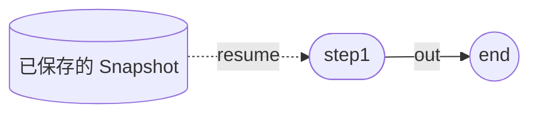

# 暂停和恢复

可以在任意步骤暂停 Workflow，以收集额外数据、等待 API 回调、限制高成本操作的执行频率，或请求[人工输入](/docs/workflows/human-in-the-loop)。暂停时，当前执行状态会保存为快照。之后可以从[指定的步骤 ID](/docs/workflows/snapshots#retrieving-snapshots) 恢复，回到快照记录的准确状态。[快照](/docs/workflows/snapshots)保存在已配置的存储 Provider 中，重新部署或重启应用后仍可使用。

## 使用 `suspend()` 暂停 Workflow {/* #pausing-a-workflow-with-suspend */}

调用 `suspend()` 可在指定步骤暂停执行。可以在该步骤的 `execute` 代码块中，根据 `resumeData` 的值定义暂停条件。

- 条件不满足时，Workflow 暂停，并返回 `suspend()` 的结果。
- 条件满足时，Workflow 继续执行该步骤的剩余逻辑。


```typescript {12-14,19-21} title="src/mastra/workflows/test-workflow.ts"
import { createWorkflow, createStep } from '@mastra/core/workflows'
import { z } from 'zod'

const step1 = createStep({
  id: 'step-1',
  inputSchema: z.object({
    userEmail: z.string(),
  }),
  outputSchema: z.object({
    output: z.string(),
  }),
  resumeSchema: z.object({
    approved: z.boolean(),
  }),
  execute: async ({ inputData, resumeData, suspend }) => {
    const { userEmail } = inputData
    const { approved } = resumeData ?? {}

    if (!approved) {
      return await suspend({})
    }

    return {
      output: `Email sent to ${userEmail}`,
    }
  },
})

export const testWorkflow = createWorkflow({
  id: 'test-workflow',
  inputSchema: z.object({
    userEmail: z.string(),
  }),
  outputSchema: z.object({
    output: z.string(),
  }),
})
  .then(step1)
  .commit()
```

## 使用 `resume()` 恢复 Workflow {/* #restarting-a-workflow-with-resume */}

调用 `resume()` 可从暂停的步骤重新开始执行。传入符合该步骤 `resumeSchema` 的 `resumeData`，以满足继续执行的条件。



```typescript
import { step1 } from './workflows/test-workflow'

const workflow = mastra.getWorkflow('testWorkflow')
const run = await workflow.createRun()

await run.start({
  inputData: {
    userEmail: 'alex@example.com',
  },
})

const handleResume = async () => {
  const result = await run.resume({
    step: step1,
    resumeData: { approved: true },
  })
}
```

传入 `step` 对象可为 `resumeData` 提供完整的类型安全保障。如果 ID 来自用户输入或数据库，也可以直接传入步骤 ID。

```typescript
const result = await run.resume({
  step: 'step-1',
  resumeData: { approved: true },
})
```

如果只有一个步骤处于暂停状态，可以省略步骤参数，Mastra 会从 Workflow 中最后暂停的步骤恢复执行。

如果只有 `runId`，请先调用 `createRun()` 创建运行实例。

```typescript
const workflow = mastra.getWorkflow('testWorkflow')
const run = await workflow.createRun({ runId: '123' })

const stream = run.resume({
  resumeData: { approved: true },
})
```

可以在应用的任意位置调用 `resume()`，例如 HTTP 端点或事件处理函数。定时器和响应[人工输入](/docs/workflows/human-in-the-loop)的代码也可以恢复 Workflow。

```typescript
const midnight = new Date()
midnight.setUTCHours(24, 0, 0, 0)

setTimeout(async () => {
  await run.resume({
    step: 'step-1',
    resumeData: { approved: true },
  })
}, midnight.getTime() - Date.now())
```

## 使用 `suspendData` 获取暂停时的数据 {/* #accessing-suspend-data-with-suspenddata */}

如果恢复步骤时需要获取暂停时传给 `suspend()` 的数据，请在步骤的执行函数中读取 `suspendData` 参数。

```typescript {25-28,32-33} title="src/mastra/workflows/user-approval.ts"
import { createStep } from '@mastra/core/workflows'
import { z } from 'zod'

const approvalStep = createStep({
  id: 'user-approval',
  inputSchema: z.object({
    requestId: z.string(),
  }),
  resumeSchema: z.object({
    approved: z.boolean(),
  }),
  suspendSchema: z.object({
    reason: z.string(),
    requestDetails: z.string(),
  }),
  outputSchema: z.object({
    result: z.string(),
  }),
  execute: async ({ inputData, resumeData, suspend, suspendData }) => {
    const { requestId } = inputData
    const { approved } = resumeData ?? {}

    // On first execution, suspend with context
    if (!approved) {
      return await suspend({
        reason: 'User approval required',
        requestDetails: `Request ${requestId} pending review`,
      })
    }

    // On resume, access the original suspend data
    const suspendReason = suspendData?.reason || 'Unknown'
    const details = suspendData?.requestDetails || 'No details'

    return {
      result: `${details} - ${suspendReason} - Decision: ${approved ? 'Approved' : 'Rejected'}`,
    }
  },
})
```

恢复步骤时，`suspendData` 参数会自动填入最初暂停时传给 `suspend()` 的原始数据。可以用它记录 Workflow 暂停的原因，在恢复时读取这些信息。

## 识别已暂停的执行 {/* #identifying-suspended-executions */}

已暂停的 Workflow 会从暂停的步骤恢复执行。检查 Workflow 的 `status` 可确认它是否暂停，再用 `suspended` 找到暂停的步骤或[嵌套 Workflow](/docs/workflows/overview#workflows-as-steps)。

```typescript {11}
const workflow = mastra.getWorkflow('testWorkflow')
const run = await workflow.createRun()

const result = await run.start({
  inputData: {
    userEmail: 'alex@example.com',
  },
})

if (result.status === 'suspended') {
  console.log(result.suspended[0])
  await run.resume({
    step: result.suspended[0],
    resumeData: { approved: true },
  })
}
```

### 输出示例 {/* #example-output */}

`suspended` 数组为该次运行中每个暂停的步骤保存一条路径。每条路径都是一个步骤 ID 数组，从顶层 Workflow 出发，经过相关的嵌套 Workflow，直到暂停的步骤。将路径传给 `resume()` 的 `step` 参数，即可恢复该路径上的执行。在默认引擎中，即使一个嵌套 Workflow 有多个并行步骤暂停，它每次也只提供一条路径。恢复后，检查返回的 `suspended` 数组，查看是否还有剩余路径。请将每条路径视为不透明值，原样传回。根据引擎的不同，路径可能包含重复的 ID 或数字形式的 `.foreach()` 索引。指向已暂停的 `.foreach()` 步骤的路径会选中所有暂停的迭代。要逐个恢复，请传入 [`forEachIndex`](/reference/workflows/run-methods/resume)。若暂停的步骤位于嵌套 Workflow 内，`result.suspended[0]` 如下：

```typescript
['nested-workflow', 'step-1']
```

## 从存储中找回已暂停的运行 {/* #recovering-suspended-runs */}

应用需要从存储中找回已暂停的运行时，请将 `workflow.getWorkflowRunById()` 与 `createWorkflowStateReader()` 搭配使用。读取器会提供暂停的步骤、恢复标签、步骤载荷和步骤输出，无需直接解析原始快照结构。

```typescript title="src/mastra/workflows/recover-run.ts"
import { createWorkflowStateReader } from '@mastra/core/workflows'

const workflow = mastra.getWorkflow('testWorkflow')
const state = await workflow.getWorkflowRunById('run-123')

if (state?.status === 'suspended') {
  const reader = createWorkflowStateReader(state)
  const suspendedStep = reader.getSuspendedStep()
  const approvalLabel = reader.getResumeLabel('approve')
  const run = await workflow.createRun({ runId: state.runId })

  await run.resume({
    step: approvalLabel?.stepId ?? suspendedStep?.path,
    resumeData: { approved: true },
    forEachIndex: approvalLabel?.foreachIndex,
  })
}
```

对于嵌套 Workflow，`suspendedStep.path` 保存恢复路径。对于 `foreach` 暂停，若匹配的恢复标签指向某次迭代，则该标签包含 `foreachIndex`。

## 休眠 {/* #sleep */}

休眠方法可以在 Workflow 层面暂停执行，并将状态设为 `waiting`。`suspend()` 则会在某个步骤内部暂停执行，并将状态设为 `suspended`。

**可用方法：**

- [`.sleep()`](/reference/workflows/workflow-methods/sleep)：暂停指定的毫秒数。
- [`.sleepUntil()`](/reference/workflows/workflow-methods/sleepUntil)：暂停到指定日期。

## 相关文档 {/* #related */}

- [控制流](/docs/workflows/control-flow)
- [人工参与](/docs/workflows/human-in-the-loop)
- [快照](/docs/workflows/snapshots)
- [时间旅行](/docs/workflows/time-travel)
- [Workflow 状态读取器](/reference/workflows/workflow-state-reader)
