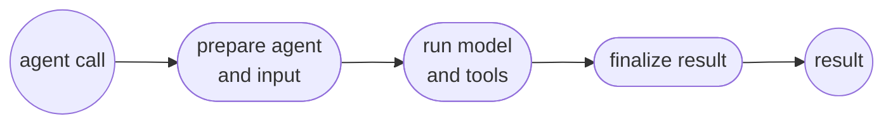

# Agent 生命週期

呼叫 [`generate()`](/reference/agents/generate) 或 [`stream()`](/reference/streaming/agents/stream) 時，Mastra 會開始一次 Agent 執行。它先準備 Agent 和輸入，才呼叫模型。若模型要求使用 Tool，Mastra 會執行 Tool，其後可能再次呼叫模型。工作完成後，Mastra 會整理並傳回結果。

本指南把工作分為準備、迴圈執行及最終處理，並說明[處理器](/docs/agents/processors)何時運作、甚麼會引發另一次模型呼叫，以及一般執行與持久化執行的分別。

## 執行、迭代及模型步驟 {/* #runs-iterations-and-model-steps */}

工作發生在三個層面：

- **執行**：由一次 `generate()` 或 `stream()` 呼叫開始，直至最終結果或錯誤的所有工作；包括持久化執行等待外部輸入時的暫停及恢復。
- **迴圈迭代**：Agent 迴圈的一輪，由模型步驟開始，並涵蓋 Mastra 決定是否繼續前所要求的 Tool 工作。
- **模型步驟**：向模型 Provider 提出的一次請求及其回應，連同該請求前後運作的輸入和輸出處理器。

準備工作視乎執行時上下文及初始輸入處理：

- [`RequestContext`](/docs/server/request-context) 把身份或租戶資料等可信執行時資訊提供給動態設定、處理器和 Tool；當中的值不會自動加入模型提示。
- [`processInput`](/reference/processors/processor-interface#processinput) 在迴圈開始前處理初始訊息，可轉換訊息，亦可建立供往後處理器鉤子及 Tool 使用的狀態。

一次執行包含一次或多次迴圈迭代。模型傳回最終答案時，執行會在目前迭代後停止。模型要求使用 Tool 時，Mastra 會處理結果，之後可能開始下一輪；但已設定的 [`stopWhen`](/reference/agents/generate#parameters) 或終止條件也可能在 Tool 工作後結束執行。每輪迭代通常對應一個模型步驟，但這只是實作行為，不屬穩定契約。

## 生命週期概述 {/* #lifecycle-overview */}

圖中顯示的是三個主要階段，並非內部 Workflow 步驟。準備階段建立首次模型互動；迴圈可多次重複模型與 Tool 工作，最後由最終處理產生結果。一般執行留在現有程序；持久化執行則可儲存狀態，日後恢復。

## 準備 {/* #preparation */}

準備階段把 Agent 定義及目前請求轉為可執行的模型互動。在此階段，Mastra 會：

- 驗證提供的 [`RequestContext`](/docs/server/request-context)。
- 解析模型、指令、Workspace、Skill 及其他動態設定。
- 根據目前輸入及已設定的記憶建立訊息清單。
- 準備迴圈使用的 Tool 和處理器。

準備完成後，執行已備妥首次模型步驟所需的訊息、Tool 及處理器設定，但這些工作並非全按嚴格次序進行。

| 準備工作 | 時間 | 對 `RequestContext` 的影響 |
| - | - | - |
| 驗證、Workspace、模型及指令 | [`processInput`](/reference/processors/processor-interface#processinput) 之前 | 必要的值在執行開始時已須存在。 |
| 供 `processInput` 使用、從記憶、Workspace 及 Skill 產生的處理器實例 | `processInput` 前完成解析 | 在 `processInput` 修改上下文，無法改變這些實例的選取結果。 |
| 動態 Skill 解析 | `processInput` 之前 | Skill 的選取不能依靠首次在 `processInput` 加入的值。 |
| 一般執行中的 Tool 轉換 | 與記憶及輸入準備並行 | 動態 [`tools` 回呼](/reference/agents/agent) 與 `processInput` 之間沒有保證的先後次序。 |
| `processInput` | 初始輸入準備期間執行一次 | 可轉換訊息，並為往後迴圈回呼及 Tool 執行建立狀態。 |
| 迴圈使用的有效輸入、LLM 請求及錯誤處理器工廠 | 一般執行的準備分支匯合後 | 這些工廠可看到較早的上下文變更，但 `processInput` 並非每個解析器都適合使用的設定位置。 |
| 持久化準備 | 持久化迴圈執行前 | 位置與一般路徑不同；恢復執行時也可能略過初始輸入處理。 |

`generate()` 及 `stream()` 先驗證 `RequestContext`，才呼叫 [`getDefaultOptions()`](/reference/agents/getDefaultOptions)。因此，函式形式的預設選項無法及時補上驗證時缺少的必需值。

一般執行會在整個過程中沿用呼叫方的 `RequestContext` 實例。動態設定、處理器及 Tool 執行收到的是同一個即時實例，而非不同副本。修改是否可見，視乎使用方是否已完成解析。

## 選擇設定 `RequestContext` 的邊界 {/* #choose-the-requestcontext-boundary */}

上下文值只能影響尚未發生的工作。請在最早需要該值的可信邊界設定。

例如，應用程式可以檢查用戶的存取權，並得出租戶或帳戶範圍。請在 Agent 外進行檢查，把結果存入新的 `RequestContext`，再將上下文傳給 `generate()` 或 `stream()`。動態設定與 Tool 便可讀取同一可信範圍，毋須再次檢查。

上下文承載授權檢查結果，並不能取代應用程式邊界的授權。

| 值須影響的工作 | 設定時間 | 原因 |
| - | - | - |
| 驗證、模型、指令、Skill、Workspace、供 `processInput` 使用的輸入處理器或動態 Tool | 在 `generate()` 或 `stream()` 前，通常由伺服器中介軟件或呼叫方程式碼設定 | 這些部分會在 `processInput` 前或與其同時完成解析。 |
| 往後迴圈的處理器工廠、處理器鉤子或 Tool 執行 | 可行時在 `generate()` 或 `stream()` 前設定，也可在 `processInput` 設定 | 輸入處理後，這些部分會接收同一個即時上下文。 |
| 已恢復的持久化執行 | 在可信的請求或恢復邊界設定 | 初始輸入處理器未必再執行，不可序列化的值亦須重新建立。 |
| 模型推理 | 放在模型可見的指令或訊息中 | `RequestContext` 是執行時資料，不會自動加入提示。 |

除非有意共用當中的值，否則每項獨立請求應建立各自的上下文。[請求上下文指南](/docs/server/request-context)說明結構描述及伺服器中介軟件。

`processInput` 仍可用於轉換訊息及建立往後迴圈所需的狀態。在此修改的值可供後續處理器鉤子及 Tool 執行使用，卻不能改變初始驗證或已完成的 Skill、輸入處理器解析；動態 Tool 準備也可能已開始。

## Agent 迴圈 {/* #the-agent-loop */}

迴圈處理截至當時累積的訊息。

再次迭代前，Tool 結果會加入累積的訊息；最終答案則離開迴圈，進入最終處理階段。

### 每個模型步驟的處理次序 {/* #around-each-model-step */}

處理器回呼按以下公開次序運作：

1. [`processInputStep`](/reference/processors/processor-interface#processinputstep) 在下一次模型呼叫前接收累積的訊息清單。
1. [`processLLMRequest`](/reference/processors/processor-interface#processllmrequest) 在訊息轉換後接收將送往 Provider 的提示。
1. Provider 以串流傳回回應；[`processOutputStream`](/reference/processors/processor-interface#processoutputstream) 可檢查或轉換每個資料區塊。
1. [`processLLMResponse`](/reference/processors/processor-interface#processllmresponse) 在該步驟的 Provider 串流結束後運作。
1. [`processOutputStep`](/reference/processors/processor-interface#processoutputstep) 在模型步驟後、本機 Tool 執行前運作。
1. 若模型要求使用本機或用戶端 Tool，Mastra 會處理輸入及已設定的審批，然後執行 Tool 或等待結果。
1. [`processToolResult`](/reference/processors/processor-interface#processtoolresult) 在原始結果加入訊息清單前，接收每項本機或用戶端 Tool 結果。

由 Provider 執行的 Tool 可能以不同方式傳回結果。如果延遲的 Provider 結果在往後的模型串流期間到達，`processToolResult` 會在結果到達時運作；它並無固定在每個模型步驟之後的位置。

有關準確的呼叫頻率、可見性保證、參數及傳回類型，請參閱 [Processor 介面的回呼時機](/reference/processors/processor-interface#callback-timing)。

### 哪些變化持續存在 {/* #what-changes-persist */}

各處理器方法修改的資料表示方式不盡相同：

- `processInput` 及 `processInputStep` 操作即時訊息清單。修改可影響後續模型步驟，亦可能由記憶處理器儲存。
- `processLLMRequest` 只修改本次 Provider 呼叫的提示，適合毋須更改已儲存對話紀錄的暫時調整。
- `processOutputStream` 修改串流資料區塊。處理器狀態可在區塊之間，以及同一請求往後的輸出回呼之間傳遞資料。
- `processToolResult` 在原始 Tool 結果加入訊息清單前運作，讓你在後續模型步驟或儲存前驗證或遮蓋內容。
- 最終處理期間，[`processOutputResult`](/reference/processors/processor-interface#processoutputresult) 可修改傳回的訊息及其中繼資料。

## 迴圈如何決定是否繼續 {/* #how-the-loop-decides-to-continue */}

模型步驟及要求的 Tool 工作完成後，Mastra 會判斷是否需要下一輪迭代。Tool 結果往往引發下一次模型呼叫，因為模型須利用結果產生後續回應。

達到已設定的停止條件或終止條件時，迴圈便會停止。條件可能包括：

- 模型傳回不再要求 Tool 的最終回應。
- 依累積步驟評估的自訂 [`stopWhen`](/reference/agents/generate#parameters) 條件。
- [`maxSteps`](/reference/agents/generate#using-maxsteps) 上限。
- 任務完成、目標達成或[子 Agent](/docs/subagents) 委派結果。
- Provider 的終止完成原因、錯誤、處理器阻斷條件或中止。

這些檢查會共同發揮作用，但並不構成公開且完整的內部次序。應把 `maxSteps` 視為模型步驟上限，並用 `stopWhen` 訂立應用程式特定的完成規則。

## 最終處理 {/* #finalization */}

執行停止後進入最終處理。無論正常完成或 Provider 擲出錯誤，`processOutputResult` 都會針對已完成的結果及訊息，每項請求執行一次。訊息未必包含最終 Assistant 回應，例如 `maxSteps` 在 Tool 呼叫時達到上限。

已設定的輸出處理器先運作，自動附加的記憶輸出處理器隨後運作，讓訊息紀錄能保存最終形式。Observational Memory 使用自己的鉤子儲存資料，不依靠自動附加的記憶輸出處理器。最終處理完成後，`generate()` 會完成，或串流會關閉。

最終處理獨立於模型步驟：它處理整次執行的結果，而非單次 Provider 呼叫的回應。

## 錯誤、重試和中止 {/* #errors-retries-and-aborts */}

Provider API 拒絕請求時，錯誤可能進入 `processAPIError`。錯誤處理器可更改請求或訊息，並要求再次嘗試呼叫 Provider。`processAPIError` 重試和阻斷條件重試共用請求層級的 [`maxProcessorRetries`](/reference/agents/generate#parameters) 上限。設定錯誤處理器而未指定 `maxProcessorRetries` 時，Mastra 會採用預設重試額度；需要特定上限時請明確設定 `maxProcessorRetries`。

輸入或輸出處理器呼叫 [`abort()`](/reference/processors/processor-interface#aborting-and-tripwire-chunks) 會觸發阻斷條件。設為 `retry: true` 後，符合條件的輸入步驟或輸出步驟檢查可帶著回饋重新執行模型步驟；次數受 `maxProcessorRetries` 限制。不重試的阻斷條件會停止正常執行，並包含在結果或串流中。

外部中止訊號會傳至 Provider 呼叫及 Tool 生命週期工作。觸發後，迴圈停止繼續、串流終止；如獲支援，部分結果仍會保留。處理器無法恢復的錯誤會傳給呼叫方。

重試設定、阻斷條件及 API 錯誤處理，請參閱[處理器](/docs/agents/processors#retry-mechanism)。

## 一般及持久化執行 {/* #regular-and-durable-runs */}

一般 [`Agent`](/reference/agents/agent) 執行會在現有程序中維持迴圈。程序結束時，記憶體中的執行亦隨之結束。

[持久化 Agent](/docs/harness/durable-agents) 把同一 Agent 迴圈包在 Workflow 內。它保存執行狀態，並透過 PubSub 發佈事件，讓受支援的執行環境恢復工作、用戶端重新連接。如狀態及事件紀錄必須在程序重啟後仍然存在，正式環境便需要持久化後端。

持久化執行可暫停，例如 Tool 等待審批時；其後可跨越一般程序內執行所沒有的序列化邊界，從已儲存狀態恢復。

Mastra 會為持久化工作保存可序列化 `RequestContext` 項目的快照。函式、類別實例、開啟的連線等不可序列化的值，在暫停或傳送到其他程序後都不應預期仍然存在。請在可信的請求或恢復邊界，根據穩定標識重新建立。

持久化執行從已儲存快照恢復時，會略過初始 `processInput` 處理。訊號喚醒和排程喚醒等開始新階段的喚醒，則會重新執行。

- 每次由外部請求恢復執行時，都要重新進行具權威性的資料補充。
- 只儲存後續流程需要的可序列化範圍資訊。
- 不要依賴只執行一次的 `processInput` 副作用。

## 延伸閱讀 {/* #what-to-read-next */}

- [請求上下文](/docs/server/request-context)：定義、驗證及填入執行時上下文。
- [身份驗證及身份資訊](/docs/guides/authentication-identity)：避免把可信身份與授權資料放入模型可控制的輸入。
- [處理器](/docs/agents/processors)：設定處理器、重試及阻斷條件。
- [Processor 介面](/reference/processors/processor-interface)：查閱回呼參數及傳回值。
- [Tool](/docs/agents/tools)：設定 Tool 執行、審批及生命週期鉤子。
- [持久化 Agent](/docs/harness/durable-agents)：保存並恢復長時間執行的 Agent。
