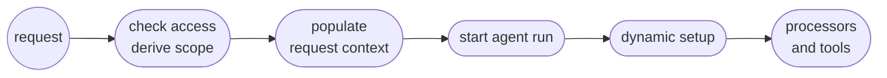
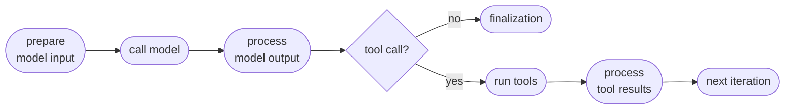

# Agent生命週期

當你打電話時[`generate()`](/reference/agents/generate)或者[`stream()`](/reference/streaming/agents/stream)，Mastra 啟動Agent程式運行。它在調用模型之前準備Agent及其輸入。如果模型請求一個Tool，Mastra 會運行它並可能再次呼叫該模型。工作完成後，Mastra 完成並傳回結果。

本指南將這項工作分解為準備、循環執行和完成。它解釋了在哪裡[processors](/docs/agents/processors) run, what can cause another model call, and how regular and durable runs differ.

## 運行、迭代和模型步驟 {/* #runs-iterations-and-model-steps */}

工作發生在三個層面：

* **跑步**：所有工作均由一次呼叫開始`generate()` or `stream()` through the final result or error, including any pause and resume while durable execution waits for external input.
* **循環迭代**：一次透過Agent循環，從模型步驟開始，並在 Mastra 決定是否繼續之前包含任何請求的Tool工作。
* **模型步驟**：對模型提供者的一個請求及其回應，以及圍繞該請求運行的輸入和輸出處理器。

準備工作取決於運行時上下文和初始輸入處理​​：

* [`RequestContext`](/docs/server/request-context)將受信任的執行時間資料（例如身分或租用戶資訊）攜帶到動態配置、處理器和Tool，但其值不會自動包含在模型提示中。
* [`processInput`](/reference/processors/processor-interface#processinput)在循環開始之前處理初始訊息，它可以在其中轉換這些訊息並建立稍後處理器掛鉤和Tool使用的狀態。

一次運行包含一次或多次循環迭代。當模型返回最終答案時，它會在當前迭代之後停止。當模型請求Tool時，Mastra 會處理結果並可能開始另一次迭代，除非已配置[`stopWhen`](/reference/agents/generate#parameters) or terminal condition ends the run after tool work. An iteration commonly coincides with one model step, but treat that pairing as implementation behavior rather than a stable contract.

## 生命週期概述 {/* #lifecycle-overview */}

此圖顯示了三個主要階段，而不是內部Workflow步驟。準備創建第一個模型互動。在最終確定產生結果之前，循環可能會重複模型和Tool工作多次。常規運行會在目前進程中繼續運行，而持久運行可以保存其狀態並在以後恢復。

## 準備 {/* #preparation */}

準備工作將Agent定義和當前請求轉變為可運行的模型交互作用。在此階段，馬斯特拉：

* [`RequestContext`](/docs/server/request-context).
* 解析模型、指令、Workspace、技能和其他動態配置。
* 從目前輸入和配置的記憶體建立訊息列表。
* 準備循環期間使用的Tool和處理器。

在準備結束時，運行具有第一個模型步驟所需的訊息、Tool和處理器配置，儘管這些任務並非全部以嚴格的順序發生。

|準備工作|時間 |這意味著什麼`RequestContext` |
| - | - | - |
| Validation, workspace, model, and instructions | Before [`processInput`](/reference/processors/processor-interface#processinput) | Required values must already exist when the run starts. |
| Memory-, workspace-, and skills-derived processor instances used for `processInput` | Resolved before `processInput` | A context change inside `processInput` can't change how these instances were selected. |
| Dynamic skill resolution | Before `processInput` | Skill selection can't depend on a value first added by `processInput`. |
| Tool conversion in a regular run | In parallel with memory and input preparation | A dynamic [`tools` callback](/reference/agents/agent) has no guaranteed ordering relative to `processInput`. |
| `processInput` | Once during initial input preparation | It can transform messages and establish state for later loop callbacks and tool execution. |
| Effective input, LLM-request, and error processor factories used by the loop | After the regular preparation branches join | These factories can observe earlier context changes, but `processInput` isn't a safe setup point for every resolver. |
| Durable preparation | Before durable loop execution | Its placement differs from the regular path, and resumed work may skip initial input processing. |

`generate()`和`stream()` validate `RequestContext` before calling [`getDefaultOptions()`](/reference/agents/getDefaultOptions). A function-based default option therefore can't add a missing required value in time for validation.

在常規運行中，Mastra 會重複使用呼叫者的`RequestContext` instance throughout execution. Dynamic configuration, processors, and tool execution receive that live instance rather than separate copies. Whether a change is visible depends on whether the consumer has already resolved.

## 選擇`RequestContext` boundary {/* #choose-the-requestcontext-boundary */}

上下文值只能影響尚未發生的工作。將每個值設定在需要它的最早的可信邊界處。

例如，應用程式可以檢查使用者的存取權限並得出租用戶或帳戶範圍。在Agent外部執行該檢查，將結果儲存在新的`RequestContext`, then pass the context to `generate()` or `stream()`. Dynamic configuration and tools can read the same trusted scope without performing the check again.

上下文攜帶授權檢查的結果。它不會取代應用程式邊界的授權。

|該值必須影響 |建立它|為什麼 |
| - | - | - |
|所使用的驗證、模型、指令、技能、工作空間、輸入處理器`processInput`, or dynamic tools | Before `generate()` or `stream()`, usually in server middleware or caller code | These consumers resolve before or concurrently with `processInput`. |
| Later loop processor factories, processor hooks, or tool execution | Before `generate()` or `stream()` when practical, or in `processInput` | These consumers receive the same live context after input processing. |
| Resumed durable work | At the trusted request or resume boundary | Initial input processors may not run again, and non-serializable values must be reconstructed. |
| Model reasoning | In model-visible instructions or messages | `RequestContext` is runtime data and isn't automatically added to the prompt. |

除非您有意共享其值，否則為每個獨立請求建立一個上下文。這[Request context guide](/docs/server/request-context) explains schemas and server middleware.

`processInput`對於循環中稍後所需的訊息轉換和狀態仍然有用。那裡的更改可以影響以後的處理器掛鉤和Tool執行。它無法更改初始驗證或已完成的技能和輸入處理器分辨率，並且動態Tool準備可能已經在運行。

## Agent循環 {/* #the-agent-loop */}

該循環處理迄今為止累積的消息。

Tool結果在另一次迭代之前加入累積的訊息，而最終答案則離開循環進行最終確定。

### 圍繞每個模型步驟 {/* #around-each-model-step */}

處理器回調會依照以下公共順序運作：

1. [`processInputStep`](/reference/processors/processor-interface#processinputstep)在下一次模型呼叫之前接收累積的訊息清單。
2. [`processLLMRequest`](/reference/processors/processor-interface#processllmrequest)訊息轉換後接收面向提供者的提示。
3. 提供者串流其回應，並且[`processOutputStream`](/reference/processors/processor-interface#processoutputstream) can inspect or transform each chunk.
4. [`processLLMResponse`](/reference/processors/processor-interface#processllmresponse)此步驟的提供者流程完成後執行。
5. [`processOutputStep`](/reference/processors/processor-interface#processoutputstep)在模型步驟之後、本地執行的Tool之前執行。
6. 如果模型請求本地或用戶端Tool，Mastra 會處理他們的輸入並處理任何配置的批准。然後它執行該Tool或等待其結果。
7. [`processToolResult`](/reference/processors/processor-interface#processtoolresult)在原始結果進入訊息清單之前接收每個本機或用戶端Tool結果。

提供者執行的Tool可以傳回不同的結果。如果延遲的提供程序結果在稍後的模型流期間到達，`processToolResult` runs when that result arrives. It doesn't have one universal position after every model step.

[callback timing in the Processor interface](/reference/processors/processor-interface#callback-timing).

### 哪些變化持續存在 {/* #what-changes-persist */}

處理器方法並非都修改相同的表示：

* `processInput`和`processInputStep` work with the live message list. Their changes can affect later model steps and may be saved by memory processors.
* `processLLMRequest`僅更改為該提供者呼叫發送的提示。將其用於面向提供者的臨時更改，這些更改不應更改儲存的對話歷史記錄。
* `processOutputStream`更改流式传输块。處理器狀態可以跨區塊攜帶數據，並為相同請求稍後輸出回調。
* `processToolResult`在原始Tool結果進入訊息清單之前運行，允許在後續模型步驟或持久性之前進行驗證或編輯。
* 在最終確定過程中，[`processOutputResult`](/reference/processors/processor-interface#processoutputresult) can change returned messages and their message metadata.

## 循環如何決定繼續 {/* #how-the-loop-decides-to-continue */}

在模型步驟和任何請求的Tool工作之後，Mastra 決定運行是否需要另一次迭代。Tool結果通常會導致另一個模型調用，因為模型必須使用這些結果來產生下一個響應。

當達到配置或終止條件時，循環停止。這些條件可以包括：

* 不需要其他Tool的最終模型響應。
* 客製化[`stopWhen`](/reference/agents/generate#parameters) condition evaluated against accumulated steps.
* 這[`maxSteps`](/reference/agents/generate#using-maxsteps) limit.
* 任務完成、目標或[subagent](/docs/subagents) delegation outcomes.
*

這些檢查一起發揮作用，而不是形成一個公開的、詳盡的內部秩序。對待`maxSteps` as a bound on model steps and use `stopWhen` for application-specific completion rules.

## 最終確定 {/* #finalization */}

停止使跑步進入最終階段。`processOutputResult` runs once per request on the completed result and messages, whether the run completes normally or the provider throws. Those messages may not include a final assistant response, such as when `maxSteps` ends on a tool call.

配置的輸出處理器首先運行，然後自動連接的記憶體輸出處理器在它們之後運行，以便訊息歷史記錄可以保留最終形式。觀察記憶堅持自己的掛鉤，而不是依賴自動附加的記憶輸出處理器。當最終完成時，`generate()` resolves or the stream closes.

最終確定與模型步驟是分開的。它對整個運行的結果進行操作，而不是對一個提供者呼叫的回應進行操作。

## 錯誤、重試和中止 {/* #errors-retries-and-aborts */}

提供者 API 拒絕可以達到`processAPIError`. An error processor may change the request or messages and request another provider attempt. `processAPIError` retries and tripwire retries share the same [`maxProcessorRetries`](/reference/agents/generate#parameters) bound on the request. When error processors are configured and `maxProcessorRetries` is omitted, Mastra applies a default error-retry budget. Set `maxProcessorRetries` explicitly when you need a specific limit.

呼喚[`abort()`](/reference/processors/processor-interface#aborting-and-tripwire-chunks) from an input or output processor raises a tripwire. Set `retry: true` to let an eligible input-step or output-step check replay the model step with feedback. `maxProcessorRetries` bounds replay attempts. A tripwire without a retry stops normal execution and is included in the result or stream.

外部中止訊號透過提供者呼叫和工俱生命週期來運作。觸發後，它會停止進一步的循環執行並終止流，同時保留支援的部分結果。處理器無法恢復的錯誤會傳播到呼叫者。

看[Processors](/docs/agents/processors#retry-mechanism) for retry configuration, tripwires, and API error handling.

## 定期且持久的運行 {/* #regular-and-durable-runs */}

一個常規的[`Agent`](/reference/agents/agent) run keeps the loop in the current process. If that process ends, the in-memory execution ends with it.

一個[durable agent](/docs/harness/durable-agents) wraps the same agent loop in a workflow. It persists run state and publishes events through PubSub so supported runtimes can recover work and clients can reconnect. Persistent production backends are required when that state and event history must survive process restarts.

持久執行還允許暫停運行（例如在Tool等待批准時），並稍後從儲存的狀態跨常規進程內運行中不存在的序列化邊界恢復。

Mastra 快照可序列化`RequestContext` entries for durable work. Functions, class instances, open connections, and similar non-serializable values shouldn't be expected to survive either suspension or transport into another process. Reconstruct them from stable identifiers at a trusted request or resume boundary.

最初的`processInput` processing is skipped when a durable run resumes from a stored snapshot. Wakes that start a fresh segment, including signal and schedule wakes, run it again.

* 每當外部請求恢復運作時，請重複權威豐富步驟。
* 僅儲存下游所需的可序列化範圍。
* `processInput` side effect.

## 接下來讀什麼 {/* #what-to-read-next */}

* [請求上下文](/docs/server/request-context)：定義、驗證和填滿運行時上下文。
* [身份驗證和身份](/docs/guides/authentication-identity)：將可信任身分和授權資料保留在模型控制的輸入之外。
* [處理器](/docs/agents/processors)：配置處理器、重試和絆線。
* [處理器介面](/reference/processors/processor-interface)：查看回調參數和傳回值。
* [Tool](/docs/agents/tools)：配置Tool執行、審核和生命週期掛鉤。
* [持久劑](/docs/harness/durable-agents)：堅持並恢復長時間運行的Agent執行。
