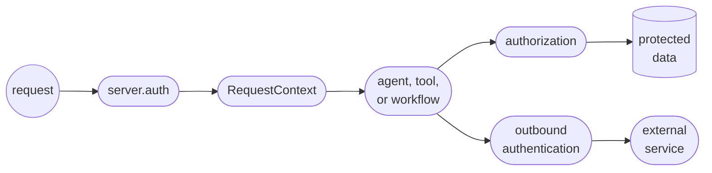

# 身分驗證與身分資料

了解如何保護應用程式中的 API 端點、Studio 和 Agent 呼叫。必須以程式碼限制存取，因為 LLM 很容易繞過系統提示詞中的表面檢查。

身分驗證確認誰在呼叫 Mastra 伺服器。身分資料是與請求相關聯、已驗證的用戶或服務帳戶。Mastra 會在運行時程式碼中傳遞此身分，讓各元件作出可信的存取決策。

可以從四個階段設計這條身分鏈：

| 階段 | 要回答的問題 | Mastra 機制 |
| - | - | - |
| 身分驗證 | 誰在呼叫？ | [`server.auth`](/docs/auth/overview) |
| 身分傳遞 | 已驗證的身分如何進入運行時程式碼？ | [`RequestContext`](/docs/server/request-context) |
| 授權 | 呼叫者可以存取或執行甚麼？ | 應用程式檢查、以角色為本的存取控制（RBAC）或[細粒度授權（FGA）](/docs/auth/fga) |
| 對外驗證 | Mastra 存取其他服務時應使用哪種憑證？ | 可信的 Tool 程式碼或 Model Context Protocol（MCP）連線設定 |

## 設計身分流程 {/* #design-the-identity-flow */}

讓身分判斷留在應用程式的可信一方。呼叫者可以提供憑證，但只有驗證 Provider 能決定該憑證代表哪位用戶。運行時元件會使用由伺服器管理的背景資料，授權資料存取或選擇對外憑證。



此流程建立四道邊界：

- **傳入資料：** 驗證成功前，所有請求資料都應視為不可信。
- **身分背景：** 由伺服器管理 `RequestContext` 中保留的身分值。
- **Tool 輸入：** 不讓模型控制的輸入決定資源所屬範圍。
- **外部憑證：** 把憑證保留在可信的運行時程式碼中，不放進模型輸入或 Tool 輸出。

## 建立可信任身份 {/* #establish-trusted-identity */}

使用[驗證 Provider](/docs/auth/overview) 或 `authenticateToken` 函式設定 `server.auth`。設定驗證後，內置路由和自訂路由都要求有效用戶，除非路由明確選擇不驗證。

從驗證器取得固定的身分識別碼，並把它對應至運行時的資源所屬邊界。

```typescript title="src/mastra/index.ts"
import { Mastra } from '@mastra/core'
import { verifyAccessToken } from './lib/auth'

type AuthUser = {
  id: string
  workspaceId: string
}

export const mastra = new Mastra({
  server: {
    auth: {
      authenticateToken: async token => verifyAccessToken(token),
      mapUserToResourceId: (user: AuthUser) => `${user.workspaceId}:${user.id}`,
    },
  },
})
```

請使用已驗證 Provider 提供的標準識別碼，因為顯示名稱和其他可變的個人資料欄位不適合作為所屬權鍵。請加入足夠的範圍資料，避免不同租戶和身分系統之間衝突。

若[自訂 API 路由](/docs/server/custom-api-routes#authentication)必須公開，請設定 `requiresAuth: false`。公開的 Webhook 在信任請求本文前，仍須驗證 Provider 簽署。

:::warning

未設定 `server.auth` 時，Mastra 路由是公開的。正式環境部署必須為所有不應匿名存取的伺服器入口設定驗證。若設定了自訂 `server.apiPrefix`，亦須更新驗證路徑設定以使用該前綴。

:::

## 選擇資源邊界 {/* #choose-the-resource-boundary */}

Mastra 驗證呼叫者後，需要決定誰擁有其 Memory 和 Thread。資源 ID 是該擁有者的固定識別碼，Mastra 會用它限定狀態範圍。憑證用來驗證身分，授權規則用來授予權限。

例如，假設兩位用戶都要求 ID 為 `support` 的 Thread。若各自的用戶 ID 就是資源 ID，Mastra 會因擁有者不同而分隔 Thread。若兩人都對應至同一機構 ID，便會共用機構的 Memory 和 Thread。

使用 `mapUserToResourceId` 從已驗證的用戶推導資源 ID。驗證成功後，Mastra 會：

- 以已驗證的用戶呼叫 `mapUserToResourceId`。
- 把結果以伺服器管理的值存入 `RequestContext`。
- 使用該值限定 Memory 和 Thread 操作的範圍。
- 忽略用戶端提供的衝突資源 ID。

:::warning

若已設定 `server.auth` 卻沒有設定 `mapUserToResourceId`，就不會有伺服器推導的資源 ID。此時內置路由會使用請求本身提供的資源 ID（例如請求本文中的 `memory.resource`），因此任何已驗證的呼叫者都可以讀寫任意資源 ID 下的 Thread。Mastra 會在啟動時對此發出警告。若多位用戶共用同一部署，務必設定 `mapUserToResourceId`。

:::

選擇符合狀態共享方式的最小邊界：

| 所需邊界 | 對應例子 |
| - | - |
| 每位用戶獨享 Memory | `user.id` |
| 機構共享 Memory | `user.organizationId` |
| 工作區和項目內的用戶 Memory | `${workspaceId}:${projectId}:${userId}` |

Mastra 會自動把此邊界套用至 Memory 和 Thread 操作，包括 Observational Memory。若請求的 Thread 屬於其他資源，或被 [FGA](/docs/auth/fga) 檢查拒絕，`GET /api/memory/observational-memory`、`POST /api/memory/observational-memory/buffer-status` 及 `GET /api/memory/status` 中的 Observational Memory 詳情均會傳回 `403`。未設定 `server.auth` 時，這些路由使用用戶端提供的 `resourceId` 和 `threadId`；但若 Thread 實際屬於其他 `resourceId`，仍會傳回 `403`。應用程式碼授權資料庫紀錄或外部服務時，可繼續使用 `RequestContext` 中的已驗證用戶。

### 來自 JWT 提供者的用戶 ID {/* #user-ids-from-jwt-providers */}

[`MastraJwtAuth`](/reference/auth/jwt)、[Auth0](/reference/auth/auth0) 和 [Clerk](/reference/auth/clerk) 在 Token 沒有 `id` 聲明時，會把已驗證用戶的 `id` 設為 Token 的 `sub` 聲明；若 Token 本身有 `id` 聲明，則保留該值。RBAC 按 `id` 載入角色；未設定 `mapUserToResourceId` 時，`id` 亦是用戶所建立紀錄的擁有者。

未設定 `mapUserToResourceId` 時，這代表：

- 每位用戶可看到自己擁有的已儲存 Agent、Skill、Workspace 等紀錄，以及公開紀錄。他們建立的紀錄由自己擁有，預設不公開。應用程式使用這些用戶 ID 前建立的紀錄沒有擁有者，仍對所有人可見。具有 `stored-agents:admin` 等管理員權限的用戶仍可查看所有紀錄。
- 每位作者的 Tool Provider 連線按用戶 `id` 儲存。以共享的 `default` 擁有者儲存的連線不會被找到，因此用戶須重新連線。共享連線不受影響。
- 回饋會把用戶 `id` 記錄為用戶 ID。

若要讓所有用戶共用一個資源，請向驗證 Provider 傳入 `mapUserToResourceId: () => 'default'`。這亦會讓所有用戶共享 Memory 和擁有者紀錄，因此只應在符合應用程式需求時使用。

## 在資料邊界落實身分控制 {/* #enforce-identity-at-the-data-boundary */}

授權應由可信程式碼執行，並盡量靠近受保護的操作。可信的運行時程式碼可以從 `RequestContext` 中已驗證的用戶推導資源所屬權，而非依靠模型產生的 Tool 輸入：

```typescript title="src/mastra/tools/list-orders.ts"
import { createTool } from '@mastra/core/tools'
import { z } from 'zod'
import { orders } from '../lib/orders'

type AuthenticatedUser = {
  id: string
}

export const listOrders = createTool({
  id: 'list-orders',
  description: 'List orders owned by the authenticated user',
  inputSchema: z.object({ status: z.enum(['open', 'shipped']).optional() }),
  execute: async ({ status }, { requestContext }) => {
    const user = requestContext.get('user') as AuthenticatedUser | undefined

    if (!user?.id) {
      throw new Error('Authenticated user is missing')
    }

    return orders.list({ ownerId: user.id, status })
  },
})
```

模型可以選擇 `status`，但不能選擇 `ownerId`。

自訂路由和 Workflow 步驟亦應遵循相同規則：從已驗證的背景資料推導資源所屬權，再限制資料庫查詢或服務呼叫，最後傳回資料。

## 在運行時程式碼中傳遞身分 {/* #carry-identity-through-runtime-code */}

驗證中介軟件會在處理函式執行前，把可信身分寫入 `RequestContext`。然後 Mastra 會把同一背景資料傳給：

- **Agent 選項：** 解析針對請求的 Agent 設定。
- **Tool 執行：** 在 `execute` 回調中讀取身分。
- **Workflow 步驟：** 在步驟的 `execute` 回調中讀取身分。
- **伺服器處理函式：** 在中介軟件和自訂 API 路由中讀取身分。

透過 `requestContext.get()` 讀取應用程式自訂鍵。[RequestContext 指南](/docs/server/request-context)介紹可用的元件 API、中介軟件模式，以及進階整合使用的保留運行時鍵。

`RequestContext` 不是隱含的全域狀態。在 Mastra 伺服器請求路徑以外啟動 Agent 或 Workflow 時，請明確傳入。

:::tip

身分可用於個人化指令和選擇可用 Tool，但這些選擇並非授權檢查。必須在接觸受保護資源的元件或 FGA 政策中執行存取控制。

:::

## 按可信身分選擇對外憑證 {/* #select-outbound-credentials-from-trusted-identity */}

傳入的驗證 Token 和下游服務憑證解決的是不同問題：

- **轉送 Token：** 外部服務信任傳給 Mastra 的同一個 Bearer Token。
- **選擇憑證：** 已驗證用戶所屬的租戶決定使用應用程式儲存的另一組憑證。

只在接收服務本來就應信任該 Token 時才轉送，例如呼叫接受呼叫者本人 Token 的服務。MCP 伺服器不能把收到的 MCP Token 轉送給其他 API。對多租戶服務，應改在可信的 Tool 程式碼中解析租戶範圍的憑證：

```typescript title="src/mastra/tools/list-invoices.ts"
import { createTool } from '@mastra/core/tools'
import { z } from 'zod'

import { billing, tenantCredentials } from '../lib/billing'

type AuthenticatedUser = {
  organizationId: string
}

export const listInvoices = createTool({
  id: 'list-invoices',
  description: 'List invoices for the authenticated tenant',
  inputSchema: z.object({ limit: z.number().int().min(1).max(100).default(20) }),
  execute: async ({ limit }, { requestContext }) => {
    const user = requestContext.get('user') as AuthenticatedUser | undefined

    if (!user?.organizationId) {
      throw new Error('Authenticated organization is missing')
    }

    const credential = await tenantCredentials.getBillingToken(user.organizationId)
    return billing.listInvoices({ limit, token: credential.token })
  },
})
```

憑證 Provider 應對未知資源拒絕存取，並傳回最小權限憑證。錯誤訊息中不要包含機密。模型只提供 `limit` 等業務輸入；可信程式碼負責選擇租戶和憑證。

應用程式連接外部 MCP 伺服器時亦遵循同一模式：按已驗證用戶的租戶選擇已儲存的憑證。若 MCP 伺服器接受呼叫者本人的 Token，則從 `MASTRA_AUTH_TOKEN_KEY` 讀取專供該服務使用的 Token，而非使用已儲存憑證。只向 Agent 開放最終取得的 Tool。這是對外憑證：MCP 伺服器不得把收到的 MCP Token 轉送給其他 API。用戶端設定請參閱 [MCP 連線](/docs/connections/mcp)；受眾邊界請參閱[安全存取上游服務](/docs/guides/mcp-authentication-authorization#access-upstream-services-safely)。

## 將身分轉送至 MCP Tool {/* #forward-identity-to-mcp-tools */}

MCP 憑證、委派存取和 Tool 權限之間的分別，請參閱 [MCP 身分驗證與授權](/docs/guides/mcp-authentication-authorization)。

預設情況下，`MCPServer` 位於 `server.auth` 後面時，Mastra 會把已驗證的呼叫者放入 MCP `authInfo` 物件。伺服器 Tool 可直接使用此身分，毋須重新解析請求：

```typescript title="src/mastra/tools/get-customer-record.ts"
import { createTool } from '@mastra/core/tools'
import { z } from 'zod'

import { customers } from '../lib/customers'

export const getCustomerRecord = createTool({
  id: 'get-customer-record',
  description: 'Get the authenticated customer record',
  inputSchema: z.object({}),
  execute: async (_input, { mcp }) => {
    const user = mcp?.extra.authInfo?.extra?.user as { id?: string } | undefined

    if (!user?.id) throw new Error('Authenticated MCP caller is missing')
    return customers.getByUserId(user.id)
  },
})
```

本例使用預設的橋接方式。Mastra 會先保留中介軟件設定的任何 `req.auth` 值。否則，若已設定 `server.mcpOptions.setRequestAuth`，它會定義 `authInfo` 的結構。無論哪個來源提供 `req.auth`，都必須包含 MCP Tool 要讀取的欄位。

`setRequestAuth` 和上游中介軟件只控制 `authInfo`。只要設定了 `req.auth`，Mastra 亦會透過 Tool 的 `requestContext`，向 MCP Tool 提供伺服器驗證解析出的用戶、權限、角色、資源和機構。這些值來自伺服器程式碼，而非 MCP 用戶端；即使 `authInfo` 指向另一個主體，亦不會改變這些值。每個 Tool 應一致地從同一來源讀取身分。

若設定的 `MCPServer.mapAuthInfoToUser` 傳回用戶，該用戶會取代細粒度授權所讀取的 `requestContext.get('user')`。權限、角色、資源和機構仍保留伺服器驗證解析出的值。

當 MCP 傳輸層身分需要轉為[細粒度授權](/docs/auth/fga)使用的用戶時，`MCPServer.mapAuthInfoToUser` 會執行反向對應。請在傳輸邊界完成對應，不要把用戶 ID 當作 Tool 參數接收。

## 把機密留在模型邊界之外 {/* #keep-secrets-outside-the-model-boundary */}

`RequestContext` 和 Tool 執行均在可信的應用程式碼中運作。模型不會自動收到其中的內容。

| 資料 | 可信的運行時程式碼 | 模型 |
| - | - | - |
| `RequestContext` 中已驗證的用戶 | 可用 | 只在應用程式碼把它加入指令或結果時可見 |
| `MASTRA_AUTH_TOKEN_KEY` 中的原始 Token | 可用 | 不得放入提示詞或 Tool 結果 |
| 租戶 API 金鑰和服務憑證 | 解析憑證的程式碼可用 | 不得放入模型可見的資料 |
| Tool 參數 | 視為不可信輸入 | 通常由模型選擇 |
| Tool 結果 | 可用 | 通常會傳回給模型 |

只傳回模型所需的資料。傳回 Tool 結果前，請移除憑證和敏感的上游欄位。

當請求背景資料附加至 Trace Span 或儲存於評分紀錄時，以 `mastra__` 或 `__mastra_` 開頭的 Mastra 保留鍵（包括 `MASTRA_AUTH_TOKEN_KEY`）會被省略。應用程式日誌和自訂遙測亦須對其他憑證及敏感身分欄位採用相同原則。

## 驗證後加入授權 {/* #add-authorization-after-authentication */}

按資源類型選擇授權層：

| 需求 | 使用方式 |
| - | - |
| 管理員、成員、檢視者等角色的廣泛權限 | `server.rbac` |
| 取決於用戶與資源關係的權限 | `server.fga` |
| 應用程式資料庫紀錄的所屬權 | 限定範圍的查詢或應用程式授權檢查 |

缺少或無效的身分會傳回 `401`；已知身分但沒有權限會傳回 `403`。詳細設定請參閱 [FGA 指南](/docs/auth/fga)。

:::tip[📹 觀看]

觀看 [FGA 正式環境實作示範](https://www.youtube.com/watch?v=aT2viVoHs7A)，了解 FGA 如何在已部署的應用程式中運作。

:::

## 上線前驗證 {/* #verify-before-production */}

- [ ] **拒絕匿名請求：** 確認所有受保護的伺服器入口在沒有憑證時傳回 `401`。
- [ ] **拒絕無效憑證：** 確認驗證失敗不會填入可信的 `RequestContext` 值。
- [ ] **驗證公開的 Webhook：** 信任請求本文前先檢查 Provider 簽署。
- [ ] **保護 Thread 所屬權：** 確認用戶無法存取其他用戶的 Thread。
- [ ] **忽略所屬權輸入：** 防止 Tool 輸入取代伺服器管理的身分或範圍。
- [ ] **拒絕未授權存取：** 確認執行層對沒有權限的已知用戶傳回 `403`。
- [ ] **安全選擇憑證：** 根據可信身分而非模型控制的輸入，解析下游憑證。
- [ ] **保護機密：** 確認機密不會進入模型可見資料或可觀測性資料。
- [ ] **明確傳遞背景資料：** 在直接呼叫 Agent 和 Workflow 的測試中提供可信的 `RequestContext` 值。

在 Studio 中手動測試時，請使用[請求背景預設](/docs/server/request-context#studio)。本機開發以外請使用正式環境驗證。
