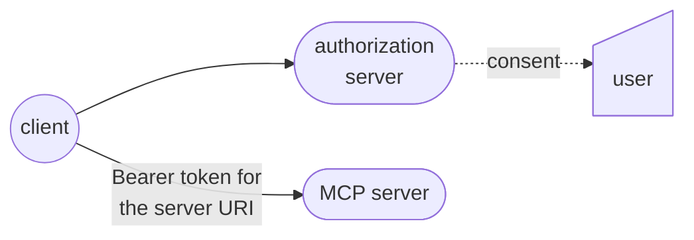

# MCP 身分驗證與授權

Mastra 應用程式可以連接其他人受保護的 MCP 伺服器，也可以向第三方客戶端開放自己的工具和資料。這兩個方向所需的憑證及檢查各有不同。

不論方向如何，MCP 連線都會跨越多重保安邊界：驗證呼叫者身分，不代表已決定他可以讀取哪些客戶紀錄；獲准連線，也不代表每項工具操作都獲授權。憑證、委託存取及應用程式權限需要分開處理。

本指南說明 Mastra 作為 MCP 客戶端和伺服器時，如何作出這些判斷。協定要求參照 [2026 年 7 月 28 日的 MCP 授權規範](https://modelcontextprotocol.io/specification/2026-07-28/basic/authorization)。

## 理解保安邊界 {/* #understand-the-boundaries */}

以下三項決定各自回答不同問題：

- **身分驗證**：核實呼叫者是誰，例如用戶或服務帳戶。
- **委託存取**：讓客戶端運用授權伺服器授予的存取權。OAuth 存取權杖只授權存取其指定資源，並非通用的身分憑證。
- **應用程式授權**：決定呼叫者可否對資料執行某項操作，例如更新其所屬機構的發票。

在 HTTP OAuth 流程中，這些是不同角色，並非同一項服務：

MCP 伺服器是受保護資源，不一定負責讓用戶登入。授權伺服器簽發權杖，亦可以與 MCP 伺服器分開運作。客戶端取得並提交權杖。在用戶委託存取的流程中，授權伺服器按需要與用戶互動，完成身分驗證及同意授權；並非每個流程都需要用戶參與。

應用程式位於圖中的哪個位置，決定它要管理哪些憑證。透過 [`MCPClient`](/reference/tools/mcp-client)，Mastra 應用程式連接另一個 MCP 伺服器；透過 [`MCPServer`](/reference/tools/mcp-server)，應用程式則向其他客戶端提供功能。同一應用程式可以兼任兩者，但傳入和傳出的憑證保障的是不同邊界。

MCP 授權屬可選功能。對 HTTP 傳輸而言，支援授權的實作應遵從規範。採用 stdio 的實作應改為從環境取得憑證，不應使用這套 HTTP 授權流程。應先選定傳輸方式，再選擇憑證機制。

## 連接受保護的 MCP 伺服器 {/* #connect-to-protected-mcp-servers */}

應按遠端伺服器需要管控誰的存取權，選用相應憑證：

| 存取模式 | Mastra 整合方式 | 應用程式責任 |
| - | - | - |
| 共用服務存取權 | 透過 `MCPClient` 請求標頭或自訂 `fetch`，配置該伺服器專用憑證。 | 限制服務帳戶的存取權。不要把共用憑證視為終端用戶擁有相同權限的證明。 |
| 由每名用戶分別委託存取 | 透過 `authProvider`，為每個伺服器配置獨立的 `MCPOAuthClientProvider`。 | 隔離每名用戶的 Provider、連線、權杖及已儲存的註冊狀態。 |

靜態及執行時工具的設定見 [MCP 連線配置](/docs/connections/mcp)；Provider 配置與儲存方式見 [OAuth 客戶端參考文件](/reference/tools/mcp-client#oauth-authentication)。

每個 MCP 伺服器使用獨立 Provider，作用與限制如下：

- 可以避免同一個 Provider 的授權會話狀態在不同伺服器之間共用。
- 不會自動隔離用戶或授權伺服器的簽發者。Mastra 預設把 OAuth 狀態存於記憶體；自訂 `OAuthStorage` 決定持久化方式，因此儲存範圍須按用戶及連線劃分。
- 不會代為把憑證綁定至簽發者。規範要求註冊憑證綁定簽發者，並將不同授權伺服器的註冊和權杖狀態分開。簽發者變更時，不可重用這些憑證。

### 註冊與瀏覽器回調 {/* #registration-and-browser-callbacks */}

規範建議支援 **Client ID Metadata Documents (CIMD)**，以 HTTPS 中繼資料 URL 識別客戶端；亦定義了預先註冊。支援所有註冊選項的客戶端，如已有預先註冊資料，應優先使用。舊版 Dynamic Client Registration (DCR) 仍可選用作兼容用途，但不再建議新實作採用。詳見相應版本的[客戶端註冊規則](https://modelcontextprotocol.io/specification/2026-07-28/basic/authorization/client-registration)。

`MCPOAuthClientProvider` 不會在執行時註冊客戶端，也不支援 DCR。只可配置一種客戶端身分：已在授權伺服器預先註冊的客戶端使用 `clientInformation`，CIMD 則使用 `clientMetadataUrl`。部署前須確認授權伺服器支援所選機制。配置示例見 [OAuth 客戶端參考文件](/reference/tools/mcp-client#oauth-authentication)。

Mastra 的互動式 `authenticate()` 流程使用本機回環回調伺服器，並非託管的多用戶登入端點。託管應用程式須自行提供回調端點，並把每次授權嘗試對應至正確的用戶及 Provider。詳見[互動式瀏覽器身分驗證](/reference/tools/mcp-client#interactive-browser-authentication)。

### 授權回應的處理責任 {/* #authorization-response-responsibilities */}

對所選客戶端整合方式，須分別核實以下協定責任：

- 客戶端必須實作 Proof Key for Code Exchange (PKCE)，核實授權伺服器已宣告支援，並在技術上可行時使用 `S256`。
- 重新導向 URI 必須使用 HTTPS 或 localhost。授權伺服器必須與已註冊的重新導向 URI 完全相符。客戶端應使用及驗證 OAuth `state`。

如授權回應的 `iss` 與經驗證的授權伺服器中繼資料所記錄的簽發者並非完全相符，客戶端亦必須拒絕回應。處理方式取決於回應內容，以及伺服器有否宣告 `authorization_response_iss_parameter_supported`：

| 授權回應的 `iss` | 伺服器宣告支援 `iss` | 客戶端操作 |
| - | - | - |
| 存在，且與記錄的簽發者完全相符 | 任意值 | 繼續 |
| 存在，但不相符 | 任意值 | 交換授權碼前拒絕 |
| 缺少 | `true` | 交換授權碼前拒絕 |
| 缺少 | `false` 或未提供 | 允許 |

詳見[授權回應驗證規則](https://modelcontextprotocol.io/specification/2026-07-28/basic/authorization#authorization-response-validation)。驗證 `state` 並不等同驗證簽發者。

依賴所選整合的 `authProvider` 配置前，須確認它履行上述責任。完整規則見[保安考慮事項](https://modelcontextprotocol.io/specification/2026-07-28/basic/authorization/security-considerations)。

## 保護 Mastra MCP 伺服器 {/* #protect-a-mastra-mcp-server */}

先分開回答兩個問題：客戶端如何找到取得權杖的位置？伺服器如何驗證該權杖？

如伺服器使用授權，協定流程如下：

1. 客戶端探索 MCP 伺服器的受保護資源中繼資料，找出其授權伺服器。
1. 客戶端探索所選授權伺服器的中繼資料，取得供 MCP 伺服器使用的權杖。
1. MCP 伺服器先驗證權杖，再由應用程式授權所要求的操作。

規範要求提供受保護資源中繼資料及授權伺服器探索機制。公布簽發者或支援的 scope，不代表已驗證權杖或執行權限檢查。詳見[授權伺服器探索](https://modelcontextprotocol.io/specification/2026-07-28/basic/authorization/authorization-server-discovery)。

使用權杖時，客戶端必須在授權及權杖請求中，以 `resource` 指定 MCP 伺服器的標準 URI；之後應透過 `Authorization` 標頭傳送存取權杖，絕不可放在查詢字串。伺服器必須驗證權杖有效，且其目標確實是自身，包括檢查 audience；權杖無效或過期時須回傳 HTTP 401。

Mastra 的 `createOAuthMiddleware` 可提供受保護資源中繼資料，並對沒有 bearer token 的請求發出驗證質詢。它會調用已配置的權杖驗證器，並拒絕標記為無效的結果。

:::warning

沒有配置驗證器時，中介軟件會接受未經驗證的權杖。此行為只供開發及測試，不足以保護正式環境。

:::

應根據簽發者配置適當驗證，包括 audience 及到期時間檢查。驗證結果還須連結至工具所使用的可信身分；中介軟件不會代為完成身分映射。

透過 `server.auth` 保護 Mastra 路由，與提供可互通的 OAuth 探索機制是兩項不同工作。不要以為配置其中一項便會自動具備另一項。

### Mastra 為 MCP 伺服器註冊的路由 {/* #routes-mastra-registers-for-an-mcp-server */}

除了 MCP 傳輸端點，Mastra 還會註冊供 Studio 列出伺服器、查看工具、執行工具及讀取資源的 REST 路由。完整清單見 [MCP 路由參考文件](/reference/server/routes#mcp)。這些路徑預設使用 `/api` 前綴。

`POST /api/mcp/:serverId/tools/:toolId/execute` 路由直接調用 `executeTool()`，不會經過協定客戶端。配置 Mastra FGA Provider 後，`MCPServer.executeTool()` 會按 `requestContext` 中的用戶檢查工具執行權限。REST 工具清單亦會透過 FGA 篩選工具，但這些權限檢查不能取代路由身分驗證。

這些路由的內建身分驗證取決於 `server.auth`。若未配置，`requiresAuth: true` 不會強制驗證身分。只檢查 `/mcp` 或 `/sse` 傳輸路徑的自訂中介軟件，會令 REST 路由保持開放。如以自訂中介軟件代替 `server.auth`，應預設拒絕 `/api/mcp/*`，只在完成身分驗證後才允許存取。

### 將已驗證身分傳給工具 {/* #pass-verified-identity-to-tools */}

Mastra 伺服器處理 MCP 請求時，身分驗證橋接層會保留既有的 `req.auth`。否則，如已配置 `server.mcpOptions.setRequestAuth`，便使用該設定；再否則從請求上下文建立 `authInfo`。採用預設橋接方式時，已驗證用戶可從 `authInfo.extra.user` 取得。

必須以可信的驗證結果填入該身分，因為欄位映射本身不會驗證憑證。橋接方式見[向 MCP 工具傳遞身分](/docs/guides/authentication-identity#forward-identity-to-mcp-tools)；映射說明見 [`authInfo` 的來源](/reference/tools/mcp-server#where-authinfo-comes-from)。

## 授權工具及資料 {/* #authorize-tools-and-data */}

OAuth scope 說明已授予的存取權，但不能取代應用程式本身的權限及資料擁有權檢查。規範建議要求最低所需的 scope，亦說明操作需要更多權限時如何逐步授權。不要假定 Mastra 會自動合併 scope，或按應用程式政策自動發出權限不足質詢。

配置 Mastra FGA Provider 後，`MCPServer` 會篩選 `tools/list`，並在 `tools/call` 時檢查工具執行權限。`mapAuthInfoToUser` 會把可信的 MCP 驗證資料映射為這些檢查使用的用戶。政策設定見[細緻權限授權](/docs/auth/fga)；MCP 專用映射見 [`MCPServer` 配置](/reference/tools/mcp-server#configuration-properties)。

單靠工具可見性並不足夠：呼叫者即使沒有先列出工具，仍可嘗試調用。須在調用時檢查權限，並確認每筆請求的紀錄屬於呼叫者有權存取的機構或用戶。呼叫者及租戶應從可信的伺服器上下文判定，不應依賴模型提供的工具參數。人工批准可以確認預期操作，但不能代替這些檢查。

MCP 工具的 FGA 整合不會自動授權資源、提示或訂閱，其映射亦不適用於內部 Agent 或 Workflow 的工具執行。如開放這些功能，須在應用程式程式碼中分別授權。

:::warning

不要假設工具權限亦可保護透過資源、提示或訂閱提供的呼叫者敏感資料。

:::

## 安全存取上游服務 {/* #access-upstream-services-safely */}

MCP 存取權杖的對象是 MCP 伺服器。規範禁止把此權杖直接轉交上游 API。工具調用其他服務時，應使用專供該服務使用的獨立憑證，並由可信的應用程式程式碼按已授權的用戶或租戶選擇。

存取權杖、刷新權杖及服務憑證，均應置於模型可見的指示、工具參數和工具結果之外。只回傳完成工作所需的資料。[身分驗證與身分指南](/docs/guides/authentication-identity#keep-secrets-outside-the-model-boundary)說明了這道模型邊界。

## 正式環境檢查清單 {/* #production-checklist */}

- [ ] **驗證權杖：**按簽發者配置驗證，包括 audience 及到期時間檢查，並確認未經驗證的權杖會被拒絕。
- [ ] **質詢沒有權杖的請求：**確認每條受保護的伺服器路徑，在沒有 bearer token 時都回傳 `401`。
- [ ] **保護 MCP REST 路由：**如未使用 `server.auth`，確認未完成身分驗證時，無法存取 `/api/mcp/:serverId/tools*`、`/api/mcp/:serverId/resources*` 及 `/api/mcp/v0/servers*`。若 API 前綴並非 `/api`，請使用實際前綴。
- [ ] **隔離用戶：**確認一名用戶的 Provider、連線及已儲存憑證不會被另一名用戶重用。
- [ ] **將憑證綁定簽發者：**確認授權伺服器改變時，不會重用註冊資料及權杖。
- [ ] **拒絕未獲授權的操作：**確認沒有權限的呼叫者在 `tools/call` 和 `POST /api/mcp/:serverId/tools/:toolId/execute` 都會被拒絕，即使他從未列出該工具。
- [ ] **按呼叫者限制紀錄範圍：**確認查詢紀錄時，租戶資料來自可信的伺服器上下文，而非工具參數。
- [ ] **權杖只供指定資源使用：**確認上游調用使用獨立憑證，絕不轉交 MCP 權杖。
- [ ] **防止機密進入模型資料：**確認權杖及憑證不會出現在指示、工具參數或工具結果中。

## 後續步驟 {/* #next-steps */}

- 按 [MCP 連線配置](/docs/connections/mcp)及 [`MCPClient` 參考文件](/reference/tools/mcp-client)，連接受保護的伺服器。
- 參閱 [`MCPServer` 參考文件](/reference/tools/mcp-server)，了解如何開放自己的工具，以及傳輸和上下文選項。
- 透過[細緻權限授權](/docs/auth/fga)加入權限檢查。
- 透過[身分驗證與身分指南](/docs/guides/authentication-identity)追查傳入請求的身分。
