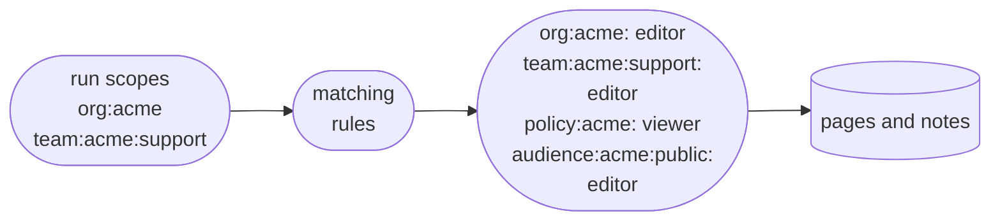

# 作用域与访问权限

範圍控制 Agent 可在 Knowledge 查看和修改哪些內容。每類範圍容許甚麼操作由你定義，每次執行（即一次 Agent 呼叫）持有哪些範圍則由伺服器決定。模型只可處理這些範圍開放的頁面及筆記，亦無法更改這兩項決定。

:::alpha

Knowledge 目前處於 Alpha 階段，API 可能隨版本而變。每次呼叫工具都會檢查權限，但 Alpha 版尚未保證範圍之間互相隔離。絕不能讓其他客戶或用戶取得的內容，請勿儲存在 Knowledge。

:::

## 声明作用域 {/* #declare-scopes */}

**範圍**是 Knowledge 內存放頁面及筆記的區域。每個範圍都有地址，例如 `org:acme`、`team:acme:support` 或 `resource:dana`。首個冒號之前是類型，例如 `team`，其餘部分用來識別該類型下的個別範圍。

Knowledge 沒有內置範圍類型。請在 `Knowledge` 的 `scopes` 選項宣告所需類型。每種類型均以模式表示，例如 `team:$orgId:$teamId`。`$name` 這類片段是預留位置，能配對任何值。地址 `team:acme:support` 符合該模式，當中 `$orgId = acme`、`$teamId = support`。

這個例子設定了以下規則：

- 支援團隊成員可編輯所屬團隊的頁面。
- 機構內所有成員均可閱讀團隊頁面及公司政策。
- 機構成員可撰寫公開頁面，供面向公眾的 FAQ Agent 讀取。
- 其他機構無法查看任何上述內容。

```typescript title="src/mastra/knowledge.ts"
import { Knowledge, knowledgeMemoryScopes } from '@mastra/core/knowledge'
import { LibSQLStore } from '@mastra/libsql'

export const knowledge = new Knowledge({
  id: 'company',
  storage: new LibSQLStore({ id: 'knowledge', url: 'file:./knowledge.db' }),
  tools: true,
  scopes: {
    ...knowledgeMemoryScopes(),
    'team:$orgId:$teamId': {
      description: 'A team',
      belongsTo: 'org:$orgId',
      access: [
        { principal: 'self', role: 'editor' },
        { principal: 'org:$orgId', role: 'viewer' },
      ],
    },
    'policy:$orgId': {
      description: 'Company policies',
      access: [{ principal: 'org:$orgId', role: 'viewer' }],
    },
    'audience:$orgId:public': {
      description: 'Pages for public visitors',
      access: [
        { principal: 'self', role: 'viewer' },
        { principal: 'org:$orgId', role: 'editor' },
      ],
    },
  },
})
```

[`knowledgeMemoryScopes()`](/reference/knowledge/knowledge-memory-scopes) 加入三種類型：每個機構的 `org:`，以及 Memory 識別用戶的 `resource:` 和識別對話的 `thread:`。執行在所持的 `resource:` 及 `thread:` 範圍擁有擁有者權限，在其 `org:` 範圍則有編輯者權限。[個別 Agent 的設定](#for-one-agent)中的 FAQ Agent 會讀取 `audience:` 範圍。

## 存取規則及角色 {/* #access-rules-and-roles */}

每項宣告的 `access` 清單指定誰可在這類範圍取得哪個角色。每項**規則**均包含 `principal` 及 `role`。主體決定規則適用於哪些執行。執行持有的範圍只要與主體配對，便適用該規則。主體可以是 `self` 或任何已宣告的模式。以 `team:$orgId:$teamId` 宣告為例：

- `self` 指正在存取的團隊範圍。持有 `team:acme:support` 的執行在該範圍擔任編輯者。
- `org:$orgId` 沿用團隊的 `$orgId`，所以指團隊所屬的機構。持有 `org:acme` 的執行可讀取 `team:acme:support`，但無法讀取 `team:globex:support`。

表內每個角色均具備排在上方的所有角色的權限：

| 角色 | 可执行的操作 |
| - | - |
| `viewer` | 搜索和阅读页面与笔记 |
| `contributor` | 建立頁面及加入筆記 |
| `editor` | 編輯頁面、在範圍內移動頁面、更改誰可查看筆記、移除筆記及固定頁面 |
| `owner` | 将页面移到其他作用域、将一个页面合并到另一个页面和删除页面 |

`belongsTo` 可在樹狀結構中將一個範圍放在另一個範圍下，情況就像在資料夾內放入另一個資料夾。這項設定本身不會授予存取權限。宣告也可加入範本頁面、子範圍及顯示標籤。[範圍宣告](/reference/knowledge/scope-declarations)列出所有欄位和 Knowledge 啟動時會回報的錯誤。

## 设置运行的作用域 {/* #set-a-runs-scopes */}

**執行範圍**指一次執行持有的範圍，用來識別它服務的用戶、團隊或對話。只有伺服器程式碼可設定，模型無法更改，客戶端亦無法透過請求主體傳入。

執行只有獲規則授予角色，才會在有關範圍取得該角色。每個執行範圍都必須符合已宣告的類型，否則 Knowledge 工具會執行失敗。

### 在服务器端设置 {/* #from-your-server */}

伺服器知道用戶身份。請在中間件將用戶範圍寫入請求上下文的 `MASTRA_SCOPES_KEY` 鍵，以 `org:acme` 這類字串表示。例子中的 `getUser()` 是應用程式本身查詢登入用戶的函數，`support` 則是已接駁 Knowledge 的 Agent：

```typescript title="src/mastra/index.ts"
import { Mastra } from '@mastra/core/mastra'
import { MASTRA_RESOURCE_ID_KEY, MASTRA_SCOPES_KEY } from '@mastra/core/request-context'

export const mastra = new Mastra({
  agents: { support },
  server: {
    middleware: [
      async (c, next) => {
        const user = await getUser(c.req.header('Authorization'))
        const requestContext = c.get('requestContext')

        requestContext.set(MASTRA_SCOPES_KEY, [
          `org:${user.orgId}`,
          ...user.teams.map(team => `team:${user.orgId}:${team}`),
          `resource:${user.id}`,
        ])
        requestContext.set(MASTRA_RESOURCE_ID_KEY, user.id)

        await next()
      },
    ],
  },
})
```

同時將 `MASTRA_RESOURCE_ID_KEY` 設為用戶 ID，伺服器便會以同一用戶核對對話串的歸屬。請參閱[請求上下文](/docs/server/request-context#reserved-keys)。

### 直接调用 Agent 时设置 {/* #in-a-direct-agent-call */}

程式碼直接呼叫 Agent 時，請透過 `scopes` 選項傳入範圍：

```typescript
await support.generate('How do I handle a chargeback?', {
  scopes: ['org:acme', 'team:acme:support'],
  memory: { resource: 'dana', thread: 'ticket-91' },
})
```

使用 Memory 時，執行亦持有 `memory` 選項指定的 `resource:` 和 `thread:` 範圍，即本例的 `resource:dana` 和 `thread:ticket-91`。一次執行在這兩種類型各只可持有一個範圍。如傳入的 `resource:` 範圍與 `memory.resource` 不符，執行便會失敗。`resource:` 和 `thread:` 範圍直接使用 Memory 的 ID，再由 Knowledge 編碼。其他範圍均使用標準地址。如 ID 含有 `:`、`/`、`#` 或 `%`，請以 [`encodeKnowledgeScopeId()`](/reference/knowledge/knowledge-memory-scopes#encodeknowledgescopeid) 編碼，例如 `` `org:${encodeKnowledgeScopeId(user.orgId)}` ``。

### 为单个 Agent 设置 {/* #for-one-agent */}

Agent 的 `scopes` 選項可調整其執行持有的範圍。傳入清單時，清單項目會加入由請求上下文及呼叫提供的範圍。傳入函數時，函數會接收這些範圍並傳回最終清單，因此可將 Agent 的權限收窄至用戶權限的一部分。這個公開 FAQ Agent 以機構的 `audience:` 範圍取代用戶的 `org:` 範圍，因此只可讀取該機構的公開頁面。它保留用戶的 `resource:` 和 `thread:` 範圍，仍可讀取其中的頁面：

```typescript
export const faq = new Agent({
  id: 'faq',
  name: 'FAQ',
  instructions: 'You answer public questions about Acme.',
  model: '__GATEWAY_OPENAI_MODEL__',
  knowledge,
  memory,
  scopes: ({ scopes }) =>
    scopes.flatMap(scope => {
      if (scope.startsWith('org:')) return [`audience:${scope.slice(4)}:public`]
      if (scope.startsWith('resource:') || scope.startsWith('thread:')) return [scope]
      return []
    }),
})
```

函數必須傳回收到的每個 `resource:` 和 `thread:` 範圍。Memory 用這些範圍識別用戶及對話串，缺少任何一個都會令執行失敗。

## 如何判定访问权限 {/* #how-access-is-decided */}

每次執行工具時，Knowledge 都會判斷該次執行可存取哪些範圍，以及在其中擔任甚麼角色：

1. 先取出本次執行持有的範圍。
1. 找出主體與任何所持範圍配對的所有規則，將各規則的角色授予本次執行。
1. 到此結束。規則授予的角色不會再帶來其他角色。

例如，本次執行持有 `org:acme` 和 `team:acme:support`：



範圍之間亦不會繼承存取權限。在 `org:acme` 擔任角色並不會獲得其下層範圍的權限，除非有規則授予。

對一次執行來說，不能存取的內容就如不存在一樣，隱藏頁面與缺失頁面無法區分。若能存取範圍但角色權限不足，錯誤訊息會說明所需角色。

### 笔记可见性 {/* #note-visibility */}

每則筆記均會**標記**一個或多個範圍。執行必須可讀取筆記所在的頁面及至少一個已標記的範圍，才可查看筆記，毋須持有該標記範圍。如筆記以 `[[...]]` 連結其他頁面，執行亦必須可讀取每個連結頁面所屬的範圍。沒有配對頁面的連結會被略過。以團隊頁面為例：

- 標記為 `resource:dana` 的筆記只對 Dana 的執行可見，因為只有這些執行可讀取 `resource:dana`。
- 所有可讀取團隊範圍的執行，都可查看標記為 `team:acme:support` 的筆記。按上述規則，整個 `org:acme` 的執行均可查看，並不限於團隊本身。

### 使用 `explainAccess()` 測試存取權限 {/* #test-access-with-explainaccess */}

[`explainAccess()`](/reference/knowledge/knowledge-class#explainaccess) 接收一組執行範圍及一個目標範圍或頁面，並傳回這些執行範圍在目標取得的角色和授予角色的規則。

以上規則均按範圍地址綁定，只取決於宣告。測試時毋須呼叫模型或寫入頁面。若規則按範圍[在樹狀結構中的位置](/reference/knowledge/scope-declarations#place-scopes-with-belongsto)綁定，須等到一次寫入把範圍放入樹狀結構後才會授予角色，因此請在寫入後測試：

```typescript title="src/mastra/knowledge.test.ts"
import { describe, expect, it } from 'vitest'
import { knowledge } from './knowledge'

const roleOn = async (scopes: string[], scope: string) =>
  (await knowledge.explainAccess(scopes, { scope })).role

describe('team access', () => {
  it('lets a team edit its own scope', async () => {
    expect(await roleOn(['org:acme', 'team:acme:support'], 'team:acme:support')).toBe('editor')
  })
  it('lets the org read it', async () => {
    expect(await roleOn(['org:acme'], 'team:acme:support')).toBe('viewer')
  })
  it('hides it from another org', async () => {
    expect(await roleOn(['org:globex'], 'team:acme:support')).toBeNull()
  })
})
```

:::warning

只可在伺服器程式碼使用 `explainAccess()`。它會顯示頁面是缺失還是被隱藏，而執行絕不能取得這項資料。請勿透過 Agent 工具或沒有管理員級別身份驗證的伺服器路由開放這項功能。

:::

## 后续步骤 {/* #next-steps */}

接下來，[為 Agent 加入 Knowledge 工具](/docs/knowledge/agents-and-tools)，讓它可在每次執行持有的範圍搜尋、讀取和寫入內容。
