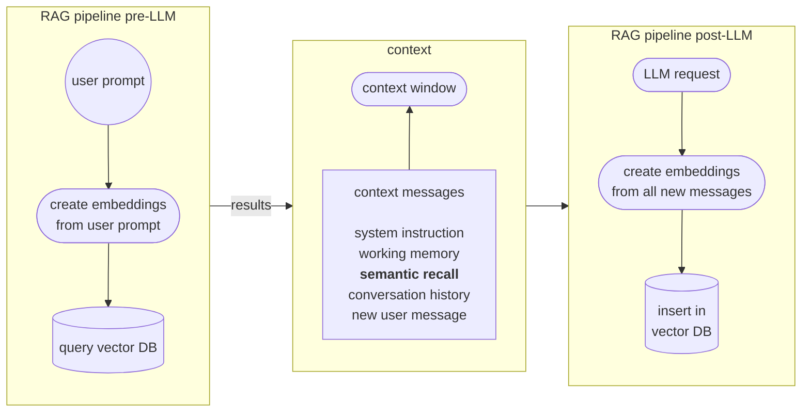

import Tabs from "@theme/Tabs";
import TabItem from "@theme/TabItem";

# 語意回憶

語意回憶是Agent記憶的檢索增強生成 (RAG) 的內建形式。當使用者發送訊息時，Mastra 會搜尋較早的訊息以尋找具有相似含義的訊息，並將最相關的訊息新增至Agent的上下文中。

意義匹配很重要，因為人們經常記住某件事背後的想法，而不是他們使用的確切單字。用戶可能會問「我們對退款有何決定？」在最初寫下「讓我們把錢還給他們」之後。關鍵字搜尋會錯過這種聯繫，但語義回憶會找到它。

當您的Agent商需要較長對話中較早的詳細資訊或用戶其他對話中不再包含的詳細資訊時，請使用語義回憶[recent message history](./message-history).

:::提示\[📹觀看]

手錶[Mastra semantic recall](https://www.youtube.com/watch?v=UVZtK8cK8xQ\&pp=ygUVbWFzdHJhIHdvcmtpbmcgbWVtb3J5) to see how agents retrieve relevant messages from past conversations.

:::

## 語意回憶如何運作 {/* #how-semantic-recall-works */}

語義召回是基於 RAG 的搜索，當訊息不再存在時，可以幫助Agent在較長的互動中維護上下文[recent message history](./message-history).

它使用訊息的向量嵌入進行相似性搜索，並與向量存儲集成，並且在檢索到的消息周圍具有可配置的上下文視窗。



啟用後，新訊息將用於在向量資料庫中查詢語義相似的訊息。

收到 LLM 的回應後，所有新訊息（使用者、助手和Tool呼叫/結果）都會插入向量資料庫中，以便在以後的互動中呼叫。

## 快速入門 {/* #quickstart */}

預設情況下禁用語義回憶。要啟用它，請設定`semanticRecall: true` in `options` and provide a `vector` store and an `embedder`. A store that generates embeddings itself, such as MongoDB with Automated Embedding, works without one. See [Server-side embeddings](#server-side-embeddings).

<Tabs>
  <TabItem value="libsql" label="LibSQL" default>
    ```typescript title="src/mastra/agents/index.ts"
    import { Agent } from '@mastra/core/agent'
    import { Memory } from '@mastra/memory'
    import { LibSQLStore, LibSQLVector } from '@mastra/libsql'
    import { ModelRouterEmbeddingModel } from '@mastra/core/llm'

    const agent = new Agent({
      id: 'support-agent',
      name: 'SupportAgent',
      instructions: 'You are a helpful support agent.',
      model: '__GATEWAY_OPENAI_MODEL__',
      memory: new Memory({
        storage: new LibSQLStore({
          id: 'agent-storage',
          url: 'file:./local.db',
        }),
        vector: new LibSQLVector({
          id: 'agent-vector',
          url: 'file:./local.db',
        }),
        embedder: new ModelRouterEmbeddingModel('openai/text-embedding-3-small'),
        options: {
          semanticRecall: true,
        },
      }),
    })
    ```
  </TabItem>

  <TabItem value="mongodb" label="MongoDB">
    ```typescript title="src/mastra/agents/index.ts"
    import { Agent } from '@mastra/core/agent'
    import { Memory } from '@mastra/memory'
    import { MongoDBStore, MongoDBVector } from '@mastra/mongodb'
    import { ModelRouterEmbeddingModel } from '@mastra/core/llm'

    const agent = new Agent({
      id: 'support-agent',
      name: 'SupportAgent',
      instructions: 'You are a helpful support agent.',
      model: '__GATEWAY_OPENAI_MODEL__',
      memory: new Memory({
        storage: new MongoDBStore({
          id: 'agent-storage',
          uri: process.env.MONGODB_URI,
          dbName: process.env.MONGODB_DB_NAME,
        }),
        vector: new MongoDBVector({
          id: 'agent-vector',
          uri: process.env.MONGODB_URI,
          dbName: process.env.MONGODB_DB_NAME,
        }),
        embedder: new ModelRouterEmbeddingModel('openai/text-embedding-3-small'),
        options: {
          semanticRecall: true,
        },
      }),
    })
    ```
  </TabItem>
</Tabs>

## 使用`recall()` method {/* #using-the-recall-method */}

儘管`listMessages` retrieves messages by thread ID with basic pagination, [`recall()`](/reference/memory/recall) adds support for **semantic search**. When you need to find messages by meaning rather than recency, use `recall()` with a `vectorSearchString`:

```typescript
const memory = await agent.getMemory()

// Basic recall - similar to listMessages
const { messages } = await memory!.recall({
  threadId: 'thread-123',
  perPage: 50,
})

// Semantic recall - find messages by meaning
const { messages: relevantMessages } = await memory!.recall({
  threadId: 'thread-123',
  vectorSearchString: 'What did we discuss about the project deadline?',
  threadConfig: {
    semanticRecall: true,
  },
})
```

## 儲存配置 {/* #storage-configuration */}

語意回憶依賴[storage and vector db](/reference/memory/memory-class) to store messages and their embeddings.

```ts title="src/mastra/agents/index.ts"
import { Memory } from '@mastra/memory'
import { Agent } from '@mastra/core/agent'
import { LibSQLStore, LibSQLVector } from '@mastra/libsql'

const agent = new Agent({
  memory: new Memory({
    // this is the default storage db if omitted
    storage: new LibSQLStore({
      id: 'agent-storage',
      url: 'file:./local.db',
    }),
    // this is the default vector db if omitted
    vector: new LibSQLVector({
      id: 'agent-vector',
      url: 'file:./local.db',
    }),
    options: {
      semanticRecall: true,
    },
  }),
})
```

下面的每個向量商店頁面都包含安裝說明、設定參數和使用範例：

* [阿斯特拉](/integrations/vectors/astra)
* [色度](/integrations/vectors/chroma)
* [Cloudflare 向量化](/integrations/vectors/vectorize)
* [凸面](/integrations/vectors/convex)
* [沙發底座](/integrations/vectors/couchbase)
* [鴨資料庫](/integrations/vectors/duckdb)
* [彈性搜尋](/integrations/vectors/elasticsearch)
* [蘭斯資料庫](/integrations/vectors/lance)
* [函式庫SQL](/integrations/vectors/libsql)
* [MongoDB](/integrations/vectors/mongodb)
* [開放搜尋](/integrations/vectors/opensearch)
* [甲骨文資料庫](/integrations/vectors/oracledb)
* [松果](/integrations/vectors/pinecone)
* [PostgreSQL](/integrations/vectors/pg)
* [奎德蘭特](/integrations/vectors/qdrant)
* [S3 向量](/integrations/vectors/s3vectors)
* [渦輪噴射機](/integrations/vectors/turbopuffer)
* [烏普斯塔什](/integrations/vectors/upstash)

## 召回配置 {/* #recall-configuration */}

以下選項控制語意回憶行為：

1. **頂級K**：要檢索的相似訊息的數量
2. **訊息範圍**：每場比賽包含的周圍消息
3. **範圍**：是否在目前執行緒或所有執行緒中搜尋某個資源
4. **篩選**：限制搜尋結果的元資料條件

```typescript {5-9}
const agent = new Agent({
  id: 'agent',
  memory: new Memory({
    options: {
      semanticRecall: {
        topK: 3, // Retrieve 3 similar messages
        messageRange: 2, // Include 2 messages before and after each match
        scope: 'resource', // Search all threads for this resource
        filter: { projectId: { $eq: 'project-a' } },
      },
    },
  }),
})
```

：：：筆記

`scope: 'resource'`LibSQL、OracleDB、PostgreSQL、MongoDB 和 Upstash 儲存適配器支援。

:::

### 元資料過濾 {/* #metadata-filtering */}

這`filter` option restricts semantic recall results to messages with matching thread metadata.

```typescript {5-10}
const agent = new Agent({
  id: 'agent',
  memory: new Memory({
    options: {
      semanticRecall: {
        scope: 'resource',
        filter: {
          projectId: { $eq: 'project-a' },
          category: { $in: ['work', 'personal'] },
        },
      },
    },
  }),
})
```

儲存訊息時，過濾器會匹配訊息嵌入中儲存的元資料。如果線程元數據稍後發生更改，現有嵌入將保留其先前的元數據，直到這些訊息再次保存或索引。

Agent運行在訊息嵌入上儲存線程元資料。舊版保存的訊息（不儲存該訊息）在再次儲存或編制索引之前不會與過濾器相符。

支援的過濾器運算子：

* `$and`：邏輯與
* `$eq`：等於
* `$gt`: 大於
* `$gte`: 大於或等於
* `$in`：在數組中
* `$lt`： 少於
* `$lte`：小於或等於
* `$ne`：不等於
* `$nin`: 不在數組中
* `$or`：邏輯或

以下範例示範了常見用例的元資料過濾器：

```typescript
// Filter by project
const options = {
  semanticRecall: { filter: { projectId: { $eq: 'my-project' } } },
}

// Filter by multiple categories
const options = {
  semanticRecall: { filter: { category: { $in: ['work', 'research'] } } },
}

// Filter by project and priority
const options = {
  semanticRecall: {
    filter: {
      $and: [{ projectId: { $eq: 'project-a' } }, { priority: { $gte: 3 } }],
    },
  },
}
```

### 長訊息 {/* #long-messages */}

嵌入模型每個輸入接受有限數量的標記。記憶體將較長的消息分割成區塊，並將每個區塊儲存為其自己的向量行，因此可以呼叫訊息的每個部分。`maxChunkChars` sets the largest chunk in characters:

```typescript {5}
const agent = new Agent({
  id: 'agent',
  memory: new Memory({
    options: {
      semanticRecall: { topK: 3, messageRange: 2, maxChunkChars: 6000 },
    },
  }),
})
```

預設為 16,384 個字符，大約 4,096 個英文文本標記，適合`openai/text-embedding-3-small` and its 8,191-token limit. The limit is in characters because each embedding provider uses its own tokenizer. Chinese, Japanese, and Korean text, and code, use more tokens per character than English, so lower `maxChunkChars` when that kind of text makes up most of your messages.

當你不設定時`maxChunkChars` and the embedder declares its input limit, Memory derives the chunk size from that limit. [FastEmbed](#using-fastembed-local) models declare their 512-token window, so they need no configuration.

每個區塊行的 ID 來自訊息 ID，因此再次儲存訊息會替換其行。如果您透過以下方式再次儲存較短文字的訊息`memory.saveMessages()`, rows for chunks past the new end stay searchable until the message is updated with `memory.updateMessages()` or deleted.

放`maxChunkChars` on the `Memory` constructor. Memory options passed per request, such as `memory.options` in `agent.stream()`, don't change it, so API callers can't force many small chunks.

## 伺服器端嵌入 {/* #server-side-embeddings */}

一些向量存儲本身產生嵌入。對於其中之一，語義回憶無需`embedder`: the database embeds each message on write and the search string on arrival. The embedding provider stays out of your application entirely.

MongoDB 透過以下方式做到這一點[Automated Embedding](/integrations/vectors/mongodb): name a Voyage AI model on the vector store and leave the `embedder` out.

```typescript title="src/mastra/agents/index.ts"
import { Memory } from '@mastra/memory'
import { MongoDBStore, MongoDBVector } from '@mastra/mongodb'

const memory = new Memory({
  storage: new MongoDBStore({
    id: 'agent-storage',
    uri: process.env.MONGODB_URI,
    dbName: process.env.MONGODB_DB_NAME,
  }),
  vector: new MongoDBVector({
    id: 'agent-vector',
    uri: process.env.MONGODB_URI,
    dbName: process.env.MONGODB_DB_NAME,
    autoEmbed: { model: 'voyage-4' },
  }),
  options: {
    semanticRecall: { topK: 3, messageRange: 2 },
  },
})
```

訊息以文字形式存儲，MongoDB 嵌入它們，因此模型選擇和向量大小屬於索引而不是您的應用程式。召回通過Agent和通過[`recall()`](#using-the-recall-method).

MongoDB 在背景嵌入新寫入的訊息。不久前儲存的訊息可能無法立即調出。

所有其他商店都希望您的應用程式提供向量，並且一直需要`embedder`. Enabling semantic recall with neither an `embedder` nor a store that embeds server-side raises an error naming both options.

## 包埋機配置 {/* #embedder-configuration */}

語意回憶依賴[embedding model](/reference/memory/memory-class) to convert messages into embeddings. Mastra supports embedding models through the model router using `provider/model` strings, or you can use any [embedding model](https://sdk.vercel.ai/docs/ai-sdk-core/embeddings) compatible with the AI SDK.

### 使用模型路由器（推薦） {/* #using-the-model-router-recommended */}

最簡單的方法是使用`provider/model` string with autocomplete support:

```ts title="src/mastra/agents/index.ts"
import { Memory } from '@mastra/memory'
import { Agent } from '@mastra/core/agent'
import { ModelRouterEmbeddingModel } from '@mastra/core/llm'

const agent = new Agent({
  id: 'agent',
  memory: new Memory({
    embedder: new ModelRouterEmbeddingModel('openai/text-embedding-3-small'),
    options: {
      semanticRecall: true,
    },
  }),
})
```

支援的嵌入模型：

* **開放人工智慧**: `text-embedding-3-small`, `text-embedding-3-large`, `text-embedding-ada-002`
* **Google**: `gemini-embedding-001`
* **開放路由器**：存取來自多個提供者的嵌入模型

```ts {7}
import { Agent } from '@mastra/core/agent'
import { Memory } from '@mastra/memory'
import { ModelRouterEmbeddingModel } from '@mastra/core/llm'

const agent = new Agent({
  id: 'agent',
  memory: new Memory({
    embedder: new ModelRouterEmbeddingModel({
      providerId: 'openrouter',
      modelId: 'openai/text-embedding-3-small',
    }),
  }),
})
```

模型路由器會自動處理來自環境變數的 API 金鑰偵測（`OPENAI_API_KEY`, `GOOGLE_API_KEY`, `OPENROUTER_API_KEY`). Google models also fall back to `GOOGLE_GENERATIVE_AI_API_KEY`.

### 使用AI SDK包 {/* #using-ai-sdk-packages */}

您也可以直接使用AI SDK嵌入模型：

```ts {2,7}
import { Memory } from '@mastra/memory'
import { Agent } from '@mastra/core/agent'
import { ModelRouterEmbeddingModel } from '@mastra/core/llm'

const agent = new Agent({
  id: 'agent',
  memory: new Memory({
    embedder: new ModelRouterEmbeddingModel('openai/text-embedding-3-small'),
  }),
})
```

### 使用 FastEmbed（本地） {/* #using-fastembed-local */}

若要使用 FastEmbed（本機嵌入模型），請安裝`@mastra/fastembed`:

```bash npm2yarn
npm install @mastra/fastembed@latest
```

然後在你的記憶體中配置它：

```ts {3,7}
import { Memory } from '@mastra/memory'
import { Agent } from '@mastra/core/agent'
import { fastembed } from '@mastra/fastembed'

const agent = new Agent({
  id: 'agent',
  memory: new Memory({
    embedder: fastembed,
  }),
})
```

FastEmbed 也公開了針對非英語內容的多語言 E5 模型。 E5是不對稱的，因此它分為兩種型號：`multilingualE5LargePassage` for text you index and `multilingualE5LargeQuery` for search text.

```ts {3,7}
import { Memory } from '@mastra/memory'
import { Agent } from '@mastra/core/agent'
import { fastembed } from '@mastra/fastembed'

const agent = new Agent({
  id: 'agent',
  memory: new Memory({
    embedder: fastembed.multilingualE5LargePassage,
  }),
})
```

記憶體使用單一嵌入器來儲存和調用訊息，因此選擇兩種模型之一併一致使用它。使用配對的`multilingualE5LargeQuery` model only where you control both sides of the pipeline, such as a RAG workflow that indexes with the passage model and searches with the query model.

多语言 E5 生成 1024 维向量。您的向量索引必須使用匹配的維度創建，並且 E5 向量不能與同一索引中另一個嵌入器的向量混合。

FastEmbed 模型每個輸入最多嵌入 512 個標記（大約 2,000 到 2,500 個英文文字字元）。較長的輸入會被截斷，因此超過限制的文字不會影響嵌入。語義召回調整其訊息區塊的大小以自動適應此視窗（請參閱[Long messages](#long-messages)). Outside of memory, the AI SDK v3 FastEmbed models return a warning when an input is truncated. The legacy v1 and v2 models don't. If you embed long documents with FastEmbed, chunk them to fit the window, for example with `maxSize: 1500` in `MDocument.chunk()`.

### 設定嵌入尺寸 {/* #setting-the-embedding-dimension */}

為了命名向量索引，記憶體需要嵌入器的輸出維度。預設情況下，它透過在第一次設定語義召回時嵌入一個短探測字元字串來尋找維度，每個`Memory` instance. If you already know the dimension, set `embeddingDimension`. Memory then skips the probe, so startup makes no embedding call and doesn't depend on the embedding provider being reachable:

```ts title="src/mastra/agents/index.ts"
import { Memory } from '@mastra/memory'

const memory = new Memory({
  embedder: 'openai/text-embedding-3-small',
  embeddingDimension: 1536,
  options: {
    semanticRecall: true,
  },
})
```

無論維度是配置的還是探測的，索引名稱都是相同的，因此現有索引可以繼續工作。

該值必須與嵌入器傳回的向量相符。内存将其与第一个真实嵌入进行比较，如果不匹配，它会抛出一个`MASTRA_MEMORY_EMBEDDING_DIMENSION_MISMATCH` error naming both values before creating or querying any index. Update `embeddingDimension` whenever you change the embedding model or its output dimension.

## PostgreSQL 索引優化 {/* #postgresql-index-optimization */}

當使用 PostgreSQL 作為向量儲存時，您可以透過配置向量索引來最佳化語義召回效能。這對於包含數千條訊息的大規模部署尤其重要。


語義回憶總是按線程或資源進行過濾。 PgVector 僅使用 pgvector 0.8.0 或更高版本上的 HNSW 進行這些搜尋的向量索引。使用 IVFFlat，每次搜尋都會將查詢與執行緒或資源中的每個訊息進行比較。

```typescript {18-23}
import { Memory } from '@mastra/memory'
import { PostgresStore, PgVector } from '@mastra/pg'

const agent = new Agent({
  memory: new Memory({
    storage: new PostgresStore({
      id: 'agent-storage',
      connectionString: process.env.DATABASE_URL,
    }),
    vector: new PgVector({
      id: 'agent-vector',
      connectionString: process.env.DATABASE_URL,
    }),
    options: {
      semanticRecall: {
        topK: 5,
        messageRange: 2,
        indexConfig: {
          type: 'hnsw', // Use HNSW for better performance
          metric: 'dotproduct', // Best for OpenAI embeddings
          hnsw: {
            m: 16, // Number of bi-directional links (default: 16)
            efConstruction: 64, // Size of candidate list during construction (default: 64)
          },
        },
      },
    },
  }),
})
```

有關索引配置選項和效能調整的詳細信息，請參閱[PgVector configuration guide](/integrations/vectors/pg#index-configuration-guide).

## 禁用語意回憶 {/* #disable-semantic-recall */}

預設會停用語義回憶（`semanticRecall: false`). Each call adds latency because new messages are converted into embeddings and used to query a vector database before the LLM receives them.

在以下情況下保持語義召回禁用：

* 訊息歷史記錄為當前對話提供了足夠的上下文。
* 您正在建立效能敏感的應用程序，例如即時雙向音頻，其中嵌入和向量查詢延遲很明顯。

## 查看撤回的消息 {/* #viewing-recalled-messages */}

啟用追蹤後，透過語義呼叫檢索到的任何訊息都將與最近的訊息歷史記錄（如果已配置）一起顯示在Agent程式的追蹤輸出中。
