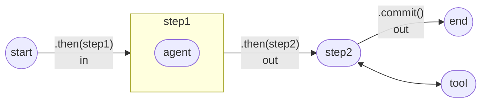
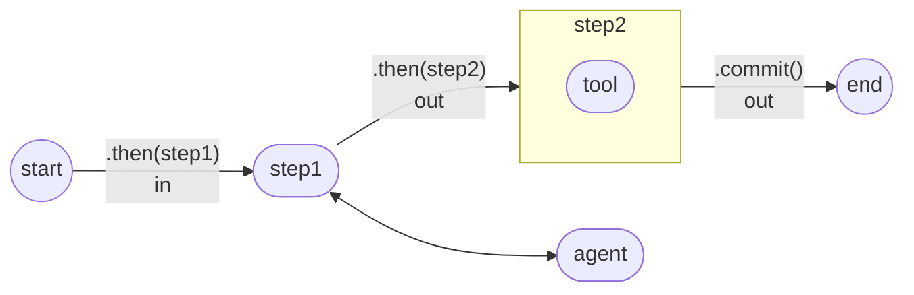

# Agent 和 Tool

Workflow 步驟可呼叫 Agent 進行 LLM 推理，亦可呼叫 Tool 執行具類型安全的邏輯。你可以在步驟的 `execute()` 函數內呼叫兩者，或直接用 `createStep()` 將它們組合成步驟。

## 在 Workflow 使用 Agent {/* #using-agents-in-workflows */}

如需推理、生成文字或處理其他以 LLM 為基礎的工作，可在 Workflow 步驟中使用 Agent。要更精細地控制呼叫，例如追蹤訊息紀錄或傳回結構化輸出，可在步驟的 `execute()` 函數內呼叫 Agent。毋須更改呼叫方式時，可直接以 Agent 組成步驟。

### 呼叫 Agent {/* #calling-agents */}

在步驟的 `execute()` 函數內，用 `.generate()` 或 `.stream()` 呼叫 Agent。這樣可調整呼叫方式，亦可在把回應交給下一步前先行處理。

```typescript {8-16} title="src/mastra/workflows/test-workflow.ts"
import { createStep } from '@mastra/core/workflows'

const step1 = createStep({
  execute: async ({ inputData, mastra }) => {
    const { message } = inputData

    const testAgent = mastra.getAgent('testAgent')
    const response = await testAgent.generate(
      `Convert this message into bullet points: ${message}`,
      {
        memory: {
          thread: 'user-123',
          resource: 'test-123',
        },
      },
    )

    return {
      list: response.text,
    }
  },
})
```

### 以 Agent 組成步驟 {/* #agents-as-steps */}

毋須更改呼叫 Agent 的方式時，可用 `createStep()` 將它組成步驟。使用 `.map()` 把上一步的輸出轉成 Agent 可用的 `prompt`。



```typescript {1,3,6-11} title="src/mastra/workflows/test-workflow.ts"
import { testAgent } from '../agents/test-agent'
import { createWorkflow, createStep } from '@mastra/core/workflows'
const step1 = createStep(testAgent)

export const testWorkflow = createWorkflow({})
  .map(async ({ inputData }) => {
    const { message } = inputData
    return {
      prompt: `Convert this message into bullet points: ${message}`,
    }
  })
  .then(step1)
  .then(step2)
  .commit()
```

詳情請參閱[輸入資料對應](/docs/workflows/control-flow#input-data-mapping)。

未有提供 `structuredOutput` 選項時，Mastra Agent 會使用預設結構描述：輸入為 `prompt` 字串，輸出為 `text` 字串。

```typescript oxfmt:false
{
  inputSchema: {
    prompt: string
  },
  outputSchema: {
    text: string
  }
}
```

### 讓 Agent 傳回結構化輸出 {/* #agents-with-structured-output */}

如果要 Agent 傳回結構化資料而非純文字，請將 `structuredOutput` 選項傳給 `createStep()`。步驟的輸出結構描述會與你提供的一致，讓後續步驟在接駁時維持類型安全。

```typescript {11} title="src/mastra/workflows/test-workflow.ts"
import { createWorkflow, createStep } from '@mastra/core/workflows'
import { z } from 'zod'

const articleSchema = z.object({
  title: z.string(),
  summary: z.string(),
  tags: z.array(z.string()),
})

const agentStep = createStep(testAgent, {
  structuredOutput: { schema: articleSchema },
})

// Next step receives typed structured data
const processStep = createStep({
  id: 'process',
  inputSchema: articleSchema, // Matches agent's outputSchema
  outputSchema: z.object({ tagCount: z.number() }),
  execute: async ({ inputData }) => ({
    tagCount: inputData.tags.length, // Fully typed
  }),
})

export const testWorkflow = createWorkflow({})
  .map(async ({ inputData }) => ({
    prompt: `Generate an article about: ${inputData.topic}`,
  }))
  .then(agentStep)
  .then(processStep)
  .commit()
```

`structuredOutput.schema` 選項接受任何 Standard JSON Schema。Agent 會按該結構描述生成輸出，步驟的 `outputSchema` 亦會自動配合。錯誤處理策略和串流結構化輸出等選項，詳見[結構化輸出](/docs/agents/structured-output)。

### `.agent()` 簡寫方式 {/* #the-agent-shorthand */}

你可以用 `.agent()` 直接加入 Agent，毋須由 `createStep()` 包裝。它接受與 `createStep(agent, options)` 相同的選項，並可用 Agent ID 字串代替實例：

```typescript {9} title="src/mastra/workflows/test-workflow.ts"
import { testAgent } from '../agents/test-agent'
import { createWorkflow } from '@mastra/core/workflows'

export const testWorkflow = createWorkflow({})
  .map(async ({ inputData }) => ({
    prompt: `Generate an article about: ${inputData.topic}`,
  }))
  .agent(testAgent, { structuredOutput: { schema: articleSchema } })
  .commit()
```

`.agent()` 在 Workflow 圖中記錄的是宣告式項目，而非看不到內部邏輯的步驟，因此可將如此建立的 Workflow 保存為[動態 Workflow](/docs/workflows/dynamic-workflows)。完整參數請參閱 [Workflow.agent()](/reference/workflows/workflow-methods/agent)。

## 在 Workflow 使用 Tool {/* #using-tools-in-workflows */}

Workflow 步驟可使用 Tool 的現有邏輯。需要準備上下文或處理回應時，可在步驟的 `.execute()` 函數內呼叫 Tool。毋須更改 Tool 的使用方式時，可直接以 Tool 組成步驟。

### 呼叫 Tool {/* #calling-tools */}

在步驟的 `.execute()` 函數內呼叫 Tool，可更精細地控制其輸入上下文，或在把回應交給下一步前先行處理。

```typescript title="src/mastra/workflows/test-workflow.ts"
import { testTool } from '../tools/test-tool'
import { isValidationError } from '@mastra/core/tools'
import { createStep } from '@mastra/core/workflows'

const step2 = createStep({
  execute: async ({ inputData, requestContext }) => {
    const { text } = inputData

    const response = await testTool.execute?.({ text }, { requestContext })

    if (!response || isValidationError(response)) {
      throw new Error('testTool did not return a result')
    }

    return {
      emphasized: response.emphasized,
    }
  },
})
```

### 以 Tool 組成步驟 {/* #tools-as-steps */}

如果上一步的輸出符合 Tool 的輸入上下文，可用 `createStep()` 將 Tool 組成步驟。兩者不符時，可用 `.map()` 轉換上一步的輸出。



```typescript {1,4,8-13} title="src/mastra/workflows/test-workflow.ts"
import { testTool } from '../tools/test-tool'
import { createWorkflow, createStep } from '@mastra/core/workflows'

const step2 = createStep(testTool)

export const testWorkflow = createWorkflow({})
  .then(step1)
  .map(async ({ inputData }) => {
    const { formatted } = inputData
    return {
      text: formatted,
    }
  })
  .then(step2)
  .commit()
```

詳情請參閱[輸入資料對應](/docs/workflows/control-flow#input-data-mapping)。

### `.tool()` 簡寫方式 {/* #the-tool-shorthand */}

你可以用 `.tool()` 直接加入 Tool，毋須由 `createStep()` 包裝。它接受 Tool 實例或已註冊的 Tool ID 字串，另可設定步驟層級的 `retries` 和 `metadata`：

```typescript {6} title="src/mastra/workflows/test-workflow.ts"
import { testTool } from '../tools/test-tool'
import { createWorkflow } from '@mastra/core/workflows'

export const testWorkflow = createWorkflow({}).then(step1).tool(testTool).commit()
```

與 `.agent()` 一樣，`.tool()` 會記錄宣告式項目，因此可將 Workflow 保存為[動態 Workflow](/docs/workflows/dynamic-workflows)。完整參數請參閱 [Workflow.tool()](/reference/workflows/workflow-methods/tool)。

## 相關文件 {/* #related */}

- [使用 Agent](/docs/agents/overview)
- [MCP 概覽](/docs/connections/mcp)
