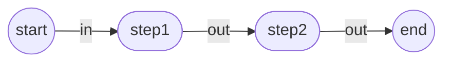
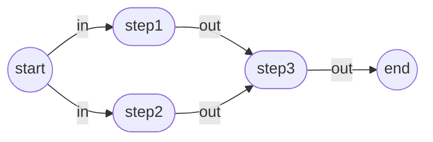
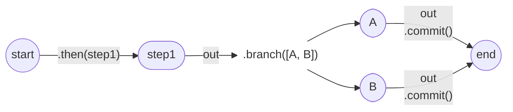
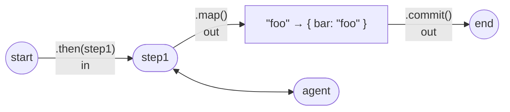
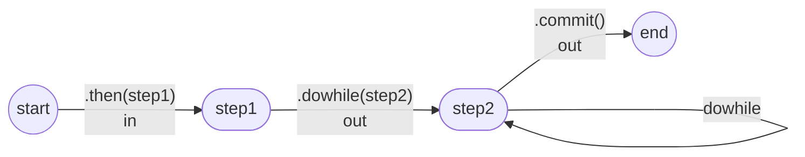
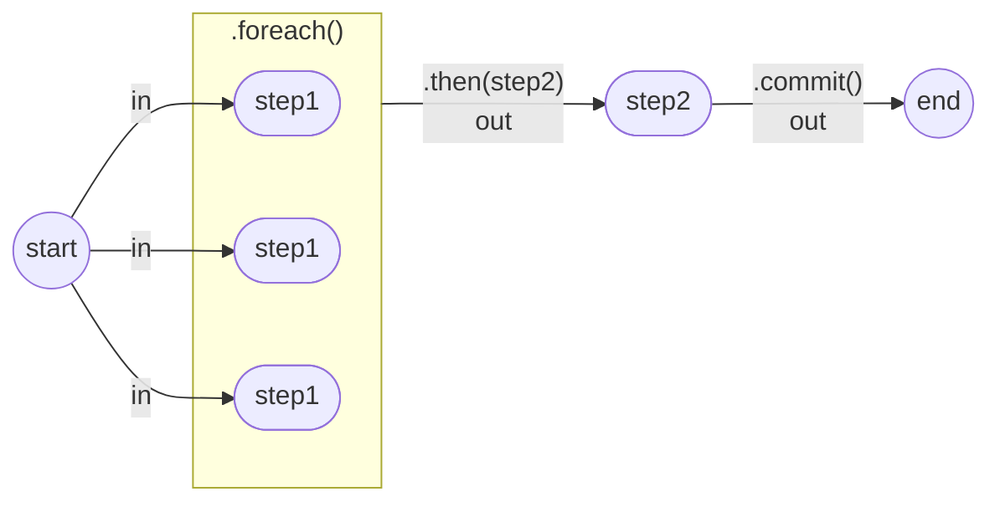

# 控制流程

Workflow讓您可以透過將每個任務分割為多個任務來控制預先定義的任務**steps**。這些步驟可以順序或並行運行，並且它們可以遵循條件路徑。

每個步驟都透過定義的模式連接到Workflow中的下一個步驟，以保持資料受控和一致性。

## 核心原則 {/* #core-principles */}

* 第一步的`inputSchema` must match the workflow’s `inputSchema`.
* 最後一步的`outputSchema` must match the workflow’s `outputSchema`.
* 每一步的`outputSchema` must match the next step’s `inputSchema`.
  * 如果沒有，請使用[Input data mapping](#input-data-mapping) to transform the data into the required shape.

## 連結步驟`.then()` {/* #chaining-steps-with-then */}

使用`.then()` to run steps in order, allowing each step to access the result of the step before it.



```typescript {30-31} title="src/mastra/workflows/test-workflow.ts"
import { createWorkflow, createStep } from '@mastra/core/workflows'
import { z } from 'zod'

const step1 = createStep({
  inputSchema: z.object({
    message: z.string(),
  }),
  outputSchema: z.object({
    formatted: z.string(),
  }),
})

const step2 = createStep({
  inputSchema: z.object({
    formatted: z.string(),
  }),
  outputSchema: z.object({
    emphasized: z.string(),
  }),
})

export const testWorkflow = createWorkflow({
  inputSchema: z.object({
    message: z.string(),
  }),
  outputSchema: z.object({
    emphasized: z.string(),
  }),
})
  .then(step1)
  .then(step2)
  .commit()
```

## 同時進行的步驟`.parallel()` {/* #simultaneous-steps-with-parallel */}

使用`.parallel()` to run steps simultaneously. All parallel steps must complete before the workflow continues to the next step. Each step's `id` is used when defining a following step's `inputSchema` and becomes the key on the `inputData` object used to access the previous step's values. The outputs of parallel steps can then be referenced or combined by a following step.



```typescript {42} title="src/mastra/workflows/test-workflow.ts"
import { createWorkflow, createStep } from '@mastra/core/workflows'
import { z } from 'zod'

const step1 = createStep({
  id: 'step-1',
})

const step2 = createStep({
  id: 'step-2',
})

const step3 = createStep({
  id: 'step-3',
  inputSchema: z.object({
    'step-1': z.object({
      formatted: z.string(),
    }),
    'step-2': z.object({
      emphasized: z.string(),
    }),
  }),
  outputSchema: z.object({
    combined: z.string(),
  }),
  execute: async ({ inputData }) => {
    const { formatted } = inputData['step-1']
    const { emphasized } = inputData['step-2']
    return {
      combined: `${formatted} | ${emphasized}`,
    }
  },
})

export const testWorkflow = createWorkflow({
  inputSchema: z.object({
    message: z.string(),
  }),
  outputSchema: z.object({
    combined: z.string(),
  }),
})
  .parallel([step1, step2])
  .then(step3)
  .commit()
```

### 輸出結構 {/* #output-structure */}

當步驟並行運行時，輸出是一個對象，其中每個鍵都是該步驟的`id` and the value is that step's output. You can access each parallel step's result independently.

```typescript title="src/mastra/workflows/test-workflow.ts"
import { createWorkflow, createStep } from '@mastra/core/workflows'
import { z } from 'zod'

const step1 = createStep({
  id: 'format-step',
  inputSchema: z.object({ message: z.string() }),
  outputSchema: z.object({ formatted: z.string() }),
  execute: async ({ inputData }) => ({
    formatted: inputData.message.toUpperCase(),
  }),
})

const step2 = createStep({
  id: 'count-step',
  inputSchema: z.object({ message: z.string() }),
  outputSchema: z.object({ count: z.number() }),
  execute: async ({ inputData }) => ({
    count: inputData.message.length,
  }),
})

const step3 = createStep({
  id: 'combine-step',
  // The inputSchema must match the structure of parallel outputs
  inputSchema: z.object({
    'format-step': z.object({ formatted: z.string() }),
    'count-step': z.object({ count: z.number() }),
  }),
  outputSchema: z.object({ result: z.string() }),
  execute: async ({ inputData }) => {
    // Access each parallel step's output by its id
    const formatted = inputData['format-step'].formatted
    const count = inputData['count-step'].count
    return {
      result: `${formatted} (${count} characters)`,
    }
  },
})

export const testWorkflow = createWorkflow({
  id: 'parallel-output-example',
  inputSchema: z.object({ message: z.string() }),
  outputSchema: z.object({ result: z.string() }),
})
  .parallel([step1, step2])
  .then(step3)
  .commit()

// When executed with { message: "hello" }
// The parallel output structure will be:
// {
//   "format-step": { formatted: "HELLO" },
//   "count-step": { count: 5 }
// }
```

**要點：**

* 每個並行步驟的輸出由其鍵控`id`
* 所有並行步驟同時執行
* 下一步接收包含所有平行步驟輸出的對象
* `inputSchema` of the following step to match this structure

### 處理步驟失敗 {/* #handling-step-failures */}

如果任何並行步驟拋出錯誤，則整個並行區塊都會失敗。若要建構某些步驟可能失敗的彈性並行Workflow（例如，多個研究Agent可能具有過期的身份驗證令牌），請使用 try/catch 處理步驟本身內部的錯誤：

```typescript title="src/mastra/workflows/test-workflow.ts"
import { createStep } from '@mastra/core/workflows'
import { z } from 'zod'

const resilientStep = createStep({
  id: 'researcher',
  inputSchema: z.object({ query: z.string() }),
  outputSchema: z.object({
    brief: z.string().nullable(),
    failed: z.boolean(),
  }),
  execute: async ({ inputData }) => {
    try {
      const result = await fetchExternalData(inputData.query)
      return { brief: result, failed: false }
    } catch {
      return { brief: null, failed: true }
    }
  },
})
```

這樣，該步驟始終會成功並獲得鍵入的結果，並且下游步驟可以過濾掉失敗的結果：

```typescript title="src/mastra/workflows/test-workflow.ts"
import { createStep } from '@mastra/core/workflows'
import { z } from 'zod'

const writerStep = createStep({
  id: 'writer',
  inputSchema: z.object({
    'researcher-a': z.object({ brief: z.string().nullable(), failed: z.boolean() }),
    'researcher-b': z.object({ brief: z.string().nullable(), failed: z.boolean() }),
  }),
  outputSchema: z.object({ synthesis: z.string() }),
  execute: async ({ inputData }) => {
    const briefs = Object.values(inputData)
      .filter(v => !v.failed && v.brief)
      .map(v => v.brief)
    return { synthesis: briefs.join('; ') }
  },
})
```

訪問[Choosing the right pattern](#choosing-the-right-pattern) to understand when to use `.parallel()` vs `.foreach()`.

## 條件邏輯與`.branch()` {/* #conditional-logic-with-branch */}

使用`.branch()` to run the steps whose conditions evaluate to `true`. Every condition is evaluated, and every condition that returns `true` runs its step, so a run can execute more than one branch. All steps in a branch need the same `inputSchema` and `outputSchema` because branching requires consistent schemas so workflows can follow different paths.



```typescript {33-36} title="src/mastra/workflows/test-workflow.ts" oxfmt:false
import { createWorkflow, createStep } from '@mastra/core/workflows';
import { z } from 'zod';

const step1 = createStep({...})

const stepA = createStep({
  inputSchema: z.object({
    value: z.number()
  }),
  outputSchema: z.object({
    result: z.string()
  })
});

const stepB = createStep({
  inputSchema: z.object({
    value: z.number()
  }),
  outputSchema: z.object({
    result: z.string()
  })
});

export const testWorkflow = createWorkflow({
  inputSchema: z.object({
    value: z.number()
  }),
  outputSchema: z.object({
    result: z.string()
  })
})
  .then(step1)
  .branch([
    [async ({ inputData: { value } }) => value > 10, stepA],
    [async ({ inputData: { value } }) => value <= 10, stepB]
  ])
  .commit();
```

### 帶分類器的路由 {/* #route-with-a-classifier */}

已配置的[classifier](/docs/classifier) can produce typed answers before `.branch()`. Route on the answer field that matches each question type: `choice`, `score`, or `probability`.

```typescript title="src/mastra/workflows/ticket-triage.ts"
import { Classifier } from '@mastra/core/classifier'
import { typeSafeAi } from '@ai-sdk/typesafe-ai'
import { createWorkflow } from '@mastra/core/workflows'
import { z } from 'zod'

const router = new Classifier({
  id: 'ticket-router',
  model: typeSafeAi.decisionModel('__AI_SDK_TYPESAFE_DECISION_MODEL__'),
  questions: {
    route: {
      type: 'choice',
      criteria: {
        billing: 'Billing, invoices, refunds, and payments',
        support: 'Account access and product help',
        other: 'Anything else',
      },
    },
  },
})

export const ticketTriage = createWorkflow({
  id: 'ticket-triage',
  inputSchema: z.object({ message: z.string() }),
  outputSchema: z.any(),
})
  .map({ message: { initData: true, path: 'message' } })
  .classifier(router)
  .branch([
    [async ({ inputData }) => inputData.answers.route.choice === 'billing', billingStep],
    [async ({ inputData }) => inputData.answers.route.choice === 'support', supportStep],
    [async ({ inputData }) => inputData.answers.route.choice === 'other', fallbackStep],
  ])
  .commit()
```

這`choice` field retains the configured criteria-key union, so `inputData.answers.route.choice` is typed as `'billing' | 'support' | 'other' | undefined`. Score answers expose `score`. Boolean answers expose the `P(true)` value as `probability`. Apply an explicit threshold when routing.

當決策模型拒絕一個問題時，它的答案是`{ type: 'refusal' }` and `choice`, `score`, and `probability` are `undefined`. In the example above, a refused `route` question matches no condition. Add a condition on `inputData.answers.route.type === 'refusal'` to handle it explicitly.

### 輸出結構 {/* #output-structure-1 */}

使用條件分支時，每個計算結果為`true` runs its step. The output structure is similar to `.parallel()`, where the result is keyed by each executed step's `id`. Because more than one condition can be true, write mutually exclusive conditions when exactly one path should run, and don't end with an unconditional `true` fallback unless you want that fallback to run alongside the matching branch.

```typescript title="src/mastra/workflows/test-workflow.ts"
import { createWorkflow, createStep } from '@mastra/core/workflows'
import { z } from 'zod'

const step1 = createStep({
  id: 'initial-step',
  inputSchema: z.object({ value: z.number() }),
  outputSchema: z.object({ value: z.number() }),
  execute: async ({ inputData }) => inputData,
})

const highValueStep = createStep({
  id: 'high-value-step',
  inputSchema: z.object({ value: z.number() }),
  outputSchema: z.object({ result: z.string() }),
  execute: async ({ inputData }) => ({
    result: `High value: ${inputData.value}`,
  }),
})

const lowValueStep = createStep({
  id: 'low-value-step',
  inputSchema: z.object({ value: z.number() }),
  outputSchema: z.object({ result: z.string() }),
  execute: async ({ inputData }) => ({
    result: `Low value: ${inputData.value}`,
  }),
})

const finalStep = createStep({
  id: 'final-step',
  // The inputSchema must account for either branch's output
  inputSchema: z.object({
    'high-value-step': z.object({ result: z.string() }).optional(),
    'low-value-step': z.object({ result: z.string() }).optional(),
  }),
  outputSchema: z.object({ message: z.string() }),
  execute: async ({ inputData }) => {
    // Conditions here are mutually exclusive, so only one branch runs
    const result = inputData['high-value-step']?.result || inputData['low-value-step']?.result
    return { message: result }
  },
})

export const testWorkflow = createWorkflow({
  id: 'branch-output-example',
  inputSchema: z.object({ value: z.number() }),
  outputSchema: z.object({ message: z.string() }),
})
  .then(step1)
  .branch([
    [async ({ inputData }) => inputData.value > 10, highValueStep],
    [async ({ inputData }) => inputData.value <= 10, lowValueStep],
  ])
  .then(finalStep)
  .commit()

// When executed with { value: 15 }
// The high-value-step condition is true, so that step executes, output structure:
// {
//   "high-value-step": { result: "High value: 15" }
// }

// When executed with { value: 5 }
// The low-value-step condition is true, so that step executes, output structure:
// {
//   "low-value-step": { result: "Low value: 5" }
// }
```

**要點：**

* 每個評估為的條件`true` runs its step, so a run can execute more than one branch
* 當只應執行一條路徑時，使用互斥條件
* 輸出由每個執行步驟的鍵控`id`
*
* 使用可選字段`inputSchema` when the next step needs to handle multiple possible branches

## 輸入資料映射 {/* #input-data-mapping */}

使用時`.then()`, `.parallel()`, or `.branch()`, it's sometimes necessary to transform the output of a previous step to match the input of the next. In these cases you can use `.map()` to access the `inputData` and transform it to create a suitable data shape for the next step.



```typescript {11} title="src/mastra/workflows/test-workflow.ts" oxfmt:false
import { createWorkflow, createStep } from '@mastra/core/workflows';

const step1 = createStep({...});
const step2 = createStep({...});

export const testWorkflow = createWorkflow({...})
  .then(step1)
  .map(async ({ inputData }) => {
    const { foo } = inputData;
    return {
      bar: `new ${foo}`,
    };
  })
  .then(step2)
  .commit();
```

這`.map()` method provides additional helper functions for more complex mapping scenarios.

**可用的輔助函數：**

* [`getStepResultAsync()`](/reference/workflows/workflow-methods/map#using-getstepresultasync)：存取特定步驟的完整輸出
* [`getInitData<any>()`](/reference/workflows/workflow-methods/map#using-getinitdata)：存取Workflow的初始輸入數據
* [`mapVariable()`](/reference/workflows/workflow-methods/map#using-mapvariable)：使用聲明性物件語法來提取和重新命名字段

### 並行和分支輸出 {/* #parallel-and-branch-outputs */}

兩個都`.parallel()` and `.branch()` return an object keyed by child step `id`. Use `.map()` to reshape that output for the next operation. This example maps two parallel results into the shared input required by `.branch()`:

```typescript title="src/mastra/workflows/order-routing-workflow.ts"
import { createStep, createWorkflow } from '@mastra/core/workflows'
import { z } from 'zod'

const orderSchema = z.object({ amount: z.number(), inventory: z.number() })
const routingSchema = z.object({ riskScore: z.number(), inStock: z.boolean() })
const decisionSchema = z.object({ action: z.enum(['review', 'approve']) })

const scoreRisk = createStep({
  id: 'score-risk',
  inputSchema: orderSchema,
  outputSchema: z.object({ riskScore: z.number() }),
  execute: async ({ inputData }) => ({
    riskScore: inputData.amount >= 1_000 ? 80 : 20,
  }),
})

const checkInventory = createStep({
  id: 'check-inventory',
  inputSchema: orderSchema,
  outputSchema: z.object({ inStock: z.boolean() }),
  execute: async ({ inputData }) => ({ inStock: inputData.inventory > 0 }),
})

const manualReview = createStep({
  id: 'manual-review',
  inputSchema: routingSchema,
  outputSchema: decisionSchema,
  execute: async () => ({ action: 'review' as const }),
})

const autoApprove = createStep({
  id: 'auto-approve',
  inputSchema: routingSchema,
  outputSchema: decisionSchema,
  execute: async () => ({ action: 'approve' as const }),
})

export const orderRoutingWorkflow = createWorkflow({
  id: 'order-routing',
  inputSchema: orderSchema,
  outputSchema: z.object({
    'manual-review': decisionSchema.optional(),
    'auto-approve': decisionSchema.optional(),
  }),
})
  .parallel([scoreRisk, checkInventory])
  .map(async ({ inputData }) => ({
    riskScore: inputData['score-risk'].riskScore,
    inStock: inputData['check-inventory'].inStock,
  }))
  .branch([
    [async ({ inputData }) => inputData.riskScore >= 70 || !inputData.inStock, manualReview],
    [async ({ inputData }) => inputData.riskScore < 70 && inputData.inStock, autoApprove],
  ])
  .commit()
```

並行輸出之前有這個形狀`.map()`:

```typescript oxfmt:false
{
  'score-risk': { riskScore: 80 },
  'check-inventory': { inStock: true },
}
```

映射的`{ riskScore, inStock }` object is passed to every branch condition and branch step, so their `inputSchema` values must match `routingSchema`. A `.map()` placed after `.branch()` works the same way. Read branch output with `inputData['manual-review']` or `await getStepResultAsync(manualReview)`.

## 循環步驟 {/* #looping-steps */}

Workflow支援不同的循環方法，使您可以重複步驟，直到滿足條件或在滿足條件時重複步驟，或迭代數組。循環可以與其他控制方法結合使用，例如`.then()`.

### 循環使用`.dountil()` {/* #looping-with-dountil */}

使用`.dountil()` to run a step repeatedly until a condition becomes true.


```typescript oxfmt:false {16} title="src/mastra/workflows/test-workflow.ts"
import { createWorkflow, createStep } from '@mastra/core/workflows';

const step1 = createStep({...});

const step2 = createStep({
  execute: async ({ inputData }) => {
    const { number } = inputData;
    return {
      number: number + 1
    };
  }
});

export const testWorkflow = createWorkflow({})
  .then(step1)
  .dountil(step2, async ({ inputData: { number } }) => number > 10)
  .commit();
```

### 循環使用`.dowhile()` {/* #looping-with-dowhile */}

使用`.dowhile()` to run a step repeatedly while a condition remains true.



```typescript oxfmt:false {16} title="src/mastra/workflows/test-workflow.ts"
import { createWorkflow, createStep } from '@mastra/core/workflows';

const step1 = createStep({...});

const step2 = createStep({
  execute: async ({ inputData }) => {
    const { number } = inputData;
    return {
      number: number + 1
    };
  }
});

export const testWorkflow = createWorkflow({})
  .then(step1)
  .dowhile(step2, async ({ inputData: { number } }) => number < 10)
  .commit();
```

### 在迭代之間傳遞數據 {/* #passing-data-between-iterations */}

每次迭代`.dountil()` or `.dowhile()` receives the previous iteration's output as its `inputData`. When input validation is enabled (the default), that output is validated against the loop body's `inputSchema` before the body runs. With an object schema such as `z.object()`, keys the schema doesn't declare are removed. Schemas that allow unknown keys, such as `.passthrough()`, keep them.

當循環體是嵌套Workflow時，將根據嵌套Workflow的輸出進行驗證`inputSchema` and then against its first step's `inputSchema`. A value is only available on the next iteration if the nested workflow returns it and both schemas declare it. This includes values produced inside the nested workflow, such as feedback from a step that suspended and resumed.

要跨迭代攜帶數據，請在主體中聲明它`inputSchema` and return it from the body's last step:

```typescript title="src/mastra/workflows/test-workflow.ts"
import { createStep } from '@mastra/core/workflows'
import { z } from 'zod'

const loopSchema = z.object({
  draft: z.string(),
  feedback: z.string().optional(),
  attempts: z.number(),
})

const reviewStep = createStep({
  id: 'review',
  inputSchema: loopSchema,
  outputSchema: loopSchema,
  execute: async ({ inputData }) => {
    // ...
    return { draft, feedback, attempts: inputData.attempts + 1 }
  },
})
```

對於不屬於步驟輸入的值（例如計數器或審核資料），請使用[workflow state](/docs/workflows/workflow-state) instead.

### 循環使用`.foreach()` {/* #looping-with-foreach */}

使用`.foreach()` to run the same step for each item in an array. The input must be of type `array` so the loop can iterate over its values, applying the step's logic to each one. See [Choosing the right pattern](#choosing-the-right-pattern) for guidance on when to use `.foreach()` vs other methods.



```typescript oxfmt:false {18} title="src/mastra/workflows/test-workflow.ts"
import { createWorkflow, createStep } from '@mastra/core/workflows';
import { z } from 'zod';

const step1 = createStep({
  inputSchema: z.string(),
  outputSchema: z.string(),
  execute: async ({ inputData }) => {
    return inputData.toUpperCase();
  }
});

const step2 = createStep({...});

export const testWorkflow = createWorkflow({
  inputSchema: z.array(z.string()),
  outputSchema: z.array(z.string())
})
  .foreach(step1)
  .then(step2)
  .commit();
```

#### 輸出結構 {/* #output-structure-2 */}

這`.foreach()` method always returns an array containing the output of each iteration. The order of outputs matches the order of inputs.

```typescript title="src/mastra/workflows/test-workflow.ts"
import { createWorkflow, createStep } from '@mastra/core/workflows'
import { z } from 'zod'

const addTenStep = createStep({
  id: 'add-ten',
  inputSchema: z.object({ value: z.number() }),
  outputSchema: z.object({ value: z.number() }),
  execute: async ({ inputData }) => ({
    value: inputData.value + 10,
  }),
})

export const testWorkflow = createWorkflow({
  id: 'foreach-output-example',
  inputSchema: z.array(z.object({ value: z.number() })),
  outputSchema: z.array(z.object({ value: z.number() })),
})
  .foreach(addTenStep)
  .commit()

// When executed with [{ value: 1 }, { value: 22 }, { value: 333 }]
// Output: [{ value: 11 }, { value: 32 }, { value: 343 }]
```

#### 並發限制 {/* #concurrency-limits */}

使用`concurrency` to control the number of array items processed. The default is `1`, which runs steps sequentially. Increasing the value allows `.foreach()` to process multiple items simultaneously.

```typescript oxfmt:false title="src/mastra/workflows/test-workflow.ts"
import { createWorkflow, createStep } from '@mastra/core/workflows';

const step1 = createStep({...})

export const testWorkflow = createWorkflow({...})
  .foreach(step1, { concurrency: 4 })
  .commit();
```

#### 之後匯總結果`.foreach()` {/* #aggregating-results-after-foreach */}

自從`.foreach()` outputs an array, you can use `.then()` or `.map()` to aggregate or transform the results. The step following `.foreach()` receives the entire array as its input.

```typescript title="src/mastra/workflows/test-workflow.ts"
import { createWorkflow, createStep } from '@mastra/core/workflows'
import { z } from 'zod'

const processItemStep = createStep({
  id: 'process-item',
  inputSchema: z.object({ value: z.number() }),
  outputSchema: z.object({ processed: z.number() }),
  execute: async ({ inputData }) => ({
    processed: inputData.value * 2,
  }),
})

const aggregateStep = createStep({
  id: 'aggregate',
  // Input is an array of outputs from foreach
  inputSchema: z.array(z.object({ processed: z.number() })),
  outputSchema: z.object({ total: z.number() }),
  execute: async ({ inputData }) => ({
    // Sum all processed values
    total: inputData.reduce((sum, item) => sum + item.processed, 0),
  }),
})

export const testWorkflow = createWorkflow({
  id: 'foreach-aggregate-example',
  inputSchema: z.array(z.object({ value: z.number() })),
  outputSchema: z.object({ total: z.number() }),
})
  .foreach(processItemStep)
  .then(aggregateStep) // Receives the full array from foreach
  .commit()

// When executed with [{ value: 1 }, { value: 2 }, { value: 3 }]
// After foreach: [{ processed: 2 }, { processed: 4 }, { processed: 6 }]
// After aggregate: { total: 12 }
```

您也可以使用`.map()` to transform the array output:

```typescript oxfmt:false title="src/mastra/workflows/test-workflow.ts"
import { createWorkflow } from '@mastra/core/workflows';

export const testWorkflow = createWorkflow({...})
  .foreach(processItemStep)
  .map(async ({ inputData }) => ({
    // Transform the array into a different structure
    values: inputData.map(item => item.processed),
    count: inputData.length
  }))
  .then(nextStep)
  .commit();
```

#### 連結多個`.foreach()` calls {/* #chaining-multiple-foreach-calls */}

當你連鎖`.foreach()` calls, each operates on the array output of the previous step. This is useful when each item in your array needs to be transformed by multiple steps in sequence.

```typescript title="src/mastra/workflows/test-workflow.ts"
import { createWorkflow, createStep } from '@mastra/core/workflows'
import { z } from 'zod'

const chunkStep = createStep({
  id: 'chunk',
  // Takes a document, returns an array of chunks
  inputSchema: z.object({ content: z.string() }),
  outputSchema: z.array(z.object({ chunk: z.string() })),
  execute: async ({ inputData }) => {
    // Split document into chunks
    const chunks = inputData.content.match(/.{1,100}/g) || []
    return chunks.map(chunk => ({ chunk }))
  },
})

const embedStep = createStep({
  id: 'embed',
  // Takes a single chunk, returns embedding
  inputSchema: z.object({ chunk: z.string() }),
  outputSchema: z.object({ embedding: z.array(z.number()) }),
  execute: async ({ inputData }) => ({
    embedding: [/* vector embedding */],
  }),
})

// For a single document that produces multiple chunks:
export const singleDocWorkflow = createWorkflow({
  id: 'single-doc-rag',
  inputSchema: z.object({ content: z.string() }),
  outputSchema: z.array(z.object({ embedding: z.array(z.number()) })),
})
  .then(chunkStep) // Returns array of chunks
  .foreach(embedStep) // Process each chunk -> array of embeddings
  .commit()
```

若要處理多個文件（每個文件產生多個區塊），您可以選擇：

**選項 1：透過批次控制一步處理所有文檔**

```typescript oxfmt:false title="src/mastra/workflows/test-workflow.ts"
import { createWorkflow, createStep } from '@mastra/core/workflows';
import { z } from 'zod';

const downloadAndChunkStep = createStep({
  id: "download-and-chunk",
  inputSchema: z.array(z.string()),  // Array of URLs
  outputSchema: z.array(z.object({ chunk: z.string(), source: z.string() })),
  execute: async ({ inputData: urls }) => {
    // Control batching/parallelization within the step
    const allChunks = [];
    for (const url of urls) {
      const content = await fetch(url).then(r => r.text());
      const chunks = content.match(/.{1,100}/g) || [];
      allChunks.push(...chunks.map(chunk => ({ chunk, source: url })));
    }
    return allChunks;
  }
});

export const multiDocWorkflow = createWorkflow({...})
  .then(downloadAndChunkStep)  // Returns flat array of all chunks
  .foreach(embedStep, { concurrency: 10 })  // Embed each chunk in parallel
  .commit();
```

**選項 2：使用 foreach 處理文件和聚合區塊，然後使用 foreach 進行嵌入**

```typescript title="src/mastra/workflows/test-workflow.ts"
import { createWorkflow, createStep } from '@mastra/core/workflows'
import { z } from 'zod'

const downloadStep = createStep({
  id: 'download',
  inputSchema: z.string(), // Single URL
  outputSchema: z.object({ content: z.string(), source: z.string() }),
  execute: async ({ inputData: url }) => ({
    content: await fetch(url).then(r => r.text()),
    source: url,
  }),
})

const chunkDocStep = createStep({
  id: 'chunk-doc',
  inputSchema: z.object({ content: z.string(), source: z.string() }),
  outputSchema: z.array(z.object({ chunk: z.string(), source: z.string() })),
  execute: async ({ inputData }) => {
    const chunks = inputData.content.match(/.{1,100}/g) || []
    return chunks.map(chunk => ({ chunk, source: inputData.source }))
  },
})

export const multiDocWorkflow = createWorkflow({
  id: 'multi-doc-rag',
  inputSchema: z.array(z.string()), // Array of URLs
  outputSchema: z.array(z.object({ embedding: z.array(z.number()) })),
})
  .foreach(downloadStep, { concurrency: 5 }) // Download docs in parallel
  .foreach(chunkDocStep) // Chunk each doc -> array of chunk arrays
  .map(async ({ inputData }) => {
    // Flatten nested arrays: [[chunks], [chunks]] -> [chunks]
    return inputData.flat()
  })
  .foreach(embedStep, { concurrency: 10 }) // Embed all chunks
  .commit()
```

**關於連結的要點`.foreach()`:**

* 每個`.foreach()` operates on the array from the previous step
* 如果邁入一步`.foreach()` returns an array, the output becomes an array of arrays
* 使用`.map()` with `.flat()` to flatten nested arrays when needed
* 對於複雜的 RAG 管道，選項 1（在單一步驟中處理批次）通常提供更好的控制

#### foreach 內的巢狀Workflow {/* #nested-workflows-inside-foreach */}

之後的步驟`.foreach()` only executes after all iterations complete. If you need to run multiple sequential operations per item, use a nested workflow instead of chaining multiple `.foreach()` calls. This keeps all operations for each item together and makes the data flow clearer.

```typescript title="src/mastra/workflows/test-workflow.ts"
import { createWorkflow } from '@mastra/core/workflows'
import { z } from 'zod'

// Define a workflow that processes a single document
const processDocumentWorkflow = createWorkflow({
  id: 'process-document',
  inputSchema: z.object({ url: z.string() }),
  outputSchema: z.object({
    embeddings: z.array(z.array(z.number())),
    metadata: z.object({ url: z.string(), chunkCount: z.number() }),
  }),
})
  .then(downloadStep) // Download the document
  .then(chunkStep) // Split into chunks
  .then(embedChunksStep) // Embed all chunks for this document
  .then(formatResultStep) // Format the final output
  .commit()

// Use the nested workflow inside foreach
export const batchProcessWorkflow = createWorkflow({
  id: 'batch-process-documents',
  inputSchema: z.array(z.object({ url: z.string() })),
  outputSchema: z.array(
    z.object({
      embeddings: z.array(z.array(z.number())),
      metadata: z.object({ url: z.string(), chunkCount: z.number() }),
    }),
  ),
})
  .foreach(processDocumentWorkflow, { concurrency: 3 })
  .commit()

// Each document goes through all 4 steps before the next document starts (with concurrency: 1)
// With concurrency: 3, up to 3 documents process their full pipelines in parallel
```

**為什麼使用嵌套Workflow：**

* **更好的並行性**： 和`concurrency: N`, multiple items run their full pipelines simultaneously. Chained `.foreach().foreach()` processes all items through step 1, waits, then all through step 2 - nested workflows let each item progress independently
*
* 比多個乾淨`.foreach()` calls which create nested arrays
* 每個嵌套Workflow執行都獨立於其自己的資料流
* 更容易單獨測試和重複使用每項邏輯

**工作原理：**

1. 父Workflow將每個陣列項目傳遞給巢狀Workflow的實例
2. 每個嵌套Workflow都會運行該專案的完整步驟序列
3. 和`concurrency > 1`, multiple nested workflows execute in parallel
4.
5. 所有嵌套Workflow完成後，父級中的下一步接收完整數組

## 標記控制流條目 {/* #labeling-control-flow-entries */}

每個控制流方法都接受一個可選的最終參數，並且具有穩定的`id`, a `description`, and JSON-serializable `metadata`. These fields identify and describe the graph entry itself, separate from the steps inside it. They survive serialization and storage and appear in `serializedStepGraph`. They have no effect on execution.

```typescript
workflow
  .parallel([validateStep, enrichStep], {
    id: 'independent-enrichment',
    description: 'Run independent enrichment tasks concurrently',
    metadata: { title: 'Independent enrichment' },
  })
  .sleep(5000, { id: 'wait-before-retry', description: 'Pause before retrying' })
```

視覺化編輯器和審閱Tool可以透過以下方式設定版面配置和選擇狀態`id` and render `metadata.title` as a display label. For `.foreach()`, pass the fields in the same options object as `concurrency`. For `.map()`, `.sleep()`, and `.sleepUntil()`, a supplied `id` replaces the generated entry id.

## 選擇正確的圖案 {/* #choosing-the-right-pattern */}

使用本節作為選擇適當的控制流方法的參考。

### 快速參考 {/* #quick-reference */}

|方法|目的|輸入 |輸出|並發 |
| - | - | - | - | - |
|`.then(step)` | Sequential processing | `T` | `U` | N/A (one at a time) |
| `.parallel([a, b])` | Different operations on same input | `T` | `{ a: U, b: V }` | All run simultaneously |
| `.foreach(step)` | Same operation on each array item | `T[]` | `U[]` | Configurable (default: 1) |
| `.branch([...])` | Conditional path selection | `T` | `{ stepId: U }` | All branches whose condition is true run simultaneously by default; `perStep: true` schedules only the first matching branch |

### `.parallel()`與`.foreach()` {/* #parallel-vs-foreach */}

**使用`.parallel()` when you have one input that needs different processing:**

```typescript
// Same user data processed differently in parallel
workflow.parallel([validateStep, enrichStep, scoreStep]).then(combineResultsStep)
```

**使用`.foreach()` when you have many inputs that need the same processing:**

```typescript
// Multiple URLs each processed the same way
workflow.foreach(downloadStep, { concurrency: 5 }).then(aggregateStep)
```

### 何時使用嵌套Workflow {/* #when-to-use-nested-workflows */}

**裡面`.foreach()`**- 當每個陣列項需要多個連續步驟時：

```typescript oxfmt:false
// Each document goes through a full pipeline
const processDocWorkflow = createWorkflow({...})
  .then(downloadStep)
  .then(parseStep)
  .then(embedStep)
  .commit();

workflow.foreach(processDocWorkflow, { concurrency: 3 })
```

單人`.foreach()` keeps the result flat. Chaining `.foreach().foreach()` creates nested arrays.

**裡面`.parallel()`**- 當並行分支需要自己的多步驟管道時：

```typescript oxfmt:false
const pipelineA = createWorkflow({...}).then(step1).then(step2).commit();
const pipelineB = createWorkflow({...}).then(step3).then(step4).commit();

workflow.parallel([pipelineA, pipelineB])
```

### {/* #chaining-patterns */}

|圖案|會發生什麼 |常見用例 |
| - | - | - |
|`.then().then()` | Sequential steps | Simple pipelines |
| `.parallel().then()` | Run in parallel, then combine | Fan-out/fan-in |
| `.foreach().then()` | Process all items, then aggregate | Map-reduce |
| `.foreach().foreach()` | Creates array of arrays | Avoid - use nested workflow or `.map()` with `.flat()` |
| `.foreach(workflow)` | Full pipeline per item | Multi-step processing per array item |

### 同步：下一步什麼時候運行？ {/* #synchronization-when-does-the-next-step-run */}

兩個都`.parallel()` and `.foreach()` are synchronization points. The next step in the workflow only executes after all parallel branches or all array iterations have completed.

```typescript
workflow
  .parallel([stepA, stepB, stepC]) // All 3 run simultaneously
  .then(combineStep) // Waits for ALL 3 to finish before running
  .commit()

workflow
  .foreach(processStep, { concurrency: 5 }) // Up to 5 items process at once
  .then(aggregateStep) // Waits for ALL items to finish before running
  .commit()
```

這意味著：

* `.parallel()`
* `.foreach()`將所有迭代輸出收集到一個陣列中，然後將其傳遞到下一步
* 結果完成後無法「串流」到下一步

### 並發行為 {/* #concurrency-behavior */}

|方法|行為 |
| - | - |
|`.then()` | Sequential - one step at a time |
| `.parallel()` | All branches run simultaneously (no limit option) |
| `.foreach()` | Controlled via `{ concurrency: N }` - default is 1 (sequential) |
| Nested workflow in `.foreach()` | Respects parent's concurrency setting |

**效能提示：**&#x5C0D;於 I/O 密集型操作`.foreach()`, increase concurrency to process items in parallel:

```typescript
// Process up to 10 items simultaneously
workflow.foreach(fetchDataStep, { concurrency: 10 })
```

## 循環管理 {/* #loop-management */}

循環條件可以透過不同的方式實現，這取決於您希望循環如何結束。

常見模式檢查傳回的值`inputData` and set a maximum number of iterations. They can also abort execution when a limit is reached.

### 中止循環 {/* #aborting-loops */}

使用`iterationCount` to limit how many times a loop runs. If the count exceeds your threshold, throw an error to fail the step and stop the workflow.

```typescript oxfmt:false title="src/mastra/workflows/test-workflow.ts"
import { createWorkflow, createStep } from '@mastra/core/workflows';

const step1 = createStep({...});

export const testWorkflow = createWorkflow({...})
  .dountil(step1, async ({ inputData: { userResponse, iterationCount } }) => {
    if (iterationCount >= 10) {
      throw new Error("Maximum iterations reached");
    }
    return userResponse === "yes";
  })
  .commit();
```

## 有關的 {/* #related */}

* [暫停和恢復](/docs/workflows/suspend-and-resume)
* [人在迴路](/docs/workflows/human-in-the-loop)
