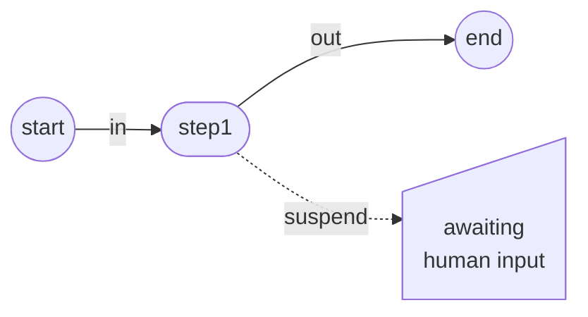
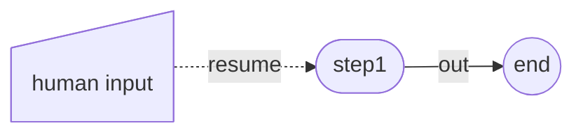

# 人在迴路

某些Workflow需要暫停以等待手動輸入，然後才能繼續。當Workflow是[suspended](/docs/workflows/suspend-and-resume#pausing-a-workflow-with-suspend)，它可以返回一條訊息，解釋為什麼暫停以及需要做什麼才能繼續。然後Workflow可以[恢復](#resuming-workflows-with-human-input)或者[保釋](#handling-human-rejection-with-bail)基於收到的輸入。這種方法非常適合手動批准、拒絕、門控決策或任何需要手動監督的步驟。

## 暫停Workflow以進行手動輸入 {/* #pausing-workflows-for-human-input */}

人機互動 (HITL) 輸入的工作原理與[pausing a workflow](/docs/workflows/suspend-and-resume) using `suspend()`. The key difference is that when human input is required, you can return `suspend()` with a payload that provides context or guidance to the user on how to continue.



```typescript {12-17,22-26} title="src/mastra/workflows/test-workflow.ts"
import { createWorkflow, createStep } from '@mastra/core/workflows'
import { z } from 'zod'

const step1 = createStep({
  id: 'step-1',
  inputSchema: z.object({
    userEmail: z.string(),
  }),
  outputSchema: z.object({
    output: z.string(),
  }),
  resumeSchema: z.object({
    approved: z.boolean(),
  }),
  suspendSchema: z.object({
    reason: z.string(),
  }),
  execute: async ({ inputData, resumeData, suspend }) => {
    const { userEmail } = inputData
    const { approved } = resumeData ?? {}

    if (!approved) {
      return await suspend({
        reason: 'Human approval required.',
      })
    }

    return {
      output: `Email sent to ${userEmail}`,
    }
  },
})

export const testWorkflow = createWorkflow({
  id: 'test-workflow',
  inputSchema: z.object({
    userEmail: z.string(),
  }),
  outputSchema: z.object({
    output: z.string(),
  }),
})
  .then(step1)
  .commit()
```

## 提供使用者回饋 {/* #providing-user-feedback */}

當Workflow暫停時，您可以訪問由`suspend()` by identifying the suspended step and reading its `suspendPayload`.

```typescript {12} title="src/test-workflow.ts"
const workflow = mastra.getWorkflow('testWorkflow')
const run = await workflow.createRun()

const result = await run.start({
  inputData: {
    userEmail: 'alex@example.com',
  },
})

if (result.status === 'suspended') {
  const suspendStep = result.suspended[0]
  const suspendedPayload = result.steps[suspendStep[0]].suspendPayload

  console.log(suspendedPayload)
}
```

### 輸出範例 {/* #example-output */}

此步驟傳回的資料可以包含原因並幫助使用者了解恢復Workflow所需的內容。

```typescript
{
  reason: 'Confirm to send email.'
}
```

## 透過手動輸入恢復Workflow {/* #resuming-workflows-with-human-input */}

與[restarting a workflow](/docs/workflows/suspend-and-resume#restarting-a-workflow-with-resume), use `resume()` with `resumeData` to continue a workflow after receiving input from a human. The workflow resumes from the step where it was paused.



```typescript {13}
const workflow = mastra.getWorkflow('testWorkflow')
const run = await workflow.createRun()

await run.start({
  inputData: {
    userEmail: 'alex@example.com',
  },
})

const handleResume = async () => {
  const result = await run.resume({
    step: 'step-1',
    resumeData: { approved: true },
  })
}
```

### 處理人類排斥`bail()` {/* #handling-human-rejection-with-bail */}

使用`bail()` to stop workflow execution at a step without triggering an error. This can be useful when a human explicitly rejects an action. The workflow completes with a `success` status, and any logic after the call to `bail()` is skipped.

```typescript {6-10}
const step1 = createStep({
  execute: async ({ inputData, resumeData, suspend, bail }) => {
    const { userEmail } = inputData
    const { approved } = resumeData ?? {}

    if (approved === false) {
      return bail({
        reason: 'User rejected the request.',
      })
    }

    if (!approved) {
      return await suspend({
        reason: 'Human approval required.',
      })
    }

    return {
      message: `Email sent to ${userEmail}`,
    }
  },
})
```

## 多輪人工輸入 {/* #multi-turn-human-input */}

對於需要在多個階段輸入的Workflow，掛起模式保持不變。每個步驟定義一個`resumeSchema`, and `suspendSchema` typically with a reason that can be used to provide user feedback.

```typescript {14-19,24-28} title="src/mastra/workflows/test-workflow.ts" oxfmt:false
import { createWorkflow, createStep } from '@mastra/core/workflows';
import { z } from 'zod';

const step1 = createStep({...});

const step2 = createStep({
  id: "step-2",
  inputSchema: z.object({
    message: z.string()
  }),
  outputSchema: z.object({
    output: z.string()
  }),
  resumeSchema: z.object({
    approved: z.boolean()
  }),
  suspendSchema: z.object({
    reason: z.string()
  }),
  execute: async ({ inputData, resumeData, suspend }) => {
    const { message } = inputData;
    const { approved } = resumeData ?? {};

    if (!approved) {
      return await suspend({
        reason: "Human approval required."
      });
    }

    return {
      output: `${message} - Deleted`
    };
  }
});

export const testWorkflow = createWorkflow({
  id: "test-workflow",
  inputSchema: z.object({
    userEmail: z.string()
  }),
  outputSchema: z.object({
    output: z.string()
  })
})
  .then(step1)
  .then(step2)
  .commit();
```

每個步驟必須按順序恢復，並單獨調用`resume()` for each suspended step. This approach helps manage multi-step approvals with consistent UI feedback and clear input handling at each stage.

```typescript {4,11}
const handleResume = async () => {
  const result = await run.resume({
    step: 'step-1',
    resumeData: { approved: true },
  })
}

const handleDelete = async () => {
  const result = await run.resume({
    step: 'step-2',
    resumeData: { approved: true },
  })
}
```

## 有關的 {/* #related */}

* [控制流程](/docs/workflows/control-flow)
* [暫停和恢復](/docs/workflows/suspend-and-resume)
