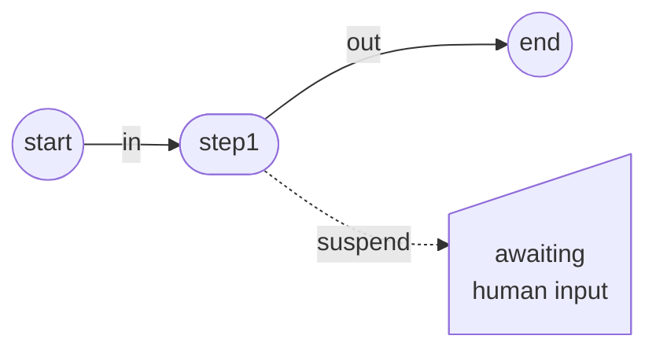

# 人工介入

有些 Workflow 須暫停等候人手輸入。[暫停](/docs/workflows/suspend-and-resume#pausing-a-workflow-with-suspend)時可回傳訊息，交代暫停原因和繼續所需的資料。收到輸入後，Workflow 可按內容[繼續執行](#resuming-workflows-with-human-input)或[提早終止](#handling-human-rejection-with-bail)。這適合人手審批、拒絕、須達到條件才可繼續的決策，以及其他需要人手監督的步驟。

## 暫停 Workflow 等候人手輸入 {/* #pausing-workflows-for-human-input */}

人工介入（HITL）與用 `suspend()` [暫停 Workflow](/docs/workflows/suspend-and-resume) 的做法相近。需要人手輸入時，可以回傳 `suspend()` 並附上資料，向用戶交代背景或說明如何繼續。



```typescript {12-17,22-26} title="src/mastra/workflows/test-workflow.ts"
import { createWorkflow, createStep } from '@mastra/core/workflows'
import { z } from 'zod'

const step1 = createStep({
  id: 'step-1',
  inputSchema: z.object({
    userEmail: z.string(),
  }),
  outputSchema: z.object({
    output: z.string(),
  }),
  resumeSchema: z.object({
    approved: z.boolean(),
  }),
  suspendSchema: z.object({
    reason: z.string(),
  }),
  execute: async ({ inputData, resumeData, suspend }) => {
    const { userEmail } = inputData
    const { approved } = resumeData ?? {}

    if (!approved) {
      return await suspend({
        reason: 'Human approval required.',
      })
    }

    return {
      output: `Email sent to ${userEmail}`,
    }
  },
})

export const testWorkflow = createWorkflow({
  id: 'test-workflow',
  inputSchema: z.object({
    userEmail: z.string(),
  }),
  outputSchema: z.object({
    output: z.string(),
  }),
})
  .then(step1)
  .commit()
```

## 向用戶說明如何繼續 {/* #providing-user-feedback */}

Workflow 暫停後，找出暫停的步驟並讀取其 `suspendPayload`，即可取得 `suspend()` 回傳的資料。

```typescript {12} title="src/test-workflow.ts"
const workflow = mastra.getWorkflow('testWorkflow')
const run = await workflow.createRun()

const result = await run.start({
  inputData: {
    userEmail: 'alex@example.com',
  },
})

if (result.status === 'suspended') {
  const suspendStep = result.suspended[0]
  const suspendedPayload = result.steps[suspendStep[0]].suspendPayload

  console.log(suspendedPayload)
}
```

### 輸出範例 {/* #example-output */}

步驟回傳的資料可包括暫停原因，並說明用戶要提供甚麼資料才可繼續執行 Workflow。

```typescript
{
  reason: 'Confirm to send email.'
}
```

## 收到人手輸入後繼續執行 Workflow {/* #resuming-workflows-with-human-input */}

做法與[恢復 Workflow](/docs/workflows/suspend-and-resume#restarting-a-workflow-with-resume)相同。收到人手輸入後，可呼叫 `resume()` 並傳入 `resumeData`，Workflow 便會由暫停的步驟繼續執行。


```typescript {13}
const workflow = mastra.getWorkflow('testWorkflow')
const run = await workflow.createRun()

await run.start({
  inputData: {
    userEmail: 'alex@example.com',
  },
})

const handleResume = async () => {
  const result = await run.resume({
    step: 'step-1',
    resumeData: { approved: true },
  })
}
```

### 以 `bail()` 處理人手拒絕 {/* #handling-human-rejection-with-bail */}

使用 `bail()` 可在某一步終止 Workflow 而不引發錯誤，例如有人明確拒絕某項操作時。Workflow 會以 `success` 狀態結束，並跳過呼叫 `bail()` 後的邏輯。

```typescript {6-10}
const step1 = createStep({
  execute: async ({ inputData, resumeData, suspend, bail }) => {
    const { userEmail } = inputData
    const { approved } = resumeData ?? {}

    if (approved === false) {
      return bail({
        reason: 'User rejected the request.',
      })
    }

    if (!approved) {
      return await suspend({
        reason: 'Human approval required.',
      })
    }

    return {
      message: `Email sent to ${userEmail}`,
    }
  },
})
```

## 多輪人工輸入 {/* #multi-turn-human-input */}

Workflow 如需在多個階段接收人手輸入，可沿用相同的暫停方式。每步都定義 `resumeSchema` 及 `suspendSchema`；後者通常包含原因，以便向用戶交代。

```typescript {14-19,24-28} title="src/mastra/workflows/test-workflow.ts" oxfmt:false
import { createWorkflow, createStep } from '@mastra/core/workflows';
import { z } from 'zod';

const step1 = createStep({...});

const step2 = createStep({
  id: "step-2",
  inputSchema: z.object({
    message: z.string()
  }),
  outputSchema: z.object({
    output: z.string()
  }),
  resumeSchema: z.object({
    approved: z.boolean()
  }),
  suspendSchema: z.object({
    reason: z.string()
  }),
  execute: async ({ inputData, resumeData, suspend }) => {
    const { message } = inputData;
    const { approved } = resumeData ?? {};

    if (!approved) {
      return await suspend({
        reason: "Human approval required."
      });
    }

    return {
      output: `${message} - Deleted`
    };
  }
});

export const testWorkflow = createWorkflow({
  id: "test-workflow",
  inputSchema: z.object({
    userEmail: z.string()
  }),
  outputSchema: z.object({
    output: z.string()
  })
})
  .then(step1)
  .then(step2)
  .commit();
```

必須按次序繼續各個步驟，每個暫停的步驟各自呼叫一次 `resume()`。這樣既方便在多階段審批中提供一致的介面回饋，亦能清楚處理各階段的輸入。

```typescript {4,11}
const handleResume = async () => {
  const result = await run.resume({
    step: 'step-1',
    resumeData: { approved: true },
  })
}

const handleDelete = async () => {
  const result = await run.resume({
    step: 'step-2',
    resumeData: { approved: true },
  })
}
```

## 相關文件 {/* #related */}

- [控制流程](/docs/workflows/control-flow)
- [暫停和恢復](/docs/workflows/suspend-and-resume)
