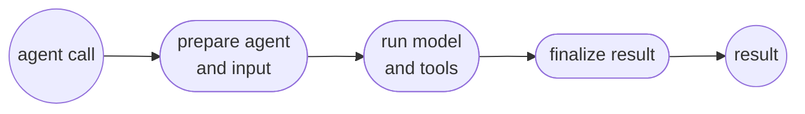
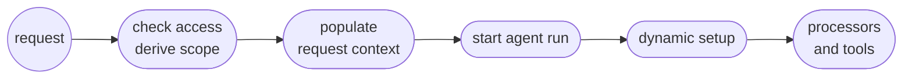
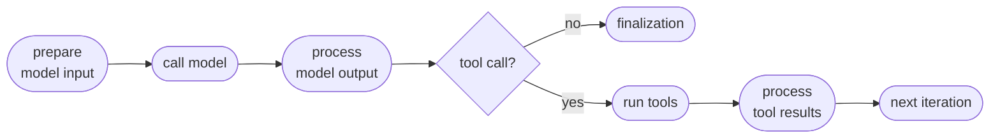

# Agent 生命週期

呼叫 [`generate()`](/reference/agents/generate) 或 [`stream()`](/reference/streaming/agents/stream) 時，Mastra 會啟動一次 Agent 執行。呼叫模型前，它會準備 Agent 及輸入。若模型要求使用 Tool，Mastra 會執行 Tool，之後可能再次呼叫模型。工作完成後，Mastra 會完成處理並回傳結果。

本指南把執行過程分為準備、迴圈執行及完成處理，說明[處理器](/docs/agents/processors)的執行時機、哪些情況會引發下一次模型呼叫，以及一般執行與持久化執行有何差異。

## 執行、迭代與模型步驟 {/* #runs-iterations-and-model-steps */}

工作發生在三個層面：

- **執行**：一次 `generate()` 或 `stream()` 呼叫所啟動的全部工作，直到最終結果或錯誤為止；也涵蓋持久化執行等待外部輸入時的暫停與恢復。
- **迴圈迭代**：Agent 迴圈的一輪，從模型步驟開始，並包含 Mastra 決定是否繼續前所要求的 Tool 工作。
- **模型步驟**：向模型 Provider 發出的一次請求及其回應，以及該請求前後執行的輸入、輸出處理器。

準備階段取決於執行階段的上下文與初始輸入處理：

- [`RequestContext`](/docs/server/request-context) 會把身分或租戶資訊等受信任的執行階段資料提供給動態設定、處理器及 Tool，但這些值不會自動加入模型提示。
- [`processInput`](/reference/processors/processor-interface#processinput) 在迴圈開始前處理初始訊息，可轉換訊息並建立後續處理器鉤子及 Tool 所需的狀態。

一次執行包含一輪或多輪迴圈迭代。模型回傳最終答案時，執行會在目前迭代後停止。模型要求使用 Tool 時，Mastra 處理結果後可能開始下一輪；但已設定的 [`stopWhen`](/reference/agents/generate#parameters) 或終止條件，也可能在 Tool 工作完成後結束執行。迭代通常對應一個模型步驟，但這只是目前的實作方式，並非穩定契約。

## 生命週期概述 {/* #lifecycle-overview */}

圖中呈現的是三個主要階段，而不是內部 Workflow 步驟。準備階段建立首次模型互動；迴圈可能多次重複模型與 Tool 工作，最後由完成處理階段產生結果。一般執行留在目前程序中；持久化執行可儲存狀態並稍後恢復。

## 準備 {/* #preparation */}

準備階段會把 Agent 定義與目前請求轉成可執行的模型互動。在此階段，Mastra 會：

- 驗證傳入的 [`RequestContext`](/docs/server/request-context)。
- 解析模型、指令、Workspace、Skill 及其他動態設定。
- 從目前輸入與已設定的記憶建立訊息清單。
- 準備迴圈使用的 Tool 和處理器。

準備結束時，執行已具備首次模型步驟所需的訊息、Tool 及處理器設定，但這些工作並非全部依嚴格順序進行。

| 準備工作 | 時機 | 對 `RequestContext` 的意義 |
| - | - | - |
| 驗證、Workspace、模型及指令 | [`processInput`](/reference/processors/processor-interface#processinput) 之前 | 必要的值在執行開始時就必須存在。 |
| 供 `processInput` 使用、由記憶、Workspace 和 Skill 推導的處理器實例 | 在 `processInput` 前解析 | 在 `processInput` 中變更上下文，無法影響這些實例的選擇。 |
| 動態 Skill 解析 | `processInput` 之前 | Skill 選擇不能依賴首次在 `processInput` 加入的值。 |
| 一般執行中的 Tool 轉換 | 與記憶及輸入準備並行 | 動態 [`tools` 回呼](/reference/agents/agent) 與 `processInput` 之間沒有保證的先後順序。 |
| `processInput` | 初始輸入準備時執行一次 | 可轉換訊息，並建立後續迴圈回呼與 Tool 執行所需的狀態。 |
| 迴圈使用的有效輸入、LLM 請求及錯誤處理器工廠 | 一般執行的準備分支匯合後 | 這些工廠可觀察較早的上下文變更，但並非每個解析器都適合透過 `processInput` 設定。 |
| 持久化執行的準備 | 持久化迴圈執行前 | 其位置與一般路徑不同，恢復執行時也可能略過初始輸入處理。 |

`generate()` 和 `stream()` 會先驗證 `RequestContext`，再呼叫 [`getDefaultOptions()`](/reference/agents/getDefaultOptions)。因此，函式形式的預設選項無法趕在驗證前補上缺少的必要值。

一般執行會從頭到尾重複使用呼叫方的 `RequestContext` 實例。動態設定、處理器及 Tool 執行拿到的是同一個即時實例，而非不同副本。變更是否可見，取決於使用方當時是否已完成解析。

## 選擇設定 `RequestContext` 的邊界 {/* #choose-the-requestcontext-boundary */}

上下文中的值只能影響尚未發生的工作。請在最早需要該值的受信任邊界設定。

例如，應用程式可檢查使用者的存取權，並推導租戶或帳戶範圍。請在 Agent 外進行檢查，把結果存入新的 `RequestContext`，再將上下文傳給 `generate()` 或 `stream()`。動態設定和 Tool 即可讀取同一可信範圍，而不必重複檢查。

上下文承載授權檢查的結果，但不會取代應用程式邊界的授權。

| 值必須影響的項目 | 設定時機 | 原因 |
| - | - | - |
| 驗證、模型、指令、Skill、Workspace、供 `processInput` 使用的輸入處理器或動態 Tool | 在 `generate()` 或 `stream()` 之前，通常由伺服器中介軟體或呼叫方程式碼設定 | 這些項目會在 `processInput` 之前或同時完成解析。 |
| 後續迴圈的處理器工廠、處理器鉤子或 Tool 執行 | 可行時在 `generate()` 或 `stream()` 之前設定，亦可在 `processInput` 設定 | 輸入處理後，這些項目都會收到同一個即時上下文。 |
| 已恢復的持久化執行 | 在可信的請求或恢復邊界設定 | 初始輸入處理器可能不會再執行；不可序列化的值必須重新建立。 |
| 模型推理 | 放入模型可見的指令或訊息 | `RequestContext` 是執行階段資料，不會自動加入提示。 |

除非刻意共享數值，否則每個獨立請求應各自建立一個上下文。[請求上下文指南](/docs/server/request-context)說明結構描述與伺服器中介軟體。

`processInput` 仍適合轉換訊息，以及建立後續迴圈所需的狀態。當中的變更可影響後續處理器鉤子和 Tool 執行，但無法改變初始驗證或已完成的 Skill、輸入處理器解析；動態 Tool 準備也可能已開始。

## Agent 迴圈 {/* #the-agent-loop */}

迴圈使用目前累積的訊息。

下一輪迭代前，Tool 結果會加入累積的訊息；最終答案則離開迴圈，進入完成處理階段。

### 每個模型步驟的處理順序 {/* #around-each-model-step */}

處理器回呼依下列公開順序執行：

1. [`processInputStep`](/reference/processors/processor-interface#processinputstep) 在下一次模型呼叫前接收累積的訊息清單。
1. [`processLLMRequest`](/reference/processors/processor-interface#processllmrequest) 在訊息轉換後接收將送給 Provider 的提示。
1. Provider 以串流回傳回應；[`processOutputStream`](/reference/processors/processor-interface#processoutputstream) 可檢查或轉換每個資料區塊。
1. [`processLLMResponse`](/reference/processors/processor-interface#processllmresponse) 在該步驟的 Provider 回應串流完成後執行。
1. [`processOutputStep`](/reference/processors/processor-interface#processoutputstep) 在模型步驟後、本機 Tool 執行前執行。
1. 若模型要求使用本機或用戶端 Tool，Mastra 會處理輸入及已設定的核准程序，接著執行 Tool 或等待其結果。
1. [`processToolResult`](/reference/processors/processor-interface#processtoolresult) 在原始結果加入訊息清單前，接收每個本機或用戶端 Tool 的結果。

由 Provider 執行的 Tool 可能以不同方式回傳結果。若延遲的 Provider 結果在後續模型串流期間抵達，`processToolResult` 會在結果抵達時執行；它並非固定出現在每個模型步驟之後。

準確的呼叫頻率、可見性保證、參數及回傳類型，請參閱 [Processor 介面的回呼時機](/reference/processors/processor-interface#callback-timing)。

### 哪些變化持續存在 {/* #what-changes-persist */}

處理器方法並非都修改同一種資料表示：

- `processInput` 與 `processInputStep` 使用即時訊息清單。它們的變更可影響後續模型步驟，也可能由記憶處理器儲存。
- `processLLMRequest` 只改變本次 Provider 呼叫的提示，適合不應改動已儲存對話紀錄的暫時性調整。
- `processOutputStream` 改變串流資料區塊。處理器狀態可在區塊之間及同一請求後續的輸出回呼之間傳遞資料。
- `processToolResult` 在原始 Tool 結果加入訊息清單前執行，可在後續模型步驟或持久化之前驗證或遮蔽內容。
- 完成處理期間，[`processOutputResult`](/reference/processors/processor-interface#processoutputresult) 可改變回傳的訊息及其中繼資料。

## 迴圈如何決定是否繼續 {/* #how-the-loop-decides-to-continue */}

模型步驟及要求的 Tool 工作完成後，Mastra 會判斷是否需要下一輪迭代。Tool 結果往往會引發另一次模型呼叫，因為模型需要利用結果產生後續回應。

達到已設定的停止條件或終止條件時，迴圈會停止。這些條件可能包括：

- 模型回傳不再要求 Tool 的最終回應。
- 根據累積步驟評估的自訂 [`stopWhen`](/reference/agents/generate#parameters) 條件。
- [`maxSteps`](/reference/agents/generate#using-maxsteps) 上限。
- 任務完成、目標達成或[子 Agent](/docs/subagents) 委派結果。
- Provider 的終止完成原因、錯誤、處理器阻斷條件或中止。

這些檢查共同運作，但不構成公開且完整的內部順序。請將 `maxSteps` 視為模型步驟的上限，並以 `stopWhen` 設定應用程式特定的完成規則。

## 完成處理 {/* #finalization */}

執行停止後便進入完成處理。無論正常完成或 Provider 擲出錯誤，`processOutputResult` 都會針對結果與訊息每個請求執行一次。訊息可能不含最終的 Assistant 回應，例如 `maxSteps` 恰好在 Tool 呼叫處結束。

已設定的輸出處理器先執行，之後才是自動附加的記憶輸出處理器，讓訊息紀錄能儲存最終形式。Observational Memory 透過自己的鉤子持久化，並不依賴自動附加的記憶輸出處理器。完成處理後，`generate()` 會完成，或串流會關閉。

完成處理與模型步驟分開：它處理整次執行的結果，而非單次 Provider 呼叫的回應。

## 錯誤、重試和中止 {/* #errors-retries-and-aborts */}

Provider API 拒絕請求時，錯誤可能進入 `processAPIError`。錯誤處理器可修改請求或訊息，並要求再次嘗試 Provider。`processAPIError` 重試與阻斷條件重試共用請求層級的 [`maxProcessorRetries`](/reference/agents/generate#parameters) 上限。若設定錯誤處理器卻未指定 `maxProcessorRetries`，Mastra 會採用預設的錯誤重試額度。需要特定上限時請明確設定 `maxProcessorRetries`。

輸入或輸出處理器呼叫 [`abort()`](/reference/processors/processor-interface#aborting-and-tripwire-chunks) 會觸發阻斷條件。設定 `retry: true` 後，符合條件的輸入步驟或輸出步驟檢查可帶著回饋重新執行模型步驟；次數受 `maxProcessorRetries` 限制。不重試的阻斷條件會停止正常執行，並出現在結果或串流中。

外部中止訊號會傳至 Provider 呼叫及 Tool 生命週期工作。觸發後，迴圈不再繼續、串流會終止；若支援，仍保留部分結果。處理器無法復原的錯誤會傳給呼叫方。

重試設定、阻斷條件及 API 錯誤處理詳見[處理器](/docs/agents/processors#retry-mechanism)。

## 一般與持久化執行 {/* #regular-and-durable-runs */}

一般 [`Agent`](/reference/agents/agent) 執行會在目前程序中維持迴圈。程序結束時，記憶體中的執行也會結束。

[持久化 Agent](/docs/harness/durable-agents) 把同一個 Agent 迴圈包在 Workflow 中。它會保存執行狀態，並透過 PubSub 發布事件，使受支援的執行環境能恢復工作、用戶端能重新連線。若狀態及事件紀錄必須在程序重新啟動後仍存在，正式環境就需要持久化後端。

持久化執行可暫停，例如等待 Tool 核准，並在稍後跨越一般程序內執行不存在的序列化邊界，從已儲存狀態恢復。

Mastra 會為持久化工作擷取可序列化 `RequestContext` 項目的快照。函式、類別實例、開啟的連線等不可序列化的值，在暫停或傳送到其他程序後都不應預期仍存在。請在可信的請求或恢復邊界，依穩定識別碼重新建立。

持久化執行從已儲存快照恢復時，會略過初始 `processInput` 處理。訊號喚醒及排程喚醒等啟動新階段的喚醒，則會再次執行。

- 每次外部請求恢復執行時，都應重做具權威性的資料補充步驟。
- 只儲存後續需要的可序列化範圍資訊。
- 不要依賴只執行一次的 `processInput` 副作用。

## 延伸閱讀 {/* #what-to-read-next */}

- [請求上下文](/docs/server/request-context)：定義、驗證並填入執行階段上下文。
- [身分驗證與身分資訊](/docs/guides/authentication-identity)：讓可信的身分及授權資料遠離模型可控制的輸入。
- [處理器](/docs/agents/processors)：設定處理器、重試與阻斷條件。
- [Processor 介面](/reference/processors/processor-interface)：查閱回呼參數與回傳值。
- [Tool](/docs/agents/tools)：設定 Tool 執行、核准及生命週期鉤子。
- [持久化 Agent](/docs/harness/durable-agents)：保存並恢復長時間執行的 Agent。
