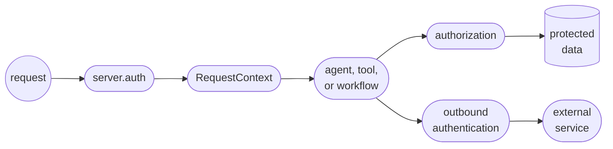

# 身份驗證和身份

了解如何保護應用程式中的 API 端點、Studio 和Agent呼叫。以程式設計方式限制存取至關重要，因為 LLM 可以快速繞過您可能新增至系統提示字元中的表面檢查。

身份驗證驗證誰在呼叫您的 Mastra 伺服器。身分是與該請求關聯的經過驗證的使用者或服務帳戶。 Mastra 透過執行時間程式碼傳遞此身份，以便每個元件都可以做出可信賴的存取決策。

您可以使用四個階段來設計該鏈：

|舞台|問題 |馬斯特拉機制|
| - | - | - |
|認證|誰在打電話？ |[`server.auth`](/docs/auth/overview) |
| Identity propagation | How does verified identity reach runtime code? | [`RequestContext`](/docs/server/request-context) |
| Authorization | What can this caller access or execute? | Application checks, role-based access control (RBAC), or [細粒度授權（FGA）](/docs/auth/fga)|
|出站認證| Mastra 應將哪一種憑證與其他服務一起使用？ |可信任Tool程式碼或模型上下文協定（MCP）連線配置 |

## 設計身分流程 {/* #design-the-identity-flow */}

將身分決策保留在應用程式的可信任端。呼叫者可以提供憑證，但只有身分驗證Provider才能決定它代表哪個使用者。運行時元件使用伺服器擁有的上下文來授權資料存取或選擇出站憑證。



這個流程建立了四個邊界：

* **傳入資料：**&#x5C07;所有請求資料視為不可信，直到身份驗證成功。
* **身分背景：**&#x8B93;伺服器擁有保留的身份值`RequestContext`.
* **Tool輸入：**&#x9632;止模型控制的輸入選擇所有權範圍。
* **外部憑證：**&#x5C07;憑證保存在受信任的運行時程式碼和外部模型輸入或Tool輸出中。

## 建立可信任身份 {/* #establish-trusted-identity */}

配置`server.auth` with an [auth provider](/docs/auth/overview) or an `authenticateToken` function. When auth is configured, built-in and custom routes require a valid user unless a route explicitly opts out.

從驗證者中選擇一個穩定的身份並將其對應到運行時所有權邊界。

```typescript title="src/mastra/index.ts"
import { Mastra } from '@mastra/core'
import { verifyAccessToken } from './lib/auth'

type AuthUser = {
  id: string
  workspaceId: string
}

export const mastra = new Mastra({
  server: {
    auth: {
      authenticateToken: async token => verifyAccessToken(token),
      mapUserToResourceId: (user: AuthUser) => `${user.workspaceId}:${user.id}`,
    },
  },
})
```

使用來自經過驗證的Provider的規範標識符，因為顯示名稱和其他可變設定檔欄位不是適當的所有權金鑰。增加足夠的範圍以防止租戶和身分系統之間發生衝突。

如果一個[custom API route](/docs/server/custom-api-routes#authentication) must be public, set `requiresAuth: false`. Public webhooks still need to verify the provider signature before trusting the body.

：：：警告

馬斯特拉路線何時公開`server.auth` isn't configured. A production deployment must configure authentication for every server surface that shouldn't be anonymous. If you set a custom `server.apiPrefix`, update the auth path configuration to use that prefix.

:::

## 選擇資源邊界 {/* #choose-the-resource-boundary */}

Mastra 验证调用者后，决定谁应该拥有其内存和线程。资源 ID 是该所有者的稳定标识符，Mastra 使用它来确定状态范围。憑證驗證身份，授權規則授予權限。

`support`. If each user's ID is their resource ID, Mastra keeps the threads separate because they have different owners. If both users map to the same organization ID, they share the organization's memory and threads instead.

使用`mapUserToResourceId` to derive this value from the verified user. After authentication succeeds, Mastra:

* 通話`mapUserToResourceId` with the authenticated user.
* 將結果儲存為伺服器擁有的值`RequestContext`.
* 使用該值來確定記憶體和線程操作的範圍。
* 忽略客戶端提供的衝突資源 ID。

：：：警告

如果`server.auth` is configured without `mapUserToResourceId`, there's no server-derived resource ID. Built-in routes then use the resource ID from the request itself (for example `memory.resource` in the body), so any authenticated caller can read and write threads under any resource ID. Mastra logs a warning at startup in this state. Always configure `mapUserToResourceId` when more than one user shares a deployment.

:::

選擇與人們應該如何共享狀態相符的最窄邊界：

|期望的邊界|範例映射 |
| - | - |
|每個使用者的私人記憶體|`user.id` |
| Shared memory for an organization | `user.organizationId` |
| User memory within a workspace and project | `${workspaceId}:${projectId}:${userId}` |

Mastra 自動將此邊界應用於記憶體和線程操作，包括觀察記憶體。`GET /api/memory/observational-memory`, `POST /api/memory/observational-memory/buffer-status`, and the Observational Memory details in `GET /api/memory/status` return `403` when the requested thread belongs to another resource or an [FGA](/docs/auth/fga) check denies it. Without `server.auth`, these routes use the `resourceId` and `threadId` the client sends, but a thread paired with a different `resourceId` still gets `403`. Application code can continue using the authenticated user in `RequestContext` when it authorizes database records or external services.

### 來自 JWT Provider的用戶 ID {/* #user-ids-from-jwt-providers */}

[`MastraJwtAuth`](/reference/auth/jwt), [Auth0](/reference/auth/auth0), and [Clerk](/reference/auth/clerk) set the authenticated user's `id` to the token's `sub` claim when the token has no `id` claim. A token with its own `id` claim keeps it. RBAC loads roles by `id`, and `id` is also the owner of the records a user creates when `mapUserToResourceId` isn't set.

沒有`mapUserToResourceId`, this means:

* 每個使用者都可以看到自己儲存的Agent、技能、工作空間和其他擁有的記錄以及公共記錄。他們創建的記錄歸他們所有，預設是私有的。在您的應用程式使用這些使用者 ID 之前建立的記錄沒有所有者，並且對所有人都可見。具有管理員權限的用戶，例如`stored-agents:admin` still see every record.
* 每個作者的ToolProvider連線都儲存在使用者的`id`. Connections saved under the shared `default` owner aren't found, so users reconnect them. Shared connections aren't affected.
* 回饋與使用者的記錄一起記錄`id` as the user ID.

若要將每個使用者保留在一個共享資源中，請傳遞`mapUserToResourceId: () => 'default'` to the auth provider. This also shares memory and owned records between all users, so use it only when that's how your app should work.

## 在資料邊界強制執行身份驗證 {/* #enforce-identity-at-the-data-boundary */}

授權屬於可信任代碼，盡可能接近受保護的操作。受信任的運行時代碼可以從經過身份驗證的用戶那裡獲取所有權`RequestContext` rather than model-generated tool input:

```typescript title="src/mastra/tools/list-orders.ts"
import { createTool } from '@mastra/core/tools'
import { z } from 'zod'
import { orders } from '../lib/orders'

type AuthenticatedUser = {
  id: string
}

export const listOrders = createTool({
  id: 'list-orders',
  description: 'List orders owned by the authenticated user',
  inputSchema: z.object({ status: z.enum(['open', 'shipped']).optional() }),
  execute: async ({ status }, { requestContext }) => {
    const user = requestContext.get('user') as AuthenticatedUser | undefined

    if (!user?.id) {
      throw new Error('Authenticated user is missing')
    }

    return orders.list({ ownerId: user.id, status })
  },
})
```

型號可選擇`status` but it can't choose `ownerId`.

對自訂路由和Workflow步驟使用相同的規則，從經過驗證的上下文中派生所有權，然後在傳回資料之前限制資料庫查詢或服務呼叫。

## 透過運行時代碼攜帶身份 {/* #carry-identity-through-runtime-code */}

Auth 中間件將可信任身分寫入`RequestContext` before handlers run. Mastra then passes the same context to:

* **Agent選項：**&#x89E3;決特定於請求的Agent配置。
* **Tool執行：**&#x8B80;取裡面的身份`execute` callbacks.
* **Workflow步驟：**&#x8B80;取步驟內的身份`execute` callbacks.
* **伺服器處理程序：**&#x8B80;取中間件和自訂 API 路由內的身份。

使用應用程式密鑰`requestContext.get()`. The [RequestContext guide](/docs/server/request-context) documents the available component APIs, middleware patterns, and reserved runtime keys used by advanced integrations.

`RequestContext`不是環境全域狀態。在 Mastra 伺服器請求路徑之外啟動Agent或Workflow時明確傳遞它。

：：：提示

身分可以個性化說明並選擇可用的Tool，但這些選擇不是授權檢查。在涉及受保護資源的元件或 FGA 策略中強制執行存取。

:::

## 從受信任的身份中選擇出站憑證 {/* #select-outbound-credentials-from-trusted-identity */}

傳入的身份驗證令牌和下游服務憑證解決不同的問題：

* **代幣轉發：**&#x5916;部服務信任提供給 Mastra 的相同不記名令牌。
* **憑證選擇：**&#x7D93;過身份驗證的使用者的租用戶選擇由應用程式儲存的單獨憑證。

僅當接收服務打算信任該令牌時才使用令牌轉發。這包括對接受呼叫者自己的令牌的服務的出站呼叫。它不允許 MCP 伺服器將其收到的 MCP 令牌轉送到另一個 API。對於多租用戶服務，請改為在受信任的Tool程式碼中解析租用戶範圍的憑證：

```typescript title="src/mastra/tools/list-invoices.ts"
import { createTool } from '@mastra/core/tools'
import { z } from 'zod'

import { billing, tenantCredentials } from '../lib/billing'

type AuthenticatedUser = {
  organizationId: string
}

export const listInvoices = createTool({
  id: 'list-invoices',
  description: 'List invoices for the authenticated tenant',
  inputSchema: z.object({ limit: z.number().int().min(1).max(100).default(20) }),
  execute: async ({ limit }, { requestContext }) => {
    const user = requestContext.get('user') as AuthenticatedUser | undefined

    if (!user?.organizationId) {
      throw new Error('Authenticated organization is missing')
    }

    const credential = await tenantCredentials.getBillingToken(user.organizationId)
    return billing.listInvoices({ limit, token: credential.token })
  },
})
```

將憑證Provider設定為對未知資源關閉失敗並傳回最低權限憑證。保守秘密，避免其錯誤。此模型僅提供業務輸入，例如`limit`. Trusted code selects the tenant and credential.

當您的應用程式連接到外部 MCP 伺服器時，適用相同的模式。使用經過驗證的使用者的租用戶來選擇儲存的憑證。當該 MCP 伺服器接受呼叫者自己的令牌時，從下列位置讀取為其準備的令牌：`MASTRA_AUTH_TOKEN_KEY` and send that instead of a stored credential. Expose only the resulting tools to the agent. This is an outgoing credential: an MCP server must not forward the MCP token it received to another API. See [MCP connections](/docs/connections/mcp) for client configuration and [access upstream services safely](/docs/guides/mcp-authentication-authorization#access-upstream-services-safely) for the audience boundary.

## 將身分轉送至 MCP Tool {/* #forward-identity-to-mcp-tools */}

有關 MCP 憑證、委派存取和Tool權限之間的區別，請參閱[Authentication and authorization with MCP](/docs/guides/mcp-authentication-authorization).

預設情況下，當`MCPServer` runs behind `server.auth`, Mastra places the authenticated caller in the MCP `authInfo` object. Server tools can use this identity without parsing the request again:

```typescript title="src/mastra/tools/get-customer-record.ts"
import { createTool } from '@mastra/core/tools'
import { z } from 'zod'

import { customers } from '../lib/customers'

export const getCustomerRecord = createTool({
  id: 'get-customer-record',
  description: 'Get the authenticated customer record',
  inputSchema: z.object({}),
  execute: async (_input, { mcp }) => {
    const user = mcp?.extra.authInfo?.extra?.user as { id?: string } | undefined

    if (!user?.id) throw new Error('Authenticated MCP caller is missing')
    return customers.getByUserId(user.id)
  },
})
```

本範例使用預設網橋。 Mastra 先保留任何`req.auth` value set by middleware. Otherwise, `server.mcpOptions.setRequestAuth` defines the `authInfo` shape when configured. Whichever source supplies `req.auth` must provide the fields your MCP tools read.

`setRequestAuth`和上游中間件僅控制`authInfo`. Whenever `req.auth` is set, Mastra also gives MCP tools the user, permissions, roles, resource, and organization that server auth resolved, through the tool's `requestContext`. These values come from server code, never from the MCP client, and `authInfo` doesn't change them, even when it names a different principal. Read identity from one source consistently in each tool.

當您配置時`MCPServer.mapAuthInfoToUser` and it returns a user, that user replaces `requestContext.get('user')`, which fine-grained authorization reads. Permissions, roles, resource, and organization stay as server auth resolved them.

`MCPServer.mapAuthInfoToUser`當MCP傳輸身分必須成為使用者所消費的時執行反向映射[fine-grained authorization](/docs/auth/fga). Keep the mapping at the transport boundary instead of accepting a user ID as a tool argument.

## 在模型邊界之外保守秘密 {/* #keep-secrets-outside-the-model-boundary */}

`RequestContext`Tool執行在可信任應用程式程式碼中運行。此模型不會自動接收其內容。

|資訊|可信賴運行時代碼 |型號|
| - | - | - |
|經過驗證的使用者位於`RequestContext` | Available | Only when application code adds it to instructions or results |
| Raw token in `MASTRA_AUTH_TOKEN_KEY` | Available | Keep it out of prompts and tool results |
| Tenant API keys and service credentials | Available to the code that resolves them | Keep them outside model-visible data |
| Tool arguments | Treat them as untrusted input | Usually selected by the model |
| Tool results | Available | Usually returned to the model |

僅傳回模型所需的資料。在傳回Tool結果之前刪除憑證和敏感上游欄位。

保留的 Mastra 鍵（以`mastra__` or `__mastra_`, including `MASTRA_AUTH_TOKEN_KEY`) are omitted when request context is attached to tracing spans or saved on score records. Application logs and custom telemetry must apply the same principle to other credentials and sensitive identity fields.

## 認證後新增授權 {/* #add-authorization-after-authentication */}

使用與資源相符的授權層：

|要求|使用|
| - | - |
|針對管理員、會員和檢視者等角色的廣泛功能 |`server.rbac` |
| Permissions that depend on a user-resource relationship | `server.fga` |
| Ownership of application database rows | A scoped query or application authorization check |

身份缺失或無效會產生`401`. A known identity without permission produces `403`. The [FGA guide](/docs/auth/fga) owns the detailed configuration.

:::提示\[📹觀看]

手錶[an FGA production walkthrough](https://www.youtube.com/watch?v=aT2viVoHs7A) to see how FGA works in a deployed application.

:::

## 生產前驗證 {/* #verify-before-production */}

* \[ ] **Reject anonymous requests:** Confirm every protected server surface returns `401` without credentials.
* \[ ] **Reject invalid credentials:** Confirm failed authentication doesn't populate trusted `RequestContext` values.
* \[ ] **Verify public webhooks:** Check the provider signature before trusting the request body.
* \[ ] **Protect thread ownership:** Confirm one user can't access another user's thread.
* \[ ] **Ignore ownership input:** Prevent tool input from replacing server-owned identity or scope.
* \[ ] **Reject forbidden access:** Confirm the enforcing layer returns `403` for a known user without permission.
* \[ ] **Select credentials safely:** Resolve downstream credentials from trusted identity rather than model-controlled input.
* \[ ] **Keep secrets private:** Confirm secrets stay outside model-facing and observability data.
* \[ ] **Pass context explicitly:** Supply trusted `RequestContext` values in direct agent and workflow tests.

對於 Studio 中的手動測試，請使用[request context presets](/docs/server/request-context#studio). Use production authentication outside local development.
