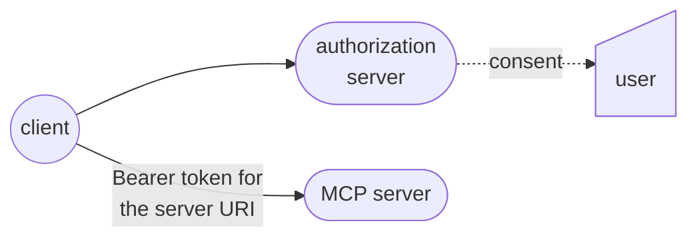

# MCP 驗證與授權

Mastra 應用程式可能連線至他人受保護的 MCP 伺服器，也可能向第三方用戶端提供自己的工具與資料。兩種方向各自需要不同的憑證和檢查。

不論是哪個方向，MCP 連線都會跨越多道安全邊界：驗證呼叫者身分，並不能決定他可以讀取哪些客戶紀錄；允許連線，也不代表允許執行每項工具操作。憑證、委派存取權和應用程式權限應分開判斷。

本指南說明 Mastra 作為 MCP 用戶端與伺服器時的判斷方式。文中的協定要求參照 [2026 年 7 月 28 日版 MCP 授權規範](https://modelcontextprotocol.io/specification/2026-07-28/basic/authorization)。

## 了解安全邊界 {/* #understand-the-boundaries */}

以下三項決策回答不同問題：

- **身分驗證**：確認呼叫者的身分，例如使用者或服務帳號。
- **委派存取**：讓用戶端使用透過授權伺服器授予的存取權。OAuth 存取權杖只授權存取指定資源，不能當成通用身分憑證。
- **應用程式授權**：判斷呼叫者能否對資料執行特定操作，例如更新所屬組織的發票。

在 HTTP OAuth 流程中，這些是彼此獨立的角色，並非同一項服務：

MCP 伺服器是受保護的資源，不一定是讓使用者登入的服務。授權伺服器負責核發權杖，可以與 MCP 伺服器分開。用戶端取得並提交權杖。在由使用者委派存取的流程中，授權伺服器會視需要與使用者互動，完成身分驗證和同意授權；並非每種流程都需要使用者參與。

應用程式在圖中的位置，決定它需要管理哪些憑證。使用 [`MCPClient`](/reference/tools/mcp-client) 時，Mastra 應用程式會連線至另一部 MCP 伺服器；使用 [`MCPServer`](/reference/tools/mcp-server) 時，應用程式則向其他用戶端提供功能。同一個應用程式可以同時扮演兩種角色，但入站與出站憑證對應不同的安全邊界。

MCP 授權並非必須。對於 HTTP 傳輸，支援授權的實作應遵循規範。使用 stdio 的實作則應從環境取得憑證，而不應使用此 HTTP 授權流程。先選擇傳輸方式，再選擇憑證機制。

## 連線至受保護的 MCP 伺服器 {/* #connect-to-protected-mcp-servers */}

依遠端伺服器應針對誰的存取權進行控管，選擇適當憑證：

| 存取模式 | Mastra 整合方式 | 應用程式的責任 |
| - | - | - |
| 共用服務存取權 | 透過 `MCPClient` 要求標頭或自訂 `fetch`，設定該伺服器專用的憑證。 | 限制服務帳號的存取權。不要把共用憑證視為終端使用者擁有相同權限的證明。 |
| 由各使用者分別委派存取 | 透過 `authProvider`，為每部伺服器設定獨立的 `MCPOAuthClientProvider`。 | 隔離各使用者的 Provider、連線、權杖及儲存的註冊狀態。 |

靜態與執行階段工具的設定方式請參閱 [MCP 連線設定](/docs/connections/mcp)；Provider 設定和儲存方式請參閱 [OAuth 用戶端參考文件](/reference/tools/mcp-client#oauth-authentication)。

每部 MCP 伺服器各自使用一個 Provider，能做到以下事情，但也有其限制：

- 它能避免同一個 Provider 的授權工作階段狀態在伺服器之間共用。
- 它不會隔離使用者或授權伺服器的簽發者。Mastra 預設將 OAuth 狀態存在記憶體中；自訂 `OAuthStorage` 決定持久化方式，因此儲存範圍應限定在個別使用者與連線。
- 它不會替你將憑證綁定至簽發者。規範要求註冊憑證綁定簽發者，且不同授權伺服器的註冊及權杖狀態必須分開。簽發者變更時，請勿重複使用這些憑證。

### 註冊與瀏覽器回呼 {/* #registration-and-browser-callbacks */}

規範建議支援 **Client ID Metadata Documents (CIMD)**，以 HTTPS 中繼資料 URL 識別用戶端；也定義了預先註冊。支援所有註冊方式的用戶端，若有既存的預先註冊資料，應優先使用。舊版 Dynamic Client Registration (DCR) 仍可選用以維持相容性，但新實作不再建議採用。詳見對應版本的[用戶端註冊規則](https://modelcontextprotocol.io/specification/2026-07-28/basic/authorization/client-registration)。

`MCPOAuthClientProvider` 不會在執行階段註冊用戶端，也不支援 DCR。請只設定一種用戶端身分：已在授權伺服器預先註冊的用戶端使用 `clientInformation`，CIMD 則使用 `clientMetadataUrl`。部署前，請確認授權伺服器支援所選機制。設定範例請參閱 [OAuth 用戶端參考文件](/reference/tools/mcp-client#oauth-authentication)。

Mastra 的互動式 `authenticate()` 流程使用本機回環回呼伺服器，並非託管式的多使用者登入端點。託管應用程式必須自行提供回呼端點，並將每次授權嘗試對應至正確的使用者與 Provider。詳見[互動式瀏覽器驗證](/reference/tools/mcp-client#interactive-browser-authentication)。

### 授權回應的處理責任 {/* #authorization-response-responsibilities */}

針對選用的用戶端整合方式，請分別確認以下協定責任：

- 用戶端必須實作 Proof Key for Code Exchange (PKCE)、確認授權伺服器宣告支援，並在技術上可行時使用 `S256`。
- 重新導向 URI 必須使用 HTTPS 或 localhost。授權伺服器必須與已註冊的重新導向 URI 完全相符。用戶端應使用並驗證 OAuth `state`。

如果授權回應中的 `iss` 與已驗證授權伺服器中繼資料所記錄的簽發者不完全相符，用戶端也必須拒絕回應。具體行為取決於回應內容，以及伺服器是否宣告 `authorization_response_iss_parameter_supported`：

| 授權回應的 `iss` | 伺服器宣告支援 `iss` | 用戶端動作 |
| - | - | - |
| 存在且與記錄的簽發者完全相符 | 任意值 | 繼續 |
| 存在但不相符 | 任意值 | 交換授權碼前拒絕 |
| 缺少 | `true` | 交換授權碼前拒絕 |
| 缺少 | `false` 或未提供 | 允許 |

詳見[授權回應驗證規則](https://modelcontextprotocol.io/specification/2026-07-28/basic/authorization#authorization-response-validation)。驗證 `state` 並不等於驗證簽發者。

在依賴所選整合的 `authProvider` 設定前，請確認它履行上述責任。完整規則請參閱[安全性考量](https://modelcontextprotocol.io/specification/2026-07-28/basic/authorization/security-considerations)。

## 保護 Mastra MCP 伺服器 {/* #protect-a-mastra-mcp-server */}

先分別釐清兩個問題：用戶端如何找出取得權杖的位置？伺服器又如何驗證該權杖？

如果伺服器使用授權，協定流程如下：

1. 用戶端探索 MCP 伺服器的受保護資源中繼資料，從中得知其授權伺服器。
1. 用戶端探索選定授權伺服器的中繼資料，並取得供 MCP 伺服器使用的權杖。
1. MCP 伺服器先驗證權杖，再由應用程式授權所要求的操作。

規範要求提供受保護資源中繼資料，以及授權伺服器探索機制。公布簽發者或支援的 scope，並不會自動驗證權杖或強制執行權限。詳見[授權伺服器探索](https://modelcontextprotocol.io/specification/2026-07-28/basic/authorization/authorization-server-discovery)。

使用權杖時，用戶端必須在授權和權杖要求中，以 `resource` 指定 MCP 伺服器的標準 URI；之後要在 `Authorization` 標頭傳送存取權杖，絕不能放在查詢字串。伺服器必須驗證權杖有效且以自身為對象，包括檢查其 audience；權杖無效或過期時須回傳 HTTP 401。

Mastra 的 `createOAuthMiddleware` 可提供受保護資源中繼資料，並對未帶 bearer token 的要求發出驗證質詢。它會呼叫已設定的權杖驗證器，並拒絕標示為無效的結果。

:::warning

若未設定驗證器，中介軟體會接受未經驗證的權杖。此行為僅供開發與測試使用，無法保護正式環境。

:::

請依簽發者設定適當的驗證，包括 audience 與到期時間檢查。驗證結果也必須連結至工具使用的可信身分；中介軟體不會替你進行身分對應。

透過 `server.auth` 保護 Mastra 路由，與提供可互通的 OAuth 探索機制，是兩項不同工作。設定其中一項，不代表另一項已經就緒。

### Mastra 為 MCP 伺服器註冊的路由 {/* #routes-mastra-registers-for-an-mcp-server */}

除了 MCP 傳輸端點，Mastra 也註冊供 Studio 列出伺服器、查看工具、執行工具與讀取資源的 REST 路由。完整清單請參閱 [MCP 路由參考文件](/reference/server/routes#mcp)。這些路徑預設使用 `/api` 前綴。

`POST /api/mcp/:serverId/tools/:toolId/execute` 路由直接呼叫 `executeTool()`，不會經過協定用戶端。若已設定 Mastra FGA Provider，`MCPServer.executeTool()` 會依據 `requestContext` 中的使用者檢查工具執行權限。REST 工具清單也會透過 FGA 篩選工具，但這些權限檢查不能取代路由的身分驗證。

這些路由的內建身分驗證取決於 `server.auth`。沒有設定它時，`requiresAuth: true` 不會強制驗證。若自訂中介軟體只檢查 `/mcp` 或 `/sse` 傳輸路徑，REST 路由仍會開放。使用自訂中介軟體而非 `server.auth` 時，應預設拒絕 `/api/mcp/*`，並只在完成驗證後允許存取。

### 將已驗證身分傳給工具 {/* #pass-verified-identity-to-tools */}

Mastra 伺服器處理 MCP 要求時，驗證橋接層會保留既有的 `req.auth`。否則，若已設定 `server.mcpOptions.setRequestAuth`，就使用該設定；再否則從要求內容建立 `authInfo`。使用預設橋接方式時，已驗證的使用者位於 `authInfo.extra.user`。

請根據可信的驗證結果填入該身分，因為欄位對應本身不會驗證憑證。橋接方式請參閱[將身分傳給 MCP 工具](/docs/guides/authentication-identity#forward-identity-to-mcp-tools)；對應關係請參閱 [`authInfo` 的來源](/reference/tools/mcp-server#where-authinfo-comes-from)。

## 授權工具與資料 {/* #authorize-tools-and-data */}

OAuth scope 說明已授予的存取權，但不能取代應用程式的權限及資料所有權檢查。規範建議要求最小必要的 scope，並說明操作需要更多權限時如何逐步授權。不要假設 Mastra 會自動合併 scope，或針對應用程式政策自動發出權限不足質詢。

設定 Mastra FGA Provider 後，`MCPServer` 會篩選 `tools/list`，並在 `tools/call` 檢查工具執行權限。`mapAuthInfoToUser` 會將可信的 MCP 驗證資訊對應到這些檢查所使用的使用者。政策設定請參閱[細粒度授權](/docs/auth/fga)；MCP 專用對應請參閱 [`MCPServer` 設定](/reference/tools/mcp-server#configuration-properties)。

控制工具是否顯示還不夠：呼叫者即使沒有先列出工具，仍可嘗試呼叫。請在呼叫時檢查權限，並確認每筆要求的紀錄屬於呼叫者可存取的組織或使用者。應從可信的伺服器內容判定呼叫者與租戶，而不是採用模型提供的工具參數。人工核准可以確認預期操作，但不能取代這些檢查。

MCP 工具的 FGA 整合不會自動授權資源、提示或訂閱，其對應設定也不適用於內部 Agent 或 Workflow 的工具執行。如果公開這些功能，請在應用程式程式碼中分別授權。

:::warning

不要假設工具權限也能保護透過資源、提示或訂閱提供的呼叫者敏感資料。

:::

## 安全存取上游服務 {/* #access-upstream-services-safely */}

MCP 存取權杖是提供給 MCP 伺服器使用的。規範禁止將它直接轉交上游 API。工具呼叫其他服務時，應使用專供該服務使用的獨立憑證，並由可信的應用程式程式碼依已授權的使用者或租戶選擇。

存取權杖、更新權杖與服務憑證，不應出現在模型可見的指示、工具參數或工具結果中。只回傳完成工作所需的資料。[驗證與身分指南](/docs/guides/authentication-identity#keep-secrets-outside-the-model-boundary)說明了這道模型邊界。

## 正式環境檢查清單 {/* #production-checklist */}

- [ ] **驗證權杖：**依簽發者設定驗證，包括 audience 和到期時間檢查，並確認未經驗證的權杖會被拒絕。
- [ ] **質詢缺少權杖的要求：**確認所有受保護的伺服器路徑，在沒有 bearer token 時都回傳 `401`。
- [ ] **保護 MCP REST 路由：**若未使用 `server.auth`，確認未通過驗證時無法存取 `/api/mcp/:serverId/tools*`、`/api/mcp/:serverId/resources*` 和 `/api/mcp/v0/servers*`。如果 API 前綴不是 `/api`，請改用實際前綴。
- [ ] **隔離使用者：**確認某位使用者的 Provider、連線與已存憑證不會供其他使用者重複使用。
- [ ] **憑證綁定簽發者：**確認授權伺服器變更時，不會重複使用註冊資料和權杖。
- [ ] **拒絕未授權操作：**確認沒有權限的呼叫者在 `tools/call` 和 `POST /api/mcp/:serverId/tools/:toolId/execute` 都會被拒絕，即使他從未列出該工具。
- [ ] **依呼叫者限制紀錄範圍：**確認查詢紀錄時，租戶資訊取自可信的伺服器內容，而不是工具參數。
- [ ] **權杖只供指定資源使用：**確認上游呼叫使用獨立憑證，且絕不轉送 MCP 權杖。
- [ ] **避免向模型揭露機密：**確認權杖與憑證不會出現在指示、工具參數或工具結果中。

## 後續步驟 {/* #next-steps */}

- 依照 [MCP 連線設定](/docs/connections/mcp)與 [`MCPClient` 參考文件](/reference/tools/mcp-client)，連線至受保護的伺服器。
- 參閱 [`MCPServer` 參考文件](/reference/tools/mcp-server)，了解如何提供自己的工具，以及傳輸與內容選項。
- 透過[細粒度授權](/docs/auth/fga)加入權限檢查。
- 透過[驗證與身分指南](/docs/guides/authentication-identity)追查傳入要求的身分。
