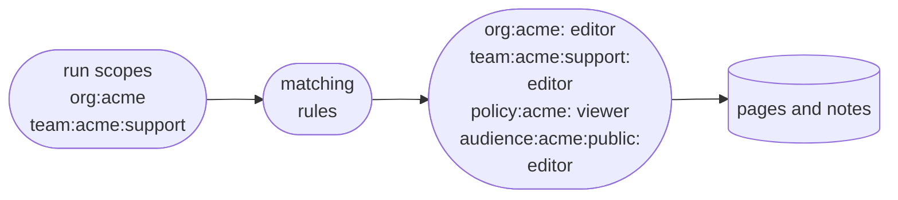

# 範圍和存取權限

範圍控制Agent可以在知識中看到和更改的內容。您決定每種範圍允許什麼。您的伺服器決定每次運行或Agent呼叫的範圍。該模型僅適用於頁面並記錄這些範圍給它的信息，並且它不能改變任何一個決定。

：：：阿爾法

知識處於阿爾法階段。其 API 可能會在不同版本之間變更。每次Tool呼叫時都會檢查存取權限，但 alpha 版本尚不能保證作用域之間的隔離。不要在 Knowledge 中儲存任何絕不能到達其他客戶或使用者的內容。

:::

## 聲明範圍 {/* #declare-scopes */}

一個**scope** is an area of Knowledge that holds pages and notes. Each scope has an address, such as `org:acme`, `team:acme:support` or `resource:dana`。第一個冒號之前的部分是作用域的類型，例如`team`。其餘部分標識該類型的一個範圍。

知識沒有內建的範圍類型。您在中声明所需的类型`scopes` option on `Knowledge`. Each type is a pattern, such as `team:$orgId:$teamId`. A `$name` segment is a placeholder that matches any value. The address `team:acme:support` matches that pattern with `$orgId = acme`和`$teamId = support`.

此範例設定了以下規則：

* 支援團隊的成員可以編輯其團隊的頁面。
* 組織中的每個人都可以閱讀團隊的頁面和公司政策。
* 組織成員可以編寫公共頁面，公共常見問題解答Agent可以讀取這些頁面。
* 其他組織看不到任何內容。

```typescript title="src/mastra/knowledge.ts"
import { Knowledge, knowledgeMemoryScopes } from '@mastra/core/knowledge'
import { LibSQLStore } from '@mastra/libsql'

export const knowledge = new Knowledge({
  id: 'company',
  storage: new LibSQLStore({ id: 'knowledge', url: 'file:./knowledge.db' }),
  tools: true,
  scopes: {
    ...knowledgeMemoryScopes(),
    'team:$orgId:$teamId': {
      description: 'A team',
      belongsTo: 'org:$orgId',
      access: [
        { principal: 'self', role: 'editor' },
        { principal: 'org:$orgId', role: 'viewer' },
      ],
    },
    'policy:$orgId': {
      description: 'Company policies',
      access: [{ principal: 'org:$orgId', role: 'viewer' }],
    },
    'audience:$orgId:public': {
      description: 'Pages for public visitors',
      access: [
        { principal: 'self', role: 'viewer' },
        { principal: 'org:$orgId', role: 'editor' },
      ],
    },
  },
})
```

[`knowledgeMemoryScopes()`](/reference/knowledge/knowledge-memory-scopes)新增三種類型：`org:` for each organization, plus Memory's `resource:` type for users and `thread:` type for conversations. A run is the owner of the `resource:` and `thread:` scopes it holds, and an editor of its `org:` scope. The FAQ agent in [For one agent](#for-one-agent) reads the `audience:` scope.

## 訪問規則和角色 {/* #access-rules-and-roles */}

每個聲明的`access` list says who gets which role on scopes of that type. Each entry is a **rule** with a `principal` and a `role`. The principal says which runs the rule applies to. A rule applies to a run when the run holds a scope that matches the principal. A principal is either `self` or one of your declared patterns. In the `team:$orgId:$teamId` declaration:

* `self`表示正在訪問的團隊範圍。跑步控股`team:acme:support` is an editor there.
* `org:$orgId`表示團隊自己的組織，因為它重複了團隊的組織`$orgId`. A run holding `org:acme` can read `team:acme:support`, but not `team:globex:support`.

每個角色都可以執行其之上的角色可以執行的所有操作：

|角色 |可|
| - | - |
|`viewer` | Search and read pages and notes |
| `contributor` | Create pages and add notes |
| `editor` | Edit pages, move them within a scope, change who can see a note, remove notes, and pin pages |
| `owner` | Move pages to another scope, merge a page into another page, and delete pages |

`belongsTo`將一個範圍放在樹中的另一個範圍下，就像資料夾中的資料夾一樣。它本身不提供任何存取權限。聲明還可以新增模板頁面、子範圍和顯示標籤。[Scope declarations](/reference/knowledge/scope-declarations) lists every field and the errors Knowledge reports at startup.

## 設定運行範圍 {/* #set-a-runs-scopes */}

**運行範圍**是運行的範圍。他們識別運行所針對的使用者、團隊或對話。只有您的伺服器代碼設定它們。模型無法更改它們，客戶端也無法在請求正文中發送它們。

只有當規則賦予運行某個作用域時，它才會在某個作用域中發揮作用。每個運行範圍也必須與聲明的類型匹配，否則知識Tool會失敗。

### 從您的伺服器 {/* #from-your-server */}

您的伺服器知道用戶是誰。在中間件中設定使用者的範圍`MASTRA_SCOPES_KEY` request context key, as strings such as `org:acme`. In this example, `getUser()` is your app's own login lookup, and `support` is an agent with Knowledge attached:

```typescript title="src/mastra/index.ts"
import { Mastra } from '@mastra/core/mastra'
import { MASTRA_RESOURCE_ID_KEY, MASTRA_SCOPES_KEY } from '@mastra/core/request-context'

export const mastra = new Mastra({
  agents: { support },
  server: {
    middleware: [
      async (c, next) => {
        const user = await getUser(c.req.header('Authorization'))
        const requestContext = c.get('requestContext')

        requestContext.set(MASTRA_SCOPES_KEY, [
          `org:${user.orgId}`,
          ...user.teams.map(team => `team:${user.orgId}:${team}`),
          `resource:${user.id}`,
        ])
        requestContext.set(MASTRA_RESOURCE_ID_KEY, user.id)

        await next()
      },
    ],
  },
})
```

還設定了`MASTRA_RESOURCE_ID_KEY` to the user's ID. The server then checks thread ownership against the same user. See [request context](/docs/server/request-context#reserved-keys).

### 在直接Agent呼叫中 {/* #in-a-direct-agent-call */}

當您的程式碼直接呼叫Agent時，請傳遞範圍`scopes` option:

```typescript
await support.generate('How do I handle a chargeback?', {
  scopes: ['org:acme', 'team:acme:support'],
  memory: { resource: 'dana', thread: 'ticket-91' },
})
```

有了內存，運行還可以保存`resource:` and `thread:` scopes from the `memory` option, here `resource:dana` and `thread:ticket-91`. A run can hold only one of each. If you pass a `resource:` scope that differs from `memory.resource`, the run fails. `resource:` and `thread:` scopes take Memory's IDs unchanged, and Knowledge encodes them. Every other scope is a canonical address: encode an ID that contains `:`, `/`, `#` or `%` with [`encodeKnowledgeScopeId()`](/reference/knowledge/knowledge-memory-scopes#encodeknowledgescopeid), such as `` `org:${encodeKnowledgeScopeId(user.orgId)}` ``.

### 對於一名Agent {/* #for-one-agent */}

一個Agent的`scopes` option changes the scopes for that agent's runs. A list adds to the scopes from the request context and the call. A function receives those scopes and returns the final list, so it can give an agent less access than the user has. This public FAQ agent replaces the user's `org:` scope with the org's `audience:` scope, so it reads the org's public pages but none of its other pages. It keeps the user's `resource:` and `thread:` scopes, so it can still read pages in those:

```typescript
export const faq = new Agent({
  id: 'faq',
  name: 'FAQ',
  instructions: 'You answer public questions about Acme.',
  model: '__GATEWAY_OPENAI_MODEL__',
  knowledge,
  memory,
  scopes: ({ scopes }) =>
    scopes.flatMap(scope => {
      if (scope.startsWith('org:')) return [`audience:${scope.slice(4)}:public`]
      if (scope.startsWith('resource:') || scope.startsWith('thread:')) return [scope]
      return []
    }),
})
```

該函數必須傳回每個`resource:` and `thread:` scope it receives. Memory uses them to identify the user and thread. The run fails if one is missing.

## 如何決定存取權限 {/* #how-access-is-decided */}

每次Tool運行時，Knowledge 都會計算出運行可以到達哪些範圍以及扮演哪個角色：

1. 它從運行範圍開始。
2. 它找到其主體與這些範圍之一相符的每條規則，並為運行提供該規則的角色。
3. 它停在那裡。規則中的角色不會導致更多角色。

例如，對於運行持有`org:acme` and `team:acme:support`:



範圍也不繼承存取權。一個角色`org:acme` gives nothing in the scopes placed under it unless a rule says so.

對於跑步者來說，任何超出其範圍的東西看起來都不存在。隱藏的頁面看起來與缺少的頁面相同。當運行可以達到某個範圍但其角色太弱時，錯誤會指出它需要哪個角色。

### 注意可見性 {/* #note-visibility */}

每個註釋都是**stamped** with one or more scopes. A run sees a note only when it can read the page and at least one of the note's stamps. The run doesn't have to hold the stamp. When the note links to other pages with `[[...]]`, the run also needs to be able to read the scope of each linked page, though a link that matches no page is ignored. For example, on a team page:

* `resource:dana` is visible only to Dana's runs, because only they can read `resource:dana`.
* `team:acme:support` is visible to every run that can read the team scope. With the rules above, that's the whole of `org:acme`, not only the team.

### 測試訪問`explainAccess()` {/* #test-access-with-explainaccess */}

[`explainAccess()`](/reference/knowledge/knowledge-class#explainaccess)取得運行範圍和範圍或頁面的清單。它會傳回那些運行範圍在那裡的角色，以及賦予它的規則。

與上述所有規則一樣，從作用域位址綁定的規則僅取決於您的聲明。測試可以檢查它們，而無需呼叫模型或編寫頁面。通過範圍綁定的規則[place in the tree](/reference/knowledge/scope-declarations#place-scopes-with-belongsto) gives no role until a writing run has placed the scope, so test those after a write:

```typescript title="src/mastra/knowledge.test.ts"
import { describe, expect, it } from 'vitest'
import { knowledge } from './knowledge'

const roleOn = async (scopes: string[], scope: string) =>
  (await knowledge.explainAccess(scopes, { scope })).role

describe('team access', () => {
  it('lets a team edit its own scope', async () => {
    expect(await roleOn(['org:acme', 'team:acme:support'], 'team:acme:support')).toBe('editor')
  })
  it('lets the org read it', async () => {
    expect(await roleOn(['org:acme'], 'team:acme:support')).toBe('viewer')
  })
  it('hides it from another org', async () => {
    expect(await roleOn(['org:globex'], 'team:acme:support')).toBeNull()
  })
})
```

：：：警告

使用`explainAccess()` only in server code. It shows whether a page is missing or hidden, and a run must never learn that. Don't expose it through an agent tool, or through a server route without admin-level auth.

:::

## 後續步驟 {/* #next-steps */}

下一個，[give an agent the Knowledge tools](/docs/knowledge/agents-and-tools) so it can search, read and write in the scopes its runs hold.
