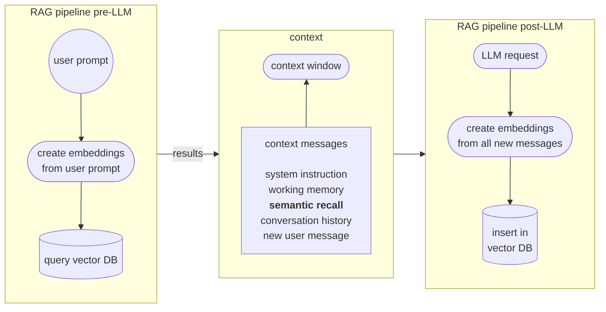

import Tabs from "@theme/Tabs";
import TabItem from "@theme/TabItem";

# 語意召回

語意召回是 Agent Memory 內建的檢索增強生成（RAG）方式。使用者傳送訊息時，Mastra 會搜尋語意相近的過往訊息，並將最相關的訊息加入 Agent 的上下文。

按語意比對很重要，因為人們記住的通常是想法，而非當時的原話。例如，使用者先說「把錢退給他們」，之後問「退款的事我們怎麼決定的？」關鍵字搜尋可能無法連起這兩句話，語意召回則可以。

當 Agent 需要取得長對話中已不在[近期訊息紀錄](./message-history)內的細節，或使用者其他對話中的細節時，可使用語意召回。

:::tip[📹 觀看]

觀看 [Mastra 語意召回](https://www.youtube.com/watch?v=UVZtK8cK8xQ\&pp=ygUVbWFzdHJhIHdvcmtpbmcgbWVtb3J5)，瞭解 Agent 如何從過往對話擷取相關訊息。

:::

## 語意召回的運作方式 {/* #how-semantic-recall-works */}

語意召回以 RAG 搜尋為基礎。當訊息已不在[近期訊息紀錄](./message-history)中時，它仍能協助 Agent 在較長的互動中維持上下文。

它將訊息轉為向量嵌入以搜尋相似內容，可搭配向量儲存空間，並能設定擷取訊息前後的上下文範圍。



啟用後，新訊息將用於在向量資料庫中查詢語義相似的訊息。

收到 LLM 回應後，所有新訊息（使用者、助理，以及 Tool 呼叫與結果）都會寫入向量資料庫，供後續互動召回。

## 快速入門 {/* #quickstart */}

語意召回預設停用。若要啟用，請在 `options` 設定 `semanticRecall: true`，並提供 `vector` 儲存空間與 `embedder`。若儲存空間能自行產生嵌入，例如啟用 Automated Embedding 的 MongoDB，就不需要另行提供。請參閱[伺服器端嵌入](#server-side-embeddings)。

<Tabs>
  <TabItem value="libsql" label="LibSQL" default>
    ```typescript title="src/mastra/agents/index.ts"
    import { Agent } from '@mastra/core/agent'
    import { Memory } from '@mastra/memory'
    import { LibSQLStore, LibSQLVector } from '@mastra/libsql'
    import { ModelRouterEmbeddingModel } from '@mastra/core/llm'

    const agent = new Agent({
      id: 'support-agent',
      name: 'SupportAgent',
      instructions: 'You are a helpful support agent.',
      model: '__GATEWAY_OPENAI_MODEL__',
      memory: new Memory({
        storage: new LibSQLStore({
          id: 'agent-storage',
          url: 'file:./local.db',
        }),
        vector: new LibSQLVector({
          id: 'agent-vector',
          url: 'file:./local.db',
        }),
        embedder: new ModelRouterEmbeddingModel('openai/text-embedding-3-small'),
        options: {
          semanticRecall: true,
        },
      }),
    })
    ```
  </TabItem>

  <TabItem value="mongodb" label="MongoDB">
    ```typescript title="src/mastra/agents/index.ts"
    import { Agent } from '@mastra/core/agent'
    import { Memory } from '@mastra/memory'
    import { MongoDBStore, MongoDBVector } from '@mastra/mongodb'
    import { ModelRouterEmbeddingModel } from '@mastra/core/llm'

    const agent = new Agent({
      id: 'support-agent',
      name: 'SupportAgent',
      instructions: 'You are a helpful support agent.',
      model: '__GATEWAY_OPENAI_MODEL__',
      memory: new Memory({
        storage: new MongoDBStore({
          id: 'agent-storage',
          uri: process.env.MONGODB_URI,
          dbName: process.env.MONGODB_DB_NAME,
        }),
        vector: new MongoDBVector({
          id: 'agent-vector',
          uri: process.env.MONGODB_URI,
          dbName: process.env.MONGODB_DB_NAME,
        }),
        embedder: new ModelRouterEmbeddingModel('openai/text-embedding-3-small'),
        options: {
          semanticRecall: true,
        },
      }),
    })
    ```
  </TabItem>
</Tabs>

## 使用 `recall()` 方法 {/* #using-the-recall-method */}

`listMessages` 依執行緒 ID 擷取訊息並提供基本分頁；[`recall()`](/reference/memory/recall) 則支援**語意搜尋**。若要依語意而非時間先後尋找訊息，可將 `vectorSearchString` 傳入 `recall()`：

```typescript
const memory = await agent.getMemory()

// Basic recall - similar to listMessages
const { messages } = await memory!.recall({
  threadId: 'thread-123',
  perPage: 50,
})

// Semantic recall - find messages by meaning
const { messages: relevantMessages } = await memory!.recall({
  threadId: 'thread-123',
  vectorSearchString: 'What did we discuss about the project deadline?',
  threadConfig: {
    semanticRecall: true,
  },
})
```

## 儲存配置 {/* #storage-configuration */}

語意召回仰賴[儲存空間與向量資料庫](/reference/memory/memory-class)儲存訊息及其嵌入。

```ts title="src/mastra/agents/index.ts"
import { Memory } from '@mastra/memory'
import { Agent } from '@mastra/core/agent'
import { LibSQLStore, LibSQLVector } from '@mastra/libsql'

const agent = new Agent({
  memory: new Memory({
    // this is the default storage db if omitted
    storage: new LibSQLStore({
      id: 'agent-storage',
      url: 'file:./local.db',
    }),
    // this is the default vector db if omitted
    vector: new LibSQLVector({
      id: 'agent-vector',
      url: 'file:./local.db',
    }),
    options: {
      semanticRecall: true,
    },
  }),
})
```

下列各向量儲存空間頁面均提供安裝說明、設定參數及使用範例：

- [Astra](/integrations/vectors/astra)
- [Chroma](/integrations/vectors/chroma)
- [Cloudflare Vectorize](/integrations/vectors/vectorize)
- [Convex](/integrations/vectors/convex)
- [Couchbase](/integrations/vectors/couchbase)
- [DuckDB](/integrations/vectors/duckdb)
- [Elasticsearch](/integrations/vectors/elasticsearch)
- [LanceDB](/integrations/vectors/lance)
- [libSQL](/integrations/vectors/libsql)
- [MongoDB](/integrations/vectors/mongodb)
- [OpenSearch](/integrations/vectors/opensearch)
- [OracleDB](/integrations/vectors/oracledb)
- [Pinecone](/integrations/vectors/pinecone)
- [PostgreSQL](/integrations/vectors/pg)
- [Qdrant](/integrations/vectors/qdrant)
- [S3 Vectors](/integrations/vectors/s3vectors)
- [Turbopuffer](/integrations/vectors/turbopuffer)
- [Upstash](/integrations/vectors/upstash)

## 召回配置 {/* #recall-configuration */}

以下選項控制語意回憶行為：

1. **topK**：要擷取的相似訊息數量
1. **messageRange**：每筆符合結果前後要納入的訊息
1. **scope**：搜尋目前執行緒，或某個資源的所有執行緒
1. **filter**：限制搜尋結果的元資料條件

```typescript {5-9}
const agent = new Agent({
  id: 'agent',
  memory: new Memory({
    options: {
      semanticRecall: {
        topK: 3, // Retrieve 3 similar messages
        messageRange: 2, // Include 2 messages before and after each match
        scope: 'resource', // Search all threads for this resource
        filter: { projectId: { $eq: 'project-a' } },
      },
    },
  }),
})
```

:::note

LibSQL、OracleDB、PostgreSQL、MongoDB 和 Upstash 儲存介接器支援 `scope: 'resource'`。

:::

### 元資料過濾 {/* #metadata-filtering */}

`filter` 選項會將語意召回結果限制為執行緒元資料相符的訊息。

```typescript {5-10}
const agent = new Agent({
  id: 'agent',
  memory: new Memory({
    options: {
      semanticRecall: {
        scope: 'resource',
        filter: {
          projectId: { $eq: 'project-a' },
          category: { $in: ['work', 'personal'] },
        },
      },
    },
  }),
})
```

儲存訊息時，過濾器會匹配訊息嵌入中儲存的元資料。如果線程元數據稍後發生更改，現有嵌入將保留其先前的元數據，直到這些訊息再次保存或索引。

Agent 執行時會將執行緒元資料儲存在訊息嵌入中。舊版儲存的訊息沒有這類元資料，須重新儲存或建立索引後才能符合篩選條件。

支援的過濾器運算子：

* `$and`：邏輯與
* `$eq`：等於
* `$gt`: 大於
* `$gte`: 大於或等於
* `$in`：在數組中
* `$lt`： 少於
* `$lte`：小於或等於
* `$ne`：不等於
* `$nin`: 不在數組中
* `$or`：邏輯或

以下範例示範了常見用例的元資料過濾器：

```typescript
// Filter by project
const options = {
  semanticRecall: { filter: { projectId: { $eq: 'my-project' } } },
}

// Filter by multiple categories
const options = {
  semanticRecall: { filter: { category: { $in: ['work', 'research'] } } },
}

// Filter by project and priority
const options = {
  semanticRecall: {
    filter: {
      $and: [{ projectId: { $eq: 'project-a' } }, { priority: { $gte: 3 } }],
    },
  },
}
```

### 長訊息 {/* #long-messages */}

嵌入模型對每筆輸入的 token 數量有限制。Memory 會將長訊息切成多個區塊，各自存成一筆向量資料，因此訊息的每一部分都能召回。`maxChunkChars` 以字元數設定區塊大小上限：

```typescript {5}
const agent = new Agent({
  id: 'agent',
  memory: new Memory({
    options: {
      semanticRecall: { topK: 3, messageRange: 2, maxChunkChars: 6000 },
    },
  }),
})
```

預設上限為 16,384 個字元，約等於 4,096 個英文 token，符合輸入上限為 8,191 個 token 的 `openai/text-embedding-3-small`。這裡以字元數為限，是因為各嵌入 Provider 使用不同的分詞器。中文、日文、韓文與程式碼每個字元通常比英文消耗更多 token，因此訊息以這些內容為主時，應降低 `maxChunkChars`。

若未設定 `maxChunkChars`，而 embedder 有宣告輸入上限，Memory 會據此推算區塊大小。[FastEmbed](#using-fastembed-local) 模型宣告了 512 token 的輸入範圍，因此無須額外設定。

各區塊資料列的 ID 都來自訊息 ID，因此再次儲存訊息會取代其區塊資料列。若透過 `memory.saveMessages()` 將訊息重新儲存為較短文字，超出新結尾的舊區塊仍可搜尋，直到使用 `memory.updateMessages()` 更新該訊息或將其刪除。

請在 `Memory` 建構函式設定 `maxChunkChars`。每次請求傳入的 Memory 選項（例如 `agent.stream()` 中的 `memory.options`）不會變更它，因此 API 呼叫方無法強制產生大量小區塊。

## 伺服器端嵌入 {/* #server-side-embeddings */}

有些向量儲存空間會自行產生嵌入。使用這類儲存空間時，語意召回無須 `embedder`：資料庫寫入訊息時會產生嵌入，收到搜尋字串時也會產生嵌入。嵌入 Provider 完全不需進入應用程式流程。

MongoDB 透過 [Automated Embedding](/integrations/vectors/mongodb) 達成此功能：在向量儲存空間指定 Voyage AI 模型，並省略 `embedder`。

```typescript title="src/mastra/agents/index.ts"
import { Memory } from '@mastra/memory'
import { MongoDBStore, MongoDBVector } from '@mastra/mongodb'

const memory = new Memory({
  storage: new MongoDBStore({
    id: 'agent-storage',
    uri: process.env.MONGODB_URI,
    dbName: process.env.MONGODB_DB_NAME,
  }),
  vector: new MongoDBVector({
    id: 'agent-vector',
    uri: process.env.MONGODB_URI,
    dbName: process.env.MONGODB_DB_NAME,
    autoEmbed: { model: 'voyage-4' },
  }),
  options: {
    semanticRecall: { topK: 3, messageRange: 2 },
  },
})
```

訊息以文字儲存，再由 MongoDB 產生嵌入，因此模型選擇與向量維度屬於索引，而非應用程式。無論透過 Agent 或 [`recall()`](#using-the-recall-method)，召回方式都相同。

MongoDB 在背景嵌入新寫入的訊息。不久前儲存的訊息可能無法立即調出。

其他儲存空間都要求應用程式提供向量，因此仍需 `embedder`。若啟用語意召回時既沒有 `embedder`，也沒有支援伺服器端嵌入的儲存空間，系統會擲出錯誤，並指出這兩個選項。

## Embedder 設定 {/* #embedder-configuration */}

語意召回仰賴[嵌入模型](/reference/memory/memory-class)將訊息轉為嵌入。Mastra 支援透過模型路由器以 `provider/model` 字串選用嵌入模型，也支援任何與 AI SDK 相容的[嵌入模型](https://sdk.vercel.ai/docs/ai-sdk-core/embeddings)。

### 使用模型路由器（推薦） {/* #using-the-model-router-recommended */}

最簡單的方式是使用支援自動完成的 `provider/model` 字串：

```ts title="src/mastra/agents/index.ts"
import { Memory } from '@mastra/memory'
import { Agent } from '@mastra/core/agent'
import { ModelRouterEmbeddingModel } from '@mastra/core/llm'

const agent = new Agent({
  id: 'agent',
  memory: new Memory({
    embedder: new ModelRouterEmbeddingModel('openai/text-embedding-3-small'),
    options: {
      semanticRecall: true,
    },
  }),
})
```

支援的嵌入模型：

- **OpenAI**：`text-embedding-3-small`、`text-embedding-3-large`、`text-embedding-ada-002`
* **Google**: `gemini-embedding-001`
- **OpenRouter**：提供來自多個 Provider 的嵌入模型

```ts {7}
import { Agent } from '@mastra/core/agent'
import { Memory } from '@mastra/memory'
import { ModelRouterEmbeddingModel } from '@mastra/core/llm'

const agent = new Agent({
  id: 'agent',
  memory: new Memory({
    embedder: new ModelRouterEmbeddingModel({
      providerId: 'openrouter',
      modelId: 'openai/text-embedding-3-small',
    }),
  }),
})
```

模型路由器會自動從環境變數（`OPENAI_API_KEY`、`GOOGLE_API_KEY`、`OPENROUTER_API_KEY`）偵測 API 金鑰。Google 模型也會在需要時改用 `GOOGLE_GENERATIVE_AI_API_KEY`。

### 使用 AI SDK 套件 {/* #using-ai-sdk-packages */}

您也可以直接使用AI SDK嵌入模型：

```ts {2,7}
import { Memory } from '@mastra/memory'
import { Agent } from '@mastra/core/agent'
import { ModelRouterEmbeddingModel } from '@mastra/core/llm'

const agent = new Agent({
  id: 'agent',
  memory: new Memory({
    embedder: new ModelRouterEmbeddingModel('openai/text-embedding-3-small'),
  }),
})
```

### 使用 FastEmbed（本地） {/* #using-fastembed-local */}

若要使用本機嵌入模型 FastEmbed，請安裝 `@mastra/fastembed`：

```bash npm2yarn
npm install @mastra/fastembed@latest
```

接著在 Memory 中設定：

```ts {3,7}
import { Memory } from '@mastra/memory'
import { Agent } from '@mastra/core/agent'
import { fastembed } from '@mastra/fastembed'

const agent = new Agent({
  id: 'agent',
  memory: new Memory({
    embedder: fastembed,
  }),
})
```

FastEmbed 也提供適用於非英語內容的多語 E5 模型。E5 採非對稱設計，因此分成兩個模型：索引文字使用 `multilingualE5LargePassage`，搜尋文字使用 `multilingualE5LargeQuery`。

```ts {3,7}
import { Memory } from '@mastra/memory'
import { Agent } from '@mastra/core/agent'
import { fastembed } from '@mastra/fastembed'

const agent = new Agent({
  id: 'agent',
  memory: new Memory({
    embedder: fastembed.multilingualE5LargePassage,
  }),
})
```

Memory 儲存與召回訊息時共用同一個 embedder，因此請選擇其中一個模型並持續使用。只有在能控制流程兩端時，才使用配對的 `multilingualE5LargeQuery`；例如 RAG Workflow 以 passage 模型建立索引，再以 query 模型搜尋。

多語言 E5 產生 1024 維向量。您的向量索引必須使用匹配的維度創建，並且 E5 向量不能與同一索引中另一個嵌入器的向量混合。

FastEmbed 模型每筆輸入最多嵌入 512 個 token（約 2,000 至 2,500 個英文字元）。較長的輸入會被截斷，超過上限的文字不會影響嵌入。語意召回會自動調整訊息分塊以符合此範圍（請參閱[長訊息](#long-messages)）。在 Memory 之外，AI SDK v3 的 FastEmbed 模型會在輸入遭截斷時發出警告，舊版 v1 和 v2 模型則不會。若用 FastEmbed 嵌入長文件，請先分塊以符合輸入範圍，例如在 `MDocument.chunk()` 設定 `maxSize: 1500`。

### 設定嵌入尺寸 {/* #setting-the-embedding-dimension */}

為了命名向量索引，Memory 需要知道 embedder 的輸出維度。預設每個 `Memory` 實例首次設定語意召回時，會嵌入一段簡短測試字串來探測維度。若已知維度，可設定 `embeddingDimension`；Memory 便會略過探測，啟動時無須呼叫嵌入服務，也不依賴服務當時可用：

```ts title="src/mastra/agents/index.ts"
import { Memory } from '@mastra/memory'

const memory = new Memory({
  embedder: 'openai/text-embedding-3-small',
  embeddingDimension: 1536,
  options: {
    semanticRecall: true,
  },
})
```

無論維度是配置的還是探測的，索引名稱都是相同的，因此現有索引可以繼續工作。

此值必須與 embedder 傳回的向量維度一致。Memory 會在建立或查詢任何索引之前，將它與首次實際嵌入的維度比較；若不相符，便擲出 `MASTRA_MEMORY_EMBEDDING_DIMENSION_MISMATCH` 錯誤並列出兩個值。更換嵌入模型或其輸出維度時，請更新 `embeddingDimension`。

## PostgreSQL 索引優化 {/* #postgresql-index-optimization */}

當使用 PostgreSQL 作為向量儲存時，您可以透過配置向量索引來最佳化語義召回效能。這對於包含數千條訊息的大規模部署尤其重要。

PostgreSQL 支援 IVFFlat 與 HNSW 索引。Mastra 預設建立 IVFFlat 索引，但 HNSW 通常效能更佳，尤其適用於使用內積距離的 OpenAI 嵌入。

語意召回一律依執行緒或資源篩選。只有在 pgvector 0.8.0 以上搭配 HNSW 時，PgVector 才會對這類搜尋使用向量索引。使用 IVFFlat 時，每次搜尋都會將查詢與該執行緒或資源中的每則訊息比較。

```typescript {18-23}
import { Memory } from '@mastra/memory'
import { PostgresStore, PgVector } from '@mastra/pg'

const agent = new Agent({
  memory: new Memory({
    storage: new PostgresStore({
      id: 'agent-storage',
      connectionString: process.env.DATABASE_URL,
    }),
    vector: new PgVector({
      id: 'agent-vector',
      connectionString: process.env.DATABASE_URL,
    }),
    options: {
      semanticRecall: {
        topK: 5,
        messageRange: 2,
        indexConfig: {
          type: 'hnsw', // Use HNSW for better performance
          metric: 'dotproduct', // Best for OpenAI embeddings
          hnsw: {
            m: 16, // Number of bi-directional links (default: 16)
            efConstruction: 64, // Size of candidate list during construction (default: 64)
          },
        },
      },
    },
  }),
})
```

如需瞭解索引設定選項與效能調校，請參閱 [PgVector 設定指南](/integrations/vectors/pg#index-configuration-guide)。

## 禁用語意回憶 {/* #disable-semantic-recall */}

語意召回預設停用（`semanticRecall: false`）。每次呼叫都會增加延遲，因為新訊息必須先轉成嵌入並查詢向量資料庫，之後才會交給 LLM。

在以下情況下保持語義召回禁用：

* 訊息歷史記錄為當前對話提供了足夠的上下文。
* 您正在建立效能敏感的應用程序，例如即時雙向音頻，其中嵌入和向量查詢延遲很明顯。

## 查看召回的訊息 {/* #viewing-recalled-messages */}

啟用追蹤後，語意召回擷取的訊息會與近期訊息紀錄（如已設定）一起顯示於 Agent 的 Trace 輸出。
