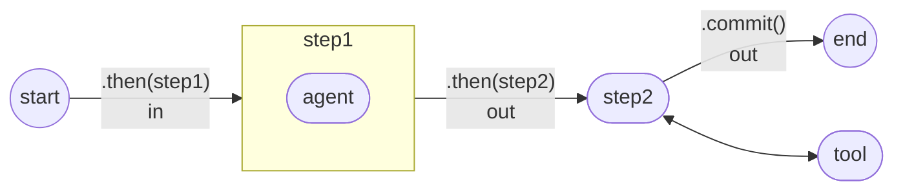
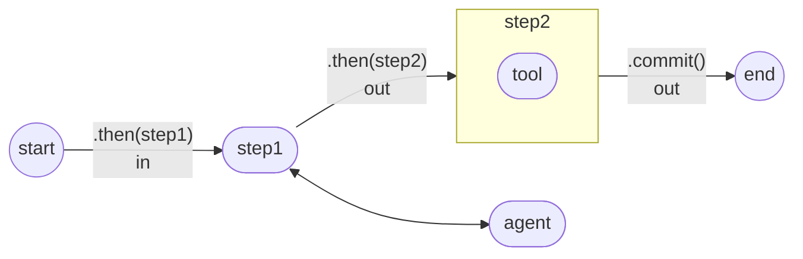

# Agent 與 Tool

Workflow 步驟可以呼叫 Agent 運用 LLM 推理，也能呼叫 Tool 執行型別安全的邏輯。你可以在步驟的 `execute()` 函式中呼叫它們，或透過 `createStep()` 直接組成步驟。

## 在 Workflow 中使用 Agent {/* #using-agents-in-workflows */}

需要推理、語言生成或執行其他仰賴 LLM 的工作時，可在 Workflow 步驟使用 Agent。若要更細緻地控制呼叫方式，例如追蹤訊息記錄或回傳結構化輸出，請在步驟的 `execute()` 函式內呼叫 Agent。不需調整呼叫方式時，可直接將 Agent 組成步驟。

### 呼叫 Agent {/* #calling-agents */}

在步驟的 `execute()` 函式中，以 `.generate()` 或 `.stream()` 呼叫 Agent。這樣就能調整呼叫方式，並先處理回應，再傳給下一個步驟。

```typescript {8-16} title="src/mastra/workflows/test-workflow.ts"
import { createStep } from '@mastra/core/workflows'

const step1 = createStep({
  execute: async ({ inputData, mastra }) => {
    const { message } = inputData

    const testAgent = mastra.getAgent('testAgent')
    const response = await testAgent.generate(
      `Convert this message into bullet points: ${message}`,
      {
        memory: {
          thread: 'user-123',
          resource: 'test-123',
        },
      },
    )

    return {
      list: response.text,
    }
  },
})
```

### 將 Agent 組成步驟 {/* #agents-as-steps */}

不需要改變 Agent 的呼叫方式時，可用 `createStep()` 將 Agent 組成步驟。透過 `.map()` 將前一步的輸出轉換成 Agent 可用的 `prompt`。



```typescript {1,3,6-11} title="src/mastra/workflows/test-workflow.ts"
import { testAgent } from '../agents/test-agent'
import { createWorkflow, createStep } from '@mastra/core/workflows'
const step1 = createStep(testAgent)

export const testWorkflow = createWorkflow({})
  .map(async ({ inputData }) => {
    const { message } = inputData
    return {
      prompt: `Convert this message into bullet points: ${message}`,
    }
  })
  .then(step1)
  .then(step2)
  .commit()
```

詳見[輸入資料對應](/docs/workflows/control-flow#input-data-mapping)。

未提供 `structuredOutput` 選項時，Mastra Agent 會採用預設結構描述：接收 `prompt` 字串，回傳 `text` 字串。

```typescript oxfmt:false
{
  inputSchema: {
    prompt: string
  },
  outputSchema: {
    text: string
  }
}
```

### 讓 Agent 回傳結構化輸出 {/* #agents-with-structured-output */}

若需要 Agent 回傳結構化資料而非純文字，請將 `structuredOutput` 選項傳給 `createStep()`。步驟的輸出結構描述會與你提供的結構描述一致，讓後續步驟能以型別安全的方式串接。

```typescript {11} title="src/mastra/workflows/test-workflow.ts"
import { createWorkflow, createStep } from '@mastra/core/workflows'
import { z } from 'zod'

const articleSchema = z.object({
  title: z.string(),
  summary: z.string(),
  tags: z.array(z.string()),
})

const agentStep = createStep(testAgent, {
  structuredOutput: { schema: articleSchema },
})

// Next step receives typed structured data
const processStep = createStep({
  id: 'process',
  inputSchema: articleSchema, // Matches agent's outputSchema
  outputSchema: z.object({ tagCount: z.number() }),
  execute: async ({ inputData }) => ({
    tagCount: inputData.tags.length, // Fully typed
  }),
})

export const testWorkflow = createWorkflow({})
  .map(async ({ inputData }) => ({
    prompt: `Generate an article about: ${inputData.topic}`,
  }))
  .then(agentStep)
  .then(processStep)
  .commit()
```

`structuredOutput.schema` 可接受任何 Standard JSON Schema。Agent 會產生符合此結構描述的輸出，步驟的 `outputSchema` 也會自動設為相同的結構描述。錯誤處理策略、結構化輸出的串流等選項，請參閱[結構化輸出](/docs/agents/structured-output)。

### 使用 `.agent()` 簡寫 {/* #the-agent-shorthand */}

用 `.agent()` 可直接加入 Agent，不必以 `createStep()` 包裝。它接受與 `createStep(agent, options)` 相同的選項，也能以 Agent ID 字串取代執行個體：

```typescript {9} title="src/mastra/workflows/test-workflow.ts"
import { testAgent } from '../agents/test-agent'
import { createWorkflow } from '@mastra/core/workflows'

export const testWorkflow = createWorkflow({})
  .map(async ({ inputData }) => ({
    prompt: `Generate an article about: ${inputData.topic}`,
  }))
  .agent(testAgent, { structuredOutput: { schema: articleSchema } })
  .commit()
```

`.agent()` 在 Workflow 圖中記錄的是宣告式項目，而非無法檢視內部邏輯的步驟，因此這樣建立的 Workflow 能以[動態 Workflow](/docs/workflows/dynamic-workflows) 的形式持久儲存。完整參數請參閱 [Workflow.agent()](/reference/workflows/workflow-methods/agent)。

## 在 Workflow 中使用 Tool {/* #using-tools-in-workflows */}

在 Workflow 步驟中使用 Tool 可沿用既有邏輯。需要準備上下文或處理回應時，請在步驟的 `.execute()` 函式中呼叫 Tool。使用方式不需調整時，可直接將 Tool 組成步驟。

### 呼叫 Tool {/* #calling-tools */}

在步驟的 `.execute()` 函式內呼叫 Tool，可更靈活地控制輸入上下文，也能先處理回應，再傳給下一個步驟。

```typescript title="src/mastra/workflows/test-workflow.ts"
import { testTool } from '../tools/test-tool'
import { isValidationError } from '@mastra/core/tools'
import { createStep } from '@mastra/core/workflows'

const step2 = createStep({
  execute: async ({ inputData, requestContext }) => {
    const { text } = inputData

    const response = await testTool.execute?.({ text }, { requestContext })

    if (!response || isValidationError(response)) {
      throw new Error('testTool did not return a result')
    }

    return {
      emphasized: response.emphasized,
    }
  },
})
```

### 將 Tool 組成步驟 {/* #tools-as-steps */}

前一步的輸出符合 Tool 的輸入上下文時，可用 `createStep()` 將 Tool 組成步驟。不符時，可用 `.map()` 轉換前一步的輸出。



```typescript {1,4,8-13} title="src/mastra/workflows/test-workflow.ts"
import { testTool } from '../tools/test-tool'
import { createWorkflow, createStep } from '@mastra/core/workflows'

const step2 = createStep(testTool)

export const testWorkflow = createWorkflow({})
  .then(step1)
  .map(async ({ inputData }) => {
    const { formatted } = inputData
    return {
      text: formatted,
    }
  })
  .then(step2)
  .commit()
```

詳見[輸入資料對應](/docs/workflows/control-flow#input-data-mapping)。

### 使用 `.tool()` 簡寫 {/* #the-tool-shorthand */}

用 `.tool()` 可直接加入 Tool，不必以 `createStep()` 包裝。它接受 Tool 執行個體或已註冊的 Tool ID 字串，以及步驟層級的 `retries` 和 `metadata`：

```typescript {6} title="src/mastra/workflows/test-workflow.ts"
import { testTool } from '../tools/test-tool'
import { createWorkflow } from '@mastra/core/workflows'

export const testWorkflow = createWorkflow({}).then(step1).tool(testTool).commit()
```

和 `.agent()` 一樣，`.tool()` 會記錄宣告式項目，因此可將 Workflow 以[動態 Workflow](/docs/workflows/dynamic-workflows) 的形式持久儲存。完整參數請參閱 [Workflow.tool()](/reference/workflows/workflow-methods/tool)。

## 相關文件 {/* #related */}

- [使用 Agent](/docs/agents/overview)
- [MCP 概觀](/docs/connections/mcp)
