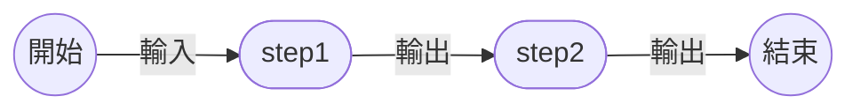
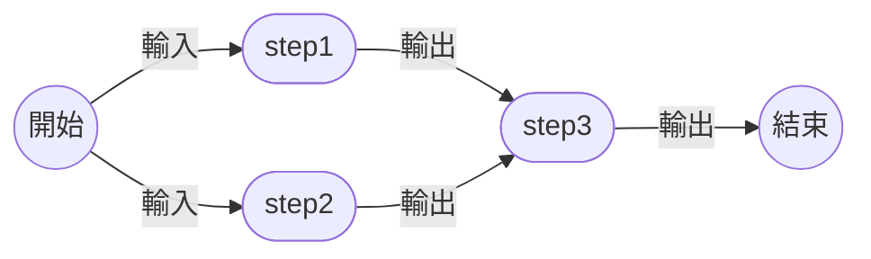
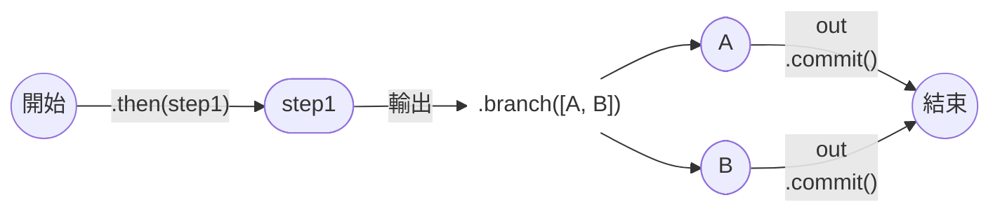
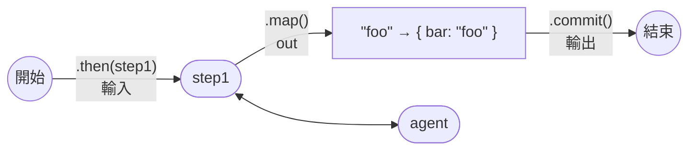
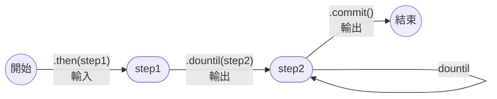
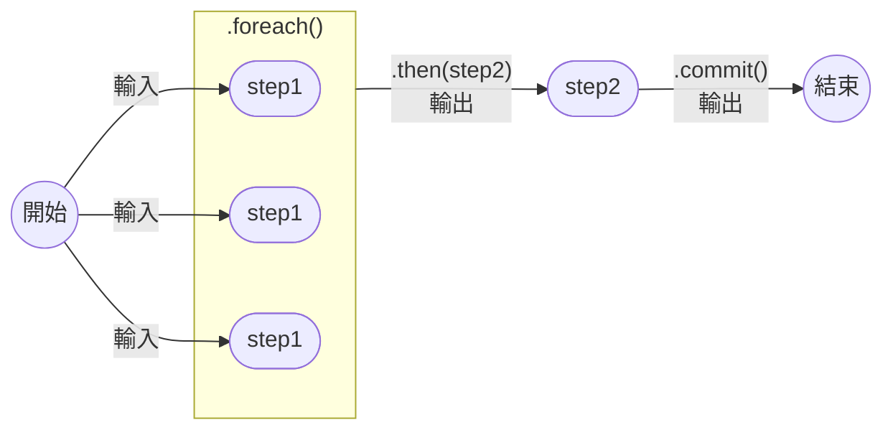

# 控制流程

Workflow 將預先定義的任務拆分為多個**步驟**，讓你控制任務的執行方式。這些步驟可以循序或平行執行，也能依條件選擇路徑。

Workflow 中的步驟透過明確定義的 schema 串接，確保資料流可控且一致。

## 核心原則 {/* #core-principles */}

* 第一步的 `inputSchema` 必須與 Workflow 的 `inputSchema` 相符。
* 最後一步的 `outputSchema` 必須與 Workflow 的 `outputSchema` 相符。
* 每一步的 `outputSchema` 必須與下一步的 `inputSchema` 相符。
  * 若不相符，請透過[輸入資料對應](#input-data-mapping)將資料轉換為所需的結構。

## 使用 `.then()` 串接步驟 {/* #chaining-steps-with-then */}

使用 `.then()` 依序執行步驟，讓每一步都能取得前一步的結果。



```typescript {30-31} title="src/mastra/workflows/test-workflow.ts"
import { createWorkflow, createStep } from '@mastra/core/workflows'
import { z } from 'zod'

const step1 = createStep({
  inputSchema: z.object({
    message: z.string(),
  }),
  outputSchema: z.object({
    formatted: z.string(),
  }),
})

const step2 = createStep({
  inputSchema: z.object({
    formatted: z.string(),
  }),
  outputSchema: z.object({
    emphasized: z.string(),
  }),
})

export const testWorkflow = createWorkflow({
  inputSchema: z.object({
    message: z.string(),
  }),
  outputSchema: z.object({
    emphasized: z.string(),
  }),
})
  .then(step1)
  .then(step2)
  .commit()
```

## 使用 `.parallel()` 同時執行步驟 {/* #simultaneous-steps-with-parallel */}

使用 `.parallel()` 同時執行多個步驟。所有平行步驟完成後，Workflow 才會繼續執行下一步。每個步驟的 `id` 用於定義後續步驟的 `inputSchema`，也會成為 `inputData` 物件中的鍵，用來取得前一步的值。後續步驟可以參照或合併這些平行步驟的輸出。



```typescript {42} title="src/mastra/workflows/test-workflow.ts"
import { createWorkflow, createStep } from '@mastra/core/workflows'
import { z } from 'zod'

const step1 = createStep({
  id: 'step-1',
})

const step2 = createStep({
  id: 'step-2',
})

const step3 = createStep({
  id: 'step-3',
  inputSchema: z.object({
    'step-1': z.object({
      formatted: z.string(),
    }),
    'step-2': z.object({
      emphasized: z.string(),
    }),
  }),
  outputSchema: z.object({
    combined: z.string(),
  }),
  execute: async ({ inputData }) => {
    const { formatted } = inputData['step-1']
    const { emphasized } = inputData['step-2']
    return {
      combined: `${formatted} | ${emphasized}`,
    }
  },
})

export const testWorkflow = createWorkflow({
  inputSchema: z.object({
    message: z.string(),
  }),
  outputSchema: z.object({
    combined: z.string(),
  }),
})
  .parallel([step1, step2])
  .then(step3)
  .commit()
```

### 輸出結構 {/* #output-structure */}

平行步驟的輸出是一個物件：每個鍵都是對應步驟的 `id`，值則是該步驟的輸出。你可以分別取得每個平行步驟的結果。

```typescript title="src/mastra/workflows/test-workflow.ts"
import { createWorkflow, createStep } from '@mastra/core/workflows'
import { z } from 'zod'

const step1 = createStep({
  id: 'format-step',
  inputSchema: z.object({ message: z.string() }),
  outputSchema: z.object({ formatted: z.string() }),
  execute: async ({ inputData }) => ({
    formatted: inputData.message.toUpperCase(),
  }),
})

const step2 = createStep({
  id: 'count-step',
  inputSchema: z.object({ message: z.string() }),
  outputSchema: z.object({ count: z.number() }),
  execute: async ({ inputData }) => ({
    count: inputData.message.length,
  }),
})

const step3 = createStep({
  id: 'combine-step',
  // The inputSchema must match the structure of parallel outputs
  inputSchema: z.object({
    'format-step': z.object({ formatted: z.string() }),
    'count-step': z.object({ count: z.number() }),
  }),
  outputSchema: z.object({ result: z.string() }),
  execute: async ({ inputData }) => {
    // Access each parallel step's output by its id
    const formatted = inputData['format-step'].formatted
    const count = inputData['count-step'].count
    return {
      result: `${formatted} (${count} characters)`,
    }
  },
})

export const testWorkflow = createWorkflow({
  id: 'parallel-output-example',
  inputSchema: z.object({ message: z.string() }),
  outputSchema: z.object({ result: z.string() }),
})
  .parallel([step1, step2])
  .then(step3)
  .commit()

// When executed with { message: "hello" }
// The parallel output structure will be:
// {
//   "format-step": { formatted: "HELLO" },
//   "count-step": { count: 5 }
// }
```

**要點：**

* 每個平行步驟的輸出都以其 `id` 為鍵
* 所有並行步驟同時執行
* 下一步會收到包含所有平行步驟輸出的物件
* 後續步驟的 `inputSchema` 必須與這個結構相符

### 處理步驟失敗 {/* #handling-step-failures */}

只要有一個平行步驟擲出錯誤，整個平行區塊就會失敗。如果希望部分步驟失敗時平行 Workflow 仍能繼續，例如多個研究 Agent 中有一個的驗證權杖已過期，就應在步驟內部使用 try/catch 處理錯誤：

```typescript title="src/mastra/workflows/test-workflow.ts"
import { createStep } from '@mastra/core/workflows'
import { z } from 'zod'

const resilientStep = createStep({
  id: 'researcher',
  inputSchema: z.object({ query: z.string() }),
  outputSchema: z.object({
    brief: z.string().nullable(),
    failed: z.boolean(),
  }),
  execute: async ({ inputData }) => {
    try {
      const result = await fetchExternalData(inputData.query)
      return { brief: result, failed: false }
    } catch {
      return { brief: null, failed: true }
    }
  },
})
```

如此一來，步驟每次都能成功傳回具型別的結果，下游步驟便能篩除失敗的結果：

```typescript title="src/mastra/workflows/test-workflow.ts"
import { createStep } from '@mastra/core/workflows'
import { z } from 'zod'

const writerStep = createStep({
  id: 'writer',
  inputSchema: z.object({
    'researcher-a': z.object({ brief: z.string().nullable(), failed: z.boolean() }),
    'researcher-b': z.object({ brief: z.string().nullable(), failed: z.boolean() }),
  }),
  outputSchema: z.object({ synthesis: z.string() }),
  execute: async ({ inputData }) => {
    const briefs = Object.values(inputData)
      .filter(v => !v.failed && v.brief)
      .map(v => v.brief)
    return { synthesis: briefs.join('; ') }
  },
})
```

請參閱[如何選擇合適的模式](#choosing-the-right-pattern)，了解何時使用 `.parallel()` 或 `.foreach()`。

## 使用 `.branch()` 處理條件邏輯 {/* #conditional-logic-with-branch */}

使用 `.branch()` 執行條件為 `true` 的步驟。系統會評估每個條件；每個傳回 `true` 的條件都會執行對應步驟，因此一次執行可能會走多個分支。各分支步驟需要使用相同的 `inputSchema` 和 `outputSchema`，維持 schema 一致，Workflow 才能沿不同路徑執行。



```typescript {33-36} title="src/mastra/workflows/test-workflow.ts" oxfmt:false
import { createWorkflow, createStep } from '@mastra/core/workflows';
import { z } from 'zod';

const step1 = createStep({...})

const stepA = createStep({
  inputSchema: z.object({
    value: z.number()
  }),
  outputSchema: z.object({
    result: z.string()
  })
});

const stepB = createStep({
  inputSchema: z.object({
    value: z.number()
  }),
  outputSchema: z.object({
    result: z.string()
  })
});

export const testWorkflow = createWorkflow({
  inputSchema: z.object({
    value: z.number()
  }),
  outputSchema: z.object({
    result: z.string()
  })
})
  .then(step1)
  .branch([
    [async ({ inputData: { value } }) => value > 10, stepA],
    [async ({ inputData: { value } }) => value <= 10, stepB]
  ])
  .commit();
```

### 使用分類器選擇路徑 {/* #route-with-a-classifier */}

設定好的[classifier](/docs/classifier)可以在 `.branch()` 之前產生具型別的答案。請依問題類型對應的答案欄位選擇路徑：`choice`、`score` 或 `probability`。

```typescript title="src/mastra/workflows/ticket-triage.ts"
import { Classifier } from '@mastra/core/classifier'
import { typeSafeAi } from '@ai-sdk/typesafe-ai'
import { createWorkflow } from '@mastra/core/workflows'
import { z } from 'zod'

const router = new Classifier({
  id: 'ticket-router',
  model: typeSafeAi.decisionModel('__AI_SDK_TYPESAFE_DECISION_MODEL__'),
  questions: {
    route: {
      type: 'choice',
      criteria: {
        billing: 'Billing, invoices, refunds, and payments',
        support: 'Account access and product help',
        other: 'Anything else',
      },
    },
  },
})

export const ticketTriage = createWorkflow({
  id: 'ticket-triage',
  inputSchema: z.object({ message: z.string() }),
  outputSchema: z.any(),
})
  .map({ message: { initData: true, path: 'message' } })
  .classifier(router)
  .branch([
    [async ({ inputData }) => inputData.answers.route.choice === 'billing', billingStep],
    [async ({ inputData }) => inputData.answers.route.choice === 'support', supportStep],
    [async ({ inputData }) => inputData.answers.route.choice === 'other', fallbackStep],
  ])
  .commit()
```

`choice` 欄位保留了設定中 criteria 鍵的聯集型別，因此 `inputData.answers.route.choice` 的型別為 `'billing' | 'support' | 'other' | undefined`。評分答案透過 `score` 提供分數；布林答案提供 `P(true)` 的值，並放在 `probability` 欄位中。選擇路徑時應設定明確的門檻。

如果決策模型拒絕回答某個問題，答案會是 `{ type: 'refusal' }`，而 `choice`、`score` 和 `probability` 都是 `undefined`。在上述範例中，被拒絕的 `route` 問題不會符合任何條件。請加入 `inputData.answers.route.type === 'refusal'` 條件，明確處理這種情況。

### 輸出結構 {/* #output-structure-1 */}

使用條件分支時，每個結果為 `true` 的條件都會執行對應步驟。輸出結構與 `.parallel()` 類似，以每個已執行步驟的 `id` 為鍵。由於可能有多個條件同時成立，如果只想執行一條路徑，就應使用互斥條件；除非希望備援分支與符合條件的分支一起執行，否則不要在最後設定無條件傳回 `true` 的備援分支。

```typescript title="src/mastra/workflows/test-workflow.ts"
import { createWorkflow, createStep } from '@mastra/core/workflows'
import { z } from 'zod'

const step1 = createStep({
  id: 'initial-step',
  inputSchema: z.object({ value: z.number() }),
  outputSchema: z.object({ value: z.number() }),
  execute: async ({ inputData }) => inputData,
})

const highValueStep = createStep({
  id: 'high-value-step',
  inputSchema: z.object({ value: z.number() }),
  outputSchema: z.object({ result: z.string() }),
  execute: async ({ inputData }) => ({
    result: `High value: ${inputData.value}`,
  }),
})

const lowValueStep = createStep({
  id: 'low-value-step',
  inputSchema: z.object({ value: z.number() }),
  outputSchema: z.object({ result: z.string() }),
  execute: async ({ inputData }) => ({
    result: `Low value: ${inputData.value}`,
  }),
})

const finalStep = createStep({
  id: 'final-step',
  // The inputSchema must account for either branch's output
  inputSchema: z.object({
    'high-value-step': z.object({ result: z.string() }).optional(),
    'low-value-step': z.object({ result: z.string() }).optional(),
  }),
  outputSchema: z.object({ message: z.string() }),
  execute: async ({ inputData }) => {
    // Conditions here are mutually exclusive, so only one branch runs
    const result = inputData['high-value-step']?.result || inputData['low-value-step']?.result
    return { message: result }
  },
})

export const testWorkflow = createWorkflow({
  id: 'branch-output-example',
  inputSchema: z.object({ value: z.number() }),
  outputSchema: z.object({ message: z.string() }),
})
  .then(step1)
  .branch([
    [async ({ inputData }) => inputData.value > 10, highValueStep],
    [async ({ inputData }) => inputData.value <= 10, lowValueStep],
  ])
  .then(finalStep)
  .commit()

// When executed with { value: 15 }
// The high-value-step condition is true, so that step executes, output structure:
// {
//   "high-value-step": { result: "High value: 15" }
// }

// When executed with { value: 5 }
// The low-value-step condition is true, so that step executes, output structure:
// {
//   "low-value-step": { result: "Low value: 5" }
// }
```

**要點：**

* 每個結果為 `true` 的條件都會執行對應步驟，因此一次執行可能會走多個分支
* 當只應執行一條路徑時，使用互斥條件
* 輸出以每個已執行步驟的 `id` 為鍵
* 後續步驟應處理所有可能的分支輸出
* 如果下一步需要處理多種可能的分支，應在 `inputSchema` 中使用選填欄位

## 輸入資料對應 {/* #input-data-mapping */}

使用 `.then()`、`.parallel()` 或 `.branch()` 時，有時需要轉換前一步的輸出，才能符合下一步的輸入。這時可以透過 `.map()` 存取 `inputData`，並將其轉換成下一步需要的資料結構。



```typescript {11} title="src/mastra/workflows/test-workflow.ts" oxfmt:false
import { createWorkflow, createStep } from '@mastra/core/workflows';

const step1 = createStep({...});
const step2 = createStep({...});

export const testWorkflow = createWorkflow({...})
  .then(step1)
  .map(async ({ inputData }) => {
    const { foo } = inputData;
    return {
      bar: `new ${foo}`,
    };
  })
  .then(step2)
  .commit();
```

`.map()` 也提供輔助函式，適合更複雜的資料對應情境。

**可用的輔助函數：**

* [`getStepResultAsync()`](/reference/workflows/workflow-methods/map#using-getstepresultasync)：存取特定步驟的完整輸出
* [`getInitData<any>()`](/reference/workflows/workflow-methods/map#using-getinitdata)：存取 Workflow 的初始輸入資料
* [`mapVariable()`](/reference/workflows/workflow-methods/map#using-mapvariable)：使用宣告式物件語法擷取欄位並重新命名

### 平行與分支輸出 {/* #parallel-and-branch-outputs */}

`.parallel()` 和 `.branch()` 都會傳回以子步驟 `id` 為鍵的物件。使用 `.map()` 調整輸出結構，供後續操作使用。以下範例將兩個平行結果對應成 `.branch()` 所需的共同輸入：

```typescript title="src/mastra/workflows/order-routing-workflow.ts"
import { createStep, createWorkflow } from '@mastra/core/workflows'
import { z } from 'zod'

const orderSchema = z.object({ amount: z.number(), inventory: z.number() })
const routingSchema = z.object({ riskScore: z.number(), inStock: z.boolean() })
const decisionSchema = z.object({ action: z.enum(['review', 'approve']) })

const scoreRisk = createStep({
  id: 'score-risk',
  inputSchema: orderSchema,
  outputSchema: z.object({ riskScore: z.number() }),
  execute: async ({ inputData }) => ({
    riskScore: inputData.amount >= 1_000 ? 80 : 20,
  }),
})

const checkInventory = createStep({
  id: 'check-inventory',
  inputSchema: orderSchema,
  outputSchema: z.object({ inStock: z.boolean() }),
  execute: async ({ inputData }) => ({ inStock: inputData.inventory > 0 }),
})

const manualReview = createStep({
  id: 'manual-review',
  inputSchema: routingSchema,
  outputSchema: decisionSchema,
  execute: async () => ({ action: 'review' as const }),
})

const autoApprove = createStep({
  id: 'auto-approve',
  inputSchema: routingSchema,
  outputSchema: decisionSchema,
  execute: async () => ({ action: 'approve' as const }),
})

export const orderRoutingWorkflow = createWorkflow({
  id: 'order-routing',
  inputSchema: orderSchema,
  outputSchema: z.object({
    'manual-review': decisionSchema.optional(),
    'auto-approve': decisionSchema.optional(),
  }),
})
  .parallel([scoreRisk, checkInventory])
  .map(async ({ inputData }) => ({
    riskScore: inputData['score-risk'].riskScore,
    inStock: inputData['check-inventory'].inStock,
  }))
  .branch([
    [async ({ inputData }) => inputData.riskScore >= 70 || !inputData.inStock, manualReview],
    [async ({ inputData }) => inputData.riskScore < 70 && inputData.inStock, autoApprove],
  ])
  .commit()
```

平行輸出在經過 `.map()` 之前的結構如下：

```typescript oxfmt:false
{
  'score-risk': { riskScore: 80 },
  'check-inventory': { inStock: true },
}
```

對應後的 `{ riskScore, inStock }` 物件會傳給每個分支條件和分支步驟，因此它們的 `inputSchema` 必須與 `routingSchema` 相符。若將 `.map()` 放在 `.branch()` 之後，用法也相同。可透過 `inputData['manual-review']` 或 `await getStepResultAsync(manualReview)` 讀取分支輸出。

## 重複執行步驟 {/* #looping-steps */}

Workflow 支援多種迴圈方法：可以重複執行步驟，直到條件成立，或在條件成立期間持續執行，也可以逐一處理陣列元素。迴圈還能與 `.then()` 等控制方法搭配使用。

### 使用 `.dountil()` 重複執行 {/* #looping-with-dountil */}

使用 `.dountil()` 重複執行步驟，直到條件成立。



```typescript oxfmt:false {16} title="src/mastra/workflows/test-workflow.ts"
import { createWorkflow, createStep } from '@mastra/core/workflows';

const step1 = createStep({...});

const step2 = createStep({
  execute: async ({ inputData }) => {
    const { number } = inputData;
    return {
      number: number + 1
    };
  }
});

export const testWorkflow = createWorkflow({})
  .then(step1)
  .dountil(step2, async ({ inputData: { number } }) => number > 10)
  .commit();
```

### 使用 `.dowhile()` 重複執行 {/* #looping-with-dowhile */}

使用 `.dowhile()` 在條件持續成立時重複執行步驟。


```typescript oxfmt:false {16} title="src/mastra/workflows/test-workflow.ts"
import { createWorkflow, createStep } from '@mastra/core/workflows';

const step1 = createStep({...});

const step2 = createStep({
  execute: async ({ inputData }) => {
    const { number } = inputData;
    return {
      number: number + 1
    };
  }
});

export const testWorkflow = createWorkflow({})
  .then(step1)
  .dowhile(step2, async ({ inputData: { number } }) => number < 10)
  .commit();
```

### 在反覆執行之間傳遞資料 {/* #passing-data-between-iterations */}

`.dountil()` 或 `.dowhile()` 的每次執行，都會將上一次的輸出作為 `inputData`。啟用輸入驗證時（預設啟用），迴圈主體執行前會先依其 `inputSchema` 驗證該輸出。若使用 `z.object()` 之類的物件 schema，未宣告的鍵會被移除；而 `.passthrough()` 等允許未知鍵的 schema 則會保留它們。

如果迴圈主體是巢狀 Workflow，輸出會先依巢狀 Workflow 的 `inputSchema` 驗證，再依其第一個步驟的 `inputSchema` 驗證。只有巢狀 Workflow 傳回某個值，且兩個 schema 都宣告了該值，它才會在下一次執行時可用。這也包括巢狀 Workflow 內產生的值，例如某個步驟暫停並恢復後取得的回饋。

若要在多次執行之間傳遞資料，請在迴圈主體的 `inputSchema` 中宣告資料，並從主體的最後一個步驟傳回：

```typescript title="src/mastra/workflows/test-workflow.ts"
import { createStep } from '@mastra/core/workflows'
import { z } from 'zod'

const loopSchema = z.object({
  draft: z.string(),
  feedback: z.string().optional(),
  attempts: z.number(),
})

const reviewStep = createStep({
  id: 'review',
  inputSchema: loopSchema,
  outputSchema: loopSchema,
  execute: async ({ inputData }) => {
    // ...
    return { draft, feedback, attempts: inputData.attempts + 1 }
  },
})
```

計數器或稽核資料等不屬於步驟輸入的值，請改用 [Workflow 狀態](/docs/workflows/workflow-state)。

### 使用 `.foreach()` 逐一處理陣列元素 {/* #looping-with-foreach */}

使用 `.foreach()` 對陣列中的每個元素執行同一個步驟。輸入必須是 `array` 型別，迴圈才能逐一處理元素並套用步驟邏輯。關於何時選用 `.foreach()` 或其他方法，請參閱[如何選擇合適的模式](#choosing-the-right-pattern)。



```typescript oxfmt:false {18} title="src/mastra/workflows/test-workflow.ts"
import { createWorkflow, createStep } from '@mastra/core/workflows';
import { z } from 'zod';

const step1 = createStep({
  inputSchema: z.string(),
  outputSchema: z.string(),
  execute: async ({ inputData }) => {
    return inputData.toUpperCase();
  }
});

const step2 = createStep({...});

export const testWorkflow = createWorkflow({
  inputSchema: z.array(z.string()),
  outputSchema: z.array(z.string())
})
  .foreach(step1)
  .then(step2)
  .commit();
```

#### 輸出結構 {/* #output-structure-2 */}

`.foreach()` 一律傳回陣列，其中包含每次執行的輸出，順序與輸入元素一致。

```typescript title="src/mastra/workflows/test-workflow.ts"
import { createWorkflow, createStep } from '@mastra/core/workflows'
import { z } from 'zod'

const addTenStep = createStep({
  id: 'add-ten',
  inputSchema: z.object({ value: z.number() }),
  outputSchema: z.object({ value: z.number() }),
  execute: async ({ inputData }) => ({
    value: inputData.value + 10,
  }),
})

export const testWorkflow = createWorkflow({
  id: 'foreach-output-example',
  inputSchema: z.array(z.object({ value: z.number() })),
  outputSchema: z.array(z.object({ value: z.number() })),
})
  .foreach(addTenStep)
  .commit()

// When executed with [{ value: 1 }, { value: 22 }, { value: 333 }]
// Output: [{ value: 11 }, { value: 32 }, { value: 343 }]
```

#### 並發限制 {/* #concurrency-limits */}

使用 `concurrency` 控制同時處理的陣列元素數量。預設值是 `1`，表示依序執行。提高此值可讓 `.foreach()` 同時處理多個元素。

```typescript oxfmt:false title="src/mastra/workflows/test-workflow.ts"
import { createWorkflow, createStep } from '@mastra/core/workflows';

const step1 = createStep({...})

export const testWorkflow = createWorkflow({...})
  .foreach(step1, { concurrency: 4 })
  .commit();
```

#### 彙整 `.foreach()` 的結果 {/* #aggregating-results-after-foreach */}

由於 `.foreach()` 輸出陣列，你可以使用 `.then()` 或 `.map()` 彙整或轉換結果。緊接在 `.foreach()` 後面的步驟會收到整個陣列作為輸入。

```typescript title="src/mastra/workflows/test-workflow.ts"
import { createWorkflow, createStep } from '@mastra/core/workflows'
import { z } from 'zod'

const processItemStep = createStep({
  id: 'process-item',
  inputSchema: z.object({ value: z.number() }),
  outputSchema: z.object({ processed: z.number() }),
  execute: async ({ inputData }) => ({
    processed: inputData.value * 2,
  }),
})

const aggregateStep = createStep({
  id: 'aggregate',
  // Input is an array of outputs from foreach
  inputSchema: z.array(z.object({ processed: z.number() })),
  outputSchema: z.object({ total: z.number() }),
  execute: async ({ inputData }) => ({
    // Sum all processed values
    total: inputData.reduce((sum, item) => sum + item.processed, 0),
  }),
})

export const testWorkflow = createWorkflow({
  id: 'foreach-aggregate-example',
  inputSchema: z.array(z.object({ value: z.number() })),
  outputSchema: z.object({ total: z.number() }),
})
  .foreach(processItemStep)
  .then(aggregateStep) // Receives the full array from foreach
  .commit()

// When executed with [{ value: 1 }, { value: 2 }, { value: 3 }]
// After foreach: [{ processed: 2 }, { processed: 4 }, { processed: 6 }]
// After aggregate: { total: 12 }
```

也可以使用 `.map()` 轉換輸出陣列：

```typescript oxfmt:false title="src/mastra/workflows/test-workflow.ts"
import { createWorkflow } from '@mastra/core/workflows';

export const testWorkflow = createWorkflow({...})
  .foreach(processItemStep)
  .map(async ({ inputData }) => ({
    // Transform the array into a different structure
    values: inputData.map(item => item.processed),
    count: inputData.length
  }))
  .then(nextStep)
  .commit();
```

#### 串接多個 `.foreach()` 呼叫 {/* #chaining-multiple-foreach-calls */}

串接 `.foreach()` 呼叫時，每次呼叫都會處理前一步輸出的陣列。當陣列中的每個元素都需要依序經過多個步驟轉換時，這種方式很有用。

```typescript title="src/mastra/workflows/test-workflow.ts"
import { createWorkflow, createStep } from '@mastra/core/workflows'
import { z } from 'zod'

const chunkStep = createStep({
  id: 'chunk',
  // Takes a document, returns an array of chunks
  inputSchema: z.object({ content: z.string() }),
  outputSchema: z.array(z.object({ chunk: z.string() })),
  execute: async ({ inputData }) => {
    // Split document into chunks
    const chunks = inputData.content.match(/.{1,100}/g) || []
    return chunks.map(chunk => ({ chunk }))
  },
})

const embedStep = createStep({
  id: 'embed',
  // Takes a single chunk, returns embedding
  inputSchema: z.object({ chunk: z.string() }),
  outputSchema: z.object({ embedding: z.array(z.number()) }),
  execute: async ({ inputData }) => ({
    embedding: [/* vector embedding */],
  }),
})

// For a single document that produces multiple chunks:
export const singleDocWorkflow = createWorkflow({
  id: 'single-doc-rag',
  inputSchema: z.object({ content: z.string() }),
  outputSchema: z.array(z.object({ embedding: z.array(z.number()) })),
})
  .then(chunkStep) // Returns array of chunks
  .foreach(embedStep) // Process each chunk -> array of embeddings
  .commit()
```

如果要處理多份文件，而每份文件都會產生多個區塊，可以採用以下方式：

**選項 1：在單一步驟內處理所有文件，並控制批次作業**

```typescript oxfmt:false title="src/mastra/workflows/test-workflow.ts"
import { createWorkflow, createStep } from '@mastra/core/workflows';
import { z } from 'zod';

const downloadAndChunkStep = createStep({
  id: "download-and-chunk",
  inputSchema: z.array(z.string()),  // Array of URLs
  outputSchema: z.array(z.object({ chunk: z.string(), source: z.string() })),
  execute: async ({ inputData: urls }) => {
    // Control batching/parallelization within the step
    const allChunks = [];
    for (const url of urls) {
      const content = await fetch(url).then(r => r.text());
      const chunks = content.match(/.{1,100}/g) || [];
      allChunks.push(...chunks.map(chunk => ({ chunk, source: url })));
    }
    return allChunks;
  }
});

export const multiDocWorkflow = createWorkflow({...})
  .then(downloadAndChunkStep)  // Returns flat array of all chunks
  .foreach(embedStep, { concurrency: 10 })  // Embed each chunk in parallel
  .commit();
```

**選項 2：先用 foreach 處理文件並彙整區塊，再用 foreach 產生嵌入向量**

```typescript title="src/mastra/workflows/test-workflow.ts"
import { createWorkflow, createStep } from '@mastra/core/workflows'
import { z } from 'zod'

const downloadStep = createStep({
  id: 'download',
  inputSchema: z.string(), // Single URL
  outputSchema: z.object({ content: z.string(), source: z.string() }),
  execute: async ({ inputData: url }) => ({
    content: await fetch(url).then(r => r.text()),
    source: url,
  }),
})

const chunkDocStep = createStep({
  id: 'chunk-doc',
  inputSchema: z.object({ content: z.string(), source: z.string() }),
  outputSchema: z.array(z.object({ chunk: z.string(), source: z.string() })),
  execute: async ({ inputData }) => {
    const chunks = inputData.content.match(/.{1,100}/g) || []
    return chunks.map(chunk => ({ chunk, source: inputData.source }))
  },
})

export const multiDocWorkflow = createWorkflow({
  id: 'multi-doc-rag',
  inputSchema: z.array(z.string()), // Array of URLs
  outputSchema: z.array(z.object({ embedding: z.array(z.number()) })),
})
  .foreach(downloadStep, { concurrency: 5 }) // Download docs in parallel
  .foreach(chunkDocStep) // Chunk each doc -> array of chunk arrays
  .map(async ({ inputData }) => {
    // Flatten nested arrays: [[chunks], [chunks]] -> [chunks]
    return inputData.flat()
  })
  .foreach(embedStep, { concurrency: 10 }) // Embed all chunks
  .commit()
```

**串接 `.foreach()` 的重點：**

* 每個 `.foreach()` 都會處理前一步輸出的陣列
* 如果 `.foreach()` 內的步驟傳回陣列，輸出就會變成巢狀陣列
* 必要時搭配 `.map()` 與 `.flat()` 將巢狀陣列攤平
* 對於複雜的 RAG 流程，選項 1（在單一步驟內控制批次作業）通常更容易掌控

#### 在 foreach 中使用巢狀 Workflow {/* #nested-workflows-inside-foreach */}

`.foreach()` 後面的步驟要等所有元素都處理完畢才會執行。如果每個元素都需要依序進行多項操作，應使用巢狀 Workflow，而不是串接多個 `.foreach()` 呼叫。這樣每個元素的操作會集中在一起，資料流也更清楚。

```typescript title="src/mastra/workflows/test-workflow.ts"
import { createWorkflow } from '@mastra/core/workflows'
import { z } from 'zod'

// Define a workflow that processes a single document
const processDocumentWorkflow = createWorkflow({
  id: 'process-document',
  inputSchema: z.object({ url: z.string() }),
  outputSchema: z.object({
    embeddings: z.array(z.array(z.number())),
    metadata: z.object({ url: z.string(), chunkCount: z.number() }),
  }),
})
  .then(downloadStep) // Download the document
  .then(chunkStep) // Split into chunks
  .then(embedChunksStep) // Embed all chunks for this document
  .then(formatResultStep) // Format the final output
  .commit()

// Use the nested workflow inside foreach
export const batchProcessWorkflow = createWorkflow({
  id: 'batch-process-documents',
  inputSchema: z.array(z.object({ url: z.string() })),
  outputSchema: z.array(
    z.object({
      embeddings: z.array(z.array(z.number())),
      metadata: z.object({ url: z.string(), chunkCount: z.number() }),
    }),
  ),
})
  .foreach(processDocumentWorkflow, { concurrency: 3 })
  .commit()

// Each document goes through all 4 steps before the next document starts (with concurrency: 1)
// With concurrency: 3, up to 3 documents process their full pipelines in parallel
```

**為什麼使用巢狀 Workflow：**

* **平行度更高**：設定 `concurrency: N` 後，多個元素可以同時完成各自的完整處理流程。串接 `.foreach().foreach()` 會先讓所有元素完成第一步，等待後再執行第二步；巢狀 Workflow 則能讓每個元素各自推進
* 每個元素的所有步驟完成後，才會收集結果
* 比起會產生巢狀陣列的多個 `.foreach()` 呼叫，結構更清楚
* 每次執行巢狀 Workflow 都有獨立的資料流
* 更容易分別測試及重複使用每個元素的處理邏輯

**工作原理：**

1. 父 Workflow 將每個陣列元素傳給一個巢狀 Workflow 執行個體
1. 每個巢狀 Workflow 都會對該元素執行完整的步驟序列
1. 當 `concurrency > 1` 時，多個巢狀 Workflow 會平行執行
1. 巢狀 Workflow 的最終輸出會成為結果陣列中的一個元素
1. 所有巢狀 Workflow 完成後，父 Workflow 的下一步會收到完整的陣列

## 為控制流程項目加上標籤 {/* #labeling-control-flow-entries */}

每個控制流程方法都可以接受最後一個選填參數，其中包含固定的 `id`、`description` 和可序列化為 JSON 的 `metadata`。這些欄位用來識別及描述流程圖中的項目本身，與項目內的步驟分開。它們經過序列化及儲存後仍會保留，並出現在 `serializedStepGraph` 中，但不影響執行。

```typescript
workflow
  .parallel([validateStep, enrichStep], {
    id: 'independent-enrichment',
    description: 'Run independent enrichment tasks concurrently',
    metadata: { title: 'Independent enrichment' },
  })
  .sleep(5000, { id: 'wait-before-retry', description: 'Pause before retrying' })
```

視覺化編輯器和審閱工具可以用 `id` 記錄版面配置和選取狀態，並將 `metadata.title` 顯示為標籤。對於 `.foreach()`，這些欄位應與 `concurrency` 放在同一個選項物件中。對於 `.map()`、`.sleep()` 和 `.sleepUntil()`，指定的 `id` 會取代自動產生的項目 ID。

## 選擇合適的模式 {/* #choosing-the-right-pattern */}

本節可作為選擇控制流程方法時的參考。

### 快速參考 {/* #quick-reference */}

| 方法 | 用途 | 輸入 | 輸出 | 並行設定 |
| - | - | - | - | - |
| `.then(step)` | 依序處理 | `T` | `U` | 不適用（一次一個步驟） |
| `.parallel([a, b])` | 對同一輸入執行不同操作 | `T` | `{ a: U, b: V }` | 所有分支同時執行 |
| `.foreach(step)` | 對陣列中的每個元素執行相同操作 | `T[]` | `U[]` | 可設定（預設：1） |
| `.branch([...])` | 依條件選擇路徑 | `T` | `{ stepId: U }` | 預設同時執行所有條件為 true 的分支；`perStep: true` 只排程第一個符合條件的分支 |

### `.parallel()` 與 `.foreach()` 的比較 {/* #parallel-vs-foreach */}

**同一輸入需要不同處理時，使用 `.parallel()`：**

```typescript
// Same user data processed differently in parallel
workflow.parallel([validateStep, enrichStep, scoreStep]).then(combineResultsStep)
```

**多個輸入都需要相同處理時，使用 `.foreach()`：**

```typescript
// Multiple URLs each processed the same way
workflow.foreach(downloadStep, { concurrency: 5 }).then(aggregateStep)
```

### 何時使用巢狀 Workflow {/* #when-to-use-nested-workflows */}

**在 `.foreach()` 中**：當每個陣列元素都需要依序執行多個步驟時：

```typescript oxfmt:false
// Each document goes through a full pipeline
const processDocWorkflow = createWorkflow({...})
  .then(downloadStep)
  .then(parseStep)
  .then(embedStep)
  .commit();

workflow.foreach(processDocWorkflow, { concurrency: 3 })
```

只呼叫一次 `.foreach()` 可讓結果維持單層陣列；串接 `.foreach().foreach()` 則會產生巢狀陣列。

**在 `.parallel()` 中**：當平行分支需要獨立的多步驟處理流程時：

```typescript oxfmt:false
const pipelineA = createWorkflow({...}).then(step1).then(step2).commit();
const pipelineB = createWorkflow({...}).then(step3).then(step4).commit();

workflow.parallel([pipelineA, pipelineB])
```

### 串接模式 {/* #chaining-patterns */}

| 模式 | 執行方式 | 常見用途 |
| - | - | - |
| `.then().then()` | 依序執行步驟 | 簡單的處理流程 |
| `.parallel().then()` | 先平行執行，再合併結果 | 扇出／扇入 |
| `.foreach().then()` | 處理所有元素後再彙整 | Map-reduce |
| `.foreach().foreach()` | 產生巢狀陣列 | 避免使用；改用巢狀 Workflow，或搭配 `.map()` 與 `.flat()` 攤平 |
| `.foreach(workflow)` | 對每個元素執行完整流程 | 每個陣列元素都需經過多個步驟 |

### 同步：下一步何時執行？ {/* #synchronization-when-does-the-next-step-run */}

`.parallel()` 和 `.foreach()` 都是同步點。所有平行分支或所有陣列元素都處理完成後，Workflow 才會執行下一步。

```typescript
workflow
  .parallel([stepA, stepB, stepC]) // All 3 run simultaneously
  .then(combineStep) // Waits for ALL 3 to finish before running
  .commit()

workflow
  .foreach(processStep, { concurrency: 5 }) // Up to 5 items process at once
  .then(aggregateStep) // Waits for ALL items to finish before running
  .commit()
```

這意味著：

* `.parallel()` 會將所有分支的輸出收集成物件，再傳給下一步
* `.foreach()` 會將所有元素的輸出收集成陣列，再傳給下一步
* 各結果完成時，無法逐一將它們以串流方式傳給下一步

### 並發行為 {/* #concurrency-behavior */}

| 方法 | 行為 |
| - | - |
| `.then()` | 依序執行，一次一個步驟 |
| `.parallel()` | 所有分支同時執行（沒有數量限制選項） |
| `.foreach()` | 透過 `{ concurrency: N }` 控制；預設為 1（依序執行） |
| `.foreach()` 中的巢狀 Workflow | 遵循父 Workflow 的並行數設定 |

**效能提示：** 對於 `.foreach()` 中的 I/O 密集型操作，可提高並行數，讓多個元素同時處理：

```typescript
// Process up to 10 items simultaneously
workflow.foreach(fetchDataStep, { concurrency: 10 })
```

## 迴圈管理 {/* #loop-management */}

可以依希望迴圈如何結束，採用不同方式實作條件。

常見做法是檢查 `inputData` 傳回的值，並設定最大執行次數；達到上限時也可以中止執行。

### 中止迴圈 {/* #aborting-loops */}

使用 `iterationCount` 限制迴圈執行次數。如果次數超過設定的門檻，就擲出錯誤，讓步驟失敗並停止 Workflow。

```typescript oxfmt:false title="src/mastra/workflows/test-workflow.ts"
import { createWorkflow, createStep } from '@mastra/core/workflows';

const step1 = createStep({...});

export const testWorkflow = createWorkflow({...})
  .dountil(step1, async ({ inputData: { userResponse, iterationCount } }) => {
    if (iterationCount >= 10) {
      throw new Error("Maximum iterations reached");
    }
    return userResponse === "yes";
  })
  .commit();
```

## 相關內容 {/* #related */}

* [暫停與恢復](/docs/workflows/suspend-and-resume)
* [人工參與流程](/docs/workflows/human-in-the-loop)
