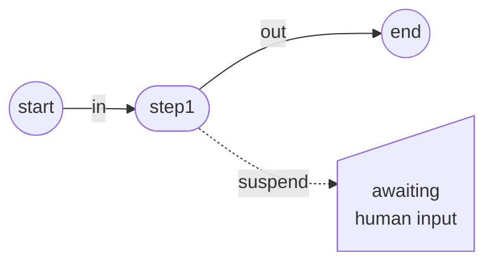
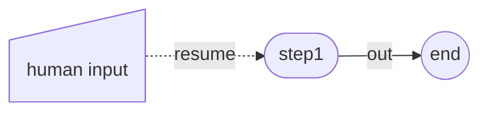

# 人在迴路

有些 Workflow 必須等到人工輸入才能繼續。[暫停](/docs/workflows/suspend-and-resume#pausing-a-workflow-with-suspend)時，可以傳回訊息說明原因，以及繼續需要哪些資訊。收到輸入後，Workflow 可以據此[繼續執行](#resuming-workflows-with-human-input)或[提前結束](#handling-human-rejection-with-bail)。這種做法適合人工核准、拒絕、有條件的決策，或其他需要人工監督的步驟。

## 暫停 Workflow 以等待人工輸入 {/* #pausing-workflows-for-human-input */}

人在迴路（HITL）與透過 `suspend()` [暫停 Workflow](/docs/workflows/suspend-and-resume) 類似。差別在於需要人工輸入時，可以回傳 `suspend()` 並附上資料，向使用者說明情境或接下來要怎麼做。



```typescript {12-17,22-26} title="src/mastra/workflows/test-workflow.ts"
import { createWorkflow, createStep } from '@mastra/core/workflows'
import { z } from 'zod'

const step1 = createStep({
  id: 'step-1',
  inputSchema: z.object({
    userEmail: z.string(),
  }),
  outputSchema: z.object({
    output: z.string(),
  }),
  resumeSchema: z.object({
    approved: z.boolean(),
  }),
  suspendSchema: z.object({
    reason: z.string(),
  }),
  execute: async ({ inputData, resumeData, suspend }) => {
    const { userEmail } = inputData
    const { approved } = resumeData ?? {}

    if (!approved) {
      return await suspend({
        reason: 'Human approval required.',
      })
    }

    return {
      output: `Email sent to ${userEmail}`,
    }
  },
})

export const testWorkflow = createWorkflow({
  id: 'test-workflow',
  inputSchema: z.object({
    userEmail: z.string(),
  }),
  outputSchema: z.object({
    output: z.string(),
  }),
})
  .then(step1)
  .commit()
```

## 向使用者說明如何繼續 {/* #providing-user-feedback */}

Workflow 暫停後，找出暫停的步驟並讀取它的 `suspendPayload`，就能取得 `suspend()` 傳回的資料。

```typescript {12} title="src/test-workflow.ts"
const workflow = mastra.getWorkflow('testWorkflow')
const run = await workflow.createRun()

const result = await run.start({
  inputData: {
    userEmail: 'alex@example.com',
  },
})

if (result.status === 'suspended') {
  const suspendStep = result.suspended[0]
  const suspendedPayload = result.steps[suspendStep[0]].suspendPayload

  console.log(suspendedPayload)
}
```

### 輸出範例 {/* #example-output */}

步驟傳回的資料可以包含暫停原因，讓使用者知道繼續執行 Workflow 所需的資訊。

```typescript
{
  reason: 'Confirm to send email.'
}
```

## 收到人工輸入後繼續執行 Workflow {/* #resuming-workflows-with-human-input */}

比照[繼續執行 Workflow](/docs/workflows/suspend-and-resume#restarting-a-workflow-with-resume)的做法，收到人工輸入後，呼叫 `resume()` 並帶入 `resumeData`。Workflow 會從暫停的步驟繼續執行。



```typescript {13}
const workflow = mastra.getWorkflow('testWorkflow')
const run = await workflow.createRun()

await run.start({
  inputData: {
    userEmail: 'alex@example.com',
  },
})

const handleResume = async () => {
  const result = await run.resume({
    step: 'step-1',
    resumeData: { approved: true },
  })
}
```

### 使用 `bail()` 處理人工拒絕 {/* #handling-human-rejection-with-bail */}

使用 `bail()` 可在某個步驟停止 Workflow，而不會觸發錯誤，例如有人明確拒絕某項操作時。Workflow 會以 `success` 狀態結束，並略過呼叫 `bail()` 之後的邏輯。

```typescript {6-10}
const step1 = createStep({
  execute: async ({ inputData, resumeData, suspend, bail }) => {
    const { userEmail } = inputData
    const { approved } = resumeData ?? {}

    if (approved === false) {
      return bail({
        reason: 'User rejected the request.',
      })
    }

    if (!approved) {
      return await suspend({
        reason: 'Human approval required.',
      })
    }

    return {
      message: `Email sent to ${userEmail}`,
    }
  },
})
```

## 多輪人工輸入 {/* #multi-turn-human-input */}

Workflow 若需要在多個階段接收人工輸入，可以沿用同一套暫停方式。每個步驟都定義 `resumeSchema` 和 `suspendSchema`，後者通常包含暫停原因，方便向使用者說明。

```typescript {14-19,24-28} title="src/mastra/workflows/test-workflow.ts" oxfmt:false
import { createWorkflow, createStep } from '@mastra/core/workflows';
import { z } from 'zod';

const step1 = createStep({...});

const step2 = createStep({
  id: "step-2",
  inputSchema: z.object({
    message: z.string()
  }),
  outputSchema: z.object({
    output: z.string()
  }),
  resumeSchema: z.object({
    approved: z.boolean()
  }),
  suspendSchema: z.object({
    reason: z.string()
  }),
  execute: async ({ inputData, resumeData, suspend }) => {
    const { message } = inputData;
    const { approved } = resumeData ?? {};

    if (!approved) {
      return await suspend({
        reason: "Human approval required."
      });
    }

    return {
      output: `${message} - Deleted`
    };
  }
});

export const testWorkflow = createWorkflow({
  id: "test-workflow",
  inputSchema: z.object({
    userEmail: z.string()
  }),
  outputSchema: z.object({
    output: z.string()
  })
})
  .then(step1)
  .then(step2)
  .commit();
```

必須依序恢復各步驟，每個暫停的步驟各呼叫一次 `resume()`。這樣可以在多階段審核中顯示一致的介面回饋，並清楚處理各階段的輸入。

```typescript {4,11}
const handleResume = async () => {
  const result = await run.resume({
    step: 'step-1',
    resumeData: { approved: true },
  })
}

const handleDelete = async () => {
  const result = await run.resume({
    step: 'step-2',
    resumeData: { approved: true },
  })
}
```

## 相關文件 {/* #related */}

- [控制流程](/docs/workflows/control-flow)
- [暫停和恢復](/docs/workflows/suspend-and-resume)
