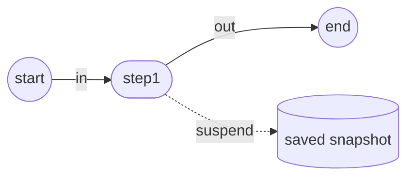
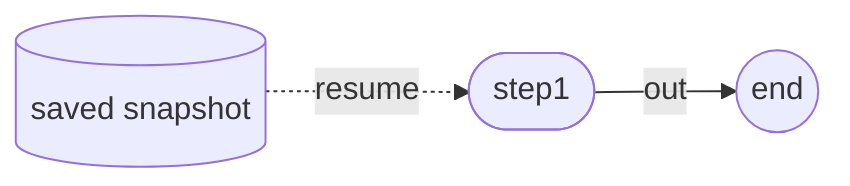

# 暫停與繼續執行

你可以在任何步驟暫停 Workflow，以收集額外資料、等待 API 回呼、限制高成本操作的執行頻率，或要求[人工輸入](/docs/workflows/human-in-the-loop)。暫停時會將目前的執行狀態存成快照。之後可從[指定的步驟 ID](/docs/workflows/snapshots#retrieving-snapshots) 繼續執行，回到當時記錄的狀態。[快照](/docs/workflows/snapshots)會保存在已設定的儲存 Provider 中，重新部署或重啟應用程式後仍可使用。

## 使用 `suspend()` 暫停 Workflow {/* #pausing-a-workflow-with-suspend */}

呼叫 `suspend()` 可讓 Workflow 在特定步驟暫停。你可以在該步驟的 `execute` 區塊中，依據 `resumeData` 的值設定暫停條件。

- 未滿足條件時，Workflow 會暫停並傳回 `suspend()` 的結果。
- 滿足條件後，Workflow 會繼續執行這個步驟剩下的邏輯。



```typescript {12-14,19-21} title="src/mastra/workflows/test-workflow.ts"
import { createWorkflow, createStep } from '@mastra/core/workflows'
import { z } from 'zod'

const step1 = createStep({
  id: 'step-1',
  inputSchema: z.object({
    userEmail: z.string(),
  }),
  outputSchema: z.object({
    output: z.string(),
  }),
  resumeSchema: z.object({
    approved: z.boolean(),
  }),
  execute: async ({ inputData, resumeData, suspend }) => {
    const { userEmail } = inputData
    const { approved } = resumeData ?? {}

    if (!approved) {
      return await suspend({})
    }

    return {
      output: `Email sent to ${userEmail}`,
    }
  },
})

export const testWorkflow = createWorkflow({
  id: 'test-workflow',
  inputSchema: z.object({
    userEmail: z.string(),
  }),
  outputSchema: z.object({
    output: z.string(),
  }),
})
  .then(step1)
  .commit()
```

## 使用 `resume()` 繼續執行 Workflow {/* #restarting-a-workflow-with-resume */}

使用 `resume()` 可從暫停的步驟重新開始。請傳入符合該步驟 `resumeSchema` 的 `resumeData`，滿足條件後即可繼續執行。



```typescript
import { step1 } from './workflows/test-workflow'

const workflow = mastra.getWorkflow('testWorkflow')
const run = await workflow.createRun()

await run.start({
  inputData: {
    userEmail: 'alex@example.com',
  },
})

const handleResume = async () => {
  const result = await run.resume({
    step: step1,
    resumeData: { approved: true },
  })
}
```

傳入 `step` 物件，可完整保留 `resumeData` 的型別安全。若 ID 來自使用者輸入或資料庫，可以傳入步驟 ID，讓呼叫方式更有彈性。

```typescript
const result = await run.resume({
  step: 'step-1',
  resumeData: { approved: true },
})
```

如果只有一個步驟暫停，可以省略步驟引數，Mastra 會從 Workflow 中最後暫停的步驟繼續執行。

如果手上只有 `runId`，請先用 `createRun()` 建立執行個體。

```typescript
const workflow = mastra.getWorkflow('testWorkflow')
const run = await workflow.createRun({ runId: '123' })

const stream = run.resume({
  resumeData: { approved: true },
})
```

你可以在應用程式的任何地方呼叫 `resume()`，例如 HTTP 端點或事件處理常式。計時器和回應[人工輸入](/docs/workflows/human-in-the-loop)的程式碼也可以讓 Workflow 繼續執行。

```typescript
const midnight = new Date()
midnight.setUTCHours(24, 0, 0, 0)

setTimeout(async () => {
  await run.resume({
    step: 'step-1',
    resumeData: { approved: true },
  })
}, midnight.getTime() - Date.now())
```

## 使用 `suspendData` 取得暫停時的資料 {/* #accessing-suspend-data-with-suspenddata */}

繼續執行步驟時，如果需要讀取暫停時傳給 `suspend()` 的資料，可以使用該步驟執行函式的 `suspendData` 參數。

```typescript {25-28,32-33} title="src/mastra/workflows/user-approval.ts"
import { createStep } from '@mastra/core/workflows'
import { z } from 'zod'

const approvalStep = createStep({
  id: 'user-approval',
  inputSchema: z.object({
    requestId: z.string(),
  }),
  resumeSchema: z.object({
    approved: z.boolean(),
  }),
  suspendSchema: z.object({
    reason: z.string(),
    requestDetails: z.string(),
  }),
  outputSchema: z.object({
    result: z.string(),
  }),
  execute: async ({ inputData, resumeData, suspend, suspendData }) => {
    const { requestId } = inputData
    const { approved } = resumeData ?? {}

    // On first execution, suspend with context
    if (!approved) {
      return await suspend({
        reason: 'User approval required',
        requestDetails: `Request ${requestId} pending review`,
      })
    }

    // On resume, access the original suspend data
    const suspendReason = suspendData?.reason || 'Unknown'
    const details = suspendData?.requestDetails || 'No details'

    return {
      result: `${details} - ${suspendReason} - Decision: ${approved ? 'Approved' : 'Rejected'}`,
    }
  },
})
```

步驟繼續執行時，系統會自動將最初暫停時傳給 `suspend()` 的原始資料填入 `suspendData`。你可以用它保留 Workflow 暫停的原因，之後繼續執行時再取用。

## 找出已暫停的執行 {/* #identifying-suspended-executions */}

已暫停的 Workflow 會從暫停的步驟繼續執行。你可以檢查 Workflow 的 `status` 確認是否暫停，再從 `suspended` 找出暫停的步驟或[巢狀 Workflow](/docs/workflows/overview#workflows-as-steps)。

```typescript {11}
const workflow = mastra.getWorkflow('testWorkflow')
const run = await workflow.createRun()

const result = await run.start({
  inputData: {
    userEmail: 'alex@example.com',
  },
})

if (result.status === 'suspended') {
  console.log(result.suspended[0])
  await run.resume({
    step: result.suspended[0],
    resumeData: { approved: true },
  })
}
```

### 輸出範例 {/* #example-output */}

`suspended` 陣列會為這次執行中每個暫停的步驟記錄一條路徑。每條路徑由步驟 ID 組成，從最外層的 Workflow 出發，經過相關的巢狀 Workflow，到達暫停的步驟。將路徑傳入 `resume()` 的 `step` 參數，即可指定要繼續的執行路徑。使用預設引擎時，即使同一個巢狀 Workflow 有多個平行步驟暫停，一次也只會提供一條路徑。繼續執行後，請檢查傳回的 `suspended` 陣列，確認是否還有其他路徑。每條路徑都應視為不透明值並原樣傳回。視引擎而定，路徑可能包含重複的 ID 或數字形式的 `.foreach()` 索引。指向暫停的 `.foreach()` 步驟的路徑涵蓋所有暫停的反覆執行項目。若要一次只繼續一個項目，請傳入 [`forEachIndex`](/reference/workflows/run-methods/resume)。若步驟在巢狀 Workflow 中暫停，`result.suspended[0]` 如下：

```typescript
['nested-workflow', 'step-1']
```

## 取回已暫停的執行 {/* #recovering-suspended-runs */}

如果應用程式需要從儲存空間取回已暫停的執行，可以搭配使用 `workflow.getWorkflowRunById()` 與 `createWorkflowStateReader()`。讀取器會提供已暫停的步驟、繼續執行用的標籤、步驟承載資料及輸出，無須直接讀取原始快照結構。

```typescript title="src/mastra/workflows/recover-run.ts"
import { createWorkflowStateReader } from '@mastra/core/workflows'

const workflow = mastra.getWorkflow('testWorkflow')
const state = await workflow.getWorkflowRunById('run-123')

if (state?.status === 'suspended') {
  const reader = createWorkflowStateReader(state)
  const suspendedStep = reader.getSuspendedStep()
  const approvalLabel = reader.getResumeLabel('approve')
  const run = await workflow.createRun({ runId: state.runId })

  await run.resume({
    step: approvalLabel?.stepId ?? suspendedStep?.path,
    resumeData: { approved: true },
    forEachIndex: approvalLabel?.foreachIndex,
  })
}
```

在巢狀 Workflow 中，`suspendedStep.path` 包含繼續執行所需的路徑。若 `foreach` 暫停，而相符的標籤指向特定反覆執行項目，該標籤就會包含 `foreachIndex`。

## 休眠 {/* #sleep */}

休眠方法可暫停整個 Workflow 的執行，並將狀態設為 `waiting`。`suspend()` 會在特定步驟內暫停執行，狀態會設為 `suspended`。

**可用的方法：**

- [`.sleep()`](/reference/workflows/workflow-methods/sleep)：暫停指定的毫秒數。
- [`.sleepUntil()`](/reference/workflows/workflow-methods/sleepUntil)：暫停至指定日期。

## 相關文件 {/* #related */}

- [控制流程](/docs/workflows/control-flow)
- [人工介入](/docs/workflows/human-in-the-loop)
- [快照](/docs/workflows/snapshots)
- [時間旅行](/docs/workflows/time-travel)
- [Workflow 狀態讀取器](/reference/workflows/workflow-state-reader)
